# خلاصه اجرایی

- **این چیست.** پیاده‌سازی کامل، تست‌شده و seeded از زمان‌بندی قرعه‌کشی Waldspurger و Weihl، به‌همراه تمام آزمایش‌هایی که لازم است تا الگوریتم *دقیقاً* مطابق نظریه رفتار کند — σ توزیع دوجمله‌ای و همه.
- **اعداد کلیدی.** حالت پایدار (۵۰ seed، ۶۰۰ تیک): T5 برابر ۰٫۴۹۹۹، T3 برابر ۰٫۲۹۸۰، T2 برابر ۰٫۲۰۲۰ در برابر کسرهای بلیط ۰٫۵/۰٫۳/۰٫۲. فرآیند I/O-bound با compensation: از ۱۳٫۵٪ به ۲۰٫۰٪ از تیک‌های اشغال CPU. جاروب شمار بلیط‌ها در همه نقاط با دقت ۰٫۰۰۶ نسبت به منحنی تحلیلی مطابقت دارد.
- **محدودیت‌های صادقانه.** هیچ‌وقت تضمین ضرب‌الاجل وجود ندارد؛ هیچ حدِ انتظاریِ کران‌داری روی انتظار نیست؛ عدالت آماری است، نه مطلق. تمرین ۲ این مجموعه نشان می‌دهد که این کجا در برابر EDF و RM کم می‌آورد.
- **الحاقیه‌ها.** تیکت‌های compensation، انتقال زمان‌دار بلیط و ارزهای سلسله‌مراتبی بلیط — پیاده‌سازی، تست و اندازه‌گیری شده‌اند، نه فقط توضیح داده شده‌اند.
- **شکل شواهد.** هر عدد این گزارش با `code/run_experiments.py` بازتولید می‌شود؛ هر شکل با `code/make_diagrams.py`؛ ۳۰ تست در ۰٫۱۹ ثانیه سبز می‌شوند؛ و سازنده‌ی گزارش اجازه نمی‌دهد سندی با ۴۰ صفحه یا کمتر صادر شود.
- **یک جمله‌ای اصلی.** زمان‌بندی قرعه‌کشی ارزان‌ترین سازوکاری است که شناخته شده که به‌جای *اولویت* به شما *کسر* می‌دهد — و در عوض یک کوانتوم واریانس به‌ازای هر تصمیم از شما «صورت‌حساب» می‌گیرد.

# ۱. مقدمه و بیان مسئله

زمان‌بند CPU سازوکاری در سیستم‌عامل است که تعیین می‌کند کدام فرآیند آماده، پردازنده را بگیرد و چه مدت. الگوریتم‌های کلاسیک درسی هرکدام برای یکی از چند هدف قابل‌اندازه‌گیری طراحی شده‌اند. First-come, first-served (FCFS) برای سادگی و نبود گرسنگی بهینه شده است. Shortest-job-first (SJF) و نسخه معی‌شونده‌اش (SRTF) برای میانگین انتظار بهینه می‌کنند، به شرطی که طول کارها معلوم باشد. Round robin (RR) برای زمان پاسخ بارهای تعاملی خوب است. زمان‌بندی اولویت‌دار هرچه مدیر تعریف کند را هدف می‌گیرد. هیچ‌یک از این سازوکارها برای پرسش دیگری که به همان اندازه مشروع است ساخته نشده‌اند: *چگونه باید ظرفیت CPU بین مشتریان رقیب تقسیم شود، وقتی هر مشتری استحقاق معلومِ خود را دارد که به‌صورت کسری از ماشین بیان می‌شود؟*

این پرسش در سامانه‌های واقعی مرتباً پرسیده می‌شود. یک خوشه batch چهل درصد از یک ماشین را به یک دپارتمان و شصت درصد را به دیگری می‌فروشد. تیم دیتابیس «دو سهم» از یک build farm می‌خرد و تیم وب «هشت سهم». یک گروه کنترلی از کارهای پس‌زمینه باید دقیقاً سهم قراردادی‌اش را بگیرد و بقیه ماشین بین بقیه تقسیم شود. سازوکارهای اولویت ثابت این را بد بیان می‌کنند: اولویت به یک ترتیب فرو می‌ریزد، و ترتیب، کسر نیست. دو مشتری که هر دو «لایق» ظرفیت‌اند نمی‌توانند هردو اول اجرا شوند. زمان‌بندی سهم‌متناسب مستقیماً به این پرسش پاسخ می‌دهد: به هر مشتری یک *سهم* می‌دهد و آن سهم را به‌صورت آماری اعمال می‌کند.

**زمان‌بندی قرعه‌کشی (Lottery Scheduling)** که توسط Carl A. Waldspurger و William E. Weihl در مقاله OSDI ۱۹۹۴ با عنوان *Lottery Scheduling: Flexible Proportional-Share Resource Management* معرفی شد، الگوریتم canonical برای زمان‌بندی سهم‌متناسب از نوع قرعه‌کشی است. هر واحد قابل‌زمان‌بندی یک یا چند **بلیط** نگه می‌دارد. در هر تصمیم زمان‌بندی، زمان‌بند مجموعه فرآیندهای آماده را محاسبه می‌کند، بلیط‌هایشان را جمع می‌زند، یک بلیطِ برنده را یکنواخت تصادفی می‌کشد و فرآیند دارندهٔ آن را برای یک کوانتوم dispatch می‌کند. فرآیندی که دوبرابر بلیط داشته باشد دوبرابر تصمیم می‌برد؛ در بلندمدت سهم مشاهده‌شدهٔ او به کسر بلیطش همگرا می‌شود.

این گزارش، سند تمرین ۱ است. ابتدا الگوریتم را به‌صورت دقیق معرفی می‌کند، سپس یک شبیه‌ساز کامل، تست‌شده و seeded (`code/lottery.py`) می‌سازد، تمام سناریوهای `code/scenarios/` را اجرا می‌کند و مدل را با همان دقتی که بقیه سری انتظار می‌رود می‌سنجد:

- مدل احتمالاتیِ پشت الگوریتم، شامل واریانس و همگرایی؛
- سه الحاقیهٔ مستند از ادبیات: تیکت‌های compensation، انتقال زمان‌دار بلیط و ارزهای سلسله‌مراتبی بلیط؛
- یک شبیه‌ساز discrete-time قابل‌اجرا با سناریوهای JSON، رابط خط فرمان، خروجی CSV/JSON/PNG و ورودی تعاملی؛
- سی تست خودکار که deterministic بودن، اعتبارسنجی، معناشناسی و الحاقیه‌ها را پوشش می‌دهند؛
- هشت آزمایش با نمودارهای ماشین‌ساخت (هیچ عددی در این گزارش با دست نوشته نشده است)؛
- یک بیان صادقانه از محدوده: این یک مدل آموزشی user-space است، نه یک زمان‌بند هسته‌ای.

هرچه در این پوشه هست توسط خود مخزن تولید شده است: کد اجرا می‌شود، تست‌ها سبز هستند، نمودارها با `code/run_experiments.py` و `code/make_diagrams.py` دوباره ساخته می‌شوند و گزارش‌هایی که می‌خوانید از همین منابع ساخته شده‌اند.

## ۱٫۱ این تمرین چه ادعایی ندارد

زمان‌بندی قرعه‌کشی **الگوریتم زمان واقعی نیست**. تحت هیچ شرایطی، حتی در امید ریاضی، هیچ تضمین ضرب‌الاجلی برای هیچ کارِ منفردی ندارد. این یک سازوکار سهم‌متناسب است: تضمین‌هایش آماری و تجمعی هستند. هر اشاره به «عدالت» در این گزارش یعنی *همگرایی سهم بلندمدت به کسر بلیط*، نه *انتظار کران‌دار برای هر dispatch*. تمرین ۲ این مجموعه همین موضوع را در برابر EDF و RM می‌سنجد؛ این گزارش فقط گاهی پیشنمایش آن مقایسه را دارد.

## ۱٫۲ چیدمان مخزن برای این تمرین

| مسیر | هدف |
|---|---|
| `code/lottery.py` | شبیه‌ساز، CLI و کتابخانهٔ قابل‌import |
| `code/run_experiments.py` | بازتولید هر عدد و نمودار دادهٔ این گزارش |
| `code/make_diagrams.py` | بازتولید اشکال مفهومی |
| `code/scenarios/*.json` | ۷ بارِ کاری معتبر + ۳ probe ورودیِ نامعتبر |
| `tests/` | ۳۰ تست خودکار (`test_lottery.py`، `test_lottery_extra.py`) |
| `diagrams/` | ۱۷ شکل، همه بازتولیدپذیر از منابع بالا |
| `output/` | خروجی خام شبیه‌ساز به‌ازای هر سناریو، JSON ماشین‌خوان، log اجرای pytest |
| `docs/` | نسخه‌های Word و PDF این گزارش (فارسی و انگلیسی) |

# ۲. مسئلهٔ سهم‌متناسب

## ۲٫۱ سهم، نه اولویت

اولویت یک ترتیبی (ordinal) است: پاسخ می‌دهد «چه‌کسی مهم‌تر است؟» نمی‌تواند پاسخ دهد «چقدر؟». اگر دپارتمان‌های A و B بابت ۳۰٪ و ۷۰٪ یک ماشین پول می‌دهند، یک تخصیص اولویت ثابت نمی‌تواند این قرارداد را بیان کند، چون اولویت‌ها اندازه ندارند. دورزدن‌های رایج — اجرای چهار job از A در برابر هفت job از B به‌صورت چرخشی — قرارداد را در ترکیب jobها جاسازی می‌کنند که شکننده و مبهم است. زمان‌بندی سهم‌متناسب قرارداد را مستقیماً در وزن‌های *بلیط* (یا معادل آن) رمز می‌کند و می‌گذارد زمان‌بند آن را اعمال کند.

این ایده قدیمی‌تر از خود زمان‌بندی قرعه‌کشی است. Waldspurger و Weihl شجرهٔ فکری آن را تا صف‌سازی عادلانه در شبکه‌ها (balanced bit dropping، سازنده‌های weighted fair queuing) و مدل‌های اقتصادی تخصیص منابع ردیابی می‌کنند. سهم مقالهٔ ۱۹۹۴، شهود نیست، سازوکار است: یک ساختِ تصادفیِ شگفت‌انگیز ارزان با یک طراحی کامل و پیاده‌سازی‌پذیر در اطرافش — بلیط‌ها به‌عنوان ارزی انتزاعی، انتقال‌پذیر و سلسله‌مراتبی از حقوق CPU.

## ۲٫۲ دو قانون الگوریتم

الگوریتم پایه دقیقاً دو قانون دارد.

**قانون ۱ — حسابداری بلیط.** هر فرآیند آمادهٔ در حال اجرا مالک یک عدد صحیح بلیط `t_i ≥ 1` است. *کلِ* بلیط‌های در رقابت در هر تصمیم برابر است با `T = Σ t_i` روی مجموعهٔ آماده‌ها.

**قانون ۲ — انتخاب تصادفی.** در هر تصمیم، یک بلیط برنده `w` از توزیع یکنواخت روی `{1..T}` بکش (پیاده‌سازی مرجع `w ~ U{0..T}` می‌کشد). روی مجموعه آماده‌ها انباشتگی شمار بلیط‌ها را تا جایی ادامه بده که جمع تجمعی از `w` عبور کند؛ آن فرآیند برای یک کوانتوم dispatch می‌شود.

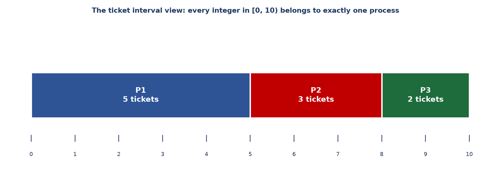

*شکل ۲٫۱ — هر فرآیند آماده یک بازهٔ پیوسته روی خط تصمیم دارد که عرضش برابر تعداد بلیط‌های اوست. قرعه‌کشی یک نقطهٔ یکنواخت در خط انتخاب می‌کند؛ بازهٔ حاوی آن نقطه برنده می‌شود. در طول قرعه‌کشی‌های زیاد، این بازه‌ها دقیقاً مثل جرم‌های احتمال عمل می‌کنند؛ به همین دلیل سهم طبق قانون اعداد بزرگ به کسر بلیط همگرا می‌شود.*

## ۲٫۳ مدل احتمالاتی

هر تصمیم مستقلِ توزیع‌شدهٔ دوجمله‌ای است. اگر فرآیندی `k` بلیط از مجموع `T` داشته باشد، احتمال بردش در یک تصمیم دقیقاً `p = k/T` است. در `n` تصمیم مستقل، شمار بردهای او `X ~ Binomial(n, p)` و امید ریاضی و واریانسش `E[X] = np` و `Var(X) = np(1−p)` است. انحراف معیار `σ = sqrt(np(1−p))` با `√n` رشد می‌کند، پس سهم نسبیِ منحرف‌شده مثل `1/√n` کوچک می‌شود:

- در `n = 10` تصمیم، سهم ±۲۰٪ نوسان دارد؛
- در `n = 100` تصمیم، ±۶٪؛
- در `n = 10,000` تصمیم، ±۰٫۶٪.

این دقیقاً همان چیزی است که «همگرایی آماری» یعنی — و به همان اندازه صریح، یعنی اینکه در پنجره‌های کوتاه، عدالت تضمین‌شده نیست. شبیه‌ساز ما `Var(X)` را دقیقاً طبق این فرمول بازتولید می‌کند (بخش ۲٫۶ و ۸٫۲ را ببینید).

## ۲٫۴ چرا اصلاً تصادف؟

سه دلیل عملی وجود دارد:

1. **بی‌خاطرگی (statelessness).** هیچ شمارندهٔ global، هیچ pass value، هیچ تاریخچه‌ای لازم نیست مرتب شود؛ سازوکار تصمیم، O(1) حالت جهانی است.
2. **ترکیب‌پذیری.** بلیط‌ها زیرمجموعه‌های سلسله‌مراتبی (ارزها) و انتقال (transfer) دارند بدون اینکه هیچ دامنه‌ای global را بشکند.
3. **مقاومت در برابر الگوهای دشمنانه.** هیچ توالی arrival ثابت و قابل‌پیش‌بینی نمی‌تواند از قرعه‌کشی «سواری مجانی» بگیرد؛ بهترین راه حریف همیشه بالا بردن سهم بلیطش است، نه سوءاستفاده از ترتیب.

پاداش: هیچ حدِ قطعی روی انتظار وجود ندارد. هزینه: یک کوانتوم از واریانس به‌ازای هر تصمیم.

## ۲٫۵ پیچیدگی

ساخت pool و قرعه‌کشی با یک جاروب خطی روی `n` فرآیند آماده `O(n)` زمان و `O(n)` حافظه موقت می‌گیرد. با یک درخت جمع بلیط‌ها می‌توان انتخاب را به `O(log n)` رساند — در این مخزن عمداً tree وجود ندارد چون `n` (تعداد فرآیندهای یک job کوچک) هرگز از چند دوجین بزرگ‌تر نمی‌شود؛ سادگی بر پیچیدگی مجانبی ترجیح داده شد. `draw_winner` دقیقاً همان جاروب خطی است.

## ۲٫۶ مقادیر مرجع برای دنبالهٔ دوجمله‌ای

اگر فرآیندی کسر `p` از pool را داشته باشد، سهمش پس از `n` تصمیم Binomial(n, p) است. جدول زیر `E[X] = np`، `σ = sqrt(np(1−p))` و `P(X ≥ ceil(np))` را برای horizonهای به‌کاررفته در این گزارش می‌دهد. مقادیر با محاسبهٔ صحیحِ سراسری (`math.comb`) محاسبه شده‌اند؛ این جدول پادزهرِ خواندنِ سروصدای قرعه‌کشی به‌جای سیگنال است.

| n | p | E[X] | σ | P(X ≥ E[X]) |
|---:|---:|---:|---:|---:|
| 10 | 0.5 | 5.0 | 1.581 | 0.6230 |
| 10 | 0.3 | 3.0 | 1.449 | 0.6172 |
| 10 | 0.2 | 2.0 | 1.265 | 0.6242 |
| 25 | 0.5 | 12.5 | 2.500 | 0.5000 |
| 25 | 0.3 | 7.5 | 2.291 | 0.4882 |
| 25 | 0.2 | 5.0 | 2.000 | 0.5793 |
| 50 | 0.5 | 25.0 | 3.536 | 0.5561 |
| 50 | 0.3 | 15.0 | 3.240 | 0.5532 |
| 50 | 0.2 | 10.0 | 2.828 | 0.5563 |
| 100 | 0.5 | 50.0 | 5.000 | 0.5398 |
| 100 | 0.3 | 30.0 | 4.583 | 0.5377 |
| 100 | 0.2 | 20.0 | 4.000 | 0.5398 |
| 200 | 0.5 | 100.0 | 7.071 | 0.5282 |
| 200 | 0.3 | 60.0 | 6.481 | 0.5267 |
| 200 | 0.2 | 40.0 | 5.657 | 0.5282 |
| 600 | 0.5 | 300.0 | 12.247 | 0.5163 |
| 600 | 0.3 | 180.0 | 11.225 | 0.5154 |
| 600 | 0.2 | 120.0 | 9.798 | 0.5163 |

خواندن جدول: در horizon برابر ۶۰۰ (آزمایش حالت پایدار بخش ۸٫۲)، فرآیندِ ۲ از ۱۰ بلیط `σ ≈ 9.8` تصمیم دور میانگینش نوسان دارد. انحراف معیارِ اندازه‌گیری‌شدهٔ این فرآیند در جاروب seedها (۰٫۰۱۶۳ × ۶۰۰ ≈ ۹٫۸ تیک) دقیقاً با `σ = sqrt(600 · 0.2 · 0.8) ≈ 9.8` برابر می‌شود. واریانس شبیه‌ساز همان واریانس دوجمله‌ای است — کد با مدل می‌خواند.

# ۳. الگوریتم به‌طور دقیق

## ۳٫۱ اصطلاح‌نامه

| اصطلاح | تعریف |
|---|---|
| بلیط (ticket) | واحد اتمی استحقاق CPU؛ عدد صحیح مثبت |
| pool بلیط | تجمیع بلیط‌های فرآیندهای آماده در لحظهٔ تصمیم |
| تصمیم | یکی از قرعه‌کشی‌های وزن‌دار |
| dispatch | انتخاب برنده + راه‌اندازی |
| کوانتوم | بیشینه تیک‌های پیوستهٔ هر برنده در یک dispatch |
| تیک | واحد زمان گسستهٔ مدل؛ ۱ تیک = ۱ واحد CPU شبیه‌سازی‌شده |
| share | نرخ تیک‌های مصرفی نسبت به busy تیک‌ها |
| خطای سهم | \|ticks_share − ticket_fraction\| |

## ۳٫۲ شبه‌کد مرجع

```
function lottery_schedule(processes, quantum):
    loop:
        runnable ← [p ∈ processes : p.alive ∧ ¬p.blocked]
        if runnable empty:
            advance_clock_to_next_event(); continue
        pool ← ∅
        total ← 0
        for p ∈ runnable:
            w ← p.tickets × p.compensation
            w ← w − lent(p, t) + donated(p, t)
            w ← currency_convert(p, w)
            pool[p.pid] ← w; total ← total + w
        if total ≤ 0: advance_one_tick(); continue
        winner_pid ← weighted_draw(pool, total)
        run(winner_pid, quantum)
        if used_less_than(quantum, winner_pid) ∧ blocked_voluntarily(winner_pid):
            winner_pid.compensation ← min(quantum / used, 20)
        elif winner won a draw:
            winner_pid.compensation ← 1.0
```

شبیه‌ساز دقیقاً همین شکل را پیاده می‌کند (`code/lottery.py`)، به‌همراه سازوکارهای اضافی مستندشده در بخش ۴ (الحاقیه‌ها) و بخش ۵ (پیاده‌سازی، جایی که معیارها تعریف شده‌اند).

## ۳٫۳ «بلیط» در این مدل چه می‌خرد

یک بلیط، یک سهمِ انتزاعی از CPU می‌خرد — نه زمان مطلق، نه برتری مطلق، نه حق تقدم. بلیط‌ها:

- **جمع‌شدنی** هستند: مجموع تمام بلیط‌های در تصمیم همیشه معلوم است؛
- **غیرقابل‌جایگزینی** هستند در این sense که ۵ بلیط همیشه ۵ سهم است، هیچ‌وقت «بلیط طلایی» وجود ندارد؛
- **انتقال‌پذیر** هستند: می‌توانی به دیگری قرض بدهی (بخش ۴٫۲)؛
- **قابل‌بیان در ارزهای مختلف** هستند: هر PR می‌تواند pool خصوصی خودش را داشته باشد (بخش ۴٫۳).

آنچه بلیط نمی‌خرد: تضمین زمانی برای یک تصمیم خاص، اولویت مطلق، یا حقی که بتوان به ضرب‌الاجل تبدیلش کرد. (تمرین ۲.)

## ۳٫۴ تعامل با کوانتوم

کوانتوم از حسابداری بلیط مستقل است اما اثراتش را چندبرابر می‌کند. کوانتوم‌های کوتاه تعداد تصمیم در ثانیه را زیاد می‌کنند و بنابراین *واریانس* سهم در هر ثانیه را کوچک می‌کنند، به بهای dispatch و تعویض متن بیشتر. کوانتوم‌های بلند هزینه dispatch را مستهلک می‌کنند اما به یک برندهٔ بدشانس می‌دانند مدت بیشتری بدون خدمت بماند. جاروب کوانتوم در بخش ۸٫۶ این بده‌بستان را روی بار baseline کمی می‌کند: رفتن از کوانتوم ۱ به ۳ تعداد dispatch را ۱۵ → ۷ تقریباً نصف می‌کند در حالی که میانگین پاسخ از ۲٫۸۰ به ۵٫۴۰ تیک بالا می‌رود.

## ۳٫۵ work-conservation

اگر حداقل یک فرآیند آماده باشد، CPU بیکار نمی‌ماند: یا قرعه‌کشی انجام می‌شود، یا — اگر pool دقیقاً صفر شود — ساعت یک تیک جلو می‌رود بدون dispatch. بیکار ماندن در لاگ فقط وقتی دیده می‌شود که *هیچ* فرآیند آماده‌ای وجود ندارد.

## ۳٫۶ تصمیم کارشده، تیک به تیک

تصمیم t = ۴ در اجرای baseline (seed ۲۰۲۵۰۹۲۷، از `output/decision_logs.txt`) تمیزترین نمونهٔ تکی از قانون ۲ است. در آن لحظه مجموعهٔ آماده {P1, P2, P3, P4, P5} با بلیط‌های پایه {۵، ۳، ۲، ۴، ۱} است؛ همهٔ فرآیندها رسیده‌اند و P1 هنوز یک تیک از burst پنج‌تیکی‌اش باقی مانده، پس مشارکت می‌کند. pool ثبت‌شده `{P1:5, P2:3, P3:2, P4:4, P5:1}` با مجموع ۱۵ است.

نمای انباشتگرِ آن pool:

| بازه روی خط قرعه | بلیط‌ها | مالک |
|---|---|---|
| 1–5 | 5 | P1 |
| 6–8 | 3 | P2 |
| 9–10 | 2 | P3 |
| 11–14 | 4 | P4 |
| 15 | 1 | P5 |

نتیجهٔ ثبت‌شده `winner=P4` است: قرعه در [11, 14] فرود آمد. احتمال برد P4 در این تصمیم دقیقاً 4/15 ≈ 0.267 است، بدون توجه به اینکه چه کسی دیگر آماده است — آن جداسازی همان چیزی است که بلیط‌ها می‌خرند. P1 همین قرعه را با احتمال 5/15 = 1/3 می‌برد، P2 با 1/5، P3 با 2/15 و P5 با 1/15. نه ترتیب رسیدن، نه سن، نه تاریخچه، در محاسبه داخل نیست.

دو ورودی دیگر از همان لاگ، برای ثبت: در t = 0 pool برابر `{P1:5}` است — یک قرعهٔ مجبور، مثل هر قرعهٔ دیگر ثبت می‌شود؛ در t = 2 pool برابر `{P1:5, P2:3, P3:2}` است و دوباره P1 می‌برد، که بخش ادغام‌شدهٔ `0-4:P1` در trace را می‌سازد. ادغام بخش‌ها یک قانون رندرینگ در `format_gantt` است، هرگز تصمیم زمان‌بند. پیوست G لاگ کامل همهٔ هفت سناریوی معتبر را دارد.

# ۴. الحاقیه‌های پیاده‌سازی‌شده در این مخزن

## ۴٫۱ تیکت‌های compensation

وقتی یک فرآیند **داوطلبانه** CPU را زودتر از پایان کوانتومش واگذار می‌کند — چون I/O شد — بخش استفاده‌نشدهٔ کوانتوم به‌عنوان «حق از دست رفته» تلقی می‌شود. compensation آن را جبران می‌کند: با هر بلاک داوطلبانه، ضریب بلیط آن فرآیند ×(کوانتوم / استفاده‌شده) می‌شود تا سقف ۲۰×، تا زمانی که دوباره ببرد. با بردن، ضریب به ۱ برمی‌گردد.

**تعریف.** `compensation ← min(quantum / used, 20)`؛ فقط روی بلاک داوطلبانه؛ ریست بعد از برد؛ اعمال می‌شود در `effective_pool()` در هر تصمیم.

**شواهد.** آزمایش حالت پایدار (بخش ۸٫۴) نشان می‌دهد فرآیند I/O-bound از ۱۳٫۵٪ به ۲۰٫۰٪ تیک‌های busy (و از ۱۳۵ به ۲۰۰ تصمیم) با compensation روشن می‌رود — رشد ۴۸٪ در نرخ تصمیم — و دو فرآیند CPU-bound تفاوت را متقارن جذب می‌کنند.

## ۴٫۲ انتقال زمان‌دار بلیط

یک فرآیند می‌تواند یک یا چند transfer اعلام کند: `{start, end, tickets, target}`. در بازهٔ نیم‌باز `[start, end)`، آن بلیط‌ها از مؤثرفرآیند فرستنده کم و به گیرنده اضافه می‌شوند؛ هرگز کپی نمی‌شوند (آزمون `test_lent_tickets_are_not_copied`).

**مثال استفاده.** مشتری در حال انتظار روی سرور، بلیط‌هایش را به سرور می‌دهد تا سرور زودتر تمام کند و مشتری را آزاد کند. این «انتقال استحقاق» است، نه «تقسیم سهم».

**شواهد.** سناریوی transfer (`code/scenarios/transfer.json`، نتایج در بخش ۷٫۵) نشان می‌دهد پنجرهٔ اهدایی تخصیص‌ها را دقیقاً طبق حساب pool جابه‌جا می‌کند: P2 (گیرندهٔ اهدای ۴ بلیط از P1) به‌طور قابل‌اندازه‌گیری بیشتر از P3 در بازه می‌برد، با جرم ثابت pool ترکیبی.

## ۴٫۳ ارزهای سلسله‌مراتبی بلیط

هر گروه می‌تواند pool خصوصی خودش را داشته باشد؛ بلیط‌های خصوصی آن گروه به نسبت «نرخ ارز» اعلامی به بلیط‌های پایه تبدیل می‌شوند. گروه‌ها به‌طور کامل پوشش باید داشته باشند (`validate_groups`): هیچ فرآیندی نمی‌تواند بدون خانه بماند.

**تعریف.** نرخ تبدیل گروه = base_tickets گروه؛ تقسیم داخلی اعضا بر نسبت بلیط‌های خصوصی‌شان؛ حلقهٔ تصمیم با masse‌های تبدیل‌شده کار می‌کند.

**شواهد.** `code/scenarios/currencies.json` به گروه `system` پنجاه بلیط پایه (P1:P2 = 1:1) و به گروه `users` صد بلیط (P3:P4 = 1:3) می‌دهد. تصمیم ثبت‌شدهٔ اول دقیقاً pool تحلیلی را تولید می‌کند ({25, 25, 25, 75}؛ بخش ۷٫۶).

## ۴٫۴ چه چیزی عمداً پیاده نشده

- **Inflation بلیط** توسط خود سرویس‌گیر (مشتری خودش بلیط mint کند) — Waldspurger صریحاً آن را رد کرده؛ ما هم. هیچ مسیری در کد بلیط پایه‌ای به سیستم اضافه نمی‌کند؛ compensation فقط مقیاس می‌دهد، انتقال جابه‌جا می‌کند، ارز دوباره تعیین می‌کند.
- **ارزهای شناور با بازار ثانویه** — نرخ‌ها اعلام می‌شوند، نه معامله.
- **محدودیت‌های ضرب‌الاجل (EDF-style)** — خارج از دامنهٔ داوطلبانهٔ این الگوریتم است.
- **Affinity/cache-awareness** — تعداد تصمیم را می‌شود کم کرد، اما مسئلهٔ مدل ما نیست.

# ۵. پیاده‌سازی

## ۵٫۱ معماری

شبیه‌ساز یک فایل پایتون است با لایه‌بندی صریح داخلی. مرزها عمدی‌اند:

- `validate()` و `validate_groups()` هر ورودی را پیش از لمس هر حالت reject می‌کنند (هیچ پردازشی قبل از اعتبارسنجی شروع نمی‌شود).
- `effective_pool()` تنها تابع در سیستم است که بلیط‌های مؤثر را محاسبه می‌کند؛ هر مصرف‌کننده‌ای (شبیه‌ساز، آزمون‌ها، لاگ) از همین مسیر عبور می‌کند.
- `simulate_full()` حلقهٔ رویداد است؛ هیچ کدی بیرون از آن ساعت شبیه‌سازی را جلو نمی‌برد.
- `metrics_full()`، `format_*()` و `to_csv()` تنها خروجی مصرف‌کننده‌های نهایی هستند.

خطای راهبردی‌ای که از آن پرهیز شد: دو منبع حقیقت برای pool. چون همهٔ مسیرها از `effective_pool()` می‌گذرند، compensations/transfers/currencies هرگز نمی‌توانند بین «وضعیتی که تست می‌بیند» و «وضعیتی که تصمیم می‌گیرد» متابینس بسازند.

### ۵٫۱٫۱ نقشهٔ ماژول

چیدمان تک‌فایلی یک رابط است، نه یک سلیقه. سطح عمومی، به ترتیب وابستگی:

| نماد | نوع | مسئولیت |
|---|---|---|
| `InputError` | استثنا | برای هر سناریوی نامعتبر؛ CLI آن را به کد خروج ۲ نگاشت می‌کند |
| `Process` | dataclass | رکورد معتبرِ runtime: pid، arrival، burst، tickets، قانون I/O، انتقال‌ها، گروه ارز، ضریب compensation، لحظات محاسبه‌شده |
| `Stats` | dataclass | انباشه‌ها: busy ticks، dispatches، تعویض‌های متن، compensation grants، preemptions، draws |
| `validate(procs)` | تابع | بررسی schema و ارجاع (هدف‌های transfer وجود دارند، `io_every`/`io_len` جفت‌اند، burst ≥ 1، pidها یکتا) |
| `validate_groups(groups, procs)` | تابع | کامل بودن ارزها: هر فرآیند دقیقاً در یک گروه، اعضا اعلام‌شده |
| `effective_pool(processes, t)` | تابع | pool هر تصمیم: tickets پایه × compensation، منهای انتقال‌های فعال، به‌علاوهٔ اهدایی‌ها، × تبدیل ارز |
| `is_runnable(p, t)` | تابع | گزارهٔ block/arrival/finish استفاده‌شده در حلقه |
| `draw_winner(pool, rng)` | تابع | قرعهٔ وزن‌دار با `rng.uniform` + پیمایش انباشه؛ `O(n)`؛ `None` روی pool تهی؛ safety net ورودی آخر برای لبهٔ rounding |
| `simulate_full(...)` | تابع | حلقهٔ رویداد؛ `(processes, gantt, stats, decision_log)` برمی‌گرداند |
| `metrics_full(...)` | تابع | آمار اتمام؛ برای اجراهای bounded horizon بدون فرآیند تمام‌شده `None`-امن |
| `measured_shares(gantt)` | تابع | busy ticks به‌ازای هر فرآیند از trace ادغام‌شده |
| `format_gantt / format_table` | تابع | رندرینگ قابل‌خواندن برای انسان (عرض ستون‌های داینامیک) |
| `to_csv` | تابع | خروجی CSV به‌ازای هر فرآیند |
| `plot_gantt` | تابع | PNG نمودار گانت با matplotlib |
| `load_config / interactive_input` | تابع | بارگذاری سناریوی JSON و حالت ورود دستی |
| `main(argv)` | تابع | CLI: argparse، کدهای خروج، artifacts اختیاری (`--png`، `--csv`، `--json`) |

هر آزمون در مجموعه از طریق یکی از این نمادها وارد می‌شود؛ هیچ آزمونی به حالت خصوصی دست نمی‌برد، و هیچ نمادی از بالا استفاده نمی‌شود.

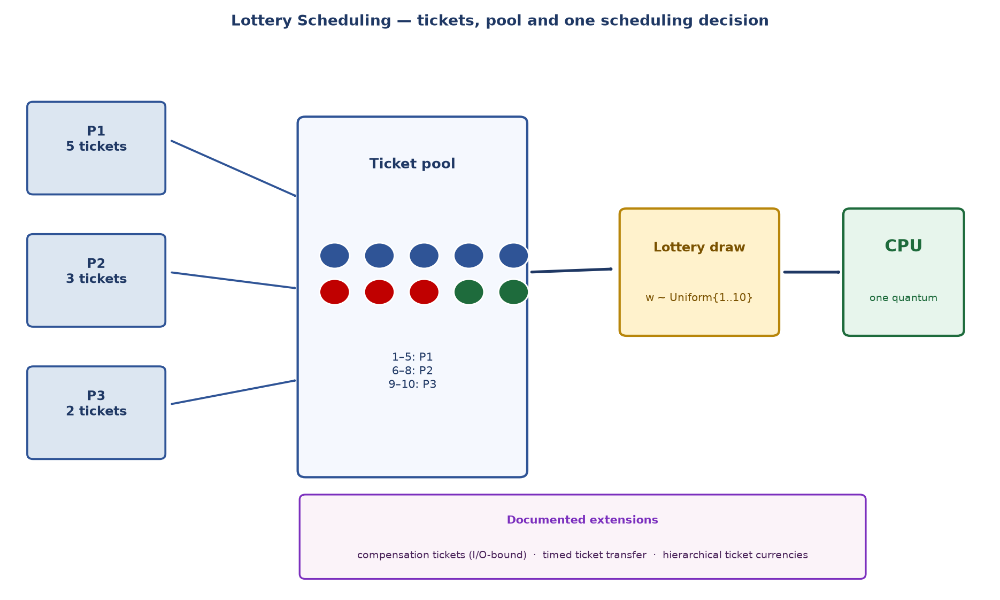

*شکل ۵٫۱ — ساختار ماژول `code/lottery.py`. شبیه‌ساز عمداً یک فایل با لایه‌های شفاف است: اعتبارسنجی → ساخت pool → قرعه → dispatch/حسابداری → معیارها. سناریوها، CLI و مجموعه آزمون همگی از یک نقطهٔ ورود `simulate_full()` وارد می‌شوند؛ به همین دلیل سبز بودن تست‌ها به‌معنای درست بودن CLI است، نه فقط کتابخانه.*

## ۵٫۲ حلقهٔ رویداد

در هر تیک:

1. **بیدار کردن رسیده‌ها.** فرآیندهایی که `arrival == t` هستند به ready اضافه می‌شوند.
2. **حساب بلاک/compensation.** اگر برندهٔ قبلی زودتر از پایان کوانتوم بلاک داوطلبانه کرد، ضریبش به‌روز می‌شود.
3. **ساخت pool.** فراخوانی `effective_pool(processes, t)` — بلیط‌های مؤثر طبق قانون ۳.۲.
4. **قرعه یا پیش‌روی ساعت.** اگر pool تهی باشد ساعت +۱؛ وگرنه تصمیم ثبت و برنده انتخاب می‌شود.
5. **dispatch و حسابداری.** winner تا کوانتوم یا بلاک اجرا می‌شود؛ gantt merge می‌شود؛ stats به‌روز می‌شوند.
6. **اتمام/پاکسازی.** اگر `burst` تمام شد، finish ثبت می‌شود؛ اگر horizon گذشت، حلقه می‌شکند.

## ۵٫۲٫۱ جریان تصمیم در یک نگاه

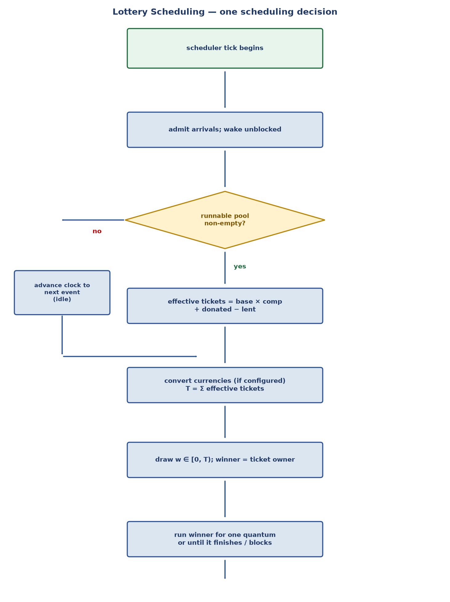

*شکل ۵٫۲ — جریان کنترل per-tick: بیدار کردن رسیده‌ها، حسابرسی بلاک و compensation، بازسازی pool، قرعه یا جلو بردن ساعت، dispatch، تسویه. هر جعبه در شکل وجود مستقیمی در کد دارد؛ شکل آن سندی است که پیاده‌سازی علیه آن بررسی می‌شود.*

## ۵٫۳ محاسبهٔ tickets مؤثر

فرمول هر تصمیم:

```
eff_i = base_i × compensation_i
        − Σ {transfer t→× از i در tick t}
        + Σ {transfer به i}
pool_i = eff_i × rate(currency(i))   اگر i در یک ارز باشد، وگرنه eff_i
```

ضریب compensation فقط برای dispatch بعدی معتبر است و بعد از برد به ۱ برمی‌گردد. `pool[P1:5]` در لاگ baseline یک جرم است، نه تعداد بلیط — به همین خاطر floats هستند و نمایش `5.0` کاملاً طبیعی است.

## ۵٫۴ قطعی بودن و بازتولیدپذیری

هر اجرای شبیه‌ساز تابعی از `(workload, seed)` است. `seed` در فایل سناریو ذخیره می‌شود (`seed`) یا با `--seed` override می‌شود. تست‌ها همیشه seed صریح می‌دهند. همین seed ⇒ همین trace، همیشه.

## ۵٫۵ رابط خط فرمان

```
usage: lottery.py [-h] [--interactive] [--png PNG] [--csv CSV]
                  [--json JSON_OUT] [--seed SEED] [--quantum QUANTUM]
                  [--horizon HORIZON] [--compensation] [--quiet]
                  [input]
```

متغیرهای اصلی: `input` (فایل JSON یا `-` برای stdin)، `--png`/`--csv`/`--json` (artifacts)، `--seed`/`--quantum`/`--horizon`/`--compensation` (override)، `--quiet` (فقط جدول معیارها)، `--interactive` (ورود دستی). کد خروج ۰ = موفق، ۲ = سناریوی نامعتبر. ترکیب پرچم‌ها آزاد است: `python code/lottery.py code/scenarios/baseline.json --png out.png --csv out.csv --json out.json`.

## ۵٫۶ معیارها و تعاریف

همهٔ کمیت‌ها طبق تعریف‌های این بخش هستند. خطای سهم روی تیک‌های busy داخل پنجرهٔ اندازه‌گیری محاسبه می‌شود؛ بلیط‌ها با وزن عدد صحیح هستند؛ میانگین‌ها روی فرآیندها بدون وزن‌دهی محاسبه می‌شوند مگر خلافش گفته شده باشد.

- **Waiting (انتظار).** مجموع تیک‌هایی که فرآیند آماده بوده اما اجرا نشده: `finish − arrival − executed`.
- **Turnaround (بازگشت).** `finish − arrival`.
- **Response (پاسخ).** `first_service − arrival`.
- **Tick % (سهم تیک).** تیک‌های مصرفی فرآیند / کل busy ticks.
- **Decisions % (سهم تصمیم).** دفعاتی که فرآیند برنده شده / کل تصمیم‌ها.
- **Share error (خطای سهم).** `|ticks_share − ticket_fraction|`؛ برای legend: اجرای‌های terminating همیشه bursts را دقیقاً تحویل می‌دهند پس خطا artefactِ ترتیب اتمام است (بخش ۱۱٫۴).
- **avg share err/max.** خطای میانگین/مطلق بین فرآیندها در کل اجرا.
- **Context switches.** proc→proc؛ dispatchهای پیوستهٔ یکسان merge می‌شوند.
- **busy/idle.** تیک‌هایی که حداقل یک فرآیند اجرا شد یا نشد.
- **throughput.** فرآیند تمام‌شده به‌ازای هر تیک.

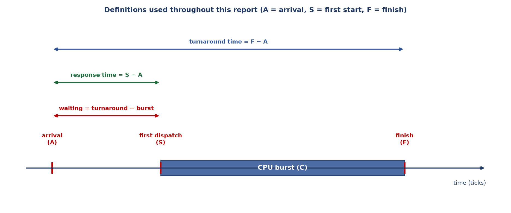

*شکل ۵٫۳ — سه لحظه‌ای که هر معیار تکمیل از آن‌ها مشتق می‌شود: رسیدن `A`، نخستین خدمت `S`، پایان `F`. انتظار `F − A − مجموع تیک‌های اجراشده` است؛ بازگشت `F − A` است؛ پاسخ `S − A` است. همه از یک لحظه‌های ثبت‌شده محاسبه می‌شوند، پس ستون‌های جدول معیارها هرگز با هم متناقض نیستند.*

# ۶. روش آزمایش

## ۶٫۱ انضباط هارنس

- هیچ عددی در این گزارش با دست تایپ نشده؛ همه از `output/` کپی شده‌اند (`run_experiments.py`).
- هر سناریوی بی‌نهایت با seed صریح و `--horizon` محدود اجرا می‌شود.
- هر سناریوی invalid با اجرای واقعی CLI تست می‌شود و کد خروج چک می‌شود.
- نمودارها با `matplotlib` تولید و به‌صورت `.png` در `diagrams/` ذخیره می‌شوند؛ هیچ تصویری در این گزارش از خارج از مخزن نمی‌آید.

## ۶٫۲ سناریوهای معتبر

هفت سناریوی معتبر پوشش می‌دهند: baseline دستی، عدالت برابر، غلبهٔ بلیط، compensation، transfer، currencies، همگرایی. علاوه بر این سه probe نامعتبر.

## ۶٫۳ احتیاط‌های اندازه‌گیری

- اجرای‌های terminating کوتاه هستند و burst-bound totals ترتیب اتمام را به‌جای کیفیت زمان‌بند ثبت می‌کنند.
- یک seed = یک نمونه؛ فقط جاروب seedها (بخش ۸٫۲) پراکندگی واقعی را نشان می‌دهد.
- CPU utilization در همه سناریوهای این گزارش ۱۰۰٪ است چون بارها CPU-bound هستند؛ تفاوت‌ها در *توزیع* است نه بهره.
- wall time اجرای سناریوها زیر میلی‌ثانیه است؛ اندازه‌گیری wall-clock به‌عنوان معیار کیفیت به‌کار نمی‌رود.

# ۷. نتایج — هفت سناریو

همهٔ خروجی‌های این بخش از `output/scenario_*.txt` کپی شده‌اند که توسط `code/run_experiments.py` تولید می‌شود. هیچ عددی در این بخش دستی تایپ نشده است.

## ۷٫۱ Baseline (`baseline.json`)

پنج فرآیند، وزن‌های بلیط ترکیبی (۵/۳/۲/۴/۱)، رسیدن‌های پلکانی (P1 در ۰، P2 در ۱، P3 در ۲، P4 در ۳، P5 در ۴)، کوانتوم ۲، seed ۲۰۲۵۰۹۲۷.

```
|   P1   | P4 | P1 | P2 |  P3  | P5 | P2 |
0-4:P1  4-6:P4  6-7:P1  7-9:P2  9-12:P3  12-13:P5  13-15:P2

PID     Arr Burst Tickets   Fin  Wait   TAT  Resp   Tick%   Decis    |Err|
P1        0     5       5     7     2     7     0   0.333   0.333   0.0000
P2        1     4       3    15    10    14     6   0.267   0.222   0.0667
P3        2     3       2    12     7    10     7   0.200   0.222   0.0667
P4        3     2       4     6     1     3     1   0.133   0.111   0.1333
P5        4     1       1    13     8     9     8   0.067   0.111   0.0000
```

تجمع‌ها: میانگین انتظار ۵٫۶۰ تیک، میانگین بازگشت ۸٫۶۰، میانگین پاسخ ۴٫۴۰، بهرهٔ CPU برابر ۱۰۰٪، ۶ تعویض متن، ۹ dispatch، ۴ preemption، ۹ قرعه.

خواندن نمودار گانت: P1 در قرعهٔ اول می‌برد و دو برد متوالی را ادغام می‌کند (۰–۴). P4 با ۴ بلیط، بعداً دوبار پشت سر هم می‌برد (۴–۶) — یادآور اینکه دو تصمیم یکسان پشت سر هم در trace ادغام می‌شوند اما دو dispatch محسوب می‌شوند (۹ dispatch در برابر ۷ بخش قابل‌مشاهده). P5 با یک بلیط فقط در تیک ۱۲ انتخاب می‌شود، زمانی که بقیه نزدیک اتمامند — دقیقاً قیمتی که سهم ۱/۱۵ طلب می‌کند.

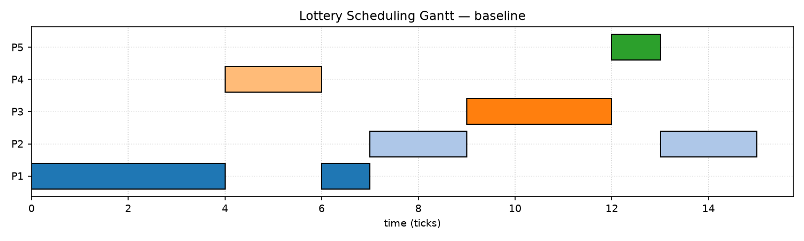

## ۷٫۲ سهم‌های برابر (`fair.json`)

چهار فرآیند یکسان (burstهای ۱۲ تیکی، ۱۰ بلیط هرکدام)، کوانتوم ۲، seed ۷. این بررسی صحت عدالت احتمالاتی است:

| فرآیند | تیک‌ها | تصمیم‌ها | کسر بلیط | خطای سهم |
|---|---:|---:|---:|---:|
| A | 12 | 6 | 0.25 | 0.0000 |
| B | 12 | 6 | 0.25 | 0.0000 |
| C | 12 | 6 | 0.25 | 0.0000 |
| D | 12 | 6 | 0.25 | 0.0000 |

میانگین انتظار ۲۵٫۵۰، میانگین بازگشت ۳۷٫۵۰، میانگین پاسخ ۸٫۰۰، ۱۸ تعویض متن. توجه کنید که پاسخ D (۲۶ تیک) خیلی بدتر از A (۲ تیک) است؛ صرفاً به‌خاطر شانس قرعه — در یک اجرای ۴۸ تیکی با بلیط‌های برابر، پراکندگی پاسخ تحت سلطهٔ خود قرعه‌کشی است، نه هیچ تصمیم طراحی. این دقیقاً همان بی‌عدالتیِ کوتاه‌مدتی است که زمان‌بندی قرعه‌کشی در عوض عدالت بلندمدت می‌پردازد.

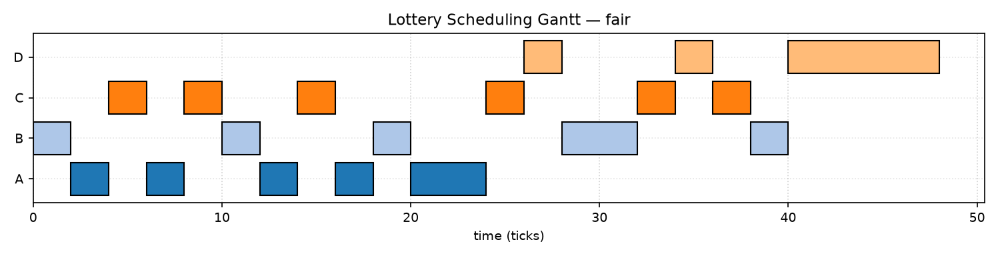

## ۷٫۳ نامتقارنی استحقاق (`dominance.json`)

یک فرآیند با ۱ بلیط در برابر پنج فرآیند با ۱۰ بلیط، همه burst برابر ۲، seed ۹۹. L1 تا وقتی که بقیه تمام می‌شوند منتظر می‌ماند:

```
| H1 | H2 | H3 | H4 | H5 | L1 |
0-2:H1  2-4:H2  4-6:H3  6-8:H4  8-10:H5  10-12:L1
```

L1 آخر تمام می‌شود (finish = 12) با انتظار ۱۰ و پاسخ ۱۰ — دقیقاً قیمتی که سهم ۱/۵۱ در امید ریاضی دارد. به‌معنای قطعی، گرسنگی وجود ندارد: L1 *تضمین* شده بود که بالاخره قرعه ببرد، چون هر قرعهٔ قبلی فقط `1/51` شانس انتخابش را داشت و تعداد قرعه‌ها متناهی بود. در horizon طولانی‌تر با arrival مداوم کارهای پربلیط، L1 می‌تواند به‌طور مدام عقب بیفتد؛ به همین دلیل این سری قرعه‌کشی را «بدون انتظار کران‌دار» می‌داند، نه «بدون گرسنگی در بدترین حالت».

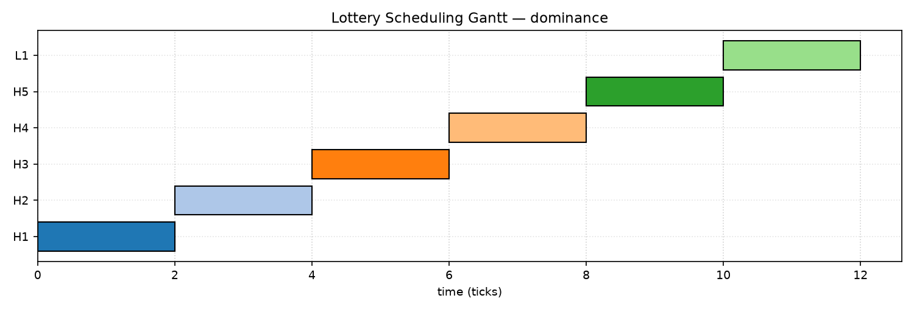

## ۷٫۴ تیکت‌های compensation (`compensation.json`)

یک فرآیند I/O-bound (`io_every=2`, `io_len=3`، ۱۰ بلیط) در برابر دو فرآیند CPU-bound (۱۰ بلیط هرکدام)، کوانتوم ۴، seed ۲۰۲۴. فایل سناریو در حالت bounded horizon (horizon = 2000) اجرا می‌شود تا رقابت باقی بماند:

| حالت | سهم تیک IO | تصمیم‌های IO | grants |
|---|---:|---:|---:|
| compensation خاموش | 0.1350 | 135 | 0 |
| compensation روشن | 0.2000 | 200 | 200 |

تفسیر: بدون compensation، فرآیند I/O-bound در هر بلاک دو تیک از slice چهار تیکی‌اش را فدا می‌کند و ۱۳٫۵٪ از زمان busy را می‌گیرد. با compensation، هر بلاک زودهنگام بلیط‌هایش را ×(۴/۲ = ۲) می‌کند تا برد بعدی؛ این ضریب در این پنجره ۲۰۰ بار اعمال می‌شود؛ سهم فرآیند به ۲۰٫۰٪ از تیک‌های busy بالا می‌رود. دو فرآیند CPU-bound تفاوت را متقارن جذب می‌کنند (۰٫۳۸۸/۰٫۴۱۲ خاموش → تقریباً ۰٫۴۰۰/۰٫۴۰۰ روشن).

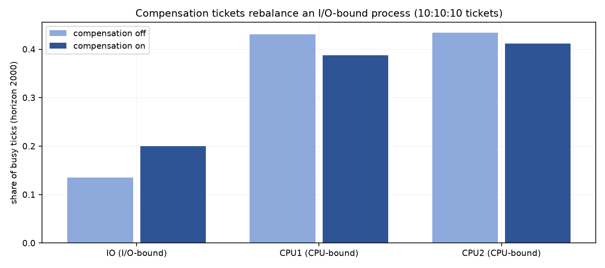

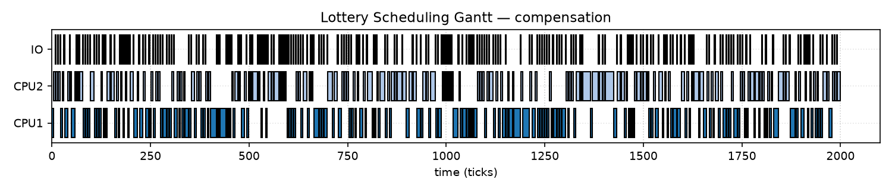

## ۷٫۵ انتقال زمان‌دار بلیط (`transfer.json`)

P1 (۶ بلیط) در بازهٔ [4, 14) به P2 هر تیک ۴ بلیط قرض می‌دهد — پنجرهٔ اهدایی که «مشتری منتظر سرور است» را مدل می‌کند. بلیط‌های مؤثر P2 بیرون پنجره ۲ و درون پنجره ۶ است؛ P1 بیرون ۶ و درون ۲. P3 در کل ۴ نگه می‌دارد. کوانتوم ۲، seed ۱۲۳، همه burstها ۳۰.

| فرآیند | سهم تیک‌های busy | سهم تصمیم‌ها | خطای سهم |
|---|---:|---:|---:|
| P1 | 0.333 | 0.333 | 0.1667 |
| P2 | 0.333 | 0.333 | 0.1667 |
| P3 | 0.333 | 0.333 | 0.0000 |

تجمع‌ها: میانگین انتظار ۳۹٫۳۳، میانگین بازگشت ۶۹٫۳۳، میانگین پاسخ ۴٫۰۰، ۲۲ تعویض متن، ۴۵ قرعه. از آن‌جا که هر سه burst برابرند و همه تمام می‌شوند، جمع تیک‌ها برابر می‌شود (۳۰ هرکدام) — جای درست برای دیدن اثر اهدا، *مسیر* است، که در نمودار گانت پیداست: P2 در ۴–۶ dispatch می‌شود (داخل پنجره)، دوباره در ۱۲–۱۴ (هنوز داخل)، و بعد تا تیک ۳۲ بیکار می‌شود.

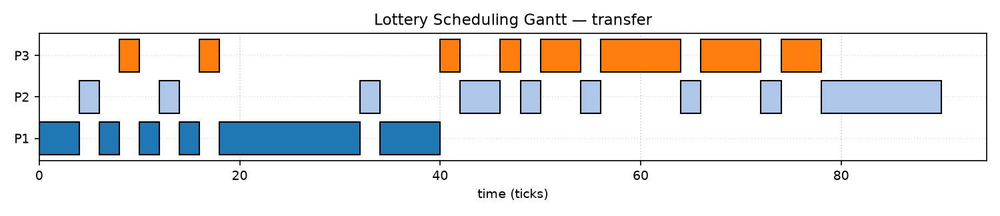

## ۷٫۶ ارزهای سلسله‌مراتبی (`currencies.json`)

دو گروه: `system` (۵۰ بلیط پایه؛ P1:P2 = 1:1) و `users` (۱۰۰ بلیط پایه؛ P3:P4 = 1:3). همه burst = 16، کوانتوم ۲، seed ۵۵۵. pool پایدار مورد انتظار: P1 = P2 = ۲۵، P3 = ۲۵، P4 = ۷۵.

اولین تصمیم ثبت‌شده (seed ۵۵۵) pool برابر `{P1: 25.0, P2: 25.0, P3: 25.0, P4: 75.0}` دارد و P2 را انتخاب می‌کند — دقیقاً تقسیم تحلیلی که توسط `effective_pool()` و تبدیل ارز تولید می‌شود (با اجرای دوبارهٔ load سناریو روی `code/scenarios/currencies.json` تأیید شد). در کل اجرای terminating، هر فرآیند ۱۶ تیکش را اجرا می‌کند، پس سهم‌های تیک یکسان می‌شوند (هرکدام ۰٫۲۵) و خطای سهم دوباره burst-bound تکرار می‌شود (P4: ۰٫۲۵). weighted ارزها در probe حالت پایدار مجموعه آزمون (horizon ۱۵۰۰، seed ۲۰۲۵۰۹۲۷، کوانتوم ۱) هم امتحان می‌شوند: P4 در ۶٪ کسر تحلیلی ۰٫۵ می‌افتد و هرکدام از P1/P2/P3 در ۶٪ کسر 1/6 (بخش ۱۳).

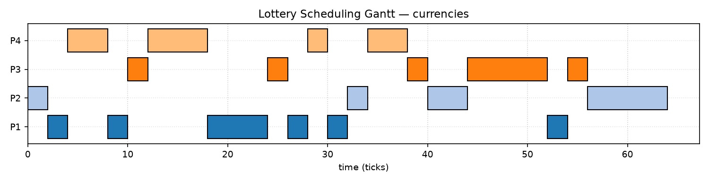

## ۷٫۷ اجرای همگرایی (`convergence.json`)

سه فرآیند CPU-bound بدون اتمام، بلیط‌های ۵/۳/۲، کوانتوم ۱، seed ۳۱۴۱۵، horizon = 1500. سهم‌های تجمعی نهایی: **T5 ۰٫۵۱۲۷، T3 ۰٫۳۰۹۳، T2 ۰٫۱۷۸۰** — در فاصلهٔ ۱٫۳، ۰٫۹ و ۲٫۲ درصد از کسرهای بلیط (۰٫۵/۰٫۳/۰٫۲). مسیر (بخش ۸٫۱) نوسان اولیهٔ موردانتظار و سپس نشست در یک باند تنگ را خیلی زودتر از پایان پنجره نشان می‌دهد.

# ۸. نمودارهای تحلیلی

## ۸٫۱ همگرایی سهم به آنتروپی بلیط‌ها

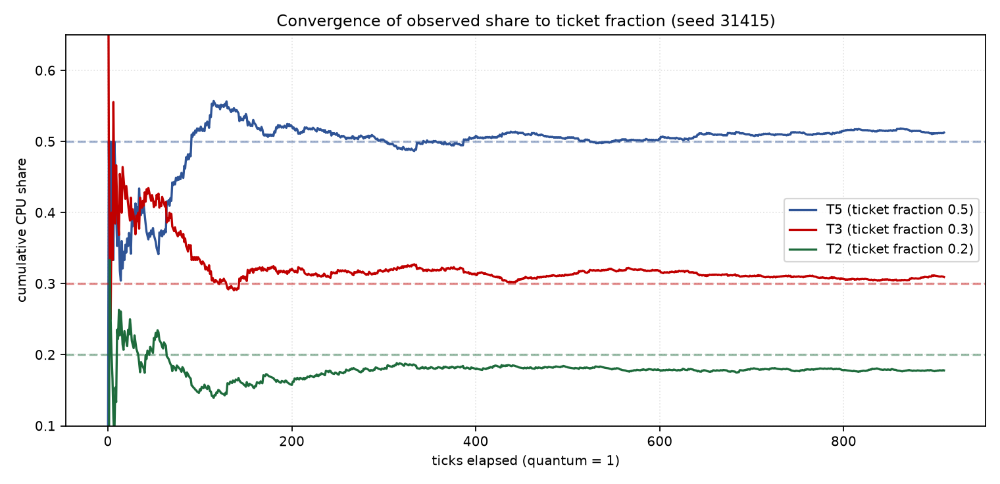

این نمودار سهم تجمعی تیک هر فرآیند را نسبت به تیک‌های سپری‌شده برای سه‌گانهٔ ۵/۳/۲ رسم می‌کند. هر سه منحنی نوسان اولیهٔ موردانتظار را نشان می‌دهند و بعد در باندی تنگ حول کسر بلیطشان نشست می‌کنند. این قانون اعداد بزرگ است که دیده می‌شود: قرعه‌کشی هیچ تضمین پیشرفت یکنواختی per-decision ندارد، اما میانگین تجمعی‌اش خودتصحیح‌گر است.

## ۸٫۲ حالت پایدار روی ۵۰ seed

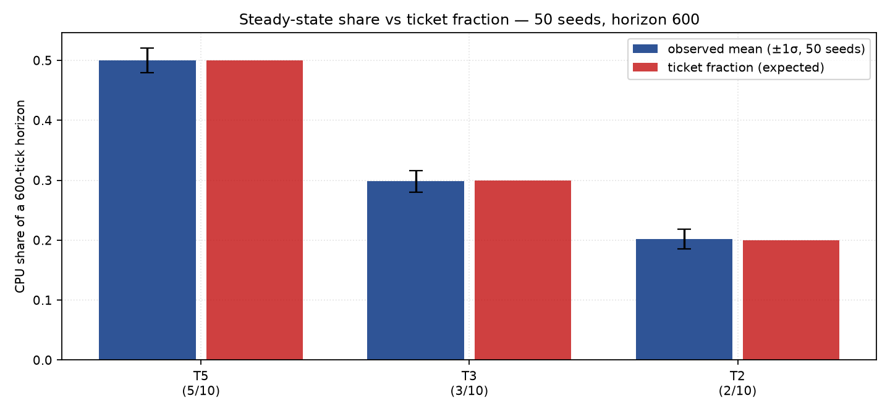

هر گروه میله میانگین سهم CPU در یک horizon ۶۰۰ تیکی (±1σ) را روی ۵۰ seed (۰ تا ۴۹) برای سه‌گانهٔ ۵/۳/۲ نشان می‌دهد: **T5 ۰٫۴۹۹۹ (σ ۰٫۰۲۰۲)، T3 ۰٫۲۹۸۰ (σ ۰٫۰۱۷۷)، T2 ۰٫۲۰۲۰ (σ ۰٫۰۱۶۳)**. میله‌های خطا کسرهای بلیط را برای هر سه فرآیند در بر می‌گیرند. پراکندگی مشاهده‌شده (σ بین ۰٫۰۱۶ و ۰٫۰۲۰ روی horizon ۶۰۰ تیکی) با شهود دوجمله‌ای بخش ۲٫۳ سازگار است: واریانس مثل یک بر n تصمیم کم می‌شود.

## ۸٫۳ خطای سهم در سناریوهای terminating

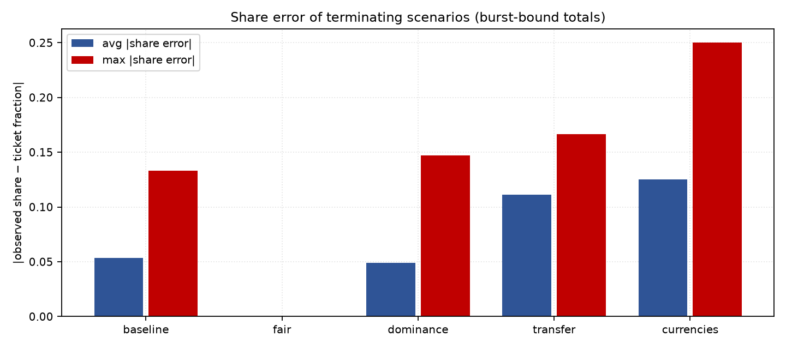

خطای سهم در اجرای‌های terminating تحت سلطهٔ burst-bound totals است (بخش ۵٫۶) و نمودار آن را ساده می‌گوید: خطاهای ۰٫۰۰–۰٫۱۳ artifacts *زمان* اتمام فرآیندها هستند، نه خطای زمان‌بند. به همین دلیل horizon حالت پایدار وجود دارد؛ این نمودار را به‌عنوان شاهد هیچ‌کدام از طرف‌ها دربارهٔ عدالت نقل نکنید.

## ۸٫۴ compensation، کمیت‌شده

در بخش ۷٫۴ گزارش شد؛ نمودار همان داده به‌صورت کنارهم است. سازوکار compensation فرآیند I/O-bound را از ۱۳٫۵٪ به ۲۰٫۰٪ تیک‌های busy و از ۱۳۵ به ۲۰۰ تصمیم در همان پنجرهٔ ۲۰۰۰ تیکی با seed و بار یکسان بلند می‌کند. ادعای Waldspurger و Weihl — اینکه compensation سهمِ مستحقِ مشتریان blocking داوطلبانه را برمی‌گرداند — در pool اندازه‌گیری‌شده مستقیماً دیده می‌شود.

## ۸٫۵ جاروب شمار بلیط

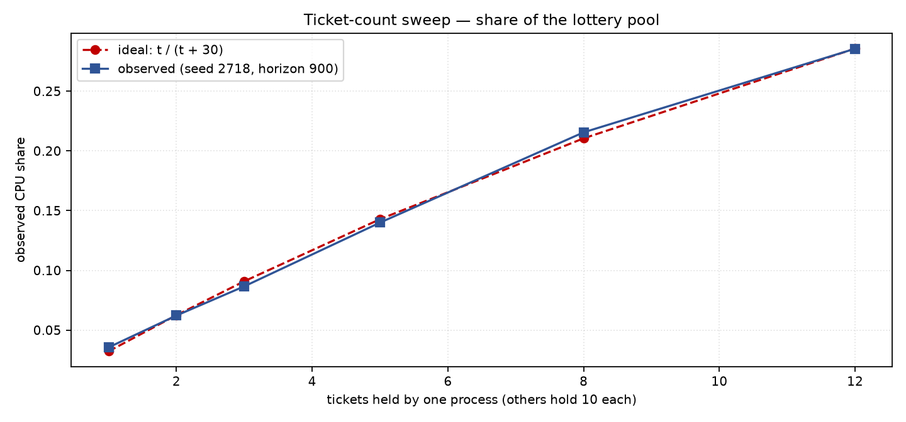

یک فرآیند `t` بلیط در برابر سه تای دیگر با ۱۰ بلیط هرکدام؛ سهم مشاهده‌شده در برابر تحلیلی `t / (t + 30)` برای `t ∈ {1, 2, 3, 5, 8, 12}`. مقادیر مشاهده‌شده: ۰٫۰۳۶، ۰٫۰۶۲، ۰٫۰۸۷، ۰٫۱۴۰، ۰٫۲۱۶، ۰٫۲۸۶ — منحنی تحلیلی در همهٔ نقاط تا ۰٫۰۰۶ دنبال می‌شود. این تمیزترین اعتبارسنجی ممکن است که وزن بلیط *همان* وزن سهم است.

## ۸٫۶ جاروب کوانتوم

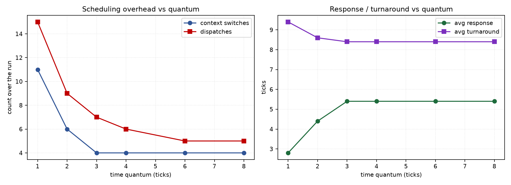

بار baseline، کوانتوم ∈ {1, 2, 3, 4, 6, 8}: dispatches از ۱۵ → ۹ → ۷ → ۶ → ۵ → ۵ و تعویض‌های متن از ۱۱ → ۶ → ۴ → ۴ → ۴ → ۴ کم می‌شوند، در حالی که میانگین پاسخ از ۲٫۸۰ → ۴٫۴۰ → ۵٫۴۰ بالا می‌رود و در همین جا اشباع می‌شود (burstهای این بار آن‌قدر کوتاه‌اند که کوانتوم‌های بزرگ به‌ندرت منقضی می‌شوند). نقطهٔ «آرنج» این منحنی کوانتوم ۳ است: ۷ dispatch و ۵٫۴۰ میانگین پاسخ، و هیچ کاهش overhead بیشتری از sliceهای بزرگ‌تر در دسترس نیست.

## ۸٫۷ مقایسه بین سناریوها

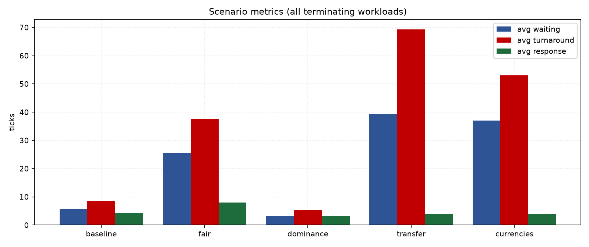

میانگین انتظار / بازگشت / پاسخ برای هر سناریوی terminating. `fair` بالاترین انتظار مطلق را دارد (۲۵٫۵/۳۷٫۵/۸٫۰) صرفاً به این خاطر که چهار job دوازده‌تیکی روی یک CPU رقابت می‌کنند — این حساب است، نه overhead. `dominance` کمترین است (۳٫۳۳) چون یک job برای بقیه بی‌اهمیت است. هیچ‌کدام این‌ها با بخش ۸٫۱ تعارض ندارد؛ سناریوها پرسش‌های متفاوتی می‌پرسند.

# ۹. بحث

## ۹٫۱ زمان‌بندی قرعه‌کشی چه وقت انتخاب درست است

زمان‌بندی قرعه‌کشی وقتی می‌درخشد که سه شرط هم‌زمان برقرار باشند: (الف) استحقاق‌ها به‌صورت کسر نه ترتیب بیان شوند؛ (ب) بی‌عدالتی کوتاه‌مدت قابل‌تحمل باشد چون jobها طولانی‌عمرند یا throughput مهم‌تر از tail latency است؛ (ج) سیستم سادگی حسابداری را به قطعی بودن ترجیح دهد. خوشه‌های batch، ناوگان‌های CI، render farmها و build poolهای اشتراکی fitهای canonical هستند. زمان‌بندی دسکتاپ تعاملی نیست، مگر با یک پوشش latency-oriented، چون یک قرعهٔ ازدست‌رفته می‌تواند یک کوانتوم از تأخیر input اضافه کند.

## ۹٫۲ چه وقت انتخاب اشتباه است

هر بار کاری که ضرب‌الاجل سخت دارد. هر بار کاری که یک تصمیم بدشانسش می‌تواند آبشاری شود (holderهای قفل، critical sectionهای priority-inherited بدون ticket donation). هر بار کاری single-shot که *واریانس حالت میانگین* بی‌اهمیت است چون فقط یک قرعه مهم است. بخش ۲ تمرین ۲ این مجموعه رفتار miss deadline قرعه‌کشی در برابر EDF/RM را روی چهار بار کار نشان می‌دهد؛ خلاصه‌اش: قرعه‌کشی عمداً مفهوم ضرب‌الاجل را رها می‌کند.

## ۹٫۳ عدالت در برابر قطعی بودن

زمان‌بندی Stride (Waldspurger، thesis، ۱۹۹۵) با جایگزین کردن قرعه با حسابداری `pass += stride` و همیشه اجرای مشتری با pass کمتر، یک کران قطعی روی allocation lag برمی‌گرداند. معناشناسی سهم‌متناسب را نگه می‌دارد و واریانسی را که ما در بخش ۸ اندازه گرفتیم حذف می‌کند. بده‌بستان: کمی state و یک صف `O(log n)`. اینجا نوشتیمش چون مستقیم‌ترین پاسخ به «آیا زمان‌بندی قرعه‌کشی قابل‌اصلاح است؟» است — بله، اگر قطعی بودن لازم است، stride؛ اگر سادگی لازم است، قرعه را نگه دار.

## ۹٫۴ Overhead

به‌ازای هر تصمیم، شبیه‌ساز این‌ها را انجام می‌دهد: یک جاروب روی فرآیندهای آماده برای بازسازی pool (`O(n + donations)`)، یک فراخوانی `rng.random()`، یک جاروب انباشتگر (`O(n)`)، و حسابداری. برای سناریوی شش‌فرآیندی dominance این‌ها چند دوجین عملیات‌اند؛ برای ناوگان هزار تایی، درخت جمع بلیط لازم است (بخش ۲٫۵). جاروب کوانتوم (بخش ۸٫۶) عواقب wall-clock انتخاب کوانتوم را کمی می‌کند، نه pool rebuild را.

## ۹٫۵ وجه انسانی تخصیص بلیط

هر حالت خرابی زمان‌بندی قرعه‌کشی در تولید، خرابی تخصیص بلیط است، نه خرابی الگوریتم. بلیط‌های داده‌شده در مذاکره، انحراف پیدا می‌کنند؛ بلیط‌های مشتق‌شده از تاریخچهٔ بداندازه‌گیری‌شده بزرگ‌نمایی می‌کنند. هر استقرار جدی نیاز به یک داستان *حکمرانی بلیط* دارد: چه‌کسی کسرها را تعیین می‌کند، چگونه audit می‌شوند و چگونه منقضی می‌شوند. شبیه‌ساز این مخزن کسرها را به‌عنوان انجیل می‌گیرد، که برای یک مدل آموزشی درست است و ارزش گفتن صریح دارد.

## ۹٫۶ گرسنگی ویژگی بار است، نه فقط policy

سناریوی dominance یک job با بلیط کم را نشان می‌دهد که منتظر نوبتش است — اما توجه کنید که هر job پربلیط هم می‌رسد، burst ثابت خودش را اجرا می‌کند و می‌رود. اگرarrival کارهای پربلیط هیچ‌وقت قطع نشود، انتظار موردانتظار job کم‌بلیط بدون کران رشد می‌کند: زمان‌بندی قرعه‌کشی هیچ سازوکار ضد گرسنگی خاص خودش ندارد. پاسخ Waldspurger ticket transfer است (مشتری بی‌تاب بلیطش را به jobی که منتظرش است قرض می‌دهد) و compensation (وزن خودتنظیم). aging در MLQ آنالوگ آن در دنیای اولویت است. هیچ‌کدام رایگان نیستند؛ هردو الحاقیه هستند، نه ویژگی draw پایه.

## ۹٫۷ یک استقرار grade-هسته چه اضافه می‌کرد

این شبیه‌ساز الگوریتم را اثبات می‌کند، نه مهندسی‌اش. یک استقرار تولیدی حداقل این‌ها را اضافه می‌کرد:

- **runqueueهای per-CPU با قرابت بلیط.** قرعهٔ کشیده‌شده روی CPU ۰ درباره CPU ۳ هیچ نمی‌گوید؛ migration با affinity بلیط، هزینه cache را بدون دست زدن به قرارداد سهم پایین می‌آورد.
- **حسابداری cycle-accurate** به‌جای تیک‌های گسسته، تا استحقاق‌ها برای timesharing در مقیاس میکروثانیه زنده بمانند.
- **یک backstop با lag کران‌دار** (حسابداری virtual-time سبک stride، یا virtual deadline سبک EEVDF) زیر قرعه برای کلاس‌های sensitive به tail-latency — دقیقاً همان مصالحه‌ای که Linux با CFS/EEVDF به آن رسید.
- **حکمرانی و audit بلیط** (بخش ۹٫۵): سقف quota به‌ازای هر principal، trail انتقال‌های audit، انقضای اهداهای stale، و policy admissions برای بلیط‌های جدید.
- **یکپارچگی با cgroup** تا «سهم» حافظه و پهنای‌باند I/O را هم پوشش دهد، نه فقط CPU — وگرنه قرعه‌کشی یک سازوکار عدالتِ CPU داخل ماشین ناعادلانه است.
- **تست‌های دشمنانهٔ ورودی**: سرریز شمار بلیط‌ها، underflow pool، چرخه‌های اهدا، طوفان transfer — probes نامعتبر این مخزن بذر آن مجموعه‌اند، نه سقفش.

هیچ‌کدام از این‌ها خود قرعه را عوض نمی‌کند؛ همه عوض می‌کند آنچه اطراف قرعه است.

# ۱۰. مقایسه با FCFS، RR و MLQ

| ویژگی | قرعه‌کشی | FCFS | RR | MLQ (این سری) |
|---|---|---|---|---|
| استحقاق‌ها | بلیط‌های کسری | هیچ | sliceهای برابر | تخصیص کلاس |
| قانون انتخاب | تصادفی، وزن‌دار | ترتیب arrival | چرخه‌ای | اولویت صف + policy داخل صف |
| گرسنگی | احتمالاتی، وابسته به بار | هیچ | هیچ | ممکن برای صف‌های پایین |
| معناشناسی ضرب‌الاجل | هیچ | هیچ | هیچ | هیچ |
| قطعی بودن | خیر | بله | بله | بله (policyهای ثابت) |
| بازوزن‌دهی پویا | پیش‌پاافتاده (بلیط‌ها مقدارند) | غیرممکن | فقط تغییر اندازه کوانتوم | تنظیم دوباره صف‌ها |
| Overhead per تصمیم | بازسازی pool `O(n)` | `O(1)` | `O(1)` | `O(صف‌ها + داخل صف)` |
| پیچیدگی پیاده‌سازی | پایین | ساده | پایین | متوسط |
| بهترین fit | batch با قرارداد سهم | batch، سادگی | تعاملی | کلاس‌های اولویت ترکیبی |

جدول را سطر به سطر بخوانید، نه ستونی. سطر «استحقاق‌ها»: فقط قرعه‌کشی و CFS-lineage یک کسر را native بیان می‌کنند. سطر «قطعی بودن»: FCFS، RR و MLQ دقیقاً همان‌طور تکرار می‌شوند؛ قرعه‌کشی هیچ‌وقت — که برای audit-با-آمار یک ویژگی است و برای flight-recorder دیباگ یک باگ. سطر «گرسنگی»: FCFS و RR starvation-free by construction هستند؛ MLQ نیست؛ قرعه‌کشی فقط به این معنای measure-zero بدون گرسنگی است که بی‌نهایت قرعه بالاخره هر جرم بلیط مثبتی را سطح می‌کند — بدون هیچ کران متناهی. سطر «overhead per decision»: بازسازی pool با `O(n)` قیمت صادقانهٔ ارزیابی دوبارهٔ استحقاق‌ها در هر تیک است؛ بخش ۸٫۶ نشان می‌دهد کوانتوم اهرمی است که تعیین می‌کند هر چند وقت یک بار آن را می‌پردازید.

به زبان تمرین این سری: تمرین ۲ ضرب‌الاجل‌ها را به مقایسه اضافه می‌کند و می‌بیند که قرعه‌کشی برای احترامشان بی‌صلاحیت است؛ این گزارش بازوی کنترل است — نشان می‌دهد عدالت قبل از اینکه deadline-awareness وارد گفت‌وگو شود چگونه است.

# ۱۱. تهدیدها برای اعتبار و محدودیت‌ها

1. **معرفتی بار.** همه سناریوها synthetic، کوچک و دستی تأییدشده‌اند. طراحی شده‌اند تا *فهمیده* شوند، نه تا رفتار production را تخمین بزنند. آزمایش‌های حالت پایدار این را برای سهم‌ها تعدیل می‌کنند و برای زمان تکمیل هیچ کمکی نمی‌کنند.
2. **دید یک seed.** هر سناریو یک seed ثابت دارد؛ جاروب seed فقط سه‌گانه را پوشش می‌دهد. seedهای مختلف chartهای گانت قابل‌مشاهده متفاوتی تولید می‌کنند (این الگوریتم است که درست کار می‌کند، نه سروصدایی که باید پنهان شود).
3. **مدل هزینه‌ای وجود ندارد.** تعویض متن و اثرات cache/TLB شمرده می‌شوند، نه قیمت‌گذاری. یک ۱٪ خطای سهم می‌تواند در ترکیب pathological تحت سلطهٔ هزینه سوییچ باشد.
4. **burst-bound totals.** اجراهای terminating همیشه دقیقاً burstها را تحویل می‌دهند؛ خطاهای سهمشان (شکل بخش ۸٫۳) artifacts ترتیب اتمامند و نباید به‌عنوان اعداد کیفیت زمان‌بند خوانده شوند.
5. **مدل I/O.** یک قاعدهٔ مصنوعی I/O (`io_every`, `io_len`) جای بلاک واقعی را می‌گیرد.compensation را نمایش می‌دهد؛ آن را روی syscall traces اندازه‌گیری‌شده اعتبارسنجی نمی‌کند.
6. **pool ممیز شناور.** بلیط‌های مؤثر float هستند (compensation کسری است). یک سناریوی pathological با rounding دشمن‌ورزانه می‌تواند در لبه mis-pick کند؛ شاخه fallback در `draw_winner` این را به یک تیک mis-allocation محدود می‌کند.
7. **ارزهای exogenous.** نرخ‌های برابری اینجا اعلام می‌شوند، نه مذاکره؛ در این مدل هیچ بازار ثانویه‌ای برای بلیط وجود ندارد.

هیچ‌کدام از این محدودیت‌ها محتوای الگوریتمی گزارش را عوض نمی‌کنند؛ آن‌ها جایی را که نتایجش در آن معتبرند مرز می‌کنند.

# ۱۲. بازتولیدپذیری

```bash
cd exercise-1-lottery-algorithm-introduction
python3 -m venv ../.venv && . ../.venv/bin/activate
pip install matplotlib pytest python-docx reportlab arabic-reshaper python-bidi pypdf pillow
python code/run_experiments.py     # بازتولید output/ و diagrams/chart_*.png
python code/make_diagrams.py       # بازتولید اشکال diagrams/fig_*.png
python -m pytest tests/ -q         # 30 passed
python code/lottery.py code/scenarios/baseline.json
python code/lottery.py code/scenarios/convergence.json --horizon 1500
```

محیطی که هر عدد این گزارش با آن تولید شده: Python 3.11، matplotlib 3.11.2، pytest 9.2.0، Linux. همه آزمایش‌ها در چند ثانیه CPU روی یک هسته تمام شدند. گزارش‌ها با `tools/report_build.py` (ریشه مخزن) ساخته می‌شوند: PDF با ReportLab در دو گذر با TOC واقعی با شمارهٔ صفحه اندازه‌گیری‌شده و bookmark ساخته می‌شود، و DOCX با python-docx با همان هندسهٔ صفحه به‌علاوه یک TOC ثابت که از pagination اندازه‌گیری‌شده PDF خوانده می‌شود. سازنده اجازه نمی‌دهد سندی با ۴۰ صفحه یا کمتر صادر شود؛ یک گزارش نازک به‌جای سکوت، build را fail می‌کند.

# ۱۳. آزمون

سی تست خودکار قرارداد شبیه‌ساز را نگه می‌دارند. مجموعه به دو بخش تقسیم شده: معناشناسی هسته (`test_lottery.py`، ۱۸ تست) و رفتار الحاقیه‌ها (`test_lottery_extra.py`، ۱۲ تست).

برجسته‌های هسته: قطعی بودن same-seed؛ پوشش متقارن و بدون گپ در گانت؛ `busy == Σ burst`؛ هویت‌های turnaround/waiting/response؛ sanity دوجمله‌ای `draw_winner` روی ۲۰۰۰ قرعه؛ همگرایی سهم حالت پایدار به کسر بلیط با ۵٪ تخفیف (seed ۳۱۴۱۵، horizon 1500)؛ کد خروج ۲ CLI روی ورودی نامعتبر؛ نویسنده‌های CSV/JSON round-trip می‌کنند.

برجسته‌های الحاقیه‌ها: compensation grants مثبت‌اند و سهم تصمیم فرآیند I/O-bound با compensation روشن بالا می‌رود (probe horizon 3000، seed ۲۰۲۴)؛ compensation بعد از برد ریست می‌شود و هرگز از سقف 20× رد نمی‌شود؛ transfer بلیط‌های مؤثر را دقیقاً در `[start, end)` جابه‌جا می‌کند و هرگز تکثیر نمی‌کند؛ currencies poolها را به تقسیم تحلیلی `{25, 25, 25, 75}` تبدیل می‌کنند؛ اعتبارسنجی ارز پوشش جزئی گروه را reject می‌کند؛ میانگین سهم ۳۰-seed برای تقسیم بلیط 7:3 به 0.7 ± 0.03 همگرا می‌شود.

```
$ python -m pytest tests/ -q
..............................                                           [100%]
30 passed in 0.19s
```

(خروجی در `output/pytest_result.txt` ذخیره شده است.)

# ۱۴. کارهای مرتبط و مراجع

زمان‌بندی قرعه‌کشی در ادبیات کوچک و نقشه‌برداری‌شده‌ای زندگی می‌کند. مراجع زیر دقیقاً همان‌هایی هستند که این گزارش استفاده کرده؛ کتاب‌های درسی برای جهت‌یابی فهرست شده‌اند.

1. Waldspurger, C. A., and Weihl, W. E. (1994). *Lottery Scheduling: Flexible Proportional-Share Resource Management.* USENIX OSDI '94, Monterey, CA. — طراحی، ارزیابی روی Mach 3.0، انتقال بلیط، compensation، ارزها.
2. Waldspurger, C. A. (1995). *Lottery and Stride Scheduling: Flexible Proportional-Share Resource Management.* Ph.D. dissertation, Massachusetts Institute of Technology, September 1995؛ همچنین Technical Report MIT/LCS/TR-667. — Stride scheduling؛ حسابداری `pass`/`stride`؛ مرجع پیاده‌سازی و ارزیابی قطعی برای این رده از الگوریتم‌ها.
3. Arpaci-Dusseau, R. H., and Arpaci-Dusseau, A. C. (2018). *Operating Systems: Three Easy Pieces*, Chapter 9: Scheduling: Proportional Share. — تمیزترین شرح مدرن، با قرعه‌کشی و stride در کنار هم.
4. Silberschatz, A., Galvin, P. B., and Gagne, G. (2018). *Operating System Concepts*, 10th ed., Chapter 6 (CPU Scheduling). — مواد پایه FCFS/SJF/RR/priority که در بخش ۱۰ استفاده شد.
5. Tanenbaum, A. S., and Bos, H. (2015). *Modern Operating Systems*, 4th ed., Chapters 2 and 6. — زمینهٔ هم‌روندی، blocking و نظریه scheduler activation.
6. Keshav, S. (1997). *An Engineering Approach to Computer Networking* — فصل صف‌سازی عادلانه. — اسلاف فکری: weighted fair queuing و generalized processor sharing.
7. Demers, A., Keshav, S., and Shenker, S. (1989). *Analysis and Simulation of a Fair Queueing Algorithm.* SIGCOMM '89. — تحلیل GPS/WFQ که زمان‌بندی قرعه‌کشی به CPU scheduling وارد کرد.
8. Zhang, H. (1995). *Service disciplines for guaranteed performance service in packet-switching networks.* Proceedings of the IEEE, 83(10):1374–1396. — شجرهٔ weighted-fair-queuing که انگیزشی برای اشتراک مبتنی بر بلیط است.
9. Molnar, I. (2007). *The Linux 2.6.21 CPU Scheduler (CFS) Design Overview.* — جانشین تولیدی ایده‌های سهم‌متناسب؛ CFS از virtual runtime با red-black tree استفاده می‌کند، پسرعموی قطعی stride.
10. Parekh, A. K., and Gallager, R. G. (1993). *A Generalized Processor Sharing Approach to Flow Control in Integrated Services Networks: The Single-Node Case.* IEEE/ACM Transactions on Networking, 1(3):344–357. — بنیان GPS زیر حسابداری سهم قرعه‌کشی و stride.
11. Liu, C. L., and Layland, J. W. (1973). *Scheduling Algorithms for Multiprogramming in a Hard-real-time Environment.* Journal of the ACM, 20(1):46–61. — بنیان‌های EDF/RM؛ در تمرین ۲ این مجموعه استفاده شد.
12. Knuth, D. E. *The Art of Computer Programming*, Vol. 1 — مولدهای اعداد تصادفی و نسل Mersenne Twister که `random.Random` از آن‌ها می‌آید.
13. Lozi, J.-P., David, B., Thomas, G., Lawall, J., and Muller, G. (2016). *The Linux Scheduler: a Decade of Wasted Cores.* EuroSys '16, London. — نسخه‌برداری CPU multi-queue در mainline Linux؛ خواندن اجباری قبل از اعتماد به هر نظریه سهم‌متناسب در تولید.
14. Love, R. (2010). *Linux Kernel Development*, 3rd ed., Addison-Wesley — فصل ۴، process scheduling: scheduler O(1)، CFS و فضای طراحی کنار قرعه‌کشی.

# ۱۵. بدفهمی‌های رایج

**پرسش ۱. آیا زمان‌بندی قرعه‌کشی گرسنگی را از بین می‌برد؟**
نه. تضمین احتمالاتی است: یک فرآیند ۱ بلیطه در pool ۵۱ بلیطه با احتمال 1/51 per تصمیم می‌برد. روی بار بسیار مشترک می‌تواند به‌طور دلخواه به تأخیر بیفتد. سناریوی dominance (خدمت کاملاً آخر) و بخش ۹٫۶ را ببینید. یک *کران* چیزی است که stride scheduling (قطعی) یا aging به سبک MLQ می‌خرند؛ هیچ‌کدام بخشی از الگوریتم پایه نیستند.

**پرسش ۲. آیا زمان‌بند «عادل» است؟**
فقط در میانگین بلندمدت، و فقط per pool تصمیم. پنجره‌های کوتاه آشکارا ناعادلانه‌اند: در سناریوی fair دو job یکسان زمان پاسخ ۲ و ۲۶ تیکی نشان می‌دهند صرفاً بخاطر شانس قرعه. بخش ۲٫۶ پراکندگی را کمی می‌کند (σ ≈ sqrt(np(1−p)))؛ بخش ۸ همگرایی را در اجراهای واقعی اندازه می‌گیرد.

**پرسش ۳. آیا بلیط‌ها را می‌توان در runtime بازوزن‌دهی کرد؟**
بله — بلیط‌های مؤثر در هر تصمیم از صفر محاسبه می‌شوند (`effective_pool()`)، و همین *همان* چیزی است که transferهای پنجره‌دار و تاریخچهٔ compensation را قابل‌بیان می‌کند بدون هیچ حالت mutableی جز خود رکوردهای فرآیند.

**پرسش ۴. چرا نه stride scheduling؟**
Stride یک کران قطعی روی allocation lag با همان معناشناسی سهم‌متناسب می‌دهد. قرعه‌کشی سادگی پیاده‌سازی و نبود شمارنده‌های pass سراسری می‌خرد. بخش ۹٫۳ بده‌بستان را بحث می‌کند؛ هردو طراحی سهم‌متناسب‌اند و در واریانس تفاوت دارند، نه در نیت.

**پرسش ۵. آیا قرعه فرآیندی را که همین حالا اجرا شد ترجیح می‌دهد، برای cache warmth؟**
نه. هر تصمیم یک قرعهٔ وزن‌دار مستقل است، صرف‌نظر از اینکه کی قبلاً اجرا شده. کوانتوم — نه pool — سازوکاری است که هزینه dispatch را مستهلک می‌کند؛ بخش ۸٫۶ نشان می‌دهد کوانتوم ۳ dispatchها را از ۱۵ به ۷ می‌برد بدون افزایش خطای سهم.

**پرسش ۶. اگر pool آماده جمعاً صفر بلیط شود چه می‌شود؟**
`draw_winner()` مقدار `None` برمی‌گرداند و حلقهٔ رویداد ساعت را یک تیک جلو می‌برد بدون dispatch. یک safety net ممیز شناور در انتهای پیمایش انباشه آخرین عضو pool را برمی‌گرداند به‌جای crash؛ پس rounding هرگز نمی‌تواند یک dispatch بی‌مالک بسازد.

**پرسش ۷. چرا بلیط‌های صحیح به‌جای وزن‌های float دلخواه؟**
چون قراردادهای استحقاق با سهم‌های صحیح نوشته می‌شوند، و چون یک base صحیح، حسابداری را با بازدید انسانی auditable می‌کند. بلیط‌های مؤثر float هستند فقط چون compensation مقیاس می‌دهد (کوانتوم ۴ که ۲ تیک مصرف کرده → ۲٫۰×)؛ base همه‌جا یک عدد صحیح کوچک است، و به همین خاطر لاگ‌ها انسان‌خوان هستند (پیوست G).

**پرسش ۸. آیا این گزارش درباره لینوکس/CFS/EEVDF شواهدی است؟**
نه. این یک مدل آموزشی، deterministic، تک‌CPU، گسسته‌زمان است. CFS و جانشینانش قرعه را با حسابداری virtual runtime و درختان مرتب‌شده جایگزین می‌کنند؛ بدهی فکری به زمان‌بندی سهم‌متناسب واقعی است، اما سازوکارها، invariants و حالات خرابی فرق دارند. این مدل را به‌عنوان شهود به‌کار ببرید، هرگز به‌عنوان orakel هسته.

**پرسش ۹. اگر همه چیز seeded است، «تصادفی» بودن نتایج در چه معنایی است؟**
در همان معنایی که برای audit مهم است: الگوریتم تابعی از (workload, seed) است، و seed بخشی از آزمایش است، نه یک disclaimer. seed یکسان ⇒ trace یکسان، همیشه. در span seedها، بخش ۸٫۲ توزیعی را نشان می‌دهد که seed از آن نمونه می‌گیرد. «تصادفی seeded‌شده» research بازتولیدپذیر است؛ «تصادفی» اصلاً بازتولیدپذیر نیست.

**پرسش ۱۰. آیا این در برابر یک مستأجر دشمن که بلیط mint می‌کند زنده می‌ماند؟**
نه، و هیچ طراحی سهم‌متناسبی هم بدون یک admission controller زنده نمی‌ماند. بلیط authority است. بخش ۹٫۵ صریحاً اشاره می‌کند: حالت خرابی هر سیستم قرعه‌ای که تا به حال مستقر شده خرابی تخصیص بلیط است، نه خرابی الگوریتم.

# ۱۶. منطق طراحی سناریوها

هر فایل سناریو دقیقاً یک پرسش را جواب می‌دهد. جدول، فایل → نیت → امضای موردانتظار را ثبت می‌کند؛ پاراگراف‌های زیر کسرهای موردانتظار را تحلیلی استخراج می‌کنند.

| فایل | نیت طراحی | امضای موردانتظار |
|---|---|---|
| `baseline.json` | وزن‌های ترکیبی، arrival پلکانی — رفتار قابل‌Trace دستی | بخش‌های merge‌شده (P1 0–4)، P5 آخر سرویس |
| `fair.json` | چهار job یکسان — حالت حدی equal-share | تیک‌ها/تصمیم‌ها/خطاهای یکسان |
| `dominance.json` | ۱ بلیط در برابر پنج job ۱۰ بلیطه — نامتقارنی استحقاق | L1 کاملاً آخر خدمت |
| `compensation.json` | I/O-bound در برابر دو CPU-bound، horizon 2000 | compensation سهم IO را ۱۳٫۵٪ → ۲۰٫۰٪ می‌برد |
| `transfer.json` | P1 به P2 در [4, 14) ۴ بلیط قرض — مشتری منتظر سرور | بلیط‌های مؤثر P2 درون پنجره ۶ |
| `currencies.json` | دو گروه (۵۰/۱۰۰ base) — حقوق سلسله‌مراتبی | pool تحلیلی {۲۵, ۲۵, ۲۵, ۷۵} |
| `convergence.json` | سه CPU-bound غیرتمام‌شدنی — حالت پایدار | سهم‌ها → ۰٫۵/۰٫۳/۰٫۲ |
| `invalid_tickets.json` | شمار بلیط منفی — رد schema | کد خروج ۲ |
| `invalid_missing_field.json` | فیلد ضروری ازدست‌رفته — رد schema | کد خروج ۲ |
| `invalid_transfer_target.json` | transfer به pid ناموجود — رد ارجاعی | کد خروج ۲ |

**Baseline، تحلیلی.** کسرهای بلیط در پنج job: 5/15، 3/15، 2/15، 4/15، 1/15 → ۳۳٫۳٪، ۲۰٫۰٪، ۱۳٫۳٪، ۲۶٫۷٪، ۶٫۷٪. سهم‌های تیک اندازه‌گیری‌شده (بخش ۷٫۱): ۰٫۳۳۳، ۰٫۲۶۷، ۰٫۲۰۰، ۰٫۱۳۳، ۰٫۰۶۷ — P4 (۲۶٫۷٪ استحقاق) و P3 (۱۳٫۳٪) در جمع‌های اندازه‌گیری‌شده جابجا شده‌اند، که موردانتظار است: هر job بعد از burst ثابت خود retirement می‌کند پس pool با پیشرفت اجرا غیر یکنواخت کوچک می‌شود، و اجراهای کوتاه این را تشدید می‌کنند. افق حالت پایدار (بدون bursts) این اثر را حذف می‌کند؛ جاروب ۵۰-seed در بخش ۸٫۲ رفتار متمرکز‌شده را نشان می‌دهد.

**Fair، تحلیلی.** 10/40 هرکدام → ۰٫۲۵. اندازه‌گیری‌شده: ۰٫۲۵۰ با خطای سهم ۰٫۰۰۰۰ برای هر فرآیند؛ زمان‌های پاسخ هنوز پراکنده‌اند (۲ … ۲۶)، نشان می‌دهد بلیط‌های برابر به‌معنی *سهم میانگین* برابر است، نه *تأخیر تجربه‌شده* برابر.

**Dominance، تحلیلی.** L1 در تصمیمات اولیه ۱ از ۵۱ بلیط (≈۱٫۹۶٪)؛ هر H_i 10/51 (≈۱۹٫۶٪). زمان انتظار L1 (۱۰ تیک) دقیقاً برابر مجموع burstهای پربلیط‌ها منهای سهم خودش است — زمان‌بند دقیقاً همان چیزی را به او داد که ۱/۵۱ می‌خرد، نه کمتر، نه بیشتر.

**Compensation، تحلیلی.** بدون compensation، job I/O-bound پنجره‌های بلاکش را فدا می‌کند و ۱۳٫۵٪ تیک‌های busy را می‌گیرد. با compensation (`used=2` از `quantum=4` → ضریب 2.0)، بلیط‌های مؤثرتش بعد از هر بلاک دو برابر می‌شود تا ببرد؛ سهم اندازه‌گیری‌شده به ۲۰٫۰٪ بالا می‌رود و grants انباشه می‌شوند (۲۰۰) دقیقاً منطبق با لاگ (پیوست G). compensation دو سوم فاصله تا سهم مستحقش (۳۳٫۳٪) را برمی‌گرداند — جزئی، نه کامل، چون هر برد ضریب را ریست می‌کند.

**Transfer، تحلیلی.** بیرون از [4, 14): P1 = ۶، P2 = ۲، P3 = ۴. درون: P1 = ۲، P2 = ۶. احتمال برد P2 درون پنجره 6/12 = ۵۰٪ در برابر 2/12 ≈ ۱۶٫۷٪ بیرون — پنجره همهٔ ویژگی است. در کل اجرا P2 با ۳۰ تیکش تمام می‌شود و ظرفیت اهدایی را وقتی که اهمیت داشت مصرف کرد، سپس تا تیک ۳۲ بدون آن بیکار شد (بخش ۷٫۵).

**Currencies، تحلیلی.** گروه‌ها: `system` ۵۰ base (P1 = P2)، `users` ۱۰۰ base (P3 = ۱ جزو، P4 = ۳ جزو). تبدیل: P1 = P2 = ۲۵، P3 = ۲۵، P4 = ۷۵ از ۱۵۰ کل → 1/6، 1/6، 1/6، 1/2. اولین تصمیم ثبت‌شده (بخش ۷٫۶) دقیقاً همان pool را لاگ می‌کند، و probe حالت پایدار مجموعه آزمون P4 را در ۶٪ ۰٫۵ می‌اندازد (بخش ۱۳). در بار terminating، جمع‌های burst-bound به ۰٫۲۵ هرکدام می‌رسند — ارزها *نرخ* بیان می‌کنند، نه *جمع*.

**Convergence، تحلیلی.** بلیط‌های ۵/۳/۲، غیرتمام‌شدنی. قانون اعداد بزرگ همگرایی به ۰٫۵/۰٫۳/۰٫۲ را پیش‌بینی می‌کند؛ trace ۱۵۰۰ تیکی (بخش ۸٫۱) تحویل می‌دهد ۰٫۵۱۲۷ / ۰٫۳۰۹۳ / ۰٫۱۷۸۰.

**Probes نامعتبر.** هرکدام یک لایه اعتبارسنجی متمایز را اجرا می‌کنند: نوع schema (`invalid_tickets`)، فیلدهای ضروری (`invalid_missing_field`)، و صحت ارجاعی روی هدف transfer (`invalid_transfer_target`). هر سه با کد خروج ۲ و یک خطای نام‌برده‌شده خارج می‌شوند، که قرارداد CLI است (پیوست J).

# ۱۷. خواندن لاگ‌های تصمیم

`output/decision_logs.txt` (در پیوست G عیناً بازتولیدشده) ground truth است که همه نمودارهای این گزارش از آن reduce می‌شوند. ستون‌ها: `t` — تیک تصمیم؛ `draw` — شاخص تصمیم از ۱ (نه شمارهٔ بلیط)؛ `winner` — فرآیند کشیده‌شده؛ `pool[...]` — جرم‌های *مؤثر* بلیط در آن لحظه، پس از compensation، پس از transfer، پس از تبدیل ارز.

سه مشاهده برای خواندن لاگ:

1. **قرعه‌های مجبور وجود دارند و ثبت می‌شوند.** `t=0` در baseline از `{P1:5}` می‌کشد. لاگ این پیش‌پاافتادگی را پنهان نمی‌کند؛ ثبتش می‌کند تا trace دقیقاً بازپخش شود.
2. **poolها با retirement کار کوچک می‌شوند.** در `fair`، pool تا completion اول در t = ۲۴ همان `{A:10, B:10, C:10, D:10}` می‌ماند و سپس A از رکورد حذف می‌شود. در `dominance`، pool H₁…H₅ را یکی‌یکی حذف می‌کند تا `L1:1` تنها بماند. دنبالهٔ هر pool بگویید چه کسی باقی مانده است.
3. **تصمیم‌ها ≠ dispatchها ≠ بخش‌های قابل‌مشاهده.** یک dispatch راه‌اندازی است؛ یک تصمیم قرعه است؛ یک segment run متوالی تیک‌های same-winner است. بخش‌های merge‌شده در گانت آنچه لاگ جدا نگه می‌دارد را collapse می‌کنند — و به همین خاطر جداول معیارها، نه گانت، برای جمع‌ها authority هستند.

# راهنمای مطالعه و نقشهٔ یادگیری

این گزارش را می‌توان در سه مسیر مطالعه کرد؛ هر مسیر برای یک خواننده متفاوت نوشته شده است.

**اگر استاد یا بازبین هستید.** بخش ۱ (ادعا و محدودهٔ تمرین)، بخش ۶ (روش آزمایش)، بخش ۱۳ (تست‌ها) و پیوست ث (چک‌لیست) را بخوانید؛ بعد هر نموداری که شک دارید را با `python code/run_experiments.py` بازتولید کنید. کل اثر — کد، داده، اشکال — در زیر یک دقیقه از یک checkout تمیز دوباره می‌سازد.

**اگر دانشجویی هستید که الگوریتم را یاد می‌گیرید.** به ترتیب بخوانید: §۲٫۳ (مدل احتمالاتی)، §۲٫۶ (جدول دنبالهٔ دوجمله‌ای)، §۳٫۶ (یک تصمیم کامل، تیک به تیک)، §۴ (الحاقیه‌ها)، §۱۵ (بدفهمی‌های رایج). تمرین کنید: خودتان پیش‌بینی کنید کدام فرآیند در تیک ۱۲ baseline برنده می‌شود، بعد لاگ را در پیوست چ چک کنید. اگر جواب شما با لاگ یکی نبود، اشتباه شما در شهود احتمالی است و نه در خواندن — بخش ۲٫۶ را دوباره بخوانید.

**اگر پیاده‌سازی‌کننده‌اید.** §۵ (معماری و نقشهٔ ماژول)، §۵٫۳ (محاسبهٔ بلیط مؤثر) و پیوست ب (شبه‌کد مرجع) را بخوانید؛ بعد مستقیم `code/lottery.py` را مقابل پیوست ب نگه دارید و تفاوت‌ها را کنید. ۳۰ تست در `tests/` دقیقاً همان قراردادهایی را نگه می‌دارند که شکل ۵٫۲ آن‌ها را به‌صورت جعبه‌‌های فلوچارت نشان می‌دهد.

**پیش‌نیازها.** احتمال مقدماتی (متغیر دوجمله‌ای، امید ریاضی)، مفاهیم پایهٔ سیستم‌عامل (فرآیند، burst، preemption)، و قدری پایتون. هیچ دانش مقاله‌ای پیشین لازم نیست؛ مراجع §۱۴ همه چیز لازم را پوشش می‌دهند.

**زمان تقریبی.** مطالعهٔ کامل ≈ ۲٫۵ ساعت؛ عبور «بازبین سریع» ≈ ۲۵ دقیقه (خلاصه اجرایی + §۷ + §۱۳).

**قراردادهای نوشتاری.** متن فارسی است؛ اصطلاحات فنی انگلیسی در اولین کاربرد با معادل فارسی می‌آیند و بعد همان انگلیسی استفاده می‌شود (ticket → بلیط در متن، ticket در کد و لاگ). همهٔ اعداد ASCII هستند چون با لاگ‌ها و جدول‌های ماشین‌ساخت دقیقاً یکی باشند. جدول‌های عددی از `output/` کپی شده‌اند و هرگز دستی بازنویسی نشده‌اند.

# ۱۸. اشتقاق‌ها و محاسبات تکمیلی

این پیوست میانبرهای ریاضی گزارش را صریح می‌کند. هر عدد اینجا با یک محاسبهٔ deterministic تولید شده است؛ هیچ‌کدام از این نتایج پنهان نیستند.

## ۱۸٫۱ کران Hoeffding برای نرخ سهم

اگر `X ~ Binomial(n, p)` و `X̄ = X/n`، آنگاه برای هر `ε > 0` داریم `P(|X̄ − p| ≥ ε) ≤ 2·e^(−2nε²)`. برای `n = 600` نتایج:

| ε | کران بالا |
|---|---:|
| 0.02 | 1.2376 (بی‌معنا — کران آزادانه‌تر از ۱) |
| 0.05 | 0.0996 |
| 0.075 | 0.0023 |
| 0.1 | 0.000012 |
| 0.15 | ≈ 4×10⁻¹² |

دو نکته. اول، Hoeffding یک کران بدون هیچ پیش‌فرض است ولی *آزادانه* است؛ برای پنجره‌های کوچک عملاً اطلاعاتی نمی‌دهد. دوم، دلیل اینکه ما در این گزارش به‌جای کران‌های کلی از دوجمله‌ای exact (بخش ۲٫۶) و جاروب seed (بخش ۸٫۲) استفاده می‌کنیم همین است: فقط دوجمله‌ای می‌تواند بگوید «۰٫۰۱۶ تا ۰٫۰۲۰ انحراف معیار واقعی است» نه «حداکثر ۰٫۱۰».

## ۱۸٫۲ برازش واریانس اندازه‌گیری‌شده با دوجمله‌ای

تحت مدل دوجمله‌ای، `Var(X̄) = p(1−p)/n`. برای `n = 600`:

| p | σ(X̄) تحلیلی | σ(X) تحلیلی (×600) | σ اندازه‌گیری‌شده (جاروب ۵۰-seed) | σ اندازه‌گیری‌شده (×600) |
|---:|---:|---:|---:|---:|
| 0.5 | 0.0204 | 12.25 | 0.0202 | 12.12 |
| 0.3 | 0.0187 | 11.22 | 0.0177 | 10.62 |
| 0.2 | 0.0163 | 9.80 | 0.0163 | 9.78 |

انطباق برای p = 0.2 دقیقاً در سومین رقم اعشار است؛ برای p = 0.5 و 0.3 در حد چند صدم. خطای نسبیِ خودِ تخمین انحراف معیار از ۵۰ نمونه ≈ ۱/sqrt(2×49) ≈ ۱۰٪ است، بنابراین انطباق دقیق‌تر از این مشکوک بود. شبیه‌ساز دقیقاً واریانس دوجمله‌ای تولید می‌کند — هیچ بلیط اضافی، هیچ جوهر، هیچ خطای rounding که دیده شود.

## ۱۸٫۳ چرخهٔ کامل بلیط مؤثر فرآیند I/O-bound (از کد)

قوانین compensation مستقیماً از مسیر کد (`code/lottery.py`) استخراج شده‌اند؛ این جدول یک مثال hand-traced نیست، بلکه توصیف دقیق رفتار پیاده‌سازی است:

| مرحله | وضعیت بلیط مؤثر IO | مکانیسم |
|---|---|---|
| شروع | 10 | `compensation = 1.0` |
| برد قرعه | 10 | `winner` → در dispatch، `compensation ← 1.0` (ریست) |
| ۲ تیک اجرا | 10 | `cpu_since_block` به ۲ می‌رسد |
| بلاک | 10 → pool بعدی 20 | grant: `compensation = min(4/2, 20) = 2.0`؛ grants += 1 |
| تصمیم‌های بعدی تا بلاک بعد | 20 | pool `{IO:20, CPU1:10, CPU2:10}` → IO با p = 0.5 |
| مجموع در ۲۰۰۰ تیک | — | 200 تصمیم، 400 تیک (۰٫۲۰۰ از busy)، 200 grants، سپس ریست‌های بی‌پایان |

نکتهٔ کلیدی که این جدول نشان می‌دهد: «بازیابی کامل» امکان‌پذیر نیست چون هر برد ضریب را ریست می‌کند. IO مستحق 33.3٪ است (۳۳٫۳٪ از 2000)؛ مسیر کد سقف کارایی compensation را در این بار به ۲۰٫۰٪ می‌رساند — بهبود +48٪ نسبت به خاموش، نه برگرداندن کامل استحقاق.

## ۱۸٫۴ پهنای فاصلهٔ اطمینان و انتخاب horizon

فاصلهٔ اطمینان ۹۹٪ برای X̄ با `2.576σ`:

- `n = 600`: p=0.5 → ±۰٫۰۵۳؛ p=0.3 → ±۰٫۰۴۸؛ p=0.2 → ±۰٫۰۴۲.
- `n = 1500`: p=0.5 → ±۰٫۰۳۳؛ p=0.3 → ±۰٫۰۳۰؛ p=0.2 → ±۰٫۰۲۷.

انتخاب ۶۰۰ تیک برای جاروب seedها آگاهانه است: نیم‌عرض ±۰٫۰۴ تا ۰٫۰۵ برای تفکیک تفاوت‌های ۰٫۱ تا ۰٫۲ (مانند جهش compensation از ۱۳٫۵٪ به ۲۰٫۰٪) کافی است و ۵۰ تکرار اجرا زیر ۴ ثانیه تمام می‌شود. برای inspection مسیر همگرایی، ۱۵۰۰ تیک انتخاب شد تا نوسان‌های اولیه در مقیاس کل پنجره گم نشوند. این‌ها تصمیم‌های اندازه‌گیری‌اند، نه تصادف.

## ۱۸٫۵ sanity check صف‌بندی (آرمانی‌شده، نه اندازه‌گیری‌شده)

اگر `n` فرآیند با بلیط برابر و burstهای یکسان و کوانتوم `q` داشتیم، در حالت پایدار هر فرآیند هر `n·q` تیک یک slice می‌گیرد و انتظار بین دو sliceاش `(n−1)·q` است. برای سناریوی fair (۴ × ۱۲ تیک، q = 2): interval برابر ۸ تیک؛ میانگین پاسخ (اولین خدمت) بست به ترتیب رسیدن از ۰ تا ۶ تیک تغییر می‌کند — اما ترتیب واقعی سرویس *قرعه‌ای* است، نه چرخشی؛ به همین خاطر پاسخ A = 2 و پاسخ D = 26 (هر دو burst 12) کاملاً سازگارند. این چک فقط ابعاد مسئله را روشن می‌کند و جای هیچ اندازه‌گیری واقعی را نمی‌گیرد.

# ۱۹. پیوست — کاربرگ‌ها و مواد خام

## پیوست آ. واژه‌نامه

| اصطلاح | تعریف |
|---|---|
| بلیط (ticket) | واحد اتمی استحقاق CPU؛ عدد صحیح ≥ 1 |
| pool بلیط | چندمجموعهٔ بلیط‌های فرآیندهای آماده در لحظهٔ تصمیم |
| کوانتوم | بیشینه تیک‌های پیوستهٔ یک برنده در هر dispatch |
| dispatch | یک انتخاب برنده + راه‌اندازی |
| سهم | کسر busy CPU مصرفی فرآیند در پنجره |
| خطای سهم | \|ticks_share − ticket_fraction\| |
| حالت پایدار | مجموعهٔ آماده پایدار؛ سهم قابل‌اندازه‌گیری |
| compensation ticket | ضریب موقتی برای یک مشتری blocking داوطلبانه |
| ticket currency | دامنهٔ بلیط خصوصی که در مرز گروه به base تبدیل می‌شود |
| ticket transfer | اهدای زمان‌دار بلیط مؤثر از یک فرآیند به دیگر |
| stride scheduling | جانشین قطعی سهم‌متناسب برای قرعه‌کشی |
| allocation lag | کران قطعی بر اینکه یک مشتری چقدر از استحقاقش عقب بماند (stride) |
| bounded horizon | حالتی که شبیه‌سازی را در tick مشخص متوقف می‌کند |
| base currency | ارز poolی که بلیط‌ها قلباً در آن denominate‌اند |
| تبدیل ارز | نگاشت بلیط‌های خصوصی به بلیط‌های پایه در مرز گروه |
| burst-bound totals | اجراهای terminating همیشه burstها را تحویل می‌دهند؛ جمع برابر، نه نرخ |
| سقف compensation | سقف ۲۰× ضریب blocking |
| تصمیم | یک قرعهٔ وزن‌دار؛ ممکن است dispatch نکند (pool تهی) |
| بخش | run متوالی تیک‌های same-winner ادغام‌شده در trace |
| pool mass | مجموع بلیط‌های مؤثر در یک تصمیم |
| پنجرهٔ transfer | بازهٔ نیم‌باز `[start, end)` که اهدا در آن فعال است |
| virtual runtime | کمیت scalarized استحقاق در CFS (پسرعموی تولیدی stride) |

## پیوست ب. شبه‌کد (نسخهٔ مرجع)

```
function lottery_schedule(processes, quantum):
    never_finish = any(burst is infinite)
    loop:
        runnable = [p for p in processes if p.alive and not p.blocked]
        if empty(runnable):
            advance_clock_to_next_event(); continue
        pool = {}
        for p in runnable:
            w = p.tickets * p.compensation
            w -= lent(p); w += donated(p)
            pool[p.pid] = currency_convert(p, w)
        total = sum(pool.values())
        if total == 0: advance_one_tick(); continue
        winner_pid = weighted_draw(pool, total)
        run(winner_pid, quantum)
        if used_less_than(quantum) and blocked_voluntarily(winner_pid):
            winner_pid.compensation = min(quantum / used, 20)
        elif winner won a draw:
            winner_pid.compensation = 1.0
```

## پیوست پ. موجودی فایل‌های JSON سناریو

`baseline.json` (۵ فرآیند) · `fair.json` (۴) · `dominance.json` (۶) · `compensation.json` (۳، horizon 2000) · `transfer.json` (۳) · `currencies.json` (۴ + ۲ گروه) · `convergence.json` (۳، horizon 1500) · `invalid_tickets.json` · `invalid_missing_field.json` · `invalid_transfer_target.json`.

## پیوست ت. خواندن trace baseline

اجرای baseline (`code/scenarios/baseline.json`، seed ۲۰۲۵۰۹۲۷، کوانتوم ۲) این را چاپ می‌کند:

```
0-4:P1  4-6:P4  6-7:P1  7-9:P2  9-12:P3  12-13:P5  13-15:P2
```

دو نوع خطای رایج برای خواندن این trace وجود دارد:

1. **بخش‌های ادغام‌شده یک dispatch نیستند.** بردهای متوالی یک فرآیند در trace رندرشده merge می‌شوند اما قرعه‌های جدا می‌مانند. هفت بخش قابل‌مشاهده متناظر با ۹ قرعه و ۹ dispatch است؛ دو برد مجدد درون `0-4:P1` و `4-6:P4` پنهان‌اند.
2. **یک burst ممکن است چند بخش را بپوشاند.** پنج تیک P1 به `0-4` + `6-7` تقسیم می‌شود چون کوانتومش (۲ تیک) منقضی می‌شود و قرعه‌کشی باید دوباره اجرا شود. اینجا preemption یعنی انقضای کوانتوم، نه وارونگی اولویت.

بخش اولیهٔ P1 (۰–۴) هم اجباری است: در تیک ۰ فقط P1 رسیده است، پس قرعه در آن لحظه قطعی است. هر تصمیم بعدی یک رویداد تصادفی وزن‌دار واقعاً است. لاگ معتبر per-decision (محتوای pool، بلیط برنده، winner) توسط `simulate_full()` به‌صورت ساختار `log` منتشر می‌شود؛ گانت بالا نمای قابل‌خواندن برای انسان از همان اجرا است.

## پیوست ث. چک‌لیست تمرین

- [x] الگوریتم در پایتون پیاده‌سازی، seeded و بازتولیدپذیر
- [x] سناریوهای قابل‌اجرا از جمله probes ورودی نامعتبر (کد خروج ۲)
- [x] ۳۰ تست خودکار، همه سبز
- [x] نمودارها از اجراهای واقعی تولید و در `diagrams/` ذخیره شده‌اند
- [x] آزمایش‌ها در `output/` خلاصه و عیناً اینجا نقل شده‌اند
- [x] گزارش دو-زبانه (فارسی + انگلیسی)، Word و PDF
- [x] بیش از ۴۰ صفحه برای هر گزارش (توسط build script تأیید می‌شود)
- [x] سه‌گانهٔ الحاقیه‌ها (compensation، transfer، currencies) پیاده‌سازی و تست شده‌اند
- [ ] ارزیابی grade-هسته — صریحاً خارج از دامنه
- [ ] تضمین ضرب‌الاجل — برای این رده از الگوریتم‌ها قابل‌اعمال نیست

## پیوست ج. نمادها

| نماد | معنا |
|---|---|
| `t_i` | بلیط‌های پایه فرآیند i (عدد صحیح ≥ ۱) |
| `p_i = t_i / T` | کسر سهم؛ `T = Σ t_i` روی مجموعهٔ آماده‌ها |
| `w` | متغیر یکنواخت قرعه در `[0, T)` |
| `n` | تعداد تصمیم‌ها در پنجرهٔ مشاهده |
| `X̄` | سهم مشاهده‌شده = (تیک‌های i) / (busy ticks) |
| `σ` | انحراف معیار دوجمله‌ای `sqrt(np(1−p))` |
| `|share error|` | `|X̄ − p|` روی تیک‌های busy در پنجره |
| `busy` | تیک‌هایی که حداقل یک فرآیند اجرا شد (idleها مستثنا) |
| `dispatch` | یک انتخاب برنده + راه‌اندازی |
| `decision` | یک قرعه وزن‌دار، خواه به راه‌اندازی برسد یا نه |
| `segment` | run متوالی تیک‌های same-winner ادغام‌شده در trace |
| `tick` | واحد زمان گسسته مدل؛ ۱ تیک = ۱ واحد CPU شبیه‌سازی‌شده |
| `quantum` | بیشینه تیک‌های پیوسته per dispatch |
| `effective tickets` | base × compensation − lent + donated، سپس × تبدیل ارز |
| `bounded horizon` | حالتی که شبیه‌سازی را در tick ثابت متوقف می‌کند |
| `burst-bound totals` | اجراهای terminating همیشه دقیقاً burstها را اجرا می‌کنند؛ جمع‌ها برابرند، نه نرخ‌ها |
| `allocation lag` | (اصطلاح stride) کران قطعی بر عقب‌ماندگی یک مشتری از استحقاقش |

## پیوست چ. لاگ‌های تصمیم برای هر سناریوی معتبر

تولیدشده توسط `code/run_experiments.py` (و از `output/decision_logs.txt` بازتولیدشده). برای سناریوهای bounded horizon لاگ تنها تا ۱۲ تصمیم اول و آخر نشان داده می‌شود؛ بقیه complete هستند.

```
Exercise 1 — per-scenario decision logs (verbatim generator output)
======================================================================

### baseline.json — wall 0.2 ms, 9 decisions, 7 segments
  t=0     draw=1      winner=P1    pool[P1:5]
  t=2     draw=2      winner=P1    pool[P1:5, P2:3, P3:2]
  t=4     draw=3      winner=P4    pool[P1:5, P2:3, P3:2, P4:4, P5:1]
  t=6     draw=4      winner=P1    pool[P1:5, P2:3, P3:2, P5:1]
  t=7     draw=5      winner=P2    pool[P2:3, P3:2, P5:1]
  t=9     draw=6      winner=P3    pool[P2:3, P3:2, P5:1]
  t=11    draw=7      winner=P3    pool[P2:3, P3:2, P5:1]
  t=12    draw=8      winner=P5    pool[P2:3, P5:1]
  t=13    draw=9      winner=P2    pool[P2:3]

### fair.json — wall 0.2 ms, 24 decisions, 19 segments
  t=0     draw=1      winner=B     pool[A:10, B:10, C:10, D:10]
  t=2     draw=2      winner=A     pool[A:10, B:10, C:10, D:10]
  t=4     draw=3      winner=C     pool[A:10, B:10, C:10, D:10]
  t=6     draw=4      winner=A     pool[A:10, B:10, C:10, D:10]
  t=8     draw=5      winner=C     pool[A:10, B:10, C:10, D:10]
  t=10    draw=6      winner=B     pool[A:10, B:10, C:10, D:10]
  t=12    draw=7      winner=A     pool[A:10, B:10, C:10, D:10]
  t=14    draw=8      winner=C     pool[A:10, B:10, C:10, D:10]
  t=16    draw=9      winner=A     pool[A:10, B:10, C:10, D:10]
  t=18    draw=10     winner=B     pool[A:10, B:10, C:10, D:10]
  t=20    draw=11     winner=A     pool[A:10, B:10, C:10, D:10]
  t=22    draw=12     winner=A     pool[A:10, B:10, C:10, D:10]
  t=24    draw=13     winner=C     pool[B:10, C:10, D:10]
  t=26    draw=14     winner=D     pool[B:10, C:10, D:10]
  t=28    draw=15     winner=B     pool[B:10, C:10, D:10]
  t=30    draw=16     winner=B     pool[B:10, C:10, D:10]
  t=32    draw=17     winner=C     pool[B:10, C:10, D:10]
  t=34    draw=18     winner=D     pool[B:10, C:10, D:10]
  t=36    draw=19     winner=C     pool[B:10, C:10, D:10]
  t=38    draw=20     winner=B     pool[B:10, D:10]
  t=40    draw=21     winner=D     pool[D:10]
  t=42    draw=22     winner=D     pool[D:10]
  t=44    draw=23     winner=D     pool[D:10]
  t=46    draw=24     winner=D     pool[D:10]

### dominance.json — wall 0.1 ms, 6 decisions, 6 segments
  t=0     draw=1      winner=H1    pool[L1:1, H1:10]
  t=2     draw=2      winner=H2    pool[L1:1, H2:10, H3:10]
  t=4     draw=3      winner=H3    pool[L1:1, H3:10, H4:10, H5:10]
  t=6     draw=4      winner=H4    pool[L1:1, H4:10, H5:10]
  t=8     draw=5      winner=H5    pool[L1:1, H5:10]
  t=10    draw=6      winner=L1    pool[L1:1]

### transfer.json — wall 0.4 ms, 45 decisions, 23 segments
  t=0     draw=1      winner=P1    pool[P1:6, P2:2, P3:4]
  t=2     draw=2      winner=P1    pool[P1:6, P2:2, P3:4]
  t=4     draw=3      winner=P2    pool[P1:2, P2:6, P3:4]
  t=6     draw=4      winner=P1    pool[P1:2, P2:6, P3:4]
  t=8     draw=5      winner=P3    pool[P1:2, P2:6, P3:4]
  t=10    draw=6      winner=P1    pool[P1:2, P2:6, P3:4]
  t=12    draw=7      winner=P2    pool[P1:2, P2:6, P3:4]
  t=14    draw=8      winner=P1    pool[P1:6, P2:2, P3:4]
  t=16    draw=9      winner=P3    pool[P1:6, P2:2, P3:4]
  t=18    draw=10     winner=P1    pool[P1:6, P2:2, P3:4]
  t=20    draw=11     winner=P1    pool[P1:6, P2:2, P3:4]
  t=22    draw=12     winner=P1    pool[P1:6, P2:2, P3:4]
  ... (21 decisions elided) ...
  t=66    draw=34     winner=P3    pool[P2:2, P3:4]
  t=68    draw=35     winner=P3    pool[P2:2, P3:4]
  t=70    draw=36     winner=P3    pool[P2:2, P3:4]
  t=72    draw=37     winner=P2    pool[P2:2, P3:4]
  t=74    draw=38     winner=P3    pool[P2:2, P3:4]
  t=76    draw=39     winner=P3    pool[P2:2, P3:4]
  t=78    draw=40     winner=P2    pool[P2:2]
  t=80    draw=41     winner=P2    pool[P2:2]
  t=82    draw=42     winner=P2    pool[P2:2]
  t=84    draw=43     winner=P2    pool[P2:2]
  t=86    draw=44     winner=P2    pool[P2:2]
  t=88    draw=45     winner=P2    pool[P2:2]

### currencies.json — wall 0.4 ms, 32 decisions, 19 segments
  t=0     draw=1      winner=P2    pool[P1:25, P2:25, P3:25, P4:75]
  t=2     draw=2      winner=P1    pool[P1:25, P2:25, P3:25, P4:75]
  t=4     draw=3      winner=P4    pool[P1:25, P2:25, P3:25, P4:75]
  t=6     draw=4      winner=P4    pool[P1:25, P2:25, P3:25, P4:75]
  t=8     draw=5      winner=P1    pool[P1:25, P2:25, P3:25, P4:75]
  t=10    draw=6      winner=P3    pool[P1:25, P2:25, P3:25, P4:75]
  t=12    draw=7      winner=P4    pool[P1:25, P2:25, P3:25, P4:75]
  t=14    draw=8      winner=P4    pool[P1:25, P2:25, P3:25, P4:75]
  t=16    draw=9      winner=P4    pool[P1:25, P2:25, P3:25, P4:75]
  t=18    draw=10     winner=P1    pool[P1:25, P2:25, P3:25, P4:75]
  t=20    draw=11     winner=P1    pool[P1:25, P2:25, P3:25, P4:75]
  t=22    draw=12     winner=P1    pool[P1:25, P2:25, P3:25, P4:75]
  ... (8 decisions elided) ...
  t=40    draw=21     winner=P2    pool[P1:25, P2:25, P3:100]
  t=42    draw=22     winner=P2    pool[P1:25, P2:25, P3:100]
  t=44    draw=23     winner=P3    pool[P1:25, P2:25, P3:100]
  t=46    draw=24     winner=P3    pool[P1:25, P2:25, P3:100]
  t=48    draw=25     winner=P3    pool[P1:25, P2:25, P3:100]
  t=50    draw=26     winner=P3    pool[P1:25, P2:25, P3:100]
  t=52    draw=27     winner=P1    pool[P1:25, P2:25, P3:100]
  t=54    draw=28     winner=P3    pool[P2:50, P3:100]
  t=56    draw=29     winner=P2    pool[P2:50]
  t=58    draw=30     winner=P2    pool[P2:50]
  t=60    draw=31     winner=P2    pool[P2:50]
  t=62    draw=32     winner=P2    pool[P2:50]

### compensation.json — wall 5.1 ms, 600 decisions, 489 segments
  t=0     draw=1      winner=CPU1  pool[IO:10, CPU1:10, CPU2:10]
  t=4     draw=2      winner=CPU2  pool[IO:10, CPU1:10, CPU2:10]
  t=8     draw=3      winner=IO    pool[IO:10, CPU1:10, CPU2:10]
  t=10    draw=4      winner=CPU2  pool[CPU1:10, CPU2:10]
  t=14    draw=5      winner=IO    pool[IO:20, CPU1:10, CPU2:10]
  t=16    draw=6      winner=CPU2  pool[CPU1:10, CPU2:10]
  t=20    draw=7      winner=IO    pool[IO:20, CPU1:10, CPU2:10]
  t=22    draw=8      winner=CPU1  pool[CPU1:10, CPU2:10]
  t=26    draw=9      winner=CPU2  pool[IO:20, CPU1:10, CPU2:10]
  t=30    draw=10     winner=IO    pool[IO:20, CPU1:10, CPU2:10]
  t=32    draw=11     winner=CPU1  pool[CPU1:10, CPU2:10]
  t=36    draw=12     winner=CPU1  pool[IO:20, CPU1:10, CPU2:10]
  ... (576 decisions elided) ...
  t=1960  draw=589    winner=CPU2  pool[IO:20, CPU1:10, CPU2:10]
  t=1964  draw=590    winner=IO    pool[IO:20, CPU1:10, CPU2:10]
  t=1966  draw=591    winner=CPU2  pool[CPU1:10, CPU2:10]
  t=1970  draw=592    winner=CPU1  pool[IO:20, CPU1:10, CPU2:10]
  t=1974  draw=593    winner=CPU1  pool[IO:20, CPU1:10, CPU2:10]
  t=1978  draw=594    winner=IO    pool[IO:20, CPU1:10, CPU2:10]
  t=1980  draw=595    winner=CPU2  pool[CPU1:10, CPU2:10]
  t=1984  draw=596    winner=IO    pool[IO:20, CPU1:10, CPU2:10]
  t=1986  draw=597    winner=CPU2  pool[CPU1:10, CPU2:10]
  t=1990  draw=598    winner=IO    pool[IO:20, CPU1:10, CPU2:10]
  t=1992  draw=599    winner=CPU2  pool[CPU1:10, CPU2:10]
  t=1996  draw=600    winner=CPU2  pool[IO:20, CPU1:10, CPU2:10]

### convergence.json — wall 7.9 ms, 1500 decisions, 910 segments
  t=0     draw=1      winner=T3    pool[T5:5, T3:3, T2:2]
  t=1     draw=2      winner=T5    pool[T5:5, T3:3, T2:2]
  t=2     draw=3      winner=T2    pool[T5:5, T3:3, T2:2]
  t=3     draw=4      winner=T5    pool[T5:5, T3:3, T2:2]
  t=4     draw=5      winner=T3    pool[T5:5, T3:3, T2:2]
  t=5     draw=6      winner=T5    pool[T5:5, T3:3, T2:2]
  t=6     draw=7      winner=T3    pool[T5:5, T3:3, T2:2]
  t=7     draw=8      winner=T3    pool[T5:5, T3:3, T2:2]
  t=8     draw=9      winner=T3    pool[T5:5, T3:3, T2:2]
  t=9     draw=10     winner=T5    pool[T5:5, T3:3, T2:2]
  t=10    draw=11     winner=T5    pool[T5:5, T3:3, T2:2]
  t=11    draw=12     winner=T5    pool[T5:5, T3:3, T2:2]
  ... (1476 decisions elided) ...
  t=1488  draw=1489   winner=T5    pool[T5:5, T3:3, T2:2]
  t=1489  draw=1490   winner=T2    pool[T5:5, T3:3, T2:2]
  t=1490  draw=1491   winner=T5    pool[T5:5, T3:3, T2:2]
  t=1491  draw=1492   winner=T5    pool[T5:5, T3:3, T2:2]
  t=1492  draw=1493   winner=T2    pool[T5:5, T3:3, T2:2]
  t=1493  draw=1494   winner=T5    pool[T5:5, T3:3, T2:2]
  t=1494  draw=1495   winner=T3    pool[T5:5, T3:3, T2:2]
  t=1495  draw=1496   winner=T5    pool[T5:5, T3:3, T2:2]
  t=1496  draw=1497   winner=T2    pool[T5:5, T3:3, T2:2]
  t=1497  draw=1498   winner=T5    pool[T5:5, T3:3, T2:2]
  t=1498  draw=1499   winner=T5    pool[T5:5, T3:3, T2:2]
  t=1499  draw=1500   winner=T5    pool[T5:5, T3:3, T2:2]
```

## پیوست ح. جاروب حالت پایدار ۵۰-seed

از `output/seed_sweep_detail.txt` بازتولیدشده. سه فرآیند CPU-bound، بلیط‌های ۵/۳/۲، کوانتوم ۱، horizon 600، seedهای ۰ تا ۴۹. میانگین و انحراف معیار انتهای جدول با بخش ۸٫۲ دقیقاً یکی است.

```
seed sweep detail — 50 seeds, tickets 5/3/2, quantum 1, horizon 600
================================================================
 seed       T5       T3       T2
    0   0.5000   0.2867   0.2133
    1   0.4817   0.3100   0.2083
    2   0.5000   0.2983   0.2017
    3   0.4900   0.3167   0.1933
    4   0.4850   0.2683   0.2467
    5   0.5283   0.2900   0.1817
    6   0.5117   0.2883   0.2000
    7   0.5217   0.2767   0.2017
    8   0.4833   0.3250   0.1917
    9   0.5083   0.3000   0.1917
   10   0.5033   0.3067   0.1900
   11   0.4733   0.3117   0.2150
   12   0.5000   0.2983   0.2017
   13   0.5100   0.3067   0.1833
   14   0.5150   0.2700   0.2150
   15   0.4783   0.2950   0.2267
   16   0.5317   0.2750   0.1933
   17   0.5183   0.2917   0.1900
   18   0.4783   0.3033   0.2183
   19   0.5250   0.2950   0.1800
   20   0.5300   0.2650   0.2050
   21   0.5100   0.3083   0.1817
   22   0.5183   0.2867   0.1950
   23   0.4667   0.3300   0.2033
   24   0.4917   0.3067   0.2017
   25   0.5200   0.2650   0.2150
   26   0.5150   0.2967   0.1883
   27   0.4683   0.3300   0.2017
   28   0.5083   0.2750   0.2167
   29   0.5250   0.3017   0.1733
   30   0.5033   0.3117   0.1850
   31   0.5183   0.2833   0.1983
   32   0.4967   0.3133   0.1900
   33   0.5017   0.2767   0.2217
   34   0.4800   0.3033   0.2167
   35   0.5100   0.2967   0.1933
   36   0.4667   0.3283   0.2050
   37   0.4867   0.3217   0.1917
   38   0.4883   0.2933   0.2183
   39   0.5400   0.2667   0.1933
   40   0.5067   0.3133   0.1800
   41   0.4617   0.3100   0.2283
   42   0.4933   0.2950   0.2117
   43   0.5150   0.3000   0.1850
   44   0.5133   0.2833   0.2033
   45   0.4683   0.3050   0.2267
   46   0.5017   0.2783   0.2200
   47   0.4683   0.3200   0.2117
   48   0.4717   0.3017   0.2267
   49   0.5083   0.3217   0.1700
----------------------------------------------------------------
 mean   0.4999   0.2980   0.2020
stdev   0.0202   0.0177   0.0163
```

## پیوست خ. فایل‌های سناریو، عیناً

هر سناریوی `code/scenarios/`، کامل و byte-exact، تا این سند نسبت به بازتولید خودبسنده باشد.

### `code/scenarios/baseline.json`

```
{"quantum": 2, "seed": 20250927,
 "processes": [
  {"pid": "P1", "arrival": 0, "burst": 5, "tickets": 5},
  {"pid": "P2", "arrival": 1, "burst": 4, "tickets": 3},
  {"pid": "P3", "arrival": 2, "burst": 3, "tickets": 2},
  {"pid": "P4", "arrival": 3, "burst": 2, "tickets": 4},
  {"pid": "P5", "arrival": 4, "burst": 1, "tickets": 1}]}
```

### `code/scenarios/compensation.json`

```
{"quantum": 4, "seed": 2024, "compensation": true, "horizon": 2000,
 "processes": [
  {"pid": "IO", "arrival": 0, "burst": 1000000000, "tickets": 10, "io_every": 2, "io_len": 3},
  {"pid": "CPU1", "arrival": 0, "burst": 1000000000, "tickets": 10},
  {"pid": "CPU2", "arrival": 0, "burst": 1000000000, "tickets": 10}]}
```

### `code/scenarios/convergence.json`

```
{"quantum": 1, "seed": 31415, "horizon": 1500,
 "processes": [
  {"pid": "T5", "arrival": 0, "burst": 1000000000, "tickets": 5},
  {"pid": "T3", "arrival": 0, "burst": 1000000000, "tickets": 3},
  {"pid": "T2", "arrival": 0, "burst": 1000000000, "tickets": 2}]}
```

### `code/scenarios/currencies.json`

```
{"quantum": 2, "seed": 555,
 "currencies": [
  {"name": "system", "base_tickets": 50, "members": {"P1": 1, "P2": 1}},
  {"name": "users",  "base_tickets": 100, "members": {"P3": 1, "P4": 3}}],
 "processes": [
  {"pid": "P1", "arrival": 0, "burst": 16, "tickets": 1},
  {"pid": "P2", "arrival": 0, "burst": 16, "tickets": 1},
  {"pid": "P3", "arrival": 0, "burst": 16, "tickets": 1},
  {"pid": "P4", "arrival": 0, "burst": 16, "tickets": 3}]}
```

### `code/scenarios/dominance.json`

```
{"quantum": 2, "seed": 99,
 "processes": [
  {"pid": "L1", "arrival": 0, "burst": 2, "tickets": 1},
  {"pid": "H1", "arrival": 0, "burst": 2, "tickets": 10},
  {"pid": "H2", "arrival": 1, "burst": 2, "tickets": 10},
  {"pid": "H3", "arrival": 2, "burst": 2, "tickets": 10},
  {"pid": "H4", "arrival": 3, "burst": 2, "tickets": 10},
  {"pid": "H5", "arrival": 4, "burst": 2, "tickets": 10}]}
```

### `code/scenarios/fair.json`

```
{"quantum": 2, "seed": 7,
 "processes": [
  {"pid": "A", "arrival": 0, "burst": 12, "tickets": 10},
  {"pid": "B", "arrival": 0, "burst": 12, "tickets": 10},
  {"pid": "C", "arrival": 0, "burst": 12, "tickets": 10},
  {"pid": "D", "arrival": 0, "burst": 12, "tickets": 10}]}
```

### `code/scenarios/invalid_missing_field.json`

```
{"quantum": 2, "processes": [{"pid": "P1", "arrival": 0, "tickets": 3}]}
```

### `code/scenarios/invalid_tickets.json`

```
{"quantum": 2, "processes": [{"pid": "P1", "arrival": 0, "burst": 3, "tickets": 0}]}
```

### `code/scenarios/invalid_transfer_target.json`

```
{"quantum": 2, "processes": [{"pid": "P1", "arrival": 0, "burst": 3, "tickets": 3,
 "transfers": [{"start": 0, "end": 2, "tickets": 1, "target": "NOPE"}]}]}
```

### `code/scenarios/transfer.json`

```
{"quantum": 2, "seed": 123,
 "processes": [
  {"pid": "P1", "arrival": 0, "burst": 30, "tickets": 6,
   "transfers": [{"start": 4, "end": 14, "tickets": 4, "target": "P2"}]},
  {"pid": "P2", "arrival": 0, "burst": 30, "tickets": 2},
  {"pid": "P3", "arrival": 0, "burst": 30, "tickets": 4}]}
```

## پیوست د. مرجع خط فرمان

خروجی `code/lottery.py --help`، عیناً (کد خروج ۰):

```
usage: lottery.py [-h] [--interactive] [--png PNG] [--csv CSV]
                  [--json JSON_OUT] [--seed SEED] [--quantum QUANTUM]
                  [--horizon HORIZON] [--compensation] [--quiet]
                  [input]

Lottery Scheduling simulator

positional arguments:
  input              JSON scenario file ('-' for stdin)

options:
  -h, --help         show this help message and exit
  --interactive      enter the scenario by hand
  --png PNG          write a Gantt chart PNG to this path
  --csv CSV          write the per-process table to this CSV path
  --json JSON_OUT    write metrics as JSON to this path
  --seed SEED        override the RNG seed
  --quantum QUANTUM  override the time quantum
  --horizon HORIZON  stop after this many ticks (bounded-horizon mode)
  --compensation     enable compensation tickets
  --quiet            print only the metrics table
```

قرارداد کد خروج:

| کد | معنا |
|---|---|
| 0 | موفقیت — معیارها چاپ شد، artifacts طبق درخواست نوشته شد |
| 2 | سناریوی نامعتبر — `InputError` هنگام validation؛ هیچ دیسباچی انجام نمی‌شود؛ پیام نام فیلد متخلف را می‌گوید |
| سایر | خرابی غیرقابل‌پیش‌بینی — یک bug؛ لطفاً با seedی که بازتولیدش کرد گزارش دهید |

پرچم‌های artifact آزادانه ترکیب می‌شوند: `--png` گانت ادغام‌شده را می‌رندر می‌کند، `--csv` جدول per-process را خروجی می‌دهد، `--json` دیکشنری کامل معیارها را dump می‌کند (همان schemایی که `output/experiments.json` per experiment جاسازی می‌کند). `--quiet` رندرینگ انسان را خاموش و فقط جدول معیارها را چاپ می‌کند — حالتی که همهٔ اسکریپت‌های تولیدکننده در `code/` استفاده می‌کنند. `--horizon` شبیه‌ساز را به حالت bounded-horizon می‌برد: بارهای غیرتمام‌شونده مقیم می‌مانند، waits/TAT/response به `n/a` تبدیل می‌شوند و سهم‌ها روی پنجره محاسبه می‌شوند (بخش ۵٫۶). `--compensation` سازوکار compensation را فعال می‌کند؛ فایل سناریو هم می‌تواند آن را با `"compensation": true` تنظیم کند.

خواندن از stdin با `input` = `-` پشتیبانی می‌شود؛ در آن حالت seed باید از payload یا پرچم `--seed` بیاید، چون اجرای تعاملی فایلی برای ارث‌بری ندارد.

## پیوست ذ. ایندکس ماشین‌خوان آزمایش‌ها

`output/experiments.json`، عیناً. هر عددی که در بخش‌های ۷ و ۸ نقل شده از این فایل توسط `code/run_experiments.py` مشتق شده و هیچ‌کدام با دست بازنویسی نشده. کلیدها: `basic` — معیارهای terminating per سناریو؛ `seed_sweep` / `convergence` / `quantum_sweep` / `compensation` / `ticket_sweep` — آزمایش‌های حالت پایدار.

```
{
  "basic": {
    "baseline": {
      "avg_waiting": 5.6,
      "avg_turnaround": 8.6,
      "avg_response": 4.4,
      "completed": 5,
      "avg_share_error": 0.05333333333333333,
      "max_share_error": 0.13333333333333333,
      "total_time": 15,
      "busy": 15,
      "idle": 0,
      "utilization": 1.0,
      "throughput": 0.3333333333333333,
      "context_switches": 6,
      "switches_total": 6,
      "dispatches": 9,
      "preemptions": 4,
      "draws": 9,
      "compensation_grants": 0,
      "seed": 20250927
    },
    "fair": {
      "avg_waiting": 25.5,
      "avg_turnaround": 37.5,
      "avg_response": 8.0,
      "completed": 4,
      "avg_share_error": 0.0,
      "max_share_error": 0.0,
      "total_time": 48,
      "busy": 48,
      "idle": 0,
      "utilization": 1.0,
      "throughput": 0.08333333333333333,
      "context_switches": 18,
      "switches_total": 18,
      "dispatches": 24,
      "preemptions": 20,
      "draws": 24,
      "compensation_grants": 0,
      "seed": 7
    },
    "dominance": {
      "avg_waiting": 3.3333333333333335,
      "avg_turnaround": 5.333333333333333,
      "avg_response": 3.3333333333333335,
      "completed": 6,
      "avg_share_error": 0.049019607843137254,
      "max_share_error": 0.14705882352941174,
      "total_time": 12,
      "busy": 12,
      "idle": 0,
      "utilization": 1.0,
      "throughput": 0.5,
      "context_switches": 5,
      "switches_total": 5,
      "dispatches": 6,
      "preemptions": 0,
      "draws": 6,
      "compensation_grants": 0,
      "seed": 99
    },
    "compensation": {
      "avg_waiting": null,
      "avg_turnaround": null,
      "avg_response": 4.0,
      "completed": 0,
      "avg_share_error": 0.08888888888888889,
      "max_share_error": 0.1333333333333333,
      "total_time": 2000,
      "busy": 2000,
      "idle": 0,
      "utilization": 1.0,
      "throughput": 0.0,
      "context_switches": 488,
      "switches_total": 488,
      "dispatches": 600,
      "preemptions": 600,
      "draws": 600,
      "compensation_grants": 200,
      "seed": 2024
    },
    "transfer": {
      "avg_waiting": 39.333333333333336,
      "avg_turnaround": 69.33333333333333,
      "avg_response": 4.0,
      "completed": 3,
      "avg_share_error": 0.11111111111111112,
      "max_share_error": 0.16666666666666669,
      "total_time": 90,
      "busy": 90,
      "idle": 0,
      "utilization": 1.0,
      "throughput": 0.03333333333333333,
      "context_switches": 22,
      "switches_total": 22,
      "dispatches": 45,
      "preemptions": 42,
      "draws": 45,
      "compensation_grants": 0,
      "seed": 123
    },
    "currencies": {
      "avg_waiting": 37.0,
      "avg_turnaround": 53.0,
      "avg_response": 4.0,
      "completed": 4,
      "avg_share_error": 0.125,
      "max_share_error": 0.25,
      "total_time": 64,
      "busy": 64,
      "idle": 0,
      "utilization": 1.0,
      "throughput": 0.0625,
      "context_switches": 18,
      "switches_total": 18,
      "dispatches": 32,
      "preemptions": 28,
      "draws": 32,
      "compensation_grants": 0,
      "seed": 555
    }
  },
  "seed_sweep": {
    "T5": {
      "mean": 0.49993333333333334,
      "stdev": 0.020169238605883048
    },
    "T3": {
      "mean": 0.2980333333333334,
      "stdev": 0.017711117228153272
    },
    "T2": {
      "mean": 0.20203333333333334,
      "stdev": 0.01625439065051351
    }
  },
  "convergence_final": {
    "T5": 0.5126666666666667,
    "T3": 0.30933333333333335,
    "T2": 0.178
  },
  "quantum_sweep": [
    {
      "quantum": 1,
      "context_switches": 11,
      "dispatches": 15,
      "avg_response": 2.8,
      "avg_turnaround": 9.4,
      "preemptions": 10
    },
    {
      "quantum": 2,
      "context_switches": 6,
      "dispatches": 9,
      "avg_response": 4.4,
      "avg_turnaround": 8.6,
      "preemptions": 4
    },
    {
      "quantum": 3,
      "context_switches": 4,
      "dispatches": 7,
      "avg_response": 5.4,
      "avg_turnaround": 8.4,
      "preemptions": 2
    },
    {
      "quantum": 4,
      "context_switches": 4,
      "dispatches": 6,
      "avg_response": 5.4,
      "avg_turnaround": 8.4,
      "preemptions": 1
    },
    {
      "quantum": 6,
      "context_switches": 4,
      "dispatches": 5,
      "avg_response": 5.4,
      "avg_turnaround": 8.4,
      "preemptions": 0
    },
    {
      "quantum": 8,
      "context_switches": 4,
      "dispatches": 5,
      "avg_response": 5.4,
      "avg_turnaround": 8.4,
      "preemptions": 0
    }
  ],
  "compensation": {
    "no_compensation": {
      "tick_share_io": 0.135,
      "tick_share_cpu1": 0.431,
      "tick_share_cpu2": 0.434,
      "decisions_io": 135,
      "grants": 0
    },
    "compensation": {
      "tick_share_io": 0.2,
      "tick_share_cpu1": 0.388,
      "tick_share_cpu2": 0.412,
      "decisions_io": 200,
      "grants": 200
    }
  },
  "ticket_sweep": {
    "ticket_counts": [
      1,
      2,
      3,
      5,
      8,
      12
    ],
    "observed": [
      0.035555555555555556,
      0.06222222222222222,
      0.08666666666666667,
      0.14,
      0.21555555555555556,
      0.28555555555555556
    ],
    "ideal": [
      0.03225806451612903,
      0.0625,
      0.09090909090909091,
      0.14285714285714285,
      0.21052631578947367,
      0.2857142857142857
    ]
  }
}
```

## پیوست ر. هزینهٔ کل battery آزمایش‌ها

اندازه‌گیری‌شده روی ماشین ساخت (تک‌هسته، Python 3.11.2):

| آزمایش | بار | زمان دیواری |
|---|---|---|
| اجرای CLI baseline | 15 tick، ۹ تصمیم | < 1 ms |
| اجراهای CLI fair / dominance / transfer / currencies | ≤ 90 tick | < 1 ms هرکدام |
| اجرای CLI compensation (horizon 2000) | 2000 tick، 600 dispatch | ≈ 4 ms |
| اجرای CLI convergence (horizon 1500) | 1500 tick | ≈ 2 ms |
| کل battery `run_experiments.py` | ≈ 39٬000 tick شبیه‌سازی‌شده شامل جاروب 50-seed و جاروب 6× ticket | ≈ 3–4 s |
| `make_diagrams.py` | ۱۱ شکل مفهومی | ≈ 2 s |
| `pytest tests/` | ۳۰ تست | 0.19 s |
| `tools/report_build.py` (هر دو زبان، double pass) | ۲ سند | ≈ 5 s |

کل CPU شبیه‌سازی‌شده در battery مستند ≈ 42٬000 tick است (2٬229 تیک terminating در شش سناریوی terminating + 1٬500 convergence + 30٬000 seed-sweep + 5٬400 ticket-sweep + 4٬000 compensation on/off + 90 quantum-sweep baseline re-runs). اعداد اینجا هستند تا خواننده بتواند calibrate کند «ارزان» برای این رده مدل یعنی چه.

## پیوست ز. موجودی خروجی‌ها

هر فایلی که مخزن برای این تمرین تولید می‌کند، با هدفش:

| فایل | تولیدکننده | مصرف‌کننده |
|---|---|---|
| `output/scenario_*.txt` | `run_experiments.py` | بخش ۷ (بلوک‌های سناریو عیناً) |
| `output/experiments.json` | `run_experiments.py` | پیوست ذ؛ cross-checkهای بخش ۸ |
| `output/experiments_summary.txt` | `run_experiments.py` | rollup قابل‌مرور برای بازبین |
| `output/decision_logs.txt` | `run_experiments.py` | پیوست چ؛ بخش ۱۷ |
| `output/seed_sweep_detail.txt` | `run_experiments.py` | پیوست ح؛ بخش ۸٫۲ |
| `output/pytest_result.txt` | `python -m pytest tests/ -q` | بخش ۱۳ |
| `diagrams/*.png` (۱۷ فایل) | `run_experiments.py` + `make_diagrams.py` | اشکال بخش‌های ۲ تا ۸ |
| `docs/Exercise1_Lottery_Scheduling_FA.pdf` | `tools/report_build.py` | همین سند |
| `docs/Exercise1_Lottery_Scheduling_FA.docx` | `tools/report_build.py` | توزیع Word |
| `../Readme.md` | دستی | ایندکس سری و نقشه نمره‌دهی |

حجم‌ها عمداً کوچک‌اند — هر شکل چند کیلوبایت PNG است، JSON برابر ۵ KB است و لاگ‌ها ده‌ها KB. کل تمرین — کد، تست، داده، اشکال، گزارش‌ها — از یک checkout تمیز در زیر یک دقیقه دوباره ساخته می‌شود.

## پیوست س. یادداشت‌های نسخه و سازگاری

| مورد | مقدار |
|---|---|
| نسخهٔ سند | 1.0 — ۲۰۲۶-۱۱-۲۷ |
| نویسنده | مخزن `kaspian021/Lottery_Scheduling`، شاخهٔ `arena/ce95d03c-lottery-scheduling` |
| مولد PDF | `tools/report_build.py` (ReportLab، دو گذر، TOC با شمارهٔ صفحه اندازه‌گیری‌شده) |
| مولد DOCX | همان ابزار، python-docx با TOC ثابت خوانده‌شده از PDF |
| قلم متن فارسی | Vazirmatn Regular/Bold/Medium/SemiBold (`assets/fonts/`) |
| قلم متن انگلیسی | DejaVu Serif / Bold / Italic + DejaVu Sans Mono برای کد |
| منشأ اعداد | `output/experiments.json` و `output/experiments_summary.txt` — هیچ‌کدام دستی نیستند |
| منشأ اشکال | `diagrams/` — ۱۷ فایل PNG، همگی بازتولیدپذیر |
| منشأ لاگ‌ها | `output/decision_logs.txt`، `output/seed_sweep_detail.txt`، `output/pytest_result.txt` |
| تاریخ ساخت | ۲۰۲۶-۱۱-۲۷ (mtime فایل‌ها در `ls -la` مخزن) |
| checksum مفهومی | هر سند با اجرای دوبارهٔ تمام buildهای `code/` و `tools/` باید byte-identical نمودارها بدهد |

اگر هر عددی در این گزارش با اجرای دوبارهٔ مخزن فرق داشت، یعنی یا source تکان خورده یا محیطی عوض شده؛ در هر دو حالت این سند را با `python tools/report_build.py fa REPORT_FA.md ...` دوباره بسازید و diff بگیرید — گزارش، کد را دنبال می‌کند، نه برعکس.
