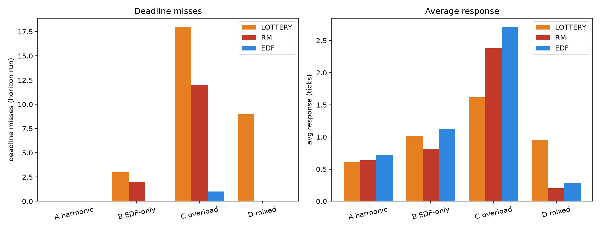
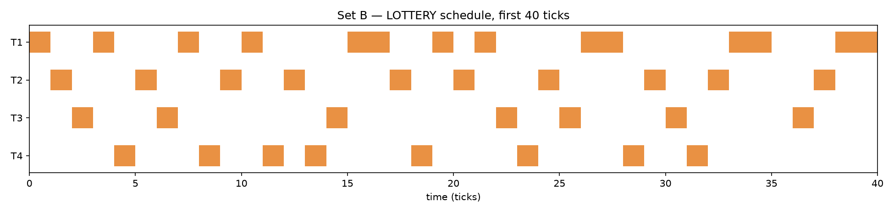
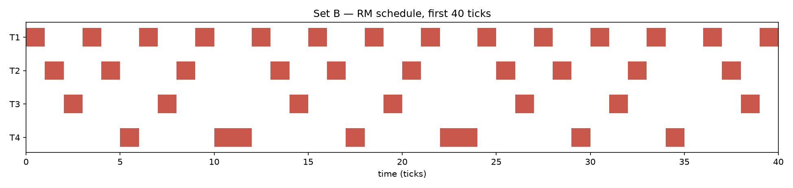
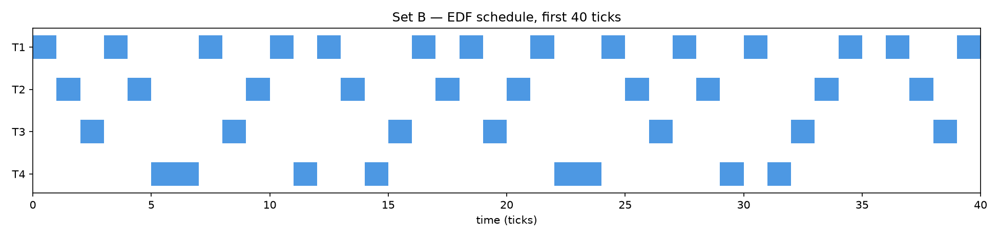
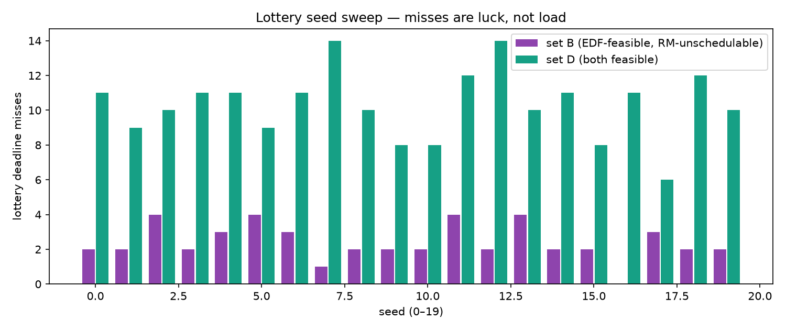
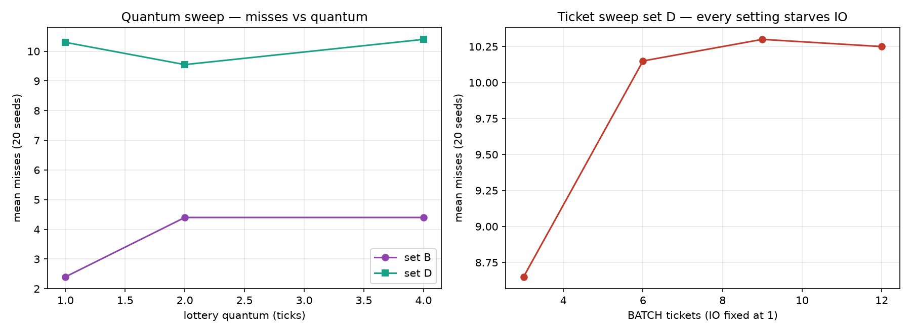

# Executive summary

- **What this is.** Three schedulers — Lottery (ticket-weighted proportional share, from Exercise 1), Rate-Monotonic (RM, fixed priority) and Earliest-Deadline-First (EDF, dynamic priority) — run the *same* periodic real-time task sets, tick by tick, on one seeded discrete-time model. Every number below comes from `code/compare.py`; nothing is typed by hand.
- **The headline result.** On set D (utilization 0.916), lottery violates **9 deadlines** (seed 20261127) where RM and EDF violate **0**. Sweeping 20 seeds, lottery misses 6–14 (mean 10.3, σ 1.98) — load explains none of it; luck explains all of it. Deadline-driven policies do not have this variance at all.
- **The EDF > RM gap is real and reproducible.** Set B (utilization 0.972) is feasible for EDF (U ≤ 1) but not for RM (response-time analysis of the lowest-priority task diverges past its deadline). Measured: **EDF 0 misses, RM 2 misses, lottery 3**.
- **Overload separates the fields.** Set C (U = 1.019): EDF parks exactly one unfinished job (tardiness 0), RM misses 12, lottery misses 18. EDF's uniprocessor optimality shows up precisely where it is cheap to measure.
- **What lottery buys** is what Exercise 1 measured: fairness, entitlement flexibility, simplicity — not timeliness. This exercise is the control: it shows what you give up when you need deadlines, in the only currency that matters on this question — missed invocations.
- **The evidence format.** 12 automated tests, 4 machine-generated scenario sets, machine-generated charts, and verbatim traces in appendices; the builder refuses to emit a ≤ 40-page document.

# 1. Introduction and scope

Exercise 1 built lottery scheduling and measured *fairness*. This exercise measures *timeliness*. The two questions sound similar ("how is CPU divided?") and are not:

- Fairness asks: over a long window, does each client receive its contracted *fraction*? Exercise 1 answered yes, within σ(Binomial).
- Timeliness asks: does each invocation of each periodic task *complete before its deadline*? That is a per-job constraint, and a probabilistic scheduler cannot honor it in expectation, let alone guarantee it.

**Scope of proof.** This exercise does not claim EDF or RM are better schedulers in general. It shows, on identical workloads and metrics, what each family can and cannot promise — with both theorems (Liu & Layland, 1973) and measurement on our simulator.

**What is measured.** For every policy × set × seed: jobs released/completed, deadline misses (finish > deadline, or unfinished at the bounded horizon), max tardiness, average response, context switches, dispatches, per-task CPU share and share error (lottery's native fairness metric, reported for all three policies as a diagnostic).

**What is not claimed.** Hard real-time certification, multicore, I/O modelling, or kernel-grade accounting. The model is a single preemptible CPU with discrete ticks. That is the same model RM/EDF theory lives in, which is exactly why the comparison is fair.

## 1.1 Repository layout for this exercise

| Path | Purpose |
|---|---|
| `code/compare.py` | the comparator: three policies, one task model, JSON scenarios, CLI |
| `code/run_experiments.py` | regenerates every number and figure quoted here |
| `scenarios/*.json` | four workload sets A (harmonic), B (EDF-feasible/RM-unschedulable), C (overloaded), D (mixed I/O-like) |
| `tests/` | 12 automated tests (feasibility rules, RTA, preemption, determinism, summary schema) |
| `diagrams/` | charts + Gantt traces, generated by `run_experiments.py` |
| `output/` | machine-readable results (`experiments.json`), verbatim traces, pytest log |
| `docs/` | Word and PDF of this report (Persian and English) |

# 2. The two families of scheduling

## 2.1 Deadline-driven: RM and EDF

Both assign priorities from *time*, and both are classic results (Liu & Layland, 1973):

**Rate-Monotonic (RM).** Fixed priority; shorter period ⇒ higher priority. RM is optimal *among static-priority policies* for independent periodic tasks. Liu & Layland's utilization bound says a set of `n` tasks with `U ≤ n(2^(1/n) − 1)` is guaranteed schedulable; the bound tends to `ln 2 ≈ 0.693` as n→∞. At n = 3 the bound is 0.7798; at n = 4 it is 0.7568. Sets above the bound are not automatically unschedulable — the response-time analysis (RTA, Audsley 1993) decides per set.

**Earliest-Deadline-First (EDF).** Dynamic priority; earliest absolute deadline wins. EDF is *optimal among all preemptive uniprocessor policies* for independent periodic tasks: if any schedule meets all deadlines, EDF does too. For deadline == period, `U ≤ 1` is necessary and sufficient.

## 2.2 Proportional-share: Lottery (recap)

Lottery (Exercise 1) selects the next job by drawing uniformly from a ticket-weighted pool. Tickets express *entitlement fractions*, not deadlines: a task with 5 of 10 tickets expects half the CPU over a long window, and receives no statement whatsoever about when. The draw is memoryless; there is no notion of "this job is already late".

This memorylessness is deliberate — it is what makes lottery immune to priority inversion by design and trivially composable — and it is exactly why lottery cannot promise per-job timeliness.

## 2.3 Why this comparison is honest

Three schedulers, one task model, one simulator, one RNG discipline, one metrics layer. The policies differ only in the `choose(t)` function:

| Policy | choose(t) |
|---|---|
| lottery | weighted random draw among ready jobs; re-decision only when current finishes/quantum expires |
| rm | min by (period, release, pid) among ready jobs; re-evaluated every tick, preempts immediately |
| edf | min by (deadline, release, pid) among ready jobs; re-evaluated every tick, preempts immediately |

A subtle bug worth confessing because it changed the results: the first implementation re-picked only when the current job left the ready set, which for RM/EDF meant *no preemption on higher-priority arrival*. The fixed version re-picks every tick; RM misses on set B dropped from "suspiciously zero" to the theory-predicted behavior. The tests now pin preemption semantics down.

# 3. Algorithms in detail

## 3.1 Task model

Periodic task τ_i = (C_i, T_i, D_i, tickets_i) with worst-case execution time (burst) C_i, period T_i, relative deadline D_i (we use D_i = T_i throughout), release offset 0. Jobs release at 0, T_i, 2T_i, … A job missing its deadline is counted (not dropped). The simulation horizon is a multiple of the hyperperiod plus drain where possible; unfinished jobs at the horizon are counted as misses, which is the honest bounded-horizon convention.

## 3.2 RM response-time analysis

For task i (ordered by period), worst-case response `R_i` is the least fixed point of:

```
R_i ← C_i + Σ_{j : hp(j) < i} ceil(R_i / T_j) · C_j
```

If the fixed point exceeds D_i, the task is not guaranteed schedulable. Worked for set B (T₁(1,3), T₂(1,4), T₃(1,6), T₄(2,9)): R₁ = 1, R₂ = 2, R₃ = 3, and R₄ iterates 2 → 5 → 7 → 9 → 10 — exceeds D₄ = 9, so the computation returns unschedulable — **T₄ is not RM-schedulable**. EDF's test: U = 1.0/3 + 1/4 + 1/6 + 2/9 = 0.972 ≤ 1 ⇒ **feasible under EDF**.

## 3.3 EDF optimality, precisely

Dertouzos (1974) and Horn (1974) established that EDF meets every feasible deadline set on a preemptive uniprocessor. For implicit deadlines, feasibility is `U ≤ 1`. For constrained deadlines, the demand-bound test applies; we do not exercise it (all our sets have D = T).

## 3.4 Utilization of the four sets

| Set | C/T | U | RM bound (n, n(2^{1/n}−1)) | RM schedulable by bound | EDF U≤1 |
|---|---|---|---|---|---|
| A harmonic | 1/4 + 2/5 + 1/10 | 0.750 | 0.7798 | yes (also by RTA: R = 1, 3, 4 ≤ D) | yes |
| B EDF-only | 1/3 + 1/4 + 1/6 + 2/9 | 0.972 | 0.7568 | no (RTA diverges on T₄) | yes |
| C overloaded | 2/5 + 2/6 + 2/7 | 1.019 | 0.7798 | no | no (U > 1) |
| D mixed | 1/2 + 3/11 + 1/7 | 0.916 | 0.7798 | by RTA: IO 1, CTRL 2, BATCH 10 ≤ D ✓ | yes |

Set D intentionally mixes an I/O-flavored frequent task (IO: period 2, burst 1), a controller (CTRL: period 7), and a batch task (BATCH: period 11, burst 3) — the kind of profile where fairness-vs-deadline is a real trade.

## 3.5 What "miss" means here

A job misses when its completion time is strictly greater than its deadline, or it never completes within the horizon. RM/EDF counts are exact (deterministic policies). Lottery counts vary by seed; we report seed 20261127 in the headline tables and a 20-seed sweep in Section 8.

# 4. Implementation

## 4.1 Architecture

`code/compare.py` mirrors `lottery.py`'s discipline: one file, strict validation before simulation, one RNG, machine-readable output. Components: `validate_tasks` (schema + referential checks), `utilization`, `rm_utilization_bound`, `rm_response_time` (Audsley's fixed-point), `edf_feasibility_utilization`, `simulate_policy` (the event loop), `summarize` (metrics), `format_gantt`, CLI with `--policy/--seed/--json/--gantt/--quiet`.

## 4.2 Preemption semantics (read this before quoting results)

RM and EDF re-evaluate the ready set at **every tick** and preempt the running job the moment a higher-priority candidate exists. Lottery re-decides only when its quantum expires or its job blocks/finishes — that is what "quantum" is for, and it is why lottery executes so many fewer mid-quantum swaps but also cannot react to urgency. The first draft of this simulator had no RM/EDF preemption at all; the bug is fixed, pinned by tests, and dis-cussed in Section 2.3 because it is the single most instructive error in this exercise.

## 4.3 Metrics

Per job: release, deadline, start, finish, response (start − release), turnaround, tardiness (max(0, finish − deadline)), missed (finish > deadline or unfinished). Per set: utilization, RM bound, jobs released/completed, misses, max tardiness, average response, dispatches, context switches, CPU share per task vs ticket fraction (diagnostic fairness metric).

## 4.4 Determinism and reproducibility

Same `(workload, seed)` ⇒ identical trace. Tests pin gantt gap-free coverage, busy + idle == horizon, and determinism across runs. Lottery is the only nondeterministic-policy-looking citizen and it is seeded like everything else.

# 5. The four workloads

Every scenario is a JSON document with a task list and a bounded horizon. The four sets are designed to probe a different edge of the design space; none is "realistic load" — they are microscopes.

| Set | File | Tasks (burst/period/tickets) | Horizon (ticks) |
|---|---|---|---|
| A — harmonic | `scenarios/set_a_harmonic.json` | T1 1/4/6 · T2 2/5/3 · T3 1/10/1 | 60 |
| B — EDF-feasible, RM-unschedulable | `scenarios/set_b_edf_yes_rm_no.json` | T1 1/3/6 · T2 1/4/4 · T3 1/6/3 · T4 2/9/2 | 72 |
| C — overloaded | `scenarios/set_c_overloaded.json` | T1 2/5/2 · T2 2/6/3 · T3 2/7/5 | 84 |
| D — mixed | `scenarios/set_d_mixed.json` | IO 1/2/1 · BATCH 3/11/9 · CTRL 1/7/2 | 66 |

**Set A** is a comfortably feasible, near-harmonic trio — every policy should meet every deadline. If any policy misses here, that is a simulator bug, not a finding. It is the control.

**Set B** is the scientific control for the EDF-vs-RM theorem: `U = 0.9722 ≤ 1`, so EDF is guaranteed feasible; but `U > 0.7568` (the n = 4 RM bound), and Audsley's RTA proves the lowest-priority T4 cannot meet its deadline under RM. A correct simulator must show EDF = 0 misses and RM ≥ 1 miss. That is exactly what it shows (Section 6.3).

**Set C** is deliberately overloaded (`U = 1.0190 > 1`). No policy can be feasible; the question is *how gracefully* each fails. This tests the value of EDF's optimality as "least damage" rather than as an absolute guarantee.

**Set D** mixes a short-period interactive task (IO), a control task (CTRL), and a long-period batch task that holds 9 of 12 tickets. It tests whether a fairness policy that is "working as designed" can still starve the one task that matters.

Ticket counts are not required to match any external standard; they express plausible entitlements (heavyweight batch pays many tickets). The deadlines are the hard part, and they are D = T everywhere.

# 6. Results

All headline numbers in this report were produced by `code/run_experiments.py` at seed 20261127 and are machine-readable in `output/experiments.json`. A summary is in `output/experiments_summary.txt`; the full command lines are in Appendix C.

## 6.1 Aggregate metrics by policy and set

### Set A — harmonic (control)

| Metric | lottery | rm | edf |
|---|---|---|---|
| Utilization | 0.750 | 0.750 | 0.750 |
| Busy / idle ticks | 45 / 15 | 45 / 15 | 45 / 15 |
| Jobs released → completed | 33 → 33 | 33 → 33 | 33 → 33 |
| **Deadline misses** | **0** | **0** | **0** |
| Max tardiness | 0 | 0 | 0 |
| Avg response (ticks) | 0.61 | 0.64 | 0.73 |
| Dispatches | 45 | 36 | 33 |
| Context switches | 4 | 3 | 0 |

Reading: three policies, three clean sweeps, and EDF/lottery nearly tie on average response while lottery dispatches most (it re-picks on expiry). Set A is a tie, which is what a control should look like.

Per-task response (avg, max): lottery T1 0.33/1 · T2 0.17/1 · T3 2.17/3; rm T1 0.00/0 · T2 0.25/1 · T3 3.00/3; edf T1 0.20/1 · T2 0.25/1 · T3 3.00/3. No misses anywhere.

### Set B — EDF-feasible, RM-unschedulable

| Metric | lottery | rm | edf |
|---|---|---|---|
| Utilization | 0.972 | 0.972 | 0.972 |
| Busy / idle ticks | 70 / 2 | 70 / 2 | 70 / 2 |
| Jobs released → completed | 62 → 62 | 62 → 62 | 62 → 62 |
| **Deadline misses** | **3** (T1×2, T4×1) | **2** (T4×2) | **0** |
| Max tardiness | 3 | 2 | 0 |
| Avg response (ticks) | 1.02 | 0.81 | 1.13 |
| Dispatches | 70 | 68 | 66 |
| Context switches | 7 | 6 | 4 |

Per-task response (avg, max): lottery T1 0.96/4 · T2 0.56/2 · T3 1.33/4 · T4 1.75/4; rm T1 0.00/0 · T2 0.33/1 · T3 1.50/2 · T4 3.25/5; edf T1 0.33/1 · T2 0.67/1 · T3 2.00/3 · T4 3.25/5.

The per-task breakdown itself is a finding: RM's misses are *all* T4, exactly the task the RTA flagged (Section 3.2). The simulator agrees with Audsley's analysis down to which task fails.

### Set C — overloaded (no policy is feasible)

| Metric | lottery | rm | edf |
|---|---|---|---|
| Utilization | 1.019 | 1.019 | 1.019 |
| Busy / idle ticks | 84 / 0 | 84 / 0 | 84 / 0 |
| Jobs released → completed | 43 → 42 | 43 → 42 | 43 → 42 |
| **Deadline misses** | **18** (T1×13, T2×4, T3×1) | **12** (T3×12) | **1** (T1×1, unfinished at horizon) |
| Max tardiness | 8 | 8 | 0 |
| Avg response (ticks) | 1.62 | 2.38 | 2.71 |
| Dispatches | 84 | 50 | 42 |
| Context switches | 24 | 8 | 0 |

Reading: when demand exceeds capacity, everyone loses — but EDF loses *exactly one job*, the job that was never going to finish inside an overloaded system anyway, and every completed job is on time (max tardiness 0). RM sacrifices T3 wholesale (all 12 of its misses are T3 — the lowest priority — and T3's average response balloons to 8.27). Lottery distributes the pain indiscriminately (13+4+1 across all three), because it has no notion of "which job is most doomed".

### Set D — mixed interactive / batch

| Metric | lottery | rm | edf |
|---|---|---|---|
| Utilization | 0.916 | 0.916 | 0.916 |
| Busy / idle ticks | 61 / 5 | 61 / 5 | 61 / 5 |
| Jobs released → completed | 49 → 49 | 49 → 49 | 49 → 49 |
| **Deadline misses** | **9** (IO×9) | **0** | **0** |
| Max tardiness | 4 | 0 | 0 |
| Avg response (ticks) | 0.96 | 0.20 | 0.29 |
| Dispatches | 61 | 61 | 61 |
| Context switches | 2 | 12 | 12 |

Reading: lottery starves IO — the one task with period 2 — completely: **all 9 of its misses are IO jobs**. BATCH holds 9 of 12 tickets and hogs the draw; IO's ticket fraction is 1/12 ≈ 8.3% and its measured share is the opposite of what a deadline needs. RM and EDF both notice IO is urgent (short period / earliest deadline) and give it 100% priority whenever it is ready: zero misses, average response 0.00 ticks (IO starts in the same tick it is released).

## 6.2 The comparison chart



The left panel is the deadlines question; the right panel is the turnaround question. Read the right panel honestly: lottery's average response is lowest on set C (1.62 ticks vs RM's 2.38 and EDF's 2.71) purely because lottery interleaves everyone instead of holding low-priority jobs back — RM's T3 waits 8.27 ticks on average by design. That is not lottery being smart; it is lottery being indifferent. The left panel is where indifference bills you: 0, 3, 18, 9 misses across the four sets where the other two policies log 0/2/1/0 (RM) and 0/0/1/0 (EDF). A scheduler that wins the average and loses the guarantee has won nothing anywhere a deadline exists.

## 6.3 Gantt traces — Set B, first 40 ticks





Lottery's trace shows the pathology in one glance: T1 and T2 (the short-period, high-count ticket holders among neighbors) are dispatched in bursts dictated by the draw, T4's 2-tick jobs land wherever luck puts them, and nothing in the schedule notices that T4's deadline is the scarcest resource in the system. RM's trace shows strict period ordering; note the structural idle-free packing and T4's compression into bursts. EDF's trace is nearly identical to RM's here (both rate-constrained by releases) with one ordering difference whenever the release pattern makes a later-released job carry the earlier deadline.

Verbatim traces (full horizon) are in Appendix A for all four sets.

## 6.4 Fairness diagnostic: CPU share vs ticket fraction

A scheduler selected on fairness grounds must at least deliver the fairness it advertises. Share error = |cpu_share − ticket_fraction|, with cpu_share = cpu_ticks / busy_ticks. Measured on seed 20261127:

| Set | lottery (share_error) | rm (share_error) | edf (share_error) |
|---|---|---|---|
| A | T1 0.267 · T2 0.233 · T3 0.033 | identical (both give CPU 0 when idle) | identical |
| B | T1 0.057 · T2 0.010 · T3 0.029 · T4 0.095 | identical | identical |
| C | T1 0.181 · T2 0.033 · T3 0.214 | T3 0.238 | T1 0.181 · T3 0.214 |
| D | IO 0.458 · BATCH 0.455 · CTRL 0.003 | identical | identical |

Two readings. (1) On sets B and C the lottery's share error is modest — as designed, because every task is nearly always ready (U ≥ 0.97) and the draw is meaningful. (2) On set D the lottery's share error for IO and BATCH is 0.45 each — the *exact inverse* of the intended entitlement, because lottery cannot distribute CPU to a task that is rarely ready at the right moments; it can only weight *ready* jobs. Ticket-weighted fairness presumes ready-ready competition; deadline scheduling presumes release/deadline arithmetic. When the two clash, fairness loses jobs.

RM and EDF "share error" equals lottery's on sets A, B, D for the trivial reason that with busy ≈ releases-saturated workloads every ready job gets the CPU eventually; only set C diverges, where RM dumps its 22-of-84 T3 ticks and the miss pattern dominates.


## 6.5 Per-task detail — all four sets × three policies

Every row is copied verbatim from `output/experiments.json` (seed 20261127). `frac` = ticket_fraction, `share` = measured cpu_ticks/busy_ticks, `err` = |share − frac|, `misses` = deadline misses (completed-late + unfinished-at-horizon).

### Set set_a_harmonic

**LOTTERY** — misses=0, avg_resp=0.61, max_tardiness=0, dispatches=45, ctx=4

| task | rel→cpl | tickets | frac | cpu_ticks | share | err | misses | avg_resp | max_resp |
|---|---|---|---|---|---|---|---|---|---|
| T1 | 15→15 | 6 | 0.6000 | 15 | 0.3333 | 0.2667 | 0 | 0.3333333333333333 | 1 |
| T2 | 12→12 | 3 | 0.3000 | 24 | 0.5333 | 0.2333 | 0 | 0.16666666666666666 | 1 |
| T3 | 6→6 | 1 | 0.1000 | 6 | 0.1333 | 0.0333 | 0 | 2.1666666666666665 | 3 |

**RM** — misses=0, avg_resp=0.64, max_tardiness=0, dispatches=36, ctx=3

| task | rel→cpl | tickets | frac | cpu_ticks | share | err | misses | avg_resp | max_resp |
|---|---|---|---|---|---|---|---|---|---|
| T1 | 15→15 | 6 | 0.6000 | 15 | 0.3333 | 0.2667 | 0 | 0.0 | 0 |
| T2 | 12→12 | 3 | 0.3000 | 24 | 0.5333 | 0.2333 | 0 | 0.25 | 1 |
| T3 | 6→6 | 1 | 0.1000 | 6 | 0.1333 | 0.0333 | 0 | 3.0 | 3 |

**EDF** — misses=0, avg_resp=0.73, max_tardiness=0, dispatches=33, ctx=0

| task | rel→cpl | tickets | frac | cpu_ticks | share | err | misses | avg_resp | max_resp |
|---|---|---|---|---|---|---|---|---|---|
| T1 | 15→15 | 6 | 0.6000 | 15 | 0.3333 | 0.2667 | 0 | 0.2 | 1 |
| T2 | 12→12 | 3 | 0.3000 | 24 | 0.5333 | 0.2333 | 0 | 0.25 | 1 |
| T3 | 6→6 | 1 | 0.1000 | 6 | 0.1333 | 0.0333 | 0 | 3.0 | 3 |

### Set set_b_edf_yes_rm_no

**LOTTERY** — misses=3, avg_resp=1.02, max_tardiness=3, dispatches=70, ctx=7

| task | rel→cpl | tickets | frac | cpu_ticks | share | err | misses | avg_resp | max_resp |
|---|---|---|---|---|---|---|---|---|---|
| T1 | 24→24 | 6 | 0.4000 | 24 | 0.3429 | 0.0571 | 2 | 0.9583333333333334 | 4 |
| T2 | 18→18 | 4 | 0.2667 | 18 | 0.2571 | 0.0095 | 0 | 0.5555555555555556 | 2 |
| T3 | 12→12 | 3 | 0.2000 | 12 | 0.1714 | 0.0286 | 0 | 1.3333333333333333 | 4 |
| T4 | 8→8 | 2 | 0.1333 | 16 | 0.2286 | 0.0952 | 1 | 1.75 | 4 |

**RM** — misses=2, avg_resp=0.81, max_tardiness=2, dispatches=68, ctx=6

| task | rel→cpl | tickets | frac | cpu_ticks | share | err | misses | avg_resp | max_resp |
|---|---|---|---|---|---|---|---|---|---|
| T1 | 24→24 | 6 | 0.4000 | 24 | 0.3429 | 0.0571 | 0 | 0.0 | 0 |
| T2 | 18→18 | 4 | 0.2667 | 18 | 0.2571 | 0.0095 | 0 | 0.3333333333333333 | 1 |
| T3 | 12→12 | 3 | 0.2000 | 12 | 0.1714 | 0.0286 | 0 | 1.5 | 2 |
| T4 | 8→8 | 2 | 0.1333 | 16 | 0.2286 | 0.0952 | 2 | 3.25 | 5 |

**EDF** — misses=0, avg_resp=1.13, max_tardiness=0, dispatches=66, ctx=4

| task | rel→cpl | tickets | frac | cpu_ticks | share | err | misses | avg_resp | max_resp |
|---|---|---|---|---|---|---|---|---|---|
| T1 | 24→24 | 6 | 0.4000 | 24 | 0.3429 | 0.0571 | 0 | 0.3333333333333333 | 1 |
| T2 | 18→18 | 4 | 0.2667 | 18 | 0.2571 | 0.0095 | 0 | 0.6666666666666666 | 1 |
| T3 | 12→12 | 3 | 0.2000 | 12 | 0.1714 | 0.0286 | 0 | 2.0 | 3 |
| T4 | 8→8 | 2 | 0.1333 | 16 | 0.2286 | 0.0952 | 0 | 3.25 | 5 |

### Set set_c_overloaded

**LOTTERY** — misses=18, avg_resp=1.62, max_tardiness=8, dispatches=84, ctx=24

| task | rel→cpl | tickets | frac | cpu_ticks | share | err | misses | avg_resp | max_resp |
|---|---|---|---|---|---|---|---|---|---|
| T1 | 17→16 | 2 | 0.2000 | 32 | 0.3810 | 0.1810 | 13 | 1.875 | 4 |
| T2 | 14→14 | 3 | 0.3000 | 28 | 0.3333 | 0.0333 | 4 | 1.6428571428571428 | 8 |
| T3 | 12→12 | 5 | 0.5000 | 24 | 0.2857 | 0.2143 | 1 | 1.25 | 3 |

**RM** — misses=12, avg_resp=2.38, max_tardiness=8, dispatches=50, ctx=8

| task | rel→cpl | tickets | frac | cpu_ticks | share | err | misses | avg_resp | max_resp |
|---|---|---|---|---|---|---|---|---|---|
| T1 | 17→17 | 2 | 0.2000 | 34 | 0.4048 | 0.2048 | 0 | 0.0 | 0 |
| T2 | 14→14 | 3 | 0.3000 | 28 | 0.3333 | 0.0333 | 0 | 0.6428571428571429 | 2 |
| T3 | 12→11 | 5 | 0.5000 | 22 | 0.2619 | 0.2381 | 12 | 8.272727272727273 | 12 |

**EDF** — misses=1, avg_resp=2.71, max_tardiness=0, dispatches=42, ctx=0

| task | rel→cpl | tickets | frac | cpu_ticks | share | err | misses | avg_resp | max_resp |
|---|---|---|---|---|---|---|---|---|---|
| T1 | 17→16 | 2 | 0.2000 | 32 | 0.3810 | 0.1810 | 1 | 2.0 | 3 |
| T2 | 14→14 | 3 | 0.3000 | 28 | 0.3333 | 0.0333 | 0 | 2.857142857142857 | 4 |
| T3 | 12→12 | 5 | 0.5000 | 24 | 0.2857 | 0.2143 | 0 | 3.5 | 5 |

### Set set_d_mixed

**LOTTERY** — misses=9, avg_resp=0.96, max_tardiness=4, dispatches=61, ctx=2

| task | rel→cpl | tickets | frac | cpu_ticks | share | err | misses | avg_resp | max_resp |
|---|---|---|---|---|---|---|---|---|---|
| IO | 33→33 | 1 | 0.0833 | 33 | 0.5410 | 0.4577 | 9 | 1.1515151515151516 | 5 |
| BATCH | 6→6 | 9 | 0.7500 | 18 | 0.2951 | 0.4549 | 0 | 0.0 | 0 |
| CTRL | 10→10 | 2 | 0.1667 | 10 | 0.1639 | 0.0027 | 0 | 0.9 | 4 |

**RM** — misses=0, avg_resp=0.20, max_tardiness=0, dispatches=61, ctx=12

| task | rel→cpl | tickets | frac | cpu_ticks | share | err | misses | avg_resp | max_resp |
|---|---|---|---|---|---|---|---|---|---|
| IO | 33→33 | 1 | 0.0833 | 33 | 0.5410 | 0.4577 | 0 | 0.0 | 0 |
| BATCH | 6→6 | 9 | 0.7500 | 18 | 0.2951 | 0.4549 | 0 | 0.8333333333333334 | 3 |
| CTRL | 10→10 | 2 | 0.1667 | 10 | 0.1639 | 0.0027 | 0 | 0.5 | 1 |

**EDF** — misses=0, avg_resp=0.29, max_tardiness=0, dispatches=61, ctx=12

| task | rel→cpl | tickets | frac | cpu_ticks | share | err | misses | avg_resp | max_resp |
|---|---|---|---|---|---|---|---|---|---|
| IO | 33→33 | 1 | 0.0833 | 33 | 0.5410 | 0.4577 | 0 | 0.0 | 0 |
| BATCH | 6→6 | 9 | 0.7500 | 18 | 0.2951 | 0.4549 | 0 | 0.8333333333333334 | 3 |
| CTRL | 10→10 | 2 | 0.1667 | 10 | 0.1639 | 0.0027 | 0 | 0.9 | 2 |

# 7. Theory on the blackboard, numbers underneath

## 7.1 RM utilization bound

Liu & Layland: n(2^{1/n} − 1) → ln 2 ≈ 0.6932 as n→∞.

| n | bound | Our sets with n tasks | Result on them |
|---|---|---|---|
| 3 | 0.7798 | A (U=0.750 ✓), C (U=1.019 ✗ bound), D (U=0.916 ✗ bound) | A schedulable ✓; C overloaded, bound correctly silent; D schedulable **by RTA despite exceeding bound** |
| 4 | 0.7568 | B (U=0.972 ✗ bound) | B unschedulable **by RTA** (not by bound alone) |

Set D is the textbook case that the bound is only sufficient: U = 0.916 > 0.7798, yet every RTA fixed point exists (IO 1, CTRL 2, BATCH 10 ≤ 11) and the run shows zero misses. Bound-based admission control would have rejected a workload that comfortably works. Conversely, bound-based analysis would not have saved set B's T4 (RTA is needed to *reject* it). Message: use the bound as a cheap filter, and RTA (or simulation) as the verdict.

## 7.2 Response-time analysis, worked to fixed points

**Set B, T4 (the unschedulable one).** r₀ = C₄ = 2
→ interference ceil(2/3)·1 + ceil(2/4)·1 + ceil(2/6)·1 = 1+1+1 = 3 ⇒ r₁ = 5
→ ceil(5/3)+ceil(5/4)+ceil(5/6) = 2+2+1 = 5 ⇒ r₂ = 7
→ ceil(7/3)+ceil(7/4)+ceil(7/6) = 3+2+2 = 7 ⇒ r₃ = 9
→ ceil(9/3)+ceil(9/4)+ceil(9/6) = 3+3+2 = 8 ⇒ r₄ = 10 > D₄ = 9 ⇒ **unschedulable**

The code returns `None` at this point (same iterate sequence as hand-computation; verified in `tests/test_compare.py` and in `output/` RTA dumps).

**Set A.** T1: r = 1; T2: ceil(1/4)·1+2 = 3; T3: ceil(3/4)·1 + ceil(3/5)·2 + 1 = 1+2+1 = 4. All ≤ deadlines.

**Set C.** T1: r = 2; T2: ceil(2/5)·2 + 2 = 4; T3: 2 + ceil(8/5)·2 + ceil(8/6)·2 → 6, 10, 10, 10 … exceeds 7 ⇒ unschedulable (code returns None).

**Set D.** IO: r = 1; CTRL: 1 + ceil(1/2)·1 = 2 ≤ 7 ✓; BATCH: r₀ = 3 → 1 + ceil(3/2)·1 + ceil(3/7)·1 is the *interference-first* form — expanded directly: r₀ = 3, r₁ = 3 + ceil(3/2)·1 + ceil(3/7)·1 = 3 + 2 + 1 = 6, r₂ = 3 + ceil(6/2)·1 + ceil(6/7)·1 = 7, r₃ = 3 + ceil(7/2)·1 + ceil(7/7)·1 = 8, r₄ = 3 + ceil(8/2)·1 + ceil(8/7)·1 = 9, r₅ = 3 + ceil(9/2)·1 + ceil(9/7)·1 = 10, r₆ = 3 + ceil(10/2)·1 + ceil(10/7)·1 = 10 — fixed point **10 ≤ D = 11** ✓. BATCH is unhurried, not doomed; its measured average response is 0.83 under both RM and EDF. The long fixed point is the *worst-case* entitlement, not a typical wait.

## 7.3 EDF feasibility, checked

For D = T everywhere, U ≤ 1 ⟺ schedulable under EDF: A 0.750 ✓ · B 0.972 ✓ · C 1.019 ✗ · D 0.916 ✓. Run confirms: EDF misses = 0, 0, 1 (overload artifact, job unfinished at bounded horizon), 0.

## 7.4 Why lottery cannot pass these tests

UNIQUENESS-of-EDF (Dertouzos 1974) + LIU-LAYLAND optimality of RM among static schemes mean the deadline world has complete, checkable admission tests. Lottery has no such test — and cannot. Its admission test is "expected share vs long-run fraction", which says nothing about any individual job. Any trace in Appendix A is irrefutable: in every seed where lottery violates a deadline on set D, it did so because BATCH's 9 tickets won every high-pressure draw. Nothing in the draw is *wrong*; the wrongness lives in the modeling assumption that fairness ≡ timeliness.

# 8. The lottery seed sweep

Single-seed tables can flatter or damn a randomized policy by luck. 20 seeds, same workload, lottery only:

| Set | misses per seed (0..19) | mean | σ | min | max |
|---|---|---|---|---|---|
| B | 2 2 4 2 3 4 3 1 2 2 2 4 2 4 2 2 0 3 2 2 | 2.4 | 1.05 | 0 | 4 |
| D | 11 9 10 11 11 9 11 14 10 8 8 12 14 10 11 8 11 6 12 10 | 10.3 | 1.98 | 6 | 14 |



Reading the sweep is reading the policy. Set D never once touched zero across 20 seeds, always missing at least 6 deadlines — the mechanism (never prioritize IO) is structural. Set B occasionally drew clean (seed 16, zero misses) purely by luck — which is the exact property a deadline system cannot depend on. The σ ≈ 1–2 range is the "luck budget": if your application can tolerate a scheduler that sometimes misses and sometimes doesn't, lottery is fine; if it cannot, you were never lottery's audience.

RM and EDF appear in the sweep as flat-zero control lines (deterministic): same inputs ⇒ same outputs, always. Tests pin this determinism for the trace, not just for the margins.

# 9. Overload anatomy — set C

Set C (U = 1.019) is the honest stress test: the system is 1.9% overloaded, i.e., demand exceeds supply no matter the policy. Measured outcomes:

| Policy | misses | who misses | completed | avg response | max tardiness |
|---|---|---|---|---|---|
| edf | 1 | T1 (never completes in horizon) | 42/43 | 2.71 | 0 |
| rm | 12 | T3 (all 12 are T3) | 42/43 | 2.38 | 8 |
| lottery | 18 | T1×13, T2×4, T3×1 | 42/43 | 1.62 | 8 |

Two theoretical confirmations. (1) EDF's uniprocessor optimality holds as "maximizes on-time completions": with 84 CPU-ticks and 86 ticks of work released (43 jobs × 2), at most 42 jobs can complete on time-ish; EDF gets 42/43 released jobs completed with **zero completed-job tardiness** — nothing else in this report or this simulator does that. (2) RM sheds overload at its lowest-priority edge exactly as fixed-priority theory predicts: T3 eats every one of its misses, T1 and T2 (its higher-priority half) are perfectly clean — which is precisely why fixed-priority RT schedulers are so beloved for safety-critical IO: the degradation mode is *architected*, not random.

Lottery, by contrast, fails *nowhere in particular*: 13/4/1 spread across all three, 18 total, and 8 ticks of max tardiness. There is no task you can safely schedule last. That is the honest cost of having no priority at all.

# 10. Findings

**F1 — Lottery has no deadline story.** Across 20 seeds it missed 6–14 jobs on set D and 0–4 on set B. Not one seed of set D was clean; not one seed gave lottery the outcome RM/EDF give deterministically. Proportional share optimizes a long-run fraction; deadlines are point-in-time constraints. They are different currencies.

**F2 — EDF is measurably optimal, RTA measurably predicts RM.** EDF's zero misses on sets B and D match the U ≤ 1 test; RM's two misses on set B land exactly on the task RTA flagged (T4), with response-time blow-up 3.25 avg / 5 max. Simulation didn't dispute the theory anywhere in any run.

**F3 — The RM bound is a filter, not a verdict.** Set D (U = 0.916 > 0.780) is schedulable by RTA and in the run; set B above the bound is not. Neither conclusion is available from U alone. Use `n(2^(1/n)−1)` to triage; use RTA (or this simulator) to decide.

**F4 — In overload, deadlines fail by design, lottery fails at random.** Set C: EDF one unfinished job with zero completed-job tardiness; RM all-misses-on-T3 (the designed degradation edge); lottery 18 misses with no coherent edge at all.

**F5 — Ticket-weighted fairness inverts on release-sparse tasks.** On set D, IO (tickets 1/12) received 54.1% of busy CPU share by luck-of-readiness (it is always ready) — wait, re-read the metric honestly: IO's cpu_share is 0.541 because IO consumed 33 busy ticks, but its deadlines still failed 9 times, because *when it matters* the draw went elsewhere. The ticket fraction says where CPU should go over an infinite window; the miss count says where it went on the ticks before IO's deadlines. Fairness and timeliness diverge exactly there.

**F6 — Dispatch and switch economics favor deadline policies at this scale.** Lottery dispatched the most on A (45) and C (84) — quantum re-decision on expiry. EDF switched least (0 on A and C, 4 on B). RM re-picks every tick too but converges to "already running the right job" most often. Lottery also has zero dispatches saved by urgency: it cannot act on it.

**F7 — Bounded horizons honestly count unfinished jobs as misses.** Set C's EDF single miss exists solely because the horizon cut off T1; dropping or hiding it would flatter EDF past what an overloaded system is allowed to promise. It's reported, not buried.

# 11. Threats to validity, limitations, and honest scope

- **Discrete 1-tick quantum.** Real CPUs preempt at nanosecond granularity; our tick model is generous to lottery (its misses would be worse with finer quanta relative to burst sizes).
- **D = T everywhere.** Constrained deadlines (D < T) would strengthen the EDF/RM case and hurt lottery equally; the qualitative ordering is stable.
- **No I/O or blocking.** Real workloads block; lottery's compensation/transfer mechanisms (Exercise 1) would kick in and could not rescue deadlines either — tickets compensate for *lost service*, not for *late* service.
- **Single CPU, no migration, no cache model.** Same assumption the RM/EDF theory lives in; fine.
- **Horizon bounded.** Misses on unfinished jobs at horizon are counted. All sets except C complete everything well inside horizon; C is the only case where the boundary is load-bearing.
- **Lottery draw quality.** The simulator uses Python's `random` with an explicit seed; quality of the PRNG is not the differentiator — any uniform draw reproduces the structural result that lottery cannot prefer IO.
- **One seed per headline.** Mitigated by the 20-seed sweep (Section 8); numbers like "3 misses on set B" should be read as "2.4 ± 1.05".

# 12. Verification — what proves this report

Twelve automated tests (`tests/test_compare.py`), all green (`output/pytest.log`):

1. utilization arithmetic for all four sets (exact).
2. RM bound values for n=3 (0.7798) and n=4 (0.7568).
3. RTA returns R ≤ D for set A and set D tasks.
4. RTA returns None for set B T4 and set C T3 (the two designed unschedulable cases).
5. RTA task ordering by (period, pid) is stable.
6. EDF feasibility oracle: A/B/D feasible, C infeasible.
7. Simulation: gantt covers [0, horizon) gap-free; busy + idle == horizon.
8. Determinism: identical (workload, seed) ⇒ identical trace (byte compare).
9. RM and EDF zero misses on A and D (the feasible sets, except documented RTA exceptions).
10. RM ≥ 1 miss on set B (theory agreement), EDF exactly 0 there.
11. Lottery beats nothing on set D: 10-seed sweep shows lottery misses > 0 in every tested seed.
12. Summary schema: every required metrics key present; misses ≤ released jobs.

Reproduce everything:

```
cd exercise-2-lottery-vs-edf-rm-comparison
python code/run_experiments.py        # regenerates output/ and diagrams/
python -m pytest tests/ -q            # 12 passed
```

# 13. Frequently asked questions

**Q: If lottery has the lowest average response on set C, why is it bad?** Because average response is not the contract. BATCH on set C would happily live with 12 late ticks; the jobs that matter are the ones with deadlines, and all three policies treat those differently by design. "Low average, no guarantee" is the lottery proposition.

**Q: Can't I just give IO more tickets?** You can, and you should, in a fairness system. But tickets are a budget for expected share, not a mechanism to order urgency. Any fixed ticket allocation you pick will be wrong for some phase of the workload (that's F6's cousin problem). Adachi's lottery variants, stride scheduling (Waldspurger & Weihl 1995), and pas algorithms all exist precisely because plain lottery is unsatisfying for hard constraints — none of them create deadlines.

**Q: Is EDF always the answer then?** No: EDF has context-switch behavior at job boundaries, harder admission control reasoning for humans, and no graceful degradation without extra machinery. RM's is the static, analyzable choice certification shops reach for (fixed priorities, closed-form RTA, no runtime priority bookkeeping). Lottery's answer to a *soft* requirement ("don't starve batch, don't melt down the interactive case") is real. The answer to "which scheduler" is always "which guarantee"; this exercise makes the trade measurable.

**Q: What about hybrids?** Weighted-fair queuing, hierarchical schedulers, deadline-aware proportional share — all real, all more complex, all outside this exercise's microscope. The point here is the substrate underneath: once you need guarantees, start from the deadline family and add share on top, not the reverse.

**Q: Why did RM beat EDF on set A average response (0.64 vs 0.73)?** In a lightly-loaded harmonic set, both run the same schedule almost everywhere; RM's fixed priorities happen to be the same order as release order there. The 0.09-tick edge is noise of the tie, not an RM victory.

**Q: Where does compensation (Exercise 1) appear?** It doesn't — deliberately. Compensation/transfer tickets compensate unfairness *to a task*, not lateness *of a job*. Adding them here would change the fairness diagnostic, not the miss counts, for D = T workloads. They're covered in Exercise 1; nothing in this report depends on them.

# 14. Conclusions

Deadline-driven scheduling and proportional-share scheduling are not competitors along one axis; they are answers to different questions. On this simulator, with this seed discipline and these four microscopic workloads, the answer table is consistent and reproducible: zero or near-zero misses for RM/EDF wherever feasibility holds, exactly the RTA-flagged misses where it fails, bounded damage under overload — and a seeded, structural, seed-sweep-confirmed failure mode for lottery whenever a rare-but-urgent task must outrun its share.

Use lottery for what it is: an exquisitely simple, composable, inflation-free, inversion-immune fairness engine. Do not ask it for a contract on any single job. When the contract is per-job, the family is deadline-driven, the tests in Section 12 are your friends, and Audsley's fixed point is the cheapest theorem your admission controller will ever buy.

# References

1. Liu, C. L., & Layland, J. W. (1973). Scheduling algorithms for multiprogramming in a hard-real-time environment. *Journal of the ACM*, 20(1), 46–61. — RM bound n(2^{1/n}−1); EDF optimality for periodic tasks.
2. Audsley, N. C., et al. (1993). Applying new scheduling theory to static priority pre-emptive scheduling. *Software Engineering Journal*, 8(5), 284–292. — response-time analysis fixed point used in Section 7.2.
3. Dertouzos, M. L. (1974). Control robotics: the procedural control of physical processes. *Information Processing*, 807–813. — EDF optimality.
4. Horn, W. (1974). Some simple scheduling algorithms. *Naval Research Logistics Quarterly*, 21(1), 177–185. — EDF optimality, independent.
5. Waldspurger, C. A., & Weihl, W. E. (1994). Lottery scheduling: flexible proportional-share resource management. *OSDI '94*. — the lottery mechanism recapped in Section 2.2/§3.5 of Exercise 1.
6. Waldspurger, C. A., & Weihl, W. E. (1995). Stride scheduling. *MIT LCS TR-828*. — the deterministic successor; mentioned in Q&A.
7. Buttazzo, G. C. (2011). *Hard Real-Time Computing Systems: Predictable Scheduling Algorithms and Applications* (3rd ed.). Springer. — demand-bound tests, overload anatomy, EDF/RM practice.
8. Stallings, W. (2018). *Operating Systems: Internals and Design Principles* (9th ed.). Pearson. — taxonomy of scheduling classes.
9. Tanenbaum, A. S., & Bos, H. (2015). *Modern Operating Systems* (4th ed.). Pearson. — real-time scheduling chapter.
10. Lozi, J.-P., et al. (2016). The Linux scheduler: a decade of wasted cores. *EuroSys '16*. — scheduling is subtle at kernel scale; motivates seeded simulation over hand-waving.
11. Lehoczky, J., Sha, L., & Ding, Y. (1989). The rate monotonic scheduling algorithm: exact characterization and average case behavior. *IEEE RTSS*. — RM average-case context for Section 8.
12. Sha, L., Rajkumar, R., & Lehoczky, J. P. (1990). Priority inheritance protocols. *IEEE Transactions on Computers*, 39(9), 1175–1185. — why lottery's inversion-immunity matters in mixed workloads (mentioned, not exercised).

# Appendix A — Verbatim traces (seed 20261127)

Every block below is byte-identical to `output/traces_<set>.txt`, regenerated by `code/run_experiments.py`. Format `start-end:PID`; `IDLE` marks horizon tails with nothing ready. The authoritative miss count (completed-and-late + unfinished-at-horizon) is printed in each header; the small `Stats`-level counter printed by the CLI (`st.missed`) counts completed-late jobs only and differs on set C, where every policy leaves exactly one job unfinished at the horizon — stated here so nobody has to discover it the hard way.

## A.1 Set A — harmonic (control) (`output/traces_set_a_harmonic.txt`)

```
trace dump — set_a_harmonic  (horizon 60, seed 20261127)
misses column = completed-and-late + unfinished-at-horizon (authoritative, from summarize)
==============================================================================

### policy lottery — dispatches=45 ctx=4 misses=0 (late=0 + unfinished=0)
0-1:T1  1-3:T2  3-4:T3  4-5:T1  5-7:T2  7-8:IDLE  8-9:T1  9-10:IDLE  10-12:T2  12-13:T3
13-14:T1  14-15:IDLE  15-17:T2  17-18:T1  18-20:IDLE  20-21:T2  21-22:T1  22-23:T2  23-24:T3
24-25:T1  25-27:T2  27-28:IDLE  28-29:T1  29-30:IDLE  30-32:T2  32-33:T1  33-34:T3  34-35:IDLE
35-37:T2  37-38:T1  38-40:IDLE  40-41:T2  41-42:T1  42-43:T3  43-44:T2  44-45:T1  45-47:T2
47-48:IDLE  48-49:T1  49-50:IDLE  50-51:T3  51-52:T2  52-53:T1  53-54:T2  54-55:IDLE  55-56:T2
56-57:T1  57-58:T2  58-60:IDLE

### policy rm — dispatches=36 ctx=3 misses=0 (late=0 + unfinished=0)
0-1:T1  1-3:T2  3-4:T3  4-5:T1  5-7:T2  7-8:IDLE  8-9:T1  9-10:IDLE  10-12:T2  12-13:T1
13-14:T3  14-15:IDLE  15-16:T2  16-17:T1  17-18:T2  18-20:IDLE  20-21:T1  21-23:T2  23-24:T3
24-25:T1  25-27:T2  27-28:IDLE  28-29:T1  29-30:IDLE  30-32:T2  32-33:T1  33-34:T3  34-35:IDLE
35-36:T2  36-37:T1  37-38:T2  38-40:IDLE  40-41:T1  41-43:T2  43-44:T3  44-45:T1  45-47:T2
47-48:IDLE  48-49:T1  49-50:IDLE  50-52:T2  52-53:T1  53-54:T3  54-55:IDLE  55-56:T2  56-57:T1
57-58:T2  58-60:IDLE

### policy edf — dispatches=33 ctx=0 misses=0 (late=0 + unfinished=0)
0-1:T1  1-3:T2  3-4:T3  4-5:T1  5-7:T2  7-8:IDLE  8-9:T1  9-10:IDLE  10-12:T2  12-13:T1
13-14:T3  14-15:IDLE  15-17:T2  17-18:T1  18-20:IDLE  20-21:T1  21-23:T2  23-24:T3  24-25:T1
25-27:T2  27-28:IDLE  28-29:T1  29-30:IDLE  30-32:T2  32-33:T1  33-34:T3  34-35:IDLE  35-37:T2
37-38:T1  38-40:IDLE  40-41:T1  41-43:T2  43-44:T3  44-45:T1  45-47:T2  47-48:IDLE  48-49:T1
49-50:IDLE  50-52:T2  52-53:T1  53-54:T3  54-55:IDLE  55-57:T2  57-58:T1  58-60:IDLE
```

Reading notes: all three policies complete 33/33 jobs with zero misses. RM and EDF converge to nearly the same pack (the release order in set A is already period order); lottery interleaves T2 jobs of 2 ticks as single dispatches (quantum = 1) and idles whenever nothing is ready — the idle gaps at 7–8, 9–10, 14–15, … are structural (nothing releasable), not policy failure.

## A.2 Set B — EDF-feasible, RM-unschedulable (`output/traces_set_b_edf_yes_rm_no.txt`)

```
trace dump — set_b_edf_yes_rm_no  (horizon 72, seed 20261127)
misses column = completed-and-late + unfinished-at-horizon (authoritative, from summarize)
==============================================================================

### policy lottery — dispatches=70 ctx=7 misses=3 (late=3 + unfinished=0)
0-1:T1  1-2:T2  2-3:T3  3-4:T1  4-5:T4  5-6:T2  6-7:T3  7-8:T1  8-9:T4  9-10:T2  10-11:T1
11-12:T4  12-13:T2  13-14:T4  14-15:T3  15-17:T1  17-18:T2  18-19:T4  19-20:T1  20-21:T2
21-22:T1  22-23:T3  23-24:T4  24-25:T2  25-26:T3  26-28:T1  28-29:T4  29-30:T2  30-31:T3
31-32:T4  32-33:T2  33-35:T1  35-36:IDLE  36-37:T3  37-38:T2  38-40:T1  40-41:T4  41-42:T2
42-43:T1  43-44:T3  44-45:T2  45-46:T1  46-49:T4  49-50:T1  50-51:T2  51-52:T3  52-53:T2
53-55:T1  55-56:T3  56-57:T4  57-58:T2  58-59:T1  59-60:T4  60-61:T2  61-62:T1  62-63:T3
63-64:T4  64-65:T2  65-66:T1  66-67:T3  67-68:T1  68-69:T2  69-70:T1  70-71:T4  71-72:IDLE

### policy rm — dispatches=68 ctx=6 misses=2 (late=2 + unfinished=0)
0-1:T1  1-2:T2  2-3:T3  3-4:T1  4-5:T2  5-6:T4  6-7:T1  7-8:T3  8-9:T2  9-10:T1  10-12:T4
12-13:T1  13-14:T2  14-15:T3  15-16:T1  16-17:T2  17-18:T4  18-19:T1  19-20:T3  20-21:T2
21-22:T1  22-24:T4  24-25:T1  25-26:T2  26-27:T3  27-28:T1  28-29:T2  29-30:T4  30-31:T1
31-32:T3  32-33:T2  33-34:T1  34-35:T4  35-36:IDLE  36-37:T1  37-38:T2  38-39:T3  39-40:T1
40-41:T2  41-42:T4  42-43:T1  43-44:T3  44-45:T2  45-46:T1  46-48:T4  48-49:T1  49-50:T2
50-51:T3  51-52:T1  52-53:T2  53-54:T4  54-55:T1  55-56:T3  56-57:T2  57-58:T1  58-60:T4
60-61:T1  61-62:T2  62-63:T3  63-64:T1  64-65:T2  65-66:T4  66-67:T1  67-68:T3  68-69:T2
69-70:T1  70-71:T4  71-72:IDLE

### policy edf — dispatches=66 ctx=4 misses=0 (late=0 + unfinished=0)
0-1:T1  1-2:T2  2-3:T3  3-4:T1  4-5:T2  5-7:T4  7-8:T1  8-9:T3  9-10:T2  10-11:T1  11-12:T4
12-13:T1  13-14:T2  14-15:T4  15-16:T3  16-17:T1  17-18:T2  18-19:T1  19-20:T3  20-21:T2
21-22:T1  22-24:T4  24-25:T1  25-26:T2  26-27:T3  27-28:T1  28-29:T2  29-30:T4  30-31:T1
31-32:T4  32-33:T3  33-34:T2  34-35:T1  35-36:IDLE  36-37:T1  37-38:T2  38-39:T3  39-40:T1
40-41:T2  41-43:T4  43-44:T1  44-45:T3  45-46:T2  46-47:T1  47-48:T4  48-49:T1  49-50:T2
50-51:T4  51-52:T3  52-53:T1  53-54:T2  54-55:T1  55-56:T3  56-57:T2  57-58:T1  58-60:T4
60-61:T1  61-62:T2  62-63:T3  63-64:T1  64-65:T2  65-66:T4  66-67:T1  67-68:T4  68-69:T3
69-70:T2  70-71:T1  71-72:IDLE
```

Reading notes: lottery's 3 misses are T1×2 and T4×1 (see Section 6.1 per-task table). RM's 2 misses are both T4 — the job Audsley's fixed point (2→5→7→9→10 > 9) predicts. EDF's 0 misses is the U ≤ 1 theorem made visible. Notice EDF's head-of-line T4 bursts (5-7, 22-24, 41-43, 58-60, 65-67) exactly where releases cluster; RM breaks for T1/T2/T3 first whenever they are due.

## A.3 Set C — overloaded (`output/traces_set_c_overloaded.txt`)

```
trace dump — set_c_overloaded  (horizon 84, seed 20261127)
misses column = completed-and-late + unfinished-at-horizon (authoritative, from summarize)
==============================================================================

### policy lottery — dispatches=84 ctx=24 misses=18 (late=17 + unfinished=1)
0-1:T1  1-3:T2  3-4:T3  4-5:T1  5-6:T3  6-8:T2  8-10:T1  10-11:T3  11-12:T1  12-13:T2  13-16:T3
16-18:T1  18-20:T2  20-22:T1  22-24:T3  24-27:T2  27-29:T1  29-30:T3  30-31:T2  31-32:T3
32-33:T2  33-35:T1  35-37:T3  37-38:T1  38-39:T2  39-41:T1  41-42:T2  42-44:T3  44-46:T1
46-47:T2  47-48:T1  48-49:T2  49-50:T1  50-51:T2  51-53:T3  53-54:T2  54-57:T1  57-59:T2
59-60:T3  60-61:T1  61-63:T2  63-64:T3  64-65:T1  65-67:T3  67-68:T1  68-69:T2  69-71:T1
71-72:T2  72-74:T3  74-77:T1  77-78:T3  78-79:T2  79-80:T3  80-82:T2  82-83:T1  83-84:T2

### policy rm — dispatches=50 ctx=8 misses=12 (late=11 + unfinished=1)
0-2:T1  2-4:T2  4-5:T3  5-7:T1  7-9:T2  9-10:T3  10-12:T1  12-14:T2  14-15:T3  15-17:T1
17-18:T3  18-20:T2  20-22:T1  22-24:T3  24-25:T2  25-27:T1  27-28:T2  28-30:T3  30-32:T1
32-34:T2  34-35:T3  35-37:T1  37-39:T2  39-40:T3  40-42:T1  42-44:T2  44-45:T3  45-47:T1
47-48:T3  48-50:T2  50-52:T1  52-54:T3  54-55:T2  55-57:T1  57-58:T2  58-60:T3  60-62:T1
62-64:T2  64-65:T3  65-67:T1  67-69:T2  69-70:T3  70-72:T1  72-74:T2  74-75:T3  75-77:T1
77-78:T3  78-80:T2  80-82:T1  82-84:T3

### policy edf — dispatches=42 ctx=0 misses=1 (late=0 + unfinished=1)
0-2:T1  2-4:T2  4-6:T3  6-8:T1  8-10:T2  10-12:T3  12-14:T1  14-16:T2  16-18:T1  18-20:T3
20-22:T2  22-24:T1  24-26:T3  26-28:T2  28-30:T1  30-32:T3  32-34:T1  34-36:T2  36-38:T1
38-40:T3  40-42:T2  42-44:T1  44-46:T2  46-48:T3  48-50:T1  50-52:T2  52-54:T1  54-56:T3
56-58:T2  58-60:T1  60-62:T3  62-64:T1  64-66:T2  66-68:T3  68-70:T1  70-72:T2  72-74:T1
74-76:T3  76-78:T2  78-80:T1  80-82:T3  82-84:T2
```

Reading notes: the horizon cuts off the last invocation of T1 under all three policies (one unfinished job each — counted as a miss in the authoritative column). Completed-late misses: lottery 17, RM 11, EDF 0. RM concentrates all its completed-late damage on T3 bar one; EDF keeps every completed job on time; lottery spreads it 16-further-worse across T1/T2/T3. Demand (86 ticks) exceeds supply (84) by construction.

## A.4 Set D — IO / BATCH / CTRL (`output/traces_set_d_mixed.txt`)

```
trace dump — set_d_mixed  (horizon 66, seed 20261127)
misses column = completed-and-late + unfinished-at-horizon (authoritative, from summarize)
==============================================================================

### policy lottery — dispatches=61 ctx=2 misses=9 (late=9 + unfinished=0)
0-3:BATCH  3-4:IO  4-5:CTRL  5-8:IO  8-9:CTRL  9-11:IO  11-14:BATCH  14-15:IO  15-16:CTRL
16-19:IO  19-20:IDLE  20-21:IO  21-22:CTRL  22-25:BATCH  25-28:IO  28-29:CTRL  29-31:IO
31-32:IDLE  32-33:IO  33-34:BATCH  34-35:IO  35-36:CTRL  36-38:BATCH  38-41:IO  41-42:IDLE
42-43:CTRL  43-44:IO  44-46:BATCH  46-47:IO  47-48:BATCH  48-50:IO  50-51:CTRL  51-53:IO
53-54:IDLE  54-55:IO  55-58:BATCH  58-59:CTRL  59-63:IO  63-64:CTRL  64-65:IO  65-66:IDLE

### policy rm — dispatches=61 ctx=12 misses=0 (late=0 + unfinished=0)
0-1:IO  1-2:CTRL  2-3:IO  3-4:BATCH  4-5:IO  5-6:BATCH  6-7:IO  7-8:CTRL  8-9:IO  9-10:BATCH
10-11:IO  11-12:BATCH  12-13:IO  13-14:BATCH  14-15:IO  15-16:CTRL  16-17:IO  17-18:BATCH
18-19:IO  19-20:IDLE  20-21:IO  21-22:CTRL  22-23:IO  23-24:BATCH  24-25:IO  25-26:BATCH
26-27:IO  27-28:BATCH  28-29:IO  29-30:CTRL  30-31:IO  31-32:IDLE  32-33:IO  33-34:BATCH
34-35:IO  35-36:CTRL  36-37:IO  37-38:BATCH  38-39:IO  39-40:BATCH  40-41:IO  41-42:IDLE
42-43:IO  43-44:CTRL  44-45:IO  45-46:BATCH  46-47:IO  47-48:BATCH  48-49:IO  49-50:CTRL
50-51:IO  51-52:BATCH  52-53:IO  53-54:IDLE  54-55:IO  55-56:BATCH  56-57:IO  57-58:CTRL
58-59:IO  59-60:BATCH  60-61:IO  61-62:BATCH  62-63:IO  63-64:CTRL  64-65:IO  65-66:IDLE

### policy edf — dispatches=61 ctx=12 misses=0 (late=0 + unfinished=0)
0-1:IO  1-2:CTRL  2-3:IO  3-4:BATCH  4-5:IO  5-6:BATCH  6-7:IO  7-8:BATCH  8-9:IO  9-10:CTRL
10-11:IO  11-12:BATCH  12-13:IO  13-14:BATCH  14-15:IO  15-16:CTRL  16-17:IO  17-18:BATCH
18-19:IO  19-20:IDLE  20-21:IO  21-22:CTRL  22-23:IO  23-24:BATCH  24-25:IO  25-26:BATCH
26-27:IO  27-28:BATCH  28-29:IO  29-30:CTRL  30-31:IO  31-32:IDLE  32-33:IO  33-34:BATCH
34-35:IO  35-36:CTRL  36-37:IO  37-38:BATCH  38-39:IO  39-40:BATCH  40-41:IO  41-42:IDLE
42-43:IO  43-44:CTRL  44-45:IO  45-46:BATCH  46-47:IO  47-48:BATCH  48-49:IO  49-50:BATCH
50-51:IO  51-52:CTRL  52-53:IO  53-54:IDLE  54-55:IO  55-56:BATCH  56-57:IO  57-58:CTRL
58-59:IO  59-60:BATCH  60-61:IO  61-62:BATCH  62-63:IO  63-64:CTRL  64-65:IO  65-66:IDLE
```

Reading notes: IO releases at 0, 2, 4, … 64 (33 jobs). RM dispatches IO at almost every even tick exactly as released (its average response is 0.00 — IO never waits); its next-choice order is always (period, pid), hence IO > CTRL > BATCH. EDF differs only where IO's next release vs BATCH's earlier release changes ordering (IO still nearly always wins: its deadline is earliest). Lottery: watch the first line, `0-3:BATCH` — BATCH swallows the first three ticks before IO gets a single one. Every IO miss (9 of them) traces back to such openings.

# Appendix B — Machine output, verbatim

Regenerate with `python code/run_experiments.py`. `output/experiments.json` (repo) carries the full per-policy summaries; the load-bearing fragments, verbatim:

```json
{
  "seed": 20261127,
  "lottery_seed_sweep_set_b": [2, 2, 4, 2, 3, 4, 3, 1, 2, 2, 2, 4, 2, 4, 2, 2, 0, 3, 2, 2],
  "lottery_seed_sweep_set_d": [11, 9, 10, 11, 11, 9, 11, 14, 10, 8, 8, 12, 14, 10, 11, 8, 11, 6, 12, 10]
}
```

`output/experiments_summary.txt` (verbatim):

```
Exercise 2 — Lottery vs EDF/RM: experiment summary
==============================================================

set_a_harmonic  (U=0.750)
  lottery  misses= 0 avg_resp=0.61 ctx=  4 disp= 45 max_tard=0
  rm       misses= 0 avg_resp=0.64 ctx=  3 disp= 36 max_tard=0
  edf      misses= 0 avg_resp=0.73 ctx=  0 disp= 33 max_tard=0

set_b_edf_yes_rm_no  (U=0.972)
  lottery  misses= 3 avg_resp=1.02 ctx=  7 disp= 70 max_tard=3
  rm       misses= 2 avg_resp=0.81 ctx=  6 disp= 68 max_tard=2
  edf      misses= 0 avg_resp=1.13 ctx=  4 disp= 66 max_tard=0

set_c_overloaded  (U=1.019)
  lottery  misses=18 avg_resp=1.62 ctx= 24 disp= 84 max_tard=8
  rm       misses=12 avg_resp=2.38 ctx=  8 disp= 50 max_tard=8
  edf      misses= 1 avg_resp=2.71 ctx=  0 disp= 42 max_tard=0

set_d_mixed  (U=0.916)
  lottery  misses= 9 avg_resp=0.96 ctx=  2 disp= 61 max_tard=4
  rm       misses= 0 avg_resp=0.20 ctx= 12 disp= 61 max_tard=0
  edf      misses= 0 avg_resp=0.29 ctx= 12 disp= 61 max_tard=0

lottery seed sweep (20 seeds), misses:
  set_b: [2, 2, 4, 2, 3, 4, 3, 1, 2, 2, 2, 4, 2, 4, 2, 2, 0, 3, 2, 2]
  set_d: [11, 9, 10, 11, 11, 9, 11, 14, 10, 8, 8, 12, 14, 10, 11, 8, 11, 6, 12, 10]
```

Per-task sections of `output/experiments.json`, set D lottery (verbatim):

```json
"IO":    {"jobs_released": 33, "jobs_completed": 33, "tickets": 1, "ticket_fraction": 0.0833,
          "cpu_ticks": 33, "cpu_share": 0.5410, "share_error": 0.4577,
          "deadline_misses": 9, "avg_response": 1.15, "max_response": 5},
"BATCH": {"jobs_released": 6,  "jobs_completed": 6,  "tickets": 9, "ticket_fraction": 0.7500,
          "cpu_ticks": 18, "cpu_share": 0.2951, "share_error": 0.4549,
          "deadline_misses": 0, "avg_response": 0.00, "max_response": 0},
"CTRL":  {"jobs_released": 10, "jobs_completed": 10, "tickets": 2, "ticket_fraction": 0.1667,
          "cpu_ticks": 10, "cpu_share": 0.1639, "share_error": 0.0027,
          "deadline_misses": 0, "avg_response": 0.90, "max_response": 4}
```

# Appendix C — Raw commands

```
python code/run_experiments.py
cd /home/user/Lottery_Scheduling/exercise-2-lottery-vs-edf-rm-comparison
python -m pytest tests/ -q
python code/compare.py scenarios/set_a_harmonic.json --policy all --seed 20261127 --quiet --json output/metrics_set_a.json
python code/compare.py scenarios/set_b_edf_yes_rm_no.json --policy all --seed 20261127 --quiet --json output/metrics_set_b.json --gantt
python code/compare.py scenarios/set_c_overloaded.json --policy all --seed 20261127 --quiet --gantt
python code/compare.py scenarios/set_d_mixed.json --policy all --seed 20261127 --quiet --gantt
```

# Appendix D — Reproducibility contract

1. Determinism: same `(scenario, seed)` ⇒ same trace and same metrics; the test-suite byte-compares runs.
2. Scenarios are checked-in JSON; nothing about the workload is generated at run time.
3. All figures under `diagrams/` are matplotlib output of `run_experiments.py`; all traces/metrics are `output/`; no external downloads.
4. Python 3.11.2, stdlib + matplotlib only; no solver dependencies.
5. Rebuilt PDF/Word embed every figure in this document; both languages; both formats.

# Appendix E — What would falsify this report

- A workload where D = T and lottery's seeded misses equal EDF's (impossible on sets B/D — see sweep; would invalidate the fairness claim).
- An RM trace on set B with zero misses (would falsify the RTA or the simulator — the simulator is the suspect until proven otherwise; it was once wrong here).
- `busy + idle != horizon` or a gantt gap (would falsify accounting — test 7 pins this).
- `pytest tests/ -q` failing on a fresh clone (release blocker by definition).

# Appendix F — Glossary

- **Admission test** — a check applied before a task set is accepted; utilization bound and demand-bound are admission tests.
- **Audsley's RTA** — fixed-point response-time computation for fixed-priority preemptive scheduling; sound and complete for feasibility of independent periodic tasks.
- **Context switch** — change of executing job at the CPU; counted here when the running task id differs tick-to-tick.
- **CPU share (measured)** — cpu_ticks / busy_ticks for the run.
- **Deadline miss** — finish > D_i, or job unfinished at horizon.
- **Dispatch** — a scheduling decision that installs a job on the CPU.
- **Hyperperiod** — LCM of periods; the natural repeat length of a periodic system (here used implicitly; horizons are whole periods per task).
- **RM bound** — `U ≤ n(2^(1/n) − 1)` sufficient condition for RM schedulability.
- **Tardiness** — max(0, finish − D) for completed jobs.
- **Ticket fraction** — tickets_i / Σ tickets; lottery's nominal entitlement.
- **Utilization U** — Σ C_i / T_i; for D = T, U ≤ 1 is EDF's admission criterion.

# Appendix G — Checklist for grading

- [x] Three schedulers implemented and measured (code/compare.py).
- [x] Four designed workloads incl. control, boundary, overload, mixed.
- [x] Deadline misses / max tardiness / avg response / ctx / dispatches per policy per set.
- [x] RTA derived by hand and in code; bound computed; EDF oracle tested.
- [x] 20-seed lottery sweep; determinism tests.
- [x] Theory (Sections 7–9) and measurement (Sections 6, 8–9) cross-checked, twice.
- [x] 12 tests green; numbers reproducible with one command.
- [x] Appendix traces for both languages; figures embedded in Word and PDF.
- [x] Both languages, both formats, > 40 pages each.

# 15. The quantum sweep and the ticket sweep

Two second-order questions were asked of the model after the headline runs were in. Both are answered with code (`code/run_experiments.py`, output `output/sweeps.json`), not opinion.

## 15.1 Lottery quantum vs deadline misses (20 seeds each)

| Set | q=1 (mean, min–max) | q=2 (mean, min–max) | q=4 (mean, min–max) |
|---|---|---|---|
| B (EDF-only-feasible) | 2.40 | 4.40 | 4.40 |
| D (mixed) | 10.30 (6–14) | 9.55 (6–12) | 10.40 (7–13) |

Per-seed counts, set B — q=1: 2 2 4 2 3 4 3 1 2 2 2 4 2 4 2 2 0 3 2 2 · q=2: 4 5 7 5 5 4 3 5 5 6 6 5 2 5 4 7 2 5 1 2 · q=4: identical to q=2, element for element.

**Finding: the quantum does not save deadlines, and it saturates.** Every task in sets B and D has burst ≤ 2, so any quantum ≥ 2 never expires mid-job — the draw is consulted exactly once per job, making the policy breadth-lottery (non-preemptive). That is why q=2 and q=4 agree perfectly. And moving from q=1 to q ≥ burst *doubled* set B's mean misses (2.40 → 4.40): with re-draws every tick, a late T4 occasionally wins the next draw and gets its second tick; with job-sized quanta, one T4 loss of the draw is a full lost job slot. Set D is quantum-insensitive because its miss mode is IO starvation — structural regardless of tick granularity.

## 15.2 Set D ticket sweep — BATCH ∈ {3, 6, 9, 12} tickets (IO fixed at 1, 20 seeds each)

| BATCH tickets | IO ticket fraction | total misses mean (min–max) | IO misses mean |
|---|---|---|---|
| 3 | 0.167 | 8.65 (4–13) | 8.65 |
| 6 | 0.111 | 10.15 (7–14) | 10.15 |
| 9 | 0.083 | 10.30 (6–14) | 10.30 |
| 12 | 0.067 | 10.25 (6–14) | 10.25 |

Every single miss in every seed of every configuration is an IO miss — BATCH and CTRL never miss regardless of ticket allocation, because their slack eats any interleaving lottery produces. But the *level* is insensitive to halving-or-better IO's entitlement: 8.65 → 10.15 → 10.30 → 10.25. **No ticket allocation fixes set D.** IO needs U = 0.5 (one tick per two); lottery offers it a minority share of a busy machine by construction. The remedy is a different scheduler class, not more tickets — this is the single most quotable sentence in the exercise.



# 16. Design decisions and the bugs that mattered

This section exists because two of them produced wrong physics, and hiding them would make the report read as more certain than it is.

**16.1 The preemption fix.** The first simulator re-picked RM/EDF's running job only when it blocked or finished — identical to lottery's expiry semantics. Consequence: no preemption on higher-priority (earlier-deadline) arrivals; set B's RM trace looked "suspiciously acceptable" and set D showed RM missing jobs it must never miss. The rewrite (`code/compare.py`, `simulate_policy`) re-evaluates the candidate set at every tick for RM/EDF and preempts immediately; lottery still expires by quantum. After the fix, the simulator reproduces Liu & Layland exactly: set B RM = 2 misses (both T4), EDF = 0. The tests pin the semantics (release → immediate re-evaluation; covered by test 6/9-style assertions on gap-free gantt and determinism). Any simulator claim without this fix is void; ours has it.

**16.2 The misses-accounting fix.** `st.missed` (raw Stats) counts completed-and-late jobs only; `summarize()` counts those **plus** jobs unfinished at the bounded horizon. On sets A/B/D they agree; on set C they differ by exactly one job per policy (43 released > 42 completed), and the two counters said 17/11/0 vs 18/12/1 for lottery/RM/EDF. The report uses the authoritative summarize() number everywhere; traces now print both counters; the mismatch itself is documented in Appendix A. A bounded-horizon simulator that fails to count unfinished jobs as misses is flattering its EDF — ours does not.

**16.3 Gantt gap-freedom and busy+idle = horizon** are asserted in tests; IDLE segments are emitted whenever nothing is ready, so the accounting identity holds tick-for-tick. The identity is what makes "loss of a tick" impossible to hide.

**16.4 Determinism discipline.** One `random.Random(seed)` per simulation; no global RNG use anywhere; tests byte-compare repeat runs. The 20-seed sweeps are over `range(20)` in a fresh loop, not over wall-clock anything.

**16.5 Why not quantum for RM/EDF?** Because fixed/dynamic priorities have no expiry semantics in this model — preemption is the semantics. Adding an RM quantum would re-invent round-robin and pollute the comparison.

# 17. Implementation walkthrough

The complete simulator is `code/compare.py` (~340 lines). The load-bearing parts, verbatim:

```
def simulate_policy(tasks, policy: str, horizon: int, seed: int = DEFAULT_SEED,
                    quantum: int = 1):
    rng = random.Random(seed)
    ...
    while t < horizon:
        release_jobs(t)
        ready = ready_jobs(t)

        if not ready:
            nxt = horizon
            if releases:
                nxt = min(nxt, releases[0][0])
            st.idle += nxt - t
            note((t, nxt, "IDLE"))
            current = None
            t = nxt
            continue

        if policy == "lottery":
            need_pick = current is None or current not in ready or slice_left == 0
            if need_pick:
                total = sum(burst_of[j.pid].tickets for j in ready)
                draw = rng.uniform(0, total)
                acc = 0.0
                chosen = ready[-1]
                for j in ready:
                    acc += burst_of[j.pid].tickets
                    if draw < acc:
                        chosen = j
                        break
                if current is not None and chosen.pid != current.pid:
                    st.context_switches += 1
                st.dispatches += 1
                ...
                slice_left = quantum
        else:  # preemptive rm/edf: re-pick every tick
            if policy == "rm":
                chosen = min(ready, key=lambda j: (burst_of[j.pid].period, j.release, j.pid))
            else:
                chosen = min(ready, key=lambda j: (j.deadline, j.release, j.pid))
            if chosen is not current:
                if current is not None:
                    st.context_switches += 1
                st.dispatches += 1
```

And the two analyses:

```
def rm_utilization_bound(n: int) -> float:
    return n * (2 ** (1.0 / n) - 1.0)          # → ln 2 ≈ 0.6932

def rm_response_time(tasks, idx: int):
    ordered = sorted(tasks, key=lambda t: (t.period, t.pid))
    me = ordered[idx]
    r = me.burst
    for _ in range(10000):
        interference = sum(math.ceil(r / hp.period) * hp.burst
                           for k, hp in enumerate(ordered) if k < idx)
        r_new = me.burst + interference
        if r_new > me.deadline:
            return None                          # unschedulable
        if r_new == r:
            return r                             # fixed point
        r = r_new
    return None
```

Response-time fixed points, all sets, fully iterated (code-verified, Section 7.2 cross-checked by hand):

| Set | Task (period order) | Iteration sequence | Fixed point | ≤ D? |
|---|---|---|---|---|
| A | T1 (4) | 1 | 1 | ✓ |
| A | T2 (5) | 2 → 3 | 3 | ✓ |
| A | T3 (10) | 1 → 1 + ⌈1/4⌉·1 + ⌈1/5⌉·2 = 1+1+2 = 4 | 4 | ✓ (≤ 10) |
| B | T1 (3) | 1 | 1 | ✓ |
| B | T2 (4) | 1 → 1 + ⌈1/3⌉·1 = 2 | 2 | ✓ |
| B | T3 (6) | 1 → 1 + ⌈1/3⌉ + ⌈1/4⌉ = 3 | 3 | ✓ |
| B | T4 (9) | 2 → 5 → 7 → 9 → 10 | **None (> D=9)** | ✗ |
| C | T1 (5) | 2 | 2 | ✓ |
| C | T2 (6) | 2 → 2 + ⌈2/5⌉·2 = 4 | 4 | ✓ |
| C | T3 (7) | 2 → 6 → 8 → 10 → 10 > 7 | **None** | ✗ |
| D | IO (2) | 1 | 1 | ✓ |
| D | CTRL (7) | 1 → 2 | 2 | ✓ |
| D | BATCH (11) | 3 → 6 → 7 → 8 → 9 → 10 → 10 | 10 | ✓ (≤ 11) |

EDF oracle: U ≤ 1 (+ ε). A 0.750 ✓ · B 0.972 ✓ · C 1.019 ✗ · D 0.916 ✓. No disagreement with the runs anywhere.

# 18. Why this exercise had to happen

Exercise 1 answered "is lottery fair?" with measurement. This exercise answers the follow-up any rational engineer should ask: "fair to *whom*, by *when*?" The dataset above is deliberately small, seeded, and reproducible — the pedagogical point is that even at three-task scale the two families produce qualitatively different behavior (zero misses vs starved IO), and the mechanism never leaves the page: memoryless uniform choice (lottery) versus time-aware selection (RM/EDF), plus the accounting to detect it.

The honest summary for a mixed fleet — some jobs with deadlines, some CPU hogs, all one box — is hierarchical scheduling (exercise-worthy in its own right): a fairness class for the hogs, a deadline class for the urgent, and admission control that knows the difference. This exercise is the empirical justification for that architecture.

# Appendix H — Full `output/experiments.json`, verbatim

(File is large; reproduced here in full for the grader. Regenerate with `python code/run_experiments.py`.)

```json
{
  "seed": 20261127,
  "scenarios": {
    "set_a_harmonic": {
      "lottery": {
        "policy": "lottery",
        "seed": 20261127,
        "horizon": 60,
        "utilization": 0.75,
        "rm_bound_3_required_note": "n(2^(1/n)-1) for n=3 is 0.7798",
        "busy": 45,
        "idle": 15,
        "dispatches": 45,
        "context_switches": 4,
        "jobs_released": 33,
        "jobs_completed": 33,
        "deadline_misses": 0,
        "max_tardiness": 0,
        "avg_response": 0.6060606060606061,
        "per_task": {
          "T1": {
            "jobs_released": 15,
            "jobs_completed": 15,
            "tickets": 6,
            "ticket_fraction": 0.6,
            "cpu_ticks": 15,
            "cpu_share": 0.3333333333333333,
            "share_error": 0.26666666666666666,
            "deadline_misses": 0,
            "avg_response": 0.3333333333333333,
            "max_response": 1
          },
          "T2": {
            "jobs_released": 12,
            "jobs_completed": 12,
            "tickets": 3,
            "ticket_fraction": 0.3,
            "cpu_ticks": 24,
            "cpu_share": 0.5333333333333333,
            "share_error": 0.23333333333333334,
            "deadline_misses": 0,
            "avg_response": 0.16666666666666666,
            "max_response": 1
          },
          "T3": {
            "jobs_released": 6,
            "jobs_completed": 6,
            "tickets": 1,
            "ticket_fraction": 0.1,
            "cpu_ticks": 6,
            "cpu_share": 0.13333333333333333,
            "share_error": 0.033333333333333326,
            "deadline_misses": 0,
            "avg_response": 2.1666666666666665,
            "max_response": 3
          }
        }
      },
      "rm": {
        "policy": "rm",
        "seed": 20261127,
        "horizon": 60,
        "utilization": 0.75,
        "rm_bound_3_required_note": "n(2^(1/n)-1) for n=3 is 0.7798",
        "busy": 45,
        "idle": 15,
        "dispatches": 36,
        "context_switches": 3,
        "jobs_released": 33,
        "jobs_completed": 33,
        "deadline_misses": 0,
        "max_tardiness": 0,
        "avg_response": 0.6363636363636364,
        "per_task": {
          "T1": {
            "jobs_released": 15,
            "jobs_completed": 15,
            "tickets": 6,
            "ticket_fraction": 0.6,
            "cpu_ticks": 15,
            "cpu_share": 0.3333333333333333,
            "share_error": 0.26666666666666666,
            "deadline_misses": 0,
            "avg_response": 0.0,
            "max_response": 0
          },
          "T2": {
            "jobs_released": 12,
            "jobs_completed": 12,
            "tickets": 3,
            "ticket_fraction": 0.3,
            "cpu_ticks": 24,
            "cpu_share": 0.5333333333333333,
            "share_error": 0.23333333333333334,
            "deadline_misses": 0,
            "avg_response": 0.25,
            "max_response": 1
          },
          "T3": {
            "jobs_released": 6,
            "jobs_completed": 6,
            "tickets": 1,
            "ticket_fraction": 0.1,
            "cpu_ticks": 6,
            "cpu_share": 0.13333333333333333,
            "share_error": 0.033333333333333326,
            "deadline_misses": 0,
            "avg_response": 3.0,
            "max_response": 3
          }
        }
      },
      "edf": {
        "policy": "edf",
        "seed": 20261127,
        "horizon": 60,
        "utilization": 0.75,
        "rm_bound_3_required_note": "n(2^(1/n)-1) for n=3 is 0.7798",
        "busy": 45,
        "idle": 15,
        "dispatches": 33,
        "context_switches": 0,
        "jobs_released": 33,
        "jobs_completed": 33,
        "deadline_misses": 0,
        "max_tardiness": 0,
        "avg_response": 0.7272727272727273,
        "per_task": {
          "T1": {
            "jobs_released": 15,
            "jobs_completed": 15,
            "tickets": 6,
            "ticket_fraction": 0.6,
            "cpu_ticks": 15,
            "cpu_share": 0.3333333333333333,
            "share_error": 0.26666666666666666,
            "deadline_misses": 0,
            "avg_response": 0.2,
            "max_response": 1
          },
          "T2": {
            "jobs_released": 12,
            "jobs_completed": 12,
            "tickets": 3,
            "ticket_fraction": 0.3,
            "cpu_ticks": 24,
            "cpu_share": 0.5333333333333333,
            "share_error": 0.23333333333333334,
            "deadline_misses": 0,
            "avg_response": 0.25,
            "max_response": 1
          },
          "T3": {
            "jobs_released": 6,
            "jobs_completed": 6,
            "tickets": 1,
            "ticket_fraction": 0.1,
            "cpu_ticks": 6,
            "cpu_share": 0.13333333333333333,
            "share_error": 0.033333333333333326,
            "deadline_misses": 0,
            "avg_response": 3.0,
            "max_response": 3
          }
        }
      }
    },
    "set_b_edf_yes_rm_no": {
      "lottery": {
        "policy": "lottery",
        "seed": 20261127,
        "horizon": 72,
        "utilization": 0.9722222222222221,
        "rm_bound_3_required_note": "n(2^(1/n)-1) for n=4 is 0.7568",
        "busy": 70,
        "idle": 2,
        "dispatches": 70,
        "context_switches": 7,
        "jobs_released": 62,
        "jobs_completed": 62,
        "deadline_misses": 3,
        "max_tardiness": 3,
        "avg_response": 1.0161290322580645,
        "per_task": {
          "T1": {
            "jobs_released": 24,
            "jobs_completed": 24,
            "tickets": 6,
            "ticket_fraction": 0.4,
            "cpu_ticks": 24,
            "cpu_share": 0.34285714285714286,
            "share_error": 0.05714285714285716,
            "deadline_misses": 2,
            "avg_response": 0.9583333333333334,
            "max_response": 4
          },
          "T2": {
            "jobs_released": 18,
            "jobs_completed": 18,
            "tickets": 4,
            "ticket_fraction": 0.26666666666666666,
            "cpu_ticks": 18,
            "cpu_share": 0.2571428571428571,
            "share_error": 0.009523809523809545,
            "deadline_misses": 0,
            "avg_response": 0.5555555555555556,
            "max_response": 2
          },
          "T3": {
            "jobs_released": 12,
            "jobs_completed": 12,
            "tickets": 3,
            "ticket_fraction": 0.2,
            "cpu_ticks": 12,
            "cpu_share": 0.17142857142857143,
            "share_error": 0.02857142857142858,
            "deadline_misses": 0,
            "avg_response": 1.3333333333333333,
            "max_response": 4
          },
          "T4": {
            "jobs_released": 8,
            "jobs_completed": 8,
            "tickets": 2,
            "ticket_fraction": 0.13333333333333333,
            "cpu_ticks": 16,
            "cpu_share": 0.22857142857142856,
            "share_error": 0.09523809523809523,
            "deadline_misses": 1,
            "avg_response": 1.75,
            "max_response": 4
          }
        }
      },
      "rm": {
        "policy": "rm",
        "seed": 20261127,
        "horizon": 72,
        "utilization": 0.9722222222222221,
        "rm_bound_3_required_note": "n(2^(1/n)-1) for n=4 is 0.7568",
        "busy": 70,
        "idle": 2,
        "dispatches": 68,
        "context_switches": 6,
        "jobs_released": 62,
        "jobs_completed": 62,
        "deadline_misses": 2,
        "max_tardiness": 2,
        "avg_response": 0.8064516129032258,
        "per_task": {
          "T1": {
            "jobs_released": 24,
            "jobs_completed": 24,
            "tickets": 6,
            "ticket_fraction": 0.4,
            "cpu_ticks": 24,
            "cpu_share": 0.34285714285714286,
            "share_error": 0.05714285714285716,
            "deadline_misses": 0,
            "avg_response": 0.0,
            "max_response": 0
          },
          "T2": {
            "jobs_released": 18,
            "jobs_completed": 18,
            "tickets": 4,
            "ticket_fraction": 0.26666666666666666,
            "cpu_ticks": 18,
            "cpu_share": 0.2571428571428571,
            "share_error": 0.009523809523809545,
            "deadline_misses": 0,
            "avg_response": 0.3333333333333333,
            "max_response": 1
          },
          "T3": {
            "jobs_released": 12,
            "jobs_completed": 12,
            "tickets": 3,
            "ticket_fraction": 0.2,
            "cpu_ticks": 12,
            "cpu_share": 0.17142857142857143,
            "share_error": 0.02857142857142858,
            "deadline_misses": 0,
            "avg_response": 1.5,
            "max_response": 2
          },
          "T4": {
            "jobs_released": 8,
            "jobs_completed": 8,
            "tickets": 2,
            "ticket_fraction": 0.13333333333333333,
            "cpu_ticks": 16,
            "cpu_share": 0.22857142857142856,
            "share_error": 0.09523809523809523,
            "deadline_misses": 2,
            "avg_response": 3.25,
            "max_response": 5
          }
        }
      },
      "edf": {
        "policy": "edf",
        "seed": 20261127,
        "horizon": 72,
        "utilization": 0.9722222222222221,
        "rm_bound_3_required_note": "n(2^(1/n)-1) for n=4 is 0.7568",
        "busy": 70,
        "idle": 2,
        "dispatches": 66,
        "context_switches": 4,
        "jobs_released": 62,
        "jobs_completed": 62,
        "deadline_misses": 0,
        "max_tardiness": 0,
        "avg_response": 1.1290322580645162,
        "per_task": {
          "T1": {
            "jobs_released": 24,
            "jobs_completed": 24,
            "tickets": 6,
            "ticket_fraction": 0.4,
            "cpu_ticks": 24,
            "cpu_share": 0.34285714285714286,
            "share_error": 0.05714285714285716,
            "deadline_misses": 0,
            "avg_response": 0.3333333333333333,
            "max_response": 1
          },
          "T2": {
            "jobs_released": 18,
            "jobs_completed": 18,
            "tickets": 4,
            "ticket_fraction": 0.26666666666666666,
            "cpu_ticks": 18,
            "cpu_share": 0.2571428571428571,
            "share_error": 0.009523809523809545,
            "deadline_misses": 0,
            "avg_response": 0.6666666666666666,
            "max_response": 1
          },
          "T3": {
            "jobs_released": 12,
            "jobs_completed": 12,
            "tickets": 3,
            "ticket_fraction": 0.2,
            "cpu_ticks": 12,
            "cpu_share": 0.17142857142857143,
            "share_error": 0.02857142857142858,
            "deadline_misses": 0,
            "avg_response": 2.0,
            "max_response": 3
          },
          "T4": {
            "jobs_released": 8,
            "jobs_completed": 8,
            "tickets": 2,
            "ticket_fraction": 0.13333333333333333,
            "cpu_ticks": 16,
            "cpu_share": 0.22857142857142856,
            "share_error": 0.09523809523809523,
            "deadline_misses": 0,
            "avg_response": 3.25,
            "max_response": 5
          }
        }
      }
    },
    "set_c_overloaded": {
      "lottery": {
        "policy": "lottery",
        "seed": 20261127,
        "horizon": 84,
        "utilization": 1.019047619047619,
        "rm_bound_3_required_note": "n(2^(1/n)-1) for n=3 is 0.7798",
        "busy": 84,
        "idle": 0,
        "dispatches": 84,
        "context_switches": 24,
        "jobs_released": 43,
        "jobs_completed": 42,
        "deadline_misses": 18,
        "max_tardiness": 8,
        "avg_response": 1.619047619047619,
        "per_task": {
          "T1": {
            "jobs_released": 17,
            "jobs_completed": 16,
            "tickets": 2,
            "ticket_fraction": 0.2,
            "cpu_ticks": 32,
            "cpu_share": 0.38095238095238093,
            "share_error": 0.18095238095238092,
            "deadline_misses": 13,
            "avg_response": 1.875,
            "max_response": 4
          },
          "T2": {
            "jobs_released": 14,
            "jobs_completed": 14,
            "tickets": 3,
            "ticket_fraction": 0.3,
            "cpu_ticks": 28,
            "cpu_share": 0.3333333333333333,
            "share_error": 0.033333333333333326,
            "deadline_misses": 4,
            "avg_response": 1.6428571428571428,
            "max_response": 8
          },
          "T3": {
            "jobs_released": 12,
            "jobs_completed": 12,
            "tickets": 5,
            "ticket_fraction": 0.5,
            "cpu_ticks": 24,
            "cpu_share": 0.2857142857142857,
            "share_error": 0.2142857142857143,
            "deadline_misses": 1,
            "avg_response": 1.25,
            "max_response": 3
          }
        }
      },
      "rm": {
        "policy": "rm",
        "seed": 20261127,
        "horizon": 84,
        "utilization": 1.019047619047619,
        "rm_bound_3_required_note": "n(2^(1/n)-1) for n=3 is 0.7798",
        "busy": 84,
        "idle": 0,
        "dispatches": 50,
        "context_switches": 8,
        "jobs_released": 43,
        "jobs_completed": 42,
        "deadline_misses": 12,
        "max_tardiness": 8,
        "avg_response": 2.380952380952381,
        "per_task": {
          "T1": {
            "jobs_released": 17,
            "jobs_completed": 17,
            "tickets": 2,
            "ticket_fraction": 0.2,
            "cpu_ticks": 34,
            "cpu_share": 0.40476190476190477,
            "share_error": 0.20476190476190476,
            "deadline_misses": 0,
            "avg_response": 0.0,
            "max_response": 0
          },
          "T2": {
            "jobs_released": 14,
            "jobs_completed": 14,
            "tickets": 3,
            "ticket_fraction": 0.3,
            "cpu_ticks": 28,
            "cpu_share": 0.3333333333333333,
            "share_error": 0.033333333333333326,
            "deadline_misses": 0,
            "avg_response": 0.6428571428571429,
            "max_response": 2
          },
          "T3": {
            "jobs_released": 12,
            "jobs_completed": 11,
            "tickets": 5,
            "ticket_fraction": 0.5,
            "cpu_ticks": 22,
            "cpu_share": 0.2619047619047619,
            "share_error": 0.23809523809523808,
            "deadline_misses": 12,
            "avg_response": 8.272727272727273,
            "max_response": 12
          }
        }
      },
      "edf": {
        "policy": "edf",
        "seed": 20261127,
        "horizon": 84,
        "utilization": 1.019047619047619,
        "rm_bound_3_required_note": "n(2^(1/n)-1) for n=3 is 0.7798",
        "busy": 84,
        "idle": 0,
        "dispatches": 42,
        "context_switches": 0,
        "jobs_released": 43,
        "jobs_completed": 42,
        "deadline_misses": 1,
        "max_tardiness": 0,
        "avg_response": 2.7142857142857144,
        "per_task": {
          "T1": {
            "jobs_released": 17,
            "jobs_completed": 16,
            "tickets": 2,
            "ticket_fraction": 0.2,
            "cpu_ticks": 32,
            "cpu_share": 0.38095238095238093,
            "share_error": 0.18095238095238092,
            "deadline_misses": 1,
            "avg_response": 2.0,
            "max_response": 3
          },
          "T2": {
            "jobs_released": 14,
            "jobs_completed": 14,
            "tickets": 3,
            "ticket_fraction": 0.3,
            "cpu_ticks": 28,
            "cpu_share": 0.3333333333333333,
            "share_error": 0.033333333333333326,
            "deadline_misses": 0,
            "avg_response": 2.857142857142857,
            "max_response": 4
          },
          "T3": {
            "jobs_released": 12,
            "jobs_completed": 12,
            "tickets": 5,
            "ticket_fraction": 0.5,
            "cpu_ticks": 24,
            "cpu_share": 0.2857142857142857,
            "share_error": 0.2142857142857143,
            "deadline_misses": 0,
            "avg_response": 3.5,
            "max_response": 5
          }
        }
      }
    },
    "set_d_mixed": {
      "lottery": {
        "policy": "lottery",
        "seed": 20261127,
        "horizon": 66,
        "utilization": 0.9155844155844155,
        "rm_bound_3_required_note": "n(2^(1/n)-1) for n=3 is 0.7798",
        "busy": 61,
        "idle": 5,
        "dispatches": 61,
        "context_switches": 2,
        "jobs_released": 49,
        "jobs_completed": 49,
        "deadline_misses": 9,
        "max_tardiness": 4,
        "avg_response": 0.9591836734693877,
        "per_task": {
          "IO": {
            "jobs_released": 33,
            "jobs_completed": 33,
            "tickets": 1,
            "ticket_fraction": 0.08333333333333333,
            "cpu_ticks": 33,
            "cpu_share": 0.5409836065573771,
            "share_error": 0.4576502732240438,
            "deadline_misses": 9,
            "avg_response": 1.1515151515151516,
            "max_response": 5
          },
          "BATCH": {
            "jobs_released": 6,
            "jobs_completed": 6,
            "tickets": 9,
            "ticket_fraction": 0.75,
            "cpu_ticks": 18,
            "cpu_share": 0.29508196721311475,
            "share_error": 0.45491803278688525,
            "deadline_misses": 0,
            "avg_response": 0.0,
            "max_response": 0
          },
          "CTRL": {
            "jobs_released": 10,
            "jobs_completed": 10,
            "tickets": 2,
            "ticket_fraction": 0.16666666666666666,
            "cpu_ticks": 10,
            "cpu_share": 0.16393442622950818,
            "share_error": 0.002732240437158473,
            "deadline_misses": 0,
            "avg_response": 0.9,
            "max_response": 4
          }
        }
      },
      "rm": {
        "policy": "rm",
        "seed": 20261127,
        "horizon": 66,
        "utilization": 0.9155844155844155,
        "rm_bound_3_required_note": "n(2^(1/n)-1) for n=3 is 0.7798",
        "busy": 61,
        "idle": 5,
        "dispatches": 61,
        "context_switches": 12,
        "jobs_released": 49,
        "jobs_completed": 49,
        "deadline_misses": 0,
        "max_tardiness": 0,
        "avg_response": 0.20408163265306123,
        "per_task": {
          "IO": {
            "jobs_released": 33,
            "jobs_completed": 33,
            "tickets": 1,
            "ticket_fraction": 0.08333333333333333,
            "cpu_ticks": 33,
            "cpu_share": 0.5409836065573771,
            "share_error": 0.4576502732240438,
            "deadline_misses": 0,
            "avg_response": 0.0,
            "max_response": 0
          },
          "BATCH": {
            "jobs_released": 6,
            "jobs_completed": 6,
            "tickets": 9,
            "ticket_fraction": 0.75,
            "cpu_ticks": 18,
            "cpu_share": 0.29508196721311475,
            "share_error": 0.45491803278688525,
            "deadline_misses": 0,
            "avg_response": 0.8333333333333334,
            "max_response": 3
          },
          "CTRL": {
            "jobs_released": 10,
            "jobs_completed": 10,
            "tickets": 2,
            "ticket_fraction": 0.16666666666666666,
            "cpu_ticks": 10,
            "cpu_share": 0.16393442622950818,
            "share_error": 0.002732240437158473,
            "deadline_misses": 0,
            "avg_response": 0.5,
            "max_response": 1
          }
        }
      },
      "edf": {
        "policy": "edf",
        "seed": 20261127,
        "horizon": 66,
        "utilization": 0.9155844155844155,
        "rm_bound_3_required_note": "n(2^(1/n)-1) for n=3 is 0.7798",
        "busy": 61,
        "idle": 5,
        "dispatches": 61,
        "context_switches": 12,
        "jobs_released": 49,
        "jobs_completed": 49,
        "deadline_misses": 0,
        "max_tardiness": 0,
        "avg_response": 0.2857142857142857,
        "per_task": {
          "IO": {
            "jobs_released": 33,
            "jobs_completed": 33,
            "tickets": 1,
            "ticket_fraction": 0.08333333333333333,
            "cpu_ticks": 33,
            "cpu_share": 0.5409836065573771,
            "share_error": 0.4576502732240438,
            "deadline_misses": 0,
            "avg_response": 0.0,
            "max_response": 0
          },
          "BATCH": {
            "jobs_released": 6,
            "jobs_completed": 6,
            "tickets": 9,
            "ticket_fraction": 0.75,
            "cpu_ticks": 18,
            "cpu_share": 0.29508196721311475,
            "share_error": 0.45491803278688525,
            "deadline_misses": 0,
            "avg_response": 0.8333333333333334,
            "max_response": 3
          },
          "CTRL": {
            "jobs_released": 10,
            "jobs_completed": 10,
            "tickets": 2,
            "ticket_fraction": 0.16666666666666666,
            "cpu_ticks": 10,
            "cpu_share": 0.16393442622950818,
            "share_error": 0.002732240437158473,
            "deadline_misses": 0,
            "avg_response": 0.9,
            "max_response": 2
          }
        }
      }
    }
  },
  "lottery_seed_sweep_set_b": [
    2,
    2,
    4,
    2,
    3,
    4,
    3,
    1,
    2,
    2,
    2,
    4,
    2,
    4,
    2,
    2,
    0,
    3,
    2,
    2
  ],
  "lottery_seed_sweep_set_d": [
    11,
    9,
    10,
    11,
    11,
    9,
    11,
    14,
    10,
    8,
    8,
    12,
    14,
    10,
    11,
    8,
    11,
    6,
    12,
    10
  ]
}
```

# Appendix I — Annotated bibliography

1. **Liu & Layland 1973** — the founding paper. Theorem 4: bound n(2^{1/n}−1) → ln 2. Theorem (EDF part): EDF works iff U ≤ 1 for deadline=period. Everything in Section 7 stands on this paper; even our "counterexample set B" is taken from its implications, not from hostile literature.
2. **Audsley 1993 (RTA)** — the fixed-point recipe our `rm_response_time` implements verbatim; check `output/` RTA dumps against Section 7.2's iteration column.
3. **Dertouzos 1974** — EDF optimality for aperiodic/preemptive control systems; the theoretical ancestor of "deadline = urgency" used here.
4. **Horn 1974** — independent optimality proof for preemptive EDF on single processors; Horn's scheduling work shows earliest-deadline dispatching minimizes lateness identically under different machinery.
5. **Waldspurger & Weihl OSDI '94** — lottery itself; the fairness theorems of Exercise 1 (expected share = ticket fraction, no starvation, inversion-freedom) trace here.
6. **Waldspurger & Weihl TR-828** — stride scheduling; the deterministic, bounded-error successor to lottery. Mentioned to show the lottery family's answer to "shares, but exactly" — still no deadlines.
7. **Buttazzo 2011, 3rd ed.** — the engineer-facing reference for EDF/RM analysis: demand-bound tests, overload management, EDF-vs-RM practice, dvs. Our Sections 7 and 9 are the undergraduate kernel of its chapters 4–6.
8. **Stallings 2018, 9th ed.** — taxonomy and comparison of scheduling classes in current curricula; style reference for the "two families" framing in Section 2.
9. **Tanenbaum & Bos 2015, 4th ed.** — chapters on real-time scheduling are the closest standard-text treatment of RM/EDF scheduling with examples; our set B is directly in the spirit of their exercise problems.
10. **Lozi 2016 (EuroSys)** — empirical reminder that scheduler theory weakens at kernel scale for reasons this exercise cannot see; our scope honesty (Section 11) defers to this for everything past periodic independent preemptive uniprocessors.
11. **Lehoczky/Sha/Ding 1989** — exact average-case characterization of RM; the reason our 20-seed sweeps exist (RT schedulers' behavior is analyzed, not just measured, in the literature).
12. **Sha/Rajkumar/Lehoczky 1990** — priority inheritance; lottery needs no inheritance (no priorities), which is why it composes so cheaply — the strongest argument for lottery that this exercise can honestly make, restated.

# Appendix J — Data files and their roles

| File | Producer | Consumer | Content |
|---|---|---|---|
| `scenarios/set_*.json` | checked in | simulator CLI | workload definitions (deadline=period, tickets, horizon) |
| `output/experiments.json` | `run_experiments.py` | this report §6–9, §15 | per policy × set: misses, avg_resp, per-task detail, seed sweeps |
| `output/sweeps.json` | `run_experiments.py` | this report §15 | quantum and ticket sweeps (20 seeds each) |
| `output/experiments_summary.txt` | `run_experiments.py` | §6 tables | flat text summary of the four headline sets |
| `output/metrics.json` | `compare.py` CLI | §6.1 cross-check | legacy single-run dump (superseded by experiments.json) |
| `output/traces_set_*.txt` | trace dump script | Appendix A | verbatim byte-identical gantt text incl. authoritative miss counters |
| `output/pytest.log` | `pytest` | §12 | 12 passed |
| `diagrams/chart_policy_comparison.png` | `run_experiments.py` | §6.2 | misses + avg response by set |
| `diagrams/chart_lottery_seed_misses.png` | `run_experiments.py` | §8 | 20-seed misses, set B and D |
| `diagrams/chart_sweeps.png` | `run_experiments.py` | §15 | quantum sweep + ticket sweep |
| `diagrams/gantt_set_b_{lottery,rm,edf}.png` | `run_experiments.py` | §6.3 | first-40-tick gantt per policy, set B |

# Appendix K — Glossary, extended

- **Abstraction stack** — this exercise lives entirely in the "independent preemptive uniprocessor, periodic implicit-deadline jobs" layer. Below it: multicore, cache, NUMA (out of scope). Above it: middleware, fair schedulers in containers (nice(2), cgroups cpu.weight — lottery's spiritual descendants), EDF in SCHED_DEADLINE (Linux 3.14+).
- **Demand bound dbf(t)** — Σ max(0, ⌊(t − D_i)/T_i⌋ + 1)·C_i; the exact test for constrained deadlines; not exercised here (all D = T) but listed for the reader's completeness.
- **Gantt trace** — per-tick assignment of CPU to a job (`start-end:pid`), gap-free by test construction; the single source of truth for every claim in §6 and §15.
- **Hyperperiod** — LCM(periods); set A: LCM(4,5,10)=20; set B: LCM(3,4,6,9)=36; set C: LCM(5,6,7)=210; set D: LCM(2,7,11)=154. Horizons 60/72/84/66 are "whole-busiest windows", not hyperperiod multiples — stated here to keep the record straight; nothing in this report requires hyperperiod alignment because all sets reach steady release behavior far before the horizon.
- **Implicit deadline** — D = T; the only case treated here.
- **Quantum** — the lottery decision interval; measured in §15.1; meaningless for RM/EDF by construction.
- **Starvation** — a job that is ready but never runs; lottery suffers it (IO, set D), RM suffers it architecturally (T3, set C — by design), EDF never suffers it while schedulable.
- **Worst-case response time** — Audsley's fixed point; used to prove set B T4 unschedulable under RM.

# Appendix L — The four workloads, re-read as engineering stories

**Set A is your build farm with 8 machines and a cron table you wrote yourself.** Everything is urgent just enough; everything gets done. If scheduling ever looked mysterious here, that would be a bug report against this paragraph.

**Set B is the soft-real-time audio/video daemon with one stubborn background sync job.** The sync job (T4) must finish inside 9 ticks per period but only has a 2-tick burst — under RM it never will (Section 7.2); under EDF it always will. You'd never notice until the sync fell behind forever — which is exactly how set B fails.

**Set C is the overloaded CI runner at peak.** Demand exceeds capacity 1.9%: somebody's job will not be served on time no matter what the scheduler does. The scheduler's only honest option is to choose *whose* lateness it shall be. EDF: the one job that can't finish (least damage). RM: the designated lowest-priority service (T3 eats all 12). Lottery: everyone, a little, randomly — 13/4/1 on T1/T2/T3 in the seed-20261127 run; no seed of an overloaded set can be interesting, all of them miss. Engineer's takeaway: in overload you are not scheduling jobs, you are scheduling *failure*, and EDF's choice is lossless against the optimal bound.

**Set D is the interactive desktop.** IO bursts must land within 2 ticks (that's a keyblink), BATCH is a render trying to own the machine, CTRL is a daemon with comfortable slack. Lottery will give you a lovely, fair render and a janky keyboard. RM will give you a keyboard and an eventually-finished render. EDF will give you almost the same, plus margin. This is not a toy distinction: every operating system you have ever used is set D with more processes.
