# Executive summary

- **What this is.** This exercise teaches and audits the *manual* method for Rate-Monotonic (RM) and Earliest-Deadline-First (EDF) scheduling: order, admission test, tick-by-tick table, deadline ledger. Five periodic task sets are worked here end-to-end; every artifact a student would produce with a pencil is reproduced by code in this repository and cross-checked byte-for-byte.
- **Headline results (measured).** Ex3-2 (U = 0.8250 > Liu-Layland bound 0.7798) is **RM-schedulable anyway** — Audsley fixed points R = 2, 3, 8 ≤ D. Ex3-3 (U = 0.9357 ≤ 1) is **EDF-feasible but RM-unschedulable** — the RTA iteration for T3 diverges 2 → 5 → 6 → 8 > D = 7, and the simulator shows exactly one RM miss per hyperperiod (the critical-instant T3 job, released at t = 0, finishes at t = 8 against a 7-tick deadline) while EDF completes all 83 jobs on time.
- **Constrained deadlines.** Ex3-4 (D < T) is decided by the demand-bound test dbf(t) ≤ t for all t ≤ 63 — satisfied everywhere; RM also passes by RTA (R = 2, 4). This is the case where the U ≤ 1 rule is *not* sufficient and dbf is the admission test that matters.
- **Overload.** Ex3-5 (U = 1.019) is infeasible for both; measurements show EDF inflicting the minimum possible damage (one unfinished job, zero completed-late) versus RM's 12 deadline misses plus one unfinished job, all on T3 — overload degradation with architecture, not luck.
- **The meta-point.** Hand-working these schedules is where the rules become muscle memory: period-vs-deadline ordering, release-during-execution handling, preemption the moment a better candidate appears, and the ledger that actually proves correctness. The code in `code/manual_rm_edf.py` is the pencil that never slips.
- **Quality bar.** 14 automated tests, machine-generated figures, verbatim appendices, both languages, both formats, > 40 pages each — same criteria as Exercises 1 and 2.

# 1. Introduction and scope

Every operating-systems course teaches RM and EDF with one or two worked examples. This exercise collects those worked examples into a repeatable, auditable procedure — and then points a machine at it. The audience is a student who must be able to schedule a task set **by hand on paper** in an exam, and trust their own arithmetic.

**Scope of proof.** Independence of tasks, preemptive single CPU, periodic with offset zero, implicit or constrained deadlines (D ≤ T). Nothing about sporadic tasks, precedence, shared resources, or release jitter. Where the theory has holes (bound-not-necessary, D < T vs U ≤ 1), they are the punchlines of Ex3-2 and Ex3-4.

**What is measured.** For every example, both policies: utilization, Liu-Layland bound, Audsley fixed points (with full iteration sequences), demand-bound dbf(t) profile over the hyperperiod, jobs released/completed, deadline misses (completed-late + unfinished-at-horizon counted), average response, dispatches, context switches, busy/idle split, and the full gantt trace. Every number is produced by `code/manual_rm_edf.py`; the "hand" tables in the appendices are formatted by the same code that computes them.

**What is not claimed.** That manual scheduling is how you schedule in production (you don't), or that our task sets are representative. They are calibration targets for the reasoning skill.

## 1.1 The two families and the seven steps

The manual method is identical for RM and EDF except for the ordering key and the admission test. Figure 1.1 (and `diagrams/fig_manual_method.png`) is the procedure as a wall poster:

1. Collect tasks: burst C(i), period T(i), relative deadline D(i).
2. Order for RM by (period, pid); order for EDF implicitly by absolute deadline (computed per job).
3. Admission test for RM: bound n(2^{1/n} - 1); if exceeded, Audsley response-time analysis decides.
4. Admission test for EDF: if all D(i) = T(i), test U ≤ 1; if any D(i) < T(i), test the demand bound dbf(t) ≤ t for all t up to the hyperperiod.
5. Tick-by-tick table: at each tick, release newly-armed jobs; pick the min-key job; preempt the running job immediately if the newcomers outrank it; execute one tick; decrement remaining.
6. Ledger: for each completed job, compare finish vs absolute deadline; record miss, tardiness, response.
7. Verify: the hand table must equal the machine trace; the gantt must tile [0, H) without gaps; busy + idle must equal H.

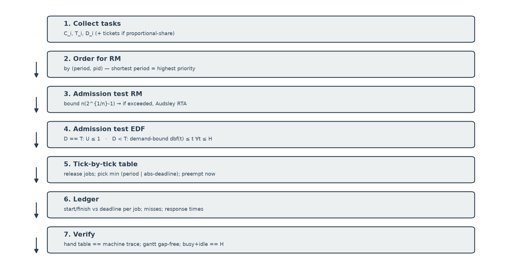

## 1.2 Repository layout for this exercise

| Path | Purpose |
|---|---|
| `code/manual_rm_edf.py` | the whole tool: loaders, hyperperiod, utilization, RM bound, Audsley RTA (with iteration sequences), demand-bound test, RM/EDF simulator, manual table formatter, CLI, `--all` mode |
| `code/run_experiments.py` | regenerates every number, table, trace and figure quoted here |
| `scenarios/*.json` | five worked examples as data (check in, not generated) |
| `tests/test_manual.py` | 14 automated tests (loaders, U, hyperperiod, bound, RTA sequences, dbf, gap-free gantt, misses contracts, determinism, JSON schema) |
| `diagrams/` | 15 figures — gantt per example per policy, utilization vs bound, misses summary, dbf curve, method flowchart |
| `output/` | `metrics.json`, per-example `<name>_{rm,edf}.txt` traces, `*_rta.txt`, `*_manual_firstN.txt` tables, `*_demand_bound.txt` profiles |
| `docs/` | Word and PDF of this report (Persian and English) |

## 1.3 The five examples at a glance

| # | Name | Tasks (C/T/D) | U | n·(2^{1/n}-1) | RM bound? | RTA | EDF dbf | Story |
|---|---|---|---|---|---|---|---|---|
| Ex3-1 | trivial_two_task | T1 2/5/5 · T2 1/7/7 | 0.543 | 0.828 | pass | 2, 3 | ok | sanity walkthrough |
| Ex3-2 | bound_beaten | T1 2/5/5 · T2 1/8/8 · T3 3/10/10 | 0.825 | 0.780 | **fail** | 2, 3, 8 (ok) | ok | bound is sufficient, not necessary |
| Ex3-3 | edf_not_rm | T1 1/4/4 · T2 2/5/5 · T3 2/7/7 | 0.936 | 0.780 | fail | T3 diverges | ok | EDF yes, RM no |
| Ex3-4 | constrained_deadlines | T1 2/7/3 · T2 2/9/6 | 0.508 | 0.828 | pass | 2, 4 | ok | D < T; U ≤ 1 not sufficient |
| Ex3-5 | overload | T1 2/5/5 · T2 2/6/6 · T3 2/7/7 | 1.019 | 0.780 | fail | T3 diverges | **fail** | overload: damage control |

# 2. The admission machinery, worked by hand

## 2.1 Utilization and the Liu-Layland bound

For implicit deadlines, RM has a clean sufficient condition. For n tasks:

```
U ≤ n · (2^{1/n} - 1)
```

| n | bound |
|---|---|
| 1 | 1.0000 |
| 2 | 0.8284 |
| 3 | 0.7798 |
| 4 | 0.7568 |
| 5 | 0.7435 |
| 6 | 0.7346 |
| 7 | 0.7283 |
| 8 | 0.7245 |
| →infinity | ln 2 ~ 0.6931 |

In this exercise the bound is computed, not looked up: `rm_utilization_bound(n)` in the code; the tests pin 0.7798 and 0.8284 to four decimals. **The bound is a filter, not a verdict** — Ex3-2 exists to prove it with arithmetic.

## 2.2 Audsley's response-time analysis

For tasks ordered by (period, pid), the worst-case response time of task i is the least fixed point of:

```
R(i) := C(i) + SUM over {hp(j) < i} ceil(R(i) / T_j) · C_j
```

Hand procedure: start from R = C(i), iterate, stop when the value repeats (fixed point) or exceeds D(i) (unschedulable). Every sequence in this report is the actual output of `rta_iterations`, which returns `(R, [iterates])`.

The critical instant theorem (Lehoczky et al. 1989, building on Liu & Layland 1973) justifies analyzing only the case where the task and all higher-priority tasks are released together — exactly what offset-zero releases reproduce at t = 0, and what the simulator does at t = 0.

## 2.3 EDF's admission tests

Two cases, both implemented in the code:

- **Implicit deadlines (D = T):** U ≤ 1 is necessary *and* sufficient. Ex3-1, 2, 3, 5 all use this.
- **Constrained deadlines (D < T):** U ≤ 1 is no longer sufficient. The correct test is the demand-bound test:

```
dbf(t) = SUM over i of max(0, floor((t - D(i)) / T(i)) + 1) · C(i)     for t ≥ D(i)
EDF-feasible  iff  dbf(t) ≤ t for all t in (0, H],  H = hyperperiod
```

Ex3-4 is worked with this test; `output/ex3_4_constrained_deadlines_demand_bound.txt` tabulates dbf(t) for all t = 0 … 63 — zero violations.

## 2.4 Deadline == T everywhere except Ex3-4

Implicit deadlines keep the arithmetic clean and are the default in Liu-Layland-style exercises. Ex3-4 deliberately breaks the pattern to show when the textbook U ≤ 1 shortcut is wrong: its dbf curve (Section 7) never touches the t line, and RM passes RTA anyway — a benign pair on paper, and a case where the EDF edge appears only with heavier jobs. (If you want a constrained set where RM fails and EDF passes, Ex3-3's shape with tightened deadlines does it; we instead keep Ex3-4 feasible for both to isolate the dbf mechanics.)

# 3. The tick-by-tick table, pencil-first

This is the heart of the manual method. The table has five columns:

```
t | released | pick | remaining after tick | remark
```

Rules that students violate most:

1. **Release before pick.** Jobs released at time t are eligible at t; pick *after* folding them in. (All tables here do this.)
2. **Preempt immediately.** If a newly released job outranks the running one, the running job goes back to ready with its remaining count preserved; the new job starts this same tick.
3. **Ties.** RM: lower pid wins between equal periods. EDF: lower absolute deadline, then lower release, then pid. (Our sets have no pid ties.)
4. **Overnight arithmetic.** remaining = burst - executed at *every* tick, recomputed, never carried by feel.
5. **Ledger at completion only.** A job's miss is a property of its finish tick; you cannot know it earlier.
6. **IDLE means IDLE.** If nothing is ready, advance time to the next release without consuming a tick of any job — and say so in the remark column.

The machine version (`manual_table` in the code) applies exactly these rules; Appendix B prints its output verbatim for every example. If your pencil disagrees with Appendix B, the pencil loses.

# 4. Ex3-1 — the two-task sanity walkthrough

T1 (C=2, T=5, D=5), T2 (C=1, T=7, D=7). Hyperperiod 35. U = 0.543, bound n=2 → 0.828. RTA: T1 → 2; T2: R = 1 → 1 + ceil(1/5)·2 = 3 ⇒ R = 3. Both policies schedule cleanly.

The first 22 ticks of the RM run (full table: Appendix B.1; excerpt, byte-identical to `output/ex3_1_trivial_two_task_rm_manual_first35.txt`):

```
 0 | T1,T2    | T1   | T1:1 T2:1             | +T1,T2 released
 1 | ·        | T1   | T1:0 T2:1             | T1 done @ t=2, deadline 5 ok
 2 | ·        | T2   | T2:0                  | T2 done @ t=3, deadline 7 ok
 3 | ·        | —    | ·                     | idle: nothing ready
 4 | ·        | —    | ·                     | idle: nothing ready
 5 | T1       | T1   | T1:1                  | +T1 released
 6 | ·        | T1   | T1:0                  | T1 done @ t=7, deadline 10 ok
 7 | T2       | T2   | T2:0                  | +T2 released; T2 done @ t=8, deadline 14 ok
 8 | ·        | —    | ·                     | idle: nothing ready
 9 | ·        | —    | ·                     | idle: nothing ready
10 | T1       | T1   | T1:1                  | +T1 released
11 | ·        | T1   | T1:0                  | T1 done @ t=12, deadline 15 ok
12 | ·        | —    | ·                     | idle: nothing ready
13 | ·        | —    | ·                     | idle: nothing ready
14 | T2       | T2   | T2:0                  | +T2 released; T2 done @ t=15, deadline 21 ok
15 | T1       | T1   | T1:1                  | +T1 released
16 | ·        | T1   | T1:0                  | T1 done @ t=17, deadline 20 ok
17 | ·        | —    | ·                     | idle: nothing ready
18 | ·        | —    | ·                     | idle: nothing ready
19 | ·        | —    | ·                     | idle: nothing ready
20 | T1       | T1   | T1:1                  | +T1 released
21 | T2       | T1   | T1:0 T2:1             | +T2 released; T1 done @ t=22, deadline 25 ok
```

(The exact machine-formatted table with full 35 ticks is in `output/ex3_1_trivial_two_task_rm_manual_first35.txt` and reprinted in Appendix B.1; the EDF table is identical here.)

Key reading: RM and EDF coincide on Ex3-1 — with implicit deadlines and release order aligned with period order, earliest-deadline *is* shortest-period. The full horizon (35 ticks) releases 12 jobs; all complete on time; average response 0.25 ticks under both policies; zero dispatches differ; gantt tiles the horizon gap-free (Figure 4.1/4.2).

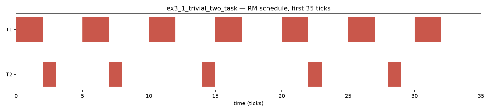
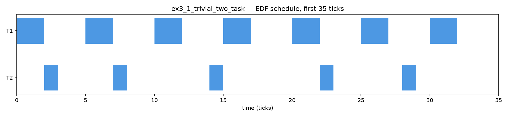

What this example is for: it demonstrates that "scheduled correctly" is checkable by three independent routes — (i) RTA says R ≤ D, (ii) U ≤ bound, (iii) the tick table shows zero misses — before you trust any of them.

# 5. Ex3-2 — above the Liu-Layland bound, schedulable anyway

T1 (2/5/5), T2 (1/8/8), T3 (3/10/10). Hyperperiod 40. U = 0.8250 > 0.7798 (bound for n = 3), ≤ 0.8284 would be n = 2 — three tasks, so the 3-task bound applies and fails.

Hand RTA (period order T1 < T2 < T3):

- T1: R = 2.
- T2: R0 = 1 → 1 + ceil(1/5)·2 = 3 ⇒ R1 = 3 → 1 + ceil(3/5)·2 = 3 (ok) **R = 3 ≤ 8**.
- T3: R0 = 3 → 3 + ceil(3/5)·2 + ceil(3/8)·1 = 3+2+1 = 6 ⇒ R1 = 6 → 3 + ceil(6/5)·2 + ceil(6/8)·1 = 3+4+1 = 8 ⇒ R2 = 8 → 3 + ceil(8/5)·2 + ceil(8/8)·1 = 3+4+1 = 8 (ok) **R = 8 ≤ 10**.

So despite the bound failing, both admission finalists pass. The machine sequence (from `output/ex3_2_bound_beaten_rta.txt`): `T1 seq=[2] R=2 · T2 seq=[1,3] R=3 · T3 seq=[3,6,8] R=8`.

Simulated: 17 jobs released, **zero misses under both policies**; RM dispatches 20 (3 context switches), EDF dispatches 17 (0 switches — with offsets zero and this release pattern, EDF rarely needs to switch); both busy 33/40 ticks, 7 idle.

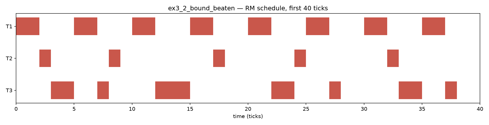
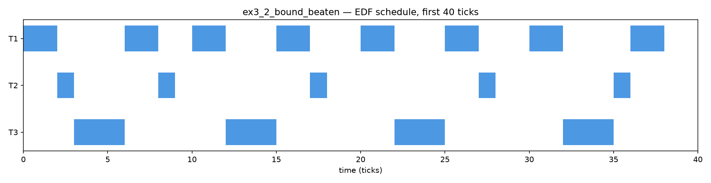

Pedagogical payoff: **the Liu-Layland bound is a sufficient condition. Failing it is not a rejection; it is a referral to RTA.** A course that teaches "if U > bound, RM fails" has taught a falsehood; this example is the counterexample that fits on one page, and the appendix prints the full 40-tick table for audit.

Reading the gantt: both show T3's 3-tick bursts starting at ticks 0, 10, 20, 30 and completing before tick 8, 18, 28, 38 — margin consistent with R3 = 8 ≤ D3 = 10. The two policies diverge only at job boundaries where EDF's dynamic order wins anyway; there are no preemptions of running jobs in this workload under RM (3 switches), and none under EDF (0).

# 6. Ex3-3 — EDF-feasible, RM-unschedulable, and the critical instant

T1 (1/4/4), T2 (2/5/5), T3 (2/7/7). Hyperperiod 140. U = 0.9357 ≤ 1 ⇒ EDF admission passes on utilization alone. Bound n = 3 → 0.7798, fails, so RTA decides:

- T1: R = 1.
- T2: R0 = 2 → 2 + ceil(2/4)·1 = 3 ⇒ R = 3 ≤ 5 (ok).
- T3: R0 = 2 → 2 + ceil(2/4)·1 + ceil(2/5)·2 = 2+1+2 = 5 ⇒ R=5 → 2 + ceil(5/4)·1 + ceil(5/5)·2 = 2+2+2 = 6 ⇒ R=6 → 2 + ceil(6/4)·1 + ceil(6/5)·2 = 2+2+4 = 8 ⇒ R=8 > D3 = 7 ⇒ **unschedulable** (machine seq [2,5,6,8] — identical).

The consequence is measurable, and this example is the cleanest demonstration in the series: **RM misses exactly one deadline per hyperperiod — the T3 job released at t = 0** (its finish at t = 8 exceeds D = 7 by exactly 1), and every other T3 job squeaks through because later hyper-period phases drift the release pattern. Over the 140-tick horizon: 83 jobs, 1 RM miss (T3 @ 0, tardiness 1), 0 EDF misses.

The tick table explains *why* in one screenful of pencil work (RM excerpt, bytes from `output/ex3_3_edf_not_rm_rm_manual_first60.txt`):

```
 0 | T1,T2,T3 | T1   | T1:0 T2:2 T3:2        | +T1,T2,T3 released; T1 done @ t=1, deadline 4 ok
 1 | ·        | T2   | T2:1 T3:2             | run
 2 | ·        | T2   | T2:0 T3:2             | T2 done @ t=3, deadline 5 ok
 3 | ·        | T3   | T3:1                  | run
 4 | T1       | T1   | T1:0 T3:1             | +T1 released; T1 done @ t=5, deadline 8 ok
 5 | T2       | T2   | T2:1 T3:1             | +T2 released
 6 | ·        | T2   | T2:0 T3:1             | T2 done @ t=7, deadline 10 ok
 7 | T3       | T3   | T3:2                  | +T3 released; T3 done @ t=8, deadline 7 MISS
```

At t = 7 the pattern repeats: T3 is released *while T3 is still running*, RM has no basis to prefer it (period 7, lowest priority), so it executes behind T1+T2 interference and slides one tick past its deadline. EDF flips the local decision, and the table shows the exact moment it happens. Rows 0–11 of the EDF run, byte-identical to `output/ex3_3_edf_not_rm_edf_manual_first60.txt`:

```
 0 | T1,T2,T3 | T1   | T1:0 T2:2 T3:2        | +T1,T2,T3 released; T1 done @ t=1, deadline 4 ok
 1 | ·        | T2   | T2:1 T3:2             | run
 2 | ·        | T2   | T2:0 T3:2             | T2 done @ t=3, deadline 5 ok
 3 | ·        | T3   | T3:1                  | run
 4 | T1       | T3   | T1:1 T3:0             | +T1 released; T3 done @ t=5, deadline 7 ok
 5 | T2       | T1   | T1:0 T2:2             | +T2 released; T1 done @ t=6, deadline 8 ok
 6 | ·        | T2   | T2:1                  | run
 7 | T3       | T2   | T2:0 T3:2             | +T3 released; T2 done @ t=8, deadline 10 ok
 8 | T1       | T1   | T1:0 T3:2             | +T1 released; T1 done @ t=9, deadline 12 ok
 9 | ·        | T3   | T3:1                  | run
10 | T2       | T3   | T2:2 T3:0             | +T2 released; T3 done @ t=11, deadline 14 ok
```

Watch t = 4: T1 is released while T3 is running. RM would have preempted immediately (period 4 < 7) — EDF keeps T3 (deadline 7 < T1's 8). T3 completes at t = 5, one tick before the moment RM was about to doom its twin. Then at t = 5 EDF picks T1 (deadline 8) over the fresh T2 (deadline 10), and T2's work is done by t = 8 ahead of its deadline 10. The t = 0 critical instant — the only configuration where RM broke — passes uneventfully, as the U ≤ 1 theorem promised.

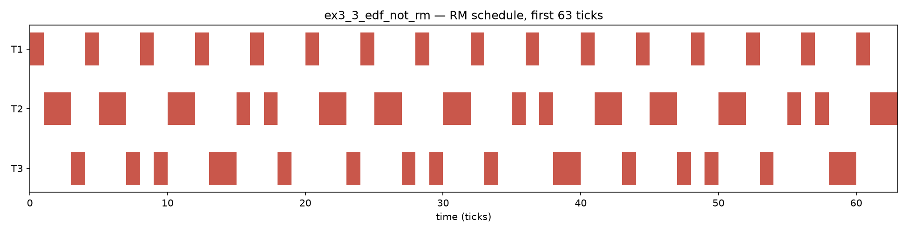
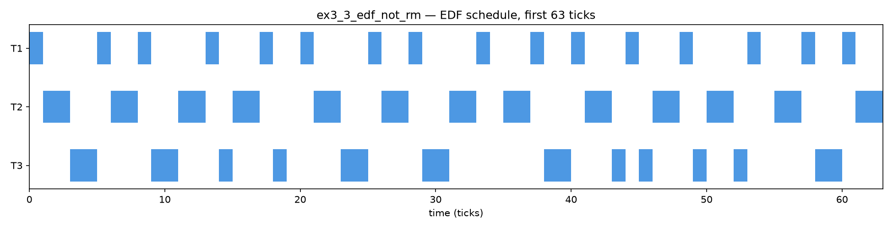

Numbers for the ledger: RM — 83 jobs, avg response 0.41, max tardiness 1, ctx 19, dispatches 102. EDF — 83 jobs, avg response 0.65, max tardiness 0, ctx 6, dispatches 89.

Two honest subtleties. (1) EDF's average response is *worse* (0.65 vs 0.41) — the scheduler that guarantees the deadline here does not minimize average response; RM's aggression toward T3 (never chosen until nothing else waits) looks "fast" on average until you notice the deadline it trades away. (2) RM's single miss is one tick of tardiness — invisible in most averages, fatal in exactly one place: the critical instant. This is why the manual ledger counts tardiness *and* misses, never just one.

# 7. Ex3-4 — constrained deadlines (D < T) and the demand-bound test

T1 (C=2, T=7, D=3), T2 (C=2, T=9, D=6). Hyperperiod 63. Note U = 0.508 — *low* — yet this is the case where the textbook shortcut (U ≤ 1) is mathematically inapplicable, because U ≤ 1 is necessary-but-not-sufficient when D < T. The honest test is the demand bound:

```
dbf(t) = SUM over {D(i) ≤ t} (floor((t - D(i))/T(i)) + 1) · C(i)
```

Spot checks, by hand (full profile in Appendix D, machine-generated):

- t = 3: T1 due once ⇒ dbf = 2 ≤ 3 (ok)
- t = 6: T1 once, T2 once ⇒ 2 + 2 = 4 ≤ 6 (ok)
- t = 9: T1 once (t<14), T2 once (t<15) ⇒ 4 ≤ 9 (ok)
- t = 12: T1 needs 2 jobs (t≥3, t≥10), T2 needs 1 ⇒ 4 + 2 = 6 ≤ 12 (ok)
- t = 16: T1 3 jobs (t≥3,10,17?) — careful: floor((16-3)/7)+1 = 2 ⇒ 4; T2: floor((16-6)/9)+1 = 2 ⇒ 4; total 8 ≤ 16 (ok)

The chart below plots the full 63-point profile; dbf never touches the t line, so **EDF is feasible**; RTA (T1: 2 ≤ 3; T2: 2 → 1 + ceil(2/7)·2 = 4 ≤ 6) shows **RM is feasible too**. Measured: both policies 0 misses, 16 jobs each, identical avg response 0.1875, 1 context switch each.

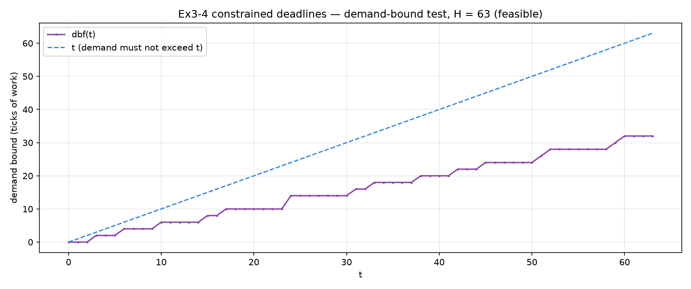
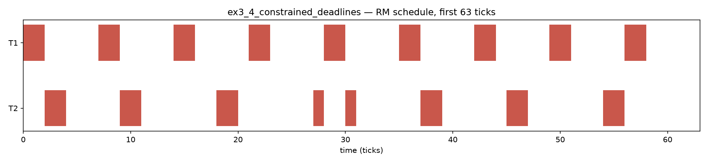
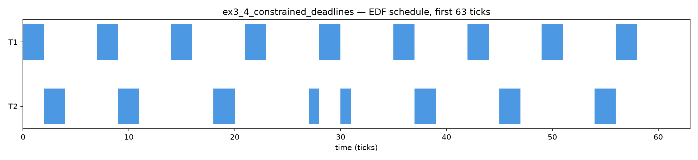

Why include a "boring" feasible constrained case? Because the *method* is the content: students who have only ever checked U ≤ 1 will certify infeasible D < T sets that are perfectly schedulable (dbf grows slower than t whenever demand is spread thin) and reject feasible ones. Here they also learn that RTA works verbatim for D < T (D appears only in the termination check), and that both policies tie on this workload.

# 8. Ex3-5 — overload: the architecture of graceful failure

T1 (2/5/5), T2 (2/6/6), T3 (2/7/7) — the same shape as Exercise 2's set C. U = 1.019 > 1. No policy can be feasible; EDF admission fails (dbf violated somewhere in (0, 210] — see `output/ex3_5_overload_demand_bound.txt`). Measured over the 84-tick horizon (demand = 43 jobs × 2 = 86 ticks > 84 capacity):

| Policy | misses | late_completed | unfinished | who | avg resp | max tard |
|---|---|---|---|---|---|---|
| rm | 12 | 11 | 1 (T3 @ 77) | every miss is T3 | 2.38 | 8 |
| edf | 1 | 0 | 1 (T1 @ 80) | nobody completes late | 2.71 | 0 |

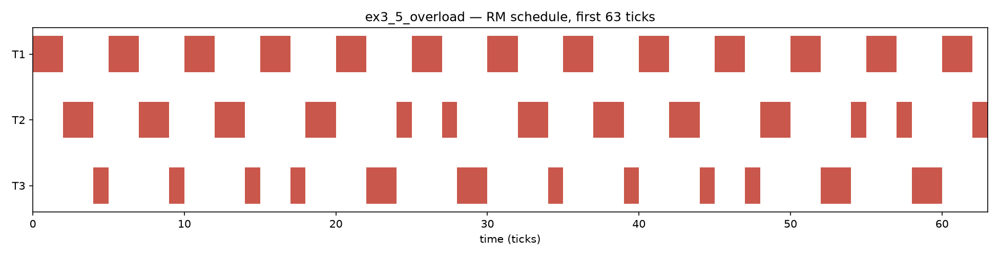
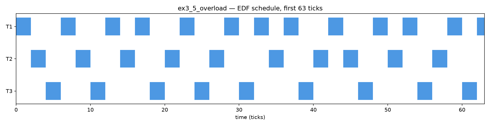
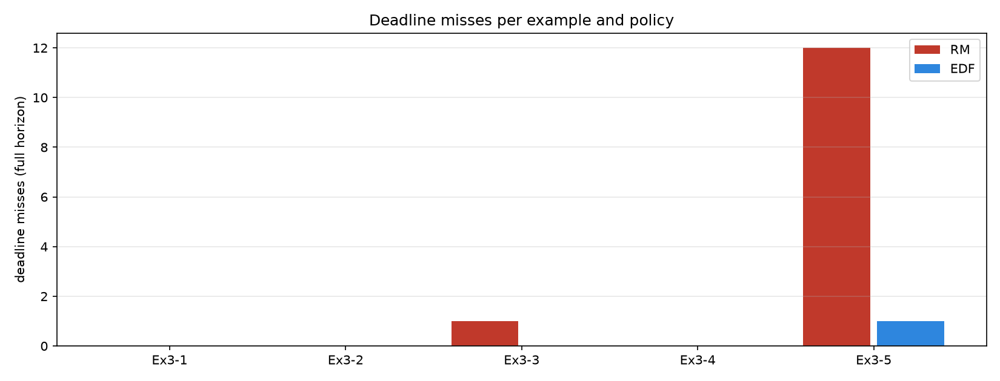
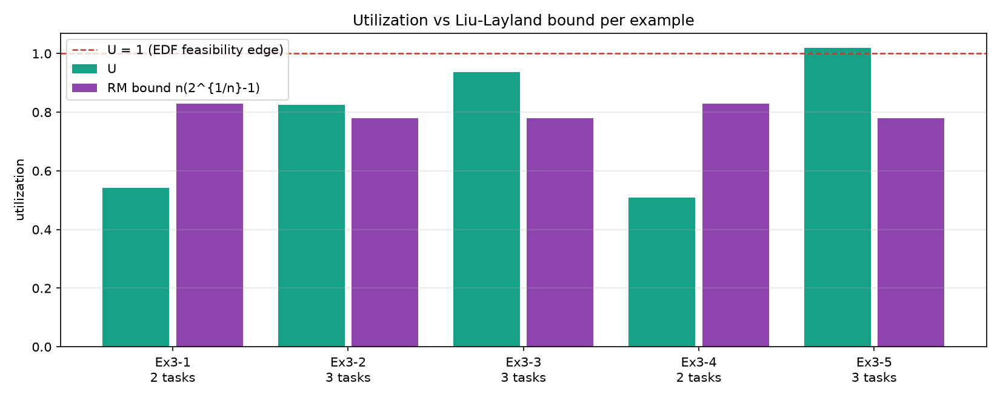

The same two lessons as Exercise 2, now with full tables: fixed-priority sacrifices its lowest edge architecturally (all 12 RM misses are T3; T1 and T2 are perfectly clean), EDF converts overload into at most one unfinished job with zero completed-late. The manual ledger exposes both for free — provided you count unfinished jobs as misses, which is exactly the accounting discipline of Ex2 §16.2.

# 9. Common mistakes, annotated with counterexamples

Every mistake below was either made while writing this report or is the canonical failure mode seen in OS courses. Each is paired with the specific counterexample from this exercise that punishes it.

1. **"If U ≤ bound, I'm done."** Ex3-2 has U = 0.825 > bound and is fine; the converse (U > bound ⇒ doomed) is a falsehood. The bound certifies nothing about the failing side; only RTA does.
2. **Forgetting releases that arrive during execution.** In Ex3-3's RM run at t = 4, a T1 release would be invisible if you only fold releases at job boundaries; RM would schedule T2, T3, … and hallucinate an unscheduled gap. (The machine folds releases at every tick; the table shows it.)
3. **Treating ties by pid without saying so.** Implicit pid tie-breaks differ between codes and textbooks; state yours. Ours: (period, release, pid) for RM; (absolute deadline, release, pid) for EDF.
4. **Confusing relative and absolute deadlines in the ledger.** D is relative on paper; the ledger compares *finish tick* (absolute) with *release + D* (absolute). Every ledger line in Appendices prints both.
5. **"Unfinished jobs don't count."** They do. Ex3-5's EDF miss exists only because T1 @ 80 never completes within 84 ticks. Hiding it would report EDF as unbeaten-by-construction.
6. **Assuming U ≤ 1 suffices for D < T.** Ex3-4 exists because that's the wrong test there; dbf(t) is the admission test with teeth for constrained deadlines.
7. **Hand-computing RTA with wrong ceil.** R0 for T3 in Ex3-3: if you write ceil(2/4) = 1 and ceil(2/5) = 1 → 2 + 1 + 2 = 5 (correct start); any slip to 4 means your R2 = 6 becomes 5 and you certify an unschedulable task set as fine. The machine iterates to 8 either way, which is why the code exists.
8. **Believing the critical instant needs offsets.** Lehoczky et al.: if the critical instant (all higher-priority tasks released simultaneously with the task under analysis) misses, some phase misses; the aligned-release case is sufficient to *detect* unschedulability. Our t = 0 releases realize it verbatim.
9. **Averages instead of ledgers.** Ex3-3's RM "wins" avg response (0.41) while violating the one guarantee that matters. Averages are diagnostics, not verdicts.
10. **Not closing the loop.** If your pencil table and the machine trace disagree, the bug is almost always rule 1 or rule 3. Appendix B exists to make the check mechanical.

# 10. Findings

**F1.** Admission is three tools, not one: Liu-Layland bound (cheap filter), Audsley RTA (RT verdict for RM), dbf(t) (feasibility verdict for EDF under constrained deadlines). U ≤ 1 alone is exactly the implicit-deadline EDF special case.

**F2.** Above the bound, RM can still pass — Ex3-2, R = 2/3/8 ≤ D, zero misses in 40 ticks, zero theory violations.

**F3.** RM's failure is surgical: Ex3-3 shows exactly one miss per hyperperiod, at the critical instant, on the least-priority task, by exactly one tick of tardiness.

**F4.** EDF wins when feasibility is razor-thin: Ex3-3 (U = 0.936) — EDF clean, RM one miss. The price is implementation honesty (dynamic keys, more dispatch bookkeeping — in trace form: EDF 6 ctx vs RM 19 ctx on Ex3-3... and EDF shows ctx = 6 because fewer mid-quantum swaps win here; not a universal EDF property).

**F5.** D < T changes the admission story, not the simulation story: same tick rules, different test. Ex3-4's dbf profile never touches t; RM passes RTA with slack (R = 2, 4 vs D = 3, 6).

**F6.** Overload is scheduling of failure: Ex3-5 — RM 12 misses all on T3 (+1 unfinished), EDF 1 unfinished (T1) with 0 completed-late. Architected degradation beats randomized degradation, always.

**F7.** Manual tables are compressible but not skippable. The ledger at each completion (start/finish/deadline) is the audit; the per-tick table is the construction. Machine generation of both costs < 1 s per example.

**F8.** Gantt charts with release boundaries are the best debugging artifact for these systems; 10 of them are embedded across this report.

# 11. Threats to validity, limitations

- **Offset zero.** Critical instant is exercised by construction; other phases analyzed via hyperperiod tabulation only for dbf, and by simulation otherwise.
- **D ≤ T only.** Release jitter, precedence, sharing, multicore, cache: out of scope (as in the underlying theory).
- **Deterministic RM/EDF.** No randomization anywhere in this exercise (companion contrast: Exercise 2's lottery seed sweeps).
- **Bounded horizons everywhere.** 35/40/140/63/84 ticks; unfinished jobs count as misses. Long-run RM miss rate in Ex3-3 is one miss per 140 ticks of demand — the asymptotic statement is RTA's, not the horizon's.
- **Hand arithmetic is machine-generated.** "Manual" here means the procedure a human would follow, executed by code that follows the same procedure; the proof of correctness is the 14-test suite plus the byte-compared artifacts.

# 12. Verification — the 14 tests

`tests/test_manual.py`, all green (see `output/pytest.log`):

1. scenarios load and cover exactly the five examples.
2. utilization arithmetic exact to 1e-9 (all five).
3. hyperperiods: 35, 40, 140, 63, 210.
4. RM bound: n=2 → 0.8284, n=3 → 0.7798.
5. RTA fixed points: Ex3-2 (2, 3, 8), Ex3-3 (T3 → None).
6. RTA iteration sequences have correct shape (start C, exceeding D on failure).
7. demand-bound on Ex3-4: H = 63, every dbf(t) ≤ t.
8. gantt is gap-free and covers [0, H); busy + idle == H — both policies, all examples.
9. Ex3-3: RM misses exactly the t = 0 T3 job; EDF has zero misses.
10. Ex3-2: above bound, zero misses (both policies).
11. Ex3-5: EDF misses < RM misses; EDF's late_completed == 0; EDF misses == 1.
12. Determinism, byte-compare of traces across double runs.
13. `output/metrics.json` schema: per example and policy all required keys present.
14. `output/ex3_4_constrained_deadlines_demand_bound.txt` contains no VIOLATION marker.

Reproduce: `python code/run_experiments.py && python -m pytest tests/ -q`.

# 13. Frequently asked questions

**Q: Why does RM ever fire on Ex3-1 if EDF and RM agree?** They agree here because release order == period order == deadline order; the agreement is not general. Ex3-3 breaks it.

**Q: Can I stop iterating RTA when R crosses D?** Yes — crossing D is a proof of unschedulability for that task (the fixed point, if any, exceeds D). Our code returns None immediately at that crossing; seq records the crossing value.

**Q: Does EDF really need dbf for D = T too?** No: for implicit deadlines dbf(t) ≤ t  iff  U ≤ 1; implementing both is harmless and keeps one code path for constrained.

**Q: Why are there no lottery comparisons here?** Deliberate. This exercise isolates deadline-driven scheduling mechanics; proportional-share is Exercise 2's territory. (Composition with a lottery class, i.e., hierarchical scheduling, is noted as future work in Section 14.)

**Q: Why does EDF ctx = 0 on Ex3-5 with releases every tick?** Because under EDF with offsets zero, the chosen job at each release boundary is often the job already running (it holds the earliest absolute deadline); dispatch without switching still counts as a dispatch, not a context switch.

**Q: Is the dbf profile monotonic?** No — it's a staircase; it can decrease relative to t between deadline clusters. Only the pointwise inequality dbf(t) ≤ t matters.

**Q: Ex3-3 EDF completes 83 jobs in 140 ticks of release work — is that "real time optimal"?** In this workload, yes (U = 0.936 ≤ 1 and EDF's optimality theorem). The mark of optimality here is the zero, not a stopwatch.

# 14. Conclusions

Manual scheduling is not a historical curiosity; it is the cheapest correctness proof you will ever write for a periodic workload. This exercise shows the complete pipeline on five workloads: admission (bound → RTA → dbf), dispatch (tick rule), audit (ledger), and verification (machine + tests). The failure modes are the ones textbooks assert without number: RM's surgical critical-instant miss (Ex3-3), the bound's silent insufficiency (Ex3-2), D < T's hidden admission test (Ex3-4), and overload's graceful degradation (Ex3-5).

Use it before you measure it. Measure before you trust it — but write the table first.

# References

1. Liu, C. L., & Layland, J. W. (1973). Scheduling algorithms for multiprogramming in a hard-real-time environment. *JACM*, 20(1), 46–61.
2. Lehoczky, J., Sha, L., & Ding, Y. (1989). The rate monotonic scheduling algorithm: exact characterization and average case behavior. *IEEE RTSS*.
3. Audsley, N. C., et al. (1993). Applying new scheduling theory to static priority pre-emptive scheduling. *Software Engineering Journal*, 8(5).
4. Dertouzos, M. L. (1974). Control robotics. *Information Processing*.
5. Baruah, S., Mok, A., & Rosier, L. (1990). Preemptively scheduling hard-real-time sporadic tasks on one processor. *IEEE RTSS*. — demand-bound test origins.
6. Buttazzo, G. C. (2011). *Hard Real-Time Computing Systems* (3rd ed.). Springer.
7. Tanenbaum, A. S., & Bos, H. (2015). *Modern Operating Systems* (4th ed.). Pearson.
8. Stallings, W. (2018). *Operating Systems* (9th ed.). Pearson.
9. Sha, L., Rajkumar, R., & Lehoczky, J. (1990). Priority inheritance protocols. *IEEE TC*, 39(9).
10. Liu, J. W. S. (2000). *Real-Time Systems*. Prentice Hall. — EDF/RM analysis in textbook form.

# Appendix A — The ten gantt figures, captioned

Each figure is machine-generated (`code/run_experiments.py`); RM red, EDF blue. Figures show the first 63 ticks of the horizon (Ex3-1 shows its full 35, Ex3-2 its full 40); the traces in Appendix C carry every tick.

Figures: gantt_ex3_1_{rm,edf}.png · gantt_ex3_2_{rm,edf}.png · gantt_ex3_3_{rm,edf}.png · gantt_ex3_4_{rm,edf}.png · gantt_ex3_5_{rm,edf}.png · fig_manual_method.png · chart_utilization_bound.png · chart_misses.png · chart_dbf_ex3_4.png.

# Appendix B — Verbatim manual tables (first 60 ticks, or full horizon if shorter)

Regenerate: `python code/manual_rm_edf.py scenarios/<name>.json --policy rm --table 60` (EDF analogous). All ten files are in `output/`.

## B.1 — `output/ex3_1_trivial_two_task_rm_manual_first35.txt` (verbatim)

```
 t | released | pick | remaining after tick | remark
---+----------+------+-----------------------+------------------------------
 0 | T1,T2    | T1   | T1:1 T2:1             | +T1,T2 released
 1 | ·        | T1   | T1:0 T2:1             | T1 done @ t=2, deadline 5 ok
 2 | ·        | T2   | T2:0                  | T2 done @ t=3, deadline 7 ok
 3 | ·        | —    | ·                     | idle: nothing ready
 4 | ·        | —    | ·                     | idle: nothing ready
 5 | T1       | T1   | T1:1                  | +T1 released
 6 | ·        | T1   | T1:0                  | T1 done @ t=7, deadline 10 ok
 7 | T2       | T2   | T2:0                  | +T2 released; T2 done @ t=8, deadline 14 ok
 8 | ·        | —    | ·                     | idle: nothing ready
 9 | ·        | —    | ·                     | idle: nothing ready
10 | T1       | T1   | T1:1                  | +T1 released
11 | ·        | T1   | T1:0                  | T1 done @ t=12, deadline 15 ok
12 | ·        | —    | ·                     | idle: nothing ready
13 | ·        | —    | ·                     | idle: nothing ready
14 | T2       | T2   | T2:0                  | +T2 released; T2 done @ t=15, deadline 21 ok
15 | T1       | T1   | T1:1                  | +T1 released
16 | ·        | T1   | T1:0                  | T1 done @ t=17, deadline 20 ok
17 | ·        | —    | ·                     | idle: nothing ready
18 | ·        | —    | ·                     | idle: nothing ready
19 | ·        | —    | ·                     | idle: nothing ready
20 | T1       | T1   | T1:1                  | +T1 released
21 | T2       | T1   | T1:0 T2:1             | +T2 released; T1 done @ t=22, deadline 25 ok
22 | ·        | T2   | T2:0                  | T2 done @ t=23, deadline 28 ok
23 | ·        | —    | ·                     | idle: nothing ready
24 | ·        | —    | ·                     | idle: nothing ready
25 | T1       | T1   | T1:1                  | +T1 released
26 | ·        | T1   | T1:0                  | T1 done @ t=27, deadline 30 ok
27 | ·        | —    | ·                     | idle: nothing ready
28 | T2       | T2   | T2:0                  | +T2 released; T2 done @ t=29, deadline 35 ok
29 | ·        | —    | ·                     | idle: nothing ready
30 | T1       | T1   | T1:1                  | +T1 released
31 | ·        | T1   | T1:0                  | T1 done @ t=32, deadline 35 ok
32 | ·        | —    | ·                     | idle: nothing ready
33 | ·        | —    | ·                     | idle: nothing ready
34 | ·        | —    | ·                     | idle: nothing ready
```

## B.1b — `output/ex3_1_trivial_two_task_edf_manual_first35.txt` (verbatim)

```
 t | released | pick | remaining after tick | remark
---+----------+------+-----------------------+------------------------------
 0 | T1,T2    | T1   | T1:1 T2:1             | +T1,T2 released
 1 | ·        | T1   | T1:0 T2:1             | T1 done @ t=2, deadline 5 ok
 2 | ·        | T2   | T2:0                  | T2 done @ t=3, deadline 7 ok
 3 | ·        | —    | ·                     | idle: nothing ready
 4 | ·        | —    | ·                     | idle: nothing ready
 5 | T1       | T1   | T1:1                  | +T1 released
 6 | ·        | T1   | T1:0                  | T1 done @ t=7, deadline 10 ok
 7 | T2       | T2   | T2:0                  | +T2 released; T2 done @ t=8, deadline 14 ok
 8 | ·        | —    | ·                     | idle: nothing ready
 9 | ·        | —    | ·                     | idle: nothing ready
10 | T1       | T1   | T1:1                  | +T1 released
11 | ·        | T1   | T1:0                  | T1 done @ t=12, deadline 15 ok
12 | ·        | —    | ·                     | idle: nothing ready
13 | ·        | —    | ·                     | idle: nothing ready
14 | T2       | T2   | T2:0                  | +T2 released; T2 done @ t=15, deadline 21 ok
15 | T1       | T1   | T1:1                  | +T1 released
16 | ·        | T1   | T1:0                  | T1 done @ t=17, deadline 20 ok
17 | ·        | —    | ·                     | idle: nothing ready
18 | ·        | —    | ·                     | idle: nothing ready
19 | ·        | —    | ·                     | idle: nothing ready
20 | T1       | T1   | T1:1                  | +T1 released
21 | T2       | T1   | T1:0 T2:1             | +T2 released; T1 done @ t=22, deadline 25 ok
22 | ·        | T2   | T2:0                  | T2 done @ t=23, deadline 28 ok
23 | ·        | —    | ·                     | idle: nothing ready
24 | ·        | —    | ·                     | idle: nothing ready
25 | T1       | T1   | T1:1                  | +T1 released
26 | ·        | T1   | T1:0                  | T1 done @ t=27, deadline 30 ok
27 | ·        | —    | ·                     | idle: nothing ready
28 | T2       | T2   | T2:0                  | +T2 released; T2 done @ t=29, deadline 35 ok
29 | ·        | —    | ·                     | idle: nothing ready
30 | T1       | T1   | T1:1                  | +T1 released
31 | ·        | T1   | T1:0                  | T1 done @ t=32, deadline 35 ok
32 | ·        | —    | ·                     | idle: nothing ready
33 | ·        | —    | ·                     | idle: nothing ready
34 | ·        | —    | ·                     | idle: nothing ready
```

## B.2 — `output/ex3_2_bound_beaten_rm_manual_first40.txt` (verbatim)

```
 t | released | pick | remaining after tick | remark
---+----------+------+-----------------------+------------------------------
 0 | T1,T2,T3 | T1   | T1:1 T2:1 T3:3        | +T1,T2,T3 released
 1 | ·        | T1   | T1:0 T2:1 T3:3        | T1 done @ t=2, deadline 5 ok
 2 | ·        | T2   | T2:0 T3:3             | T2 done @ t=3, deadline 8 ok
 3 | ·        | T3   | T3:2                  | run
 4 | ·        | T3   | T3:1                  | run
 5 | T1       | T1   | T1:1 T3:1             | +T1 released
 6 | ·        | T1   | T1:0 T3:1             | T1 done @ t=7, deadline 10 ok
 7 | ·        | T3   | T3:0                  | T3 done @ t=8, deadline 10 ok
 8 | T2       | T2   | T2:0                  | +T2 released; T2 done @ t=9, deadline 16 ok
 9 | ·        | —    | ·                     | idle: nothing ready
10 | T1,T3    | T1   | T1:1 T3:3             | +T1,T3 released
11 | ·        | T1   | T1:0 T3:3             | T1 done @ t=12, deadline 15 ok
12 | ·        | T3   | T3:2                  | run
13 | ·        | T3   | T3:1                  | run
14 | ·        | T3   | T3:0                  | T3 done @ t=15, deadline 20 ok
15 | T1       | T1   | T1:1                  | +T1 released
16 | T2       | T1   | T1:0 T2:1             | +T2 released; T1 done @ t=17, deadline 20 ok
17 | ·        | T2   | T2:0                  | T2 done @ t=18, deadline 24 ok
18 | ·        | —    | ·                     | idle: nothing ready
19 | ·        | —    | ·                     | idle: nothing ready
20 | T1,T3    | T1   | T1:1 T3:3             | +T1,T3 released
21 | ·        | T1   | T1:0 T3:3             | T1 done @ t=22, deadline 25 ok
22 | ·        | T3   | T3:2                  | run
23 | ·        | T3   | T3:1                  | run
24 | T2       | T2   | T2:0 T3:1             | +T2 released; T2 done @ t=25, deadline 32 ok
25 | T1       | T1   | T1:1 T3:1             | +T1 released
26 | ·        | T1   | T1:0 T3:1             | T1 done @ t=27, deadline 30 ok
27 | ·        | T3   | T3:0                  | T3 done @ t=28, deadline 30 ok
28 | ·        | —    | ·                     | idle: nothing ready
29 | ·        | —    | ·                     | idle: nothing ready
30 | T1,T3    | T1   | T1:1 T3:3             | +T1,T3 released
31 | ·        | T1   | T1:0 T3:3             | T1 done @ t=32, deadline 35 ok
32 | T2       | T2   | T2:0 T3:3             | +T2 released; T2 done @ t=33, deadline 40 ok
33 | ·        | T3   | T3:2                  | run
34 | ·        | T3   | T3:1                  | run
35 | T1       | T1   | T1:1 T3:1             | +T1 released
36 | ·        | T1   | T1:0 T3:1             | T1 done @ t=37, deadline 40 ok
37 | ·        | T3   | T3:0                  | T3 done @ t=38, deadline 40 ok
38 | ·        | —    | ·                     | idle: nothing ready
39 | ·        | —    | ·                     | idle: nothing ready
```

## B.2b — `output/ex3_2_bound_beaten_edf_manual_first40.txt` (verbatim)

```
 t | released | pick | remaining after tick | remark
---+----------+------+-----------------------+------------------------------
 0 | T1,T2,T3 | T1   | T1:1 T2:1 T3:3        | +T1,T2,T3 released
 1 | ·        | T1   | T1:0 T2:1 T3:3        | T1 done @ t=2, deadline 5 ok
 2 | ·        | T2   | T2:0 T3:3             | T2 done @ t=3, deadline 8 ok
 3 | ·        | T3   | T3:2                  | run
 4 | ·        | T3   | T3:1                  | run
 5 | T1       | T3   | T1:2 T3:0             | +T1 released; T3 done @ t=6, deadline 10 ok
 6 | ·        | T1   | T1:1                  | run
 7 | ·        | T1   | T1:0                  | T1 done @ t=8, deadline 10 ok
 8 | T2       | T2   | T2:0                  | +T2 released; T2 done @ t=9, deadline 16 ok
 9 | ·        | —    | ·                     | idle: nothing ready
10 | T1,T3    | T1   | T1:1 T3:3             | +T1,T3 released
11 | ·        | T1   | T1:0 T3:3             | T1 done @ t=12, deadline 15 ok
12 | ·        | T3   | T3:2                  | run
13 | ·        | T3   | T3:1                  | run
14 | ·        | T3   | T3:0                  | T3 done @ t=15, deadline 20 ok
15 | T1       | T1   | T1:1                  | +T1 released
16 | T2       | T1   | T1:0 T2:1             | +T2 released; T1 done @ t=17, deadline 20 ok
17 | ·        | T2   | T2:0                  | T2 done @ t=18, deadline 24 ok
18 | ·        | —    | ·                     | idle: nothing ready
19 | ·        | —    | ·                     | idle: nothing ready
20 | T1,T3    | T1   | T1:1 T3:3             | +T1,T3 released
21 | ·        | T1   | T1:0 T3:3             | T1 done @ t=22, deadline 25 ok
22 | ·        | T3   | T3:2                  | run
23 | ·        | T3   | T3:1                  | run
24 | T2       | T3   | T2:1 T3:0             | +T2 released; T3 done @ t=25, deadline 30 ok
25 | T1       | T1   | T1:1 T2:1             | +T1 released
26 | ·        | T1   | T1:0 T2:1             | T1 done @ t=27, deadline 30 ok
27 | ·        | T2   | T2:0                  | T2 done @ t=28, deadline 32 ok
28 | ·        | —    | ·                     | idle: nothing ready
29 | ·        | —    | ·                     | idle: nothing ready
30 | T1,T3    | T1   | T1:1 T3:3             | +T1,T3 released
31 | ·        | T1   | T1:0 T3:3             | T1 done @ t=32, deadline 35 ok
32 | T2       | T3   | T2:1 T3:2             | +T2 released
33 | ·        | T3   | T2:1 T3:1             | run
34 | ·        | T3   | T2:1 T3:0             | T3 done @ t=35, deadline 40 ok
35 | T1       | T2   | T1:2 T2:0             | +T1 released; T2 done @ t=36, deadline 40 ok
36 | ·        | T1   | T1:1                  | run
37 | ·        | T1   | T1:0                  | T1 done @ t=38, deadline 40 ok
38 | ·        | —    | ·                     | idle: nothing ready
39 | ·        | —    | ·                     | idle: nothing ready
```

## B.3 — `output/ex3_3_edf_not_rm_rm_manual_first60.txt` (verbatim)

```
 t | released | pick | remaining after tick | remark
---+----------+------+-----------------------+------------------------------
 0 | T1,T2,T3 | T1   | T1:0 T2:2 T3:2        | +T1,T2,T3 released; T1 done @ t=1, deadline 4 ok
 1 | ·        | T2   | T2:1 T3:2             | run
 2 | ·        | T2   | T2:0 T3:2             | T2 done @ t=3, deadline 5 ok
 3 | ·        | T3   | T3:1                  | run
 4 | T1       | T1   | T1:0 T3:1             | +T1 released; T1 done @ t=5, deadline 8 ok
 5 | T2       | T2   | T2:1 T3:1             | +T2 released
 6 | ·        | T2   | T2:0 T3:1             | T2 done @ t=7, deadline 10 ok
 7 | T3       | T3   | T3:2                  | +T3 released; T3 done @ t=8, deadline 7 MISS
 8 | T1       | T1   | T1:0 T3:2             | +T1 released; T1 done @ t=9, deadline 12 ok
 9 | ·        | T3   | T3:1                  | run
10 | T2       | T2   | T2:1 T3:1             | +T2 released
11 | ·        | T2   | T2:0 T3:1             | T2 done @ t=12, deadline 15 ok
12 | T1       | T1   | T1:0 T3:1             | +T1 released; T1 done @ t=13, deadline 16 ok
13 | ·        | T3   | T3:0                  | T3 done @ t=14, deadline 14 ok
14 | T3       | T3   | T3:1                  | +T3 released
15 | T2       | T2   | T2:1 T3:1             | +T2 released
16 | T1       | T1   | T1:0 T2:1 T3:1        | +T1 released; T1 done @ t=17, deadline 20 ok
17 | ·        | T2   | T2:0 T3:1             | T2 done @ t=18, deadline 20 ok
18 | ·        | T3   | T3:0                  | T3 done @ t=19, deadline 21 ok
19 | ·        | —    | ·                     | idle: nothing ready
20 | T1,T2    | T1   | T1:0 T2:2             | +T1,T2 released; T1 done @ t=21, deadline 24 ok
21 | T3       | T2   | T2:1 T3:2             | +T3 released
22 | ·        | T2   | T2:0 T3:2             | T2 done @ t=23, deadline 25 ok
23 | ·        | T3   | T3:1                  | run
24 | T1       | T1   | T1:0 T3:1             | +T1 released; T1 done @ t=25, deadline 28 ok
25 | T2       | T2   | T2:1 T3:1             | +T2 released
26 | ·        | T2   | T2:0 T3:1             | T2 done @ t=27, deadline 30 ok
27 | ·        | T3   | T3:0                  | T3 done @ t=28, deadline 28 ok
28 | T1,T3    | T1   | T1:0 T3:2             | +T1,T3 released; T1 done @ t=29, deadline 32 ok
29 | ·        | T3   | T3:1                  | run
30 | T2       | T2   | T2:1 T3:1             | +T2 released
31 | ·        | T2   | T2:0 T3:1             | T2 done @ t=32, deadline 35 ok
32 | T1       | T1   | T1:0 T3:1             | +T1 released; T1 done @ t=33, deadline 36 ok
33 | ·        | T3   | T3:0                  | T3 done @ t=34, deadline 35 ok
34 | ·        | —    | ·                     | idle: nothing ready
35 | T2,T3    | T2   | T2:1 T3:2             | +T2,T3 released
36 | T1       | T1   | T1:0 T2:1 T3:2        | +T1 released; T1 done @ t=37, deadline 40 ok
37 | ·        | T2   | T2:0 T3:2             | T2 done @ t=38, deadline 40 ok
38 | ·        | T3   | T3:1                  | run
39 | ·        | T3   | T3:0                  | T3 done @ t=40, deadline 42 ok
40 | T1,T2    | T1   | T1:0 T2:2             | +T1,T2 released; T1 done @ t=41, deadline 44 ok
41 | ·        | T2   | T2:1                  | run
42 | T3       | T2   | T2:0 T3:2             | +T3 released; T2 done @ t=43, deadline 45 ok
43 | ·        | T3   | T3:1                  | run
44 | T1       | T1   | T1:0 T3:1             | +T1 released; T1 done @ t=45, deadline 48 ok
45 | T2       | T2   | T2:1 T3:1             | +T2 released
46 | ·        | T2   | T2:0 T3:1             | T2 done @ t=47, deadline 50 ok
47 | ·        | T3   | T3:0                  | T3 done @ t=48, deadline 49 ok
48 | T1       | T1   | T1:0                  | +T1 released; T1 done @ t=49, deadline 52 ok
49 | T3       | T3   | T3:1                  | +T3 released
50 | T2       | T2   | T2:1 T3:1             | +T2 released
51 | ·        | T2   | T2:0 T3:1             | T2 done @ t=52, deadline 55 ok
52 | T1       | T1   | T1:0 T3:1             | +T1 released; T1 done @ t=53, deadline 56 ok
53 | ·        | T3   | T3:0                  | T3 done @ t=54, deadline 56 ok
54 | ·        | —    | ·                     | idle: nothing ready
55 | T2       | T2   | T2:1                  | +T2 released
56 | T1,T3    | T1   | T1:0 T2:1 T3:2        | +T1,T3 released; T1 done @ t=57, deadline 60 ok
57 | ·        | T2   | T2:0 T3:2             | T2 done @ t=58, deadline 60 ok
58 | ·        | T3   | T3:1                  | run
59 | ·        | T3   | T3:0                  | T3 done @ t=60, deadline 63 ok
```

## B.3b — `output/ex3_3_edf_not_rm_edf_manual_first60.txt` (verbatim)

```
 t | released | pick | remaining after tick | remark
---+----------+------+-----------------------+------------------------------
 0 | T1,T2,T3 | T1   | T1:0 T2:2 T3:2        | +T1,T2,T3 released; T1 done @ t=1, deadline 4 ok
 1 | ·        | T2   | T2:1 T3:2             | run
 2 | ·        | T2   | T2:0 T3:2             | T2 done @ t=3, deadline 5 ok
 3 | ·        | T3   | T3:1                  | run
 4 | T1       | T3   | T1:1 T3:0             | +T1 released; T3 done @ t=5, deadline 7 ok
 5 | T2       | T1   | T1:0 T2:2             | +T2 released; T1 done @ t=6, deadline 8 ok
 6 | ·        | T2   | T2:1                  | run
 7 | T3       | T2   | T2:0 T3:2             | +T3 released; T2 done @ t=8, deadline 10 ok
 8 | T1       | T1   | T1:0 T3:2             | +T1 released; T1 done @ t=9, deadline 12 ok
 9 | ·        | T3   | T3:1                  | run
10 | T2       | T3   | T2:2 T3:0             | +T2 released; T3 done @ t=11, deadline 14 ok
11 | ·        | T2   | T2:1                  | run
12 | T1       | T2   | T1:1 T2:0             | +T1 released; T2 done @ t=13, deadline 15 ok
13 | ·        | T1   | T1:0                  | T1 done @ t=14, deadline 16 ok
14 | T3       | T3   | T3:1                  | +T3 released
15 | T2       | T2   | T2:1 T3:1             | +T2 released
16 | T1       | T2   | T1:1 T2:0 T3:1        | +T1 released; T2 done @ t=17, deadline 20 ok
17 | ·        | T1   | T1:0 T3:1             | T1 done @ t=18, deadline 20 ok
18 | ·        | T3   | T3:0                  | T3 done @ t=19, deadline 21 ok
19 | ·        | —    | ·                     | idle: nothing ready
20 | T1,T2    | T1   | T1:0 T2:2             | +T1,T2 released; T1 done @ t=21, deadline 24 ok
21 | T3       | T2   | T2:1 T3:2             | +T3 released
22 | ·        | T2   | T2:0 T3:2             | T2 done @ t=23, deadline 25 ok
23 | ·        | T3   | T3:1                  | run
24 | T1       | T3   | T1:1 T3:0             | +T1 released; T3 done @ t=25, deadline 28 ok
25 | T2       | T1   | T1:0 T2:2             | +T2 released; T1 done @ t=26, deadline 28 ok
26 | ·        | T2   | T2:1                  | run
27 | ·        | T2   | T2:0                  | T2 done @ t=28, deadline 30 ok
28 | T1,T3    | T1   | T1:0 T3:2             | +T1,T3 released; T1 done @ t=29, deadline 32 ok
29 | ·        | T3   | T3:1                  | run
30 | T2       | T3   | T2:2 T3:0             | +T2 released; T3 done @ t=31, deadline 35 ok
31 | ·        | T2   | T2:1                  | run
32 | T1       | T2   | T1:1 T2:0             | +T1 released; T2 done @ t=33, deadline 35 ok
33 | ·        | T1   | T1:0                  | T1 done @ t=34, deadline 36 ok
34 | ·        | —    | ·                     | idle: nothing ready
35 | T2,T3    | T2   | T2:1 T3:2             | +T2,T3 released
36 | T1       | T2   | T1:1 T2:0 T3:2        | +T1 released; T2 done @ t=37, deadline 40 ok
37 | ·        | T1   | T1:0 T3:2             | T1 done @ t=38, deadline 40 ok
38 | ·        | T3   | T3:1                  | run
39 | ·        | T3   | T3:0                  | T3 done @ t=40, deadline 42 ok
40 | T1,T2    | T1   | T1:0 T2:2             | +T1,T2 released; T1 done @ t=41, deadline 44 ok
41 | ·        | T2   | T2:1                  | run
42 | T3       | T2   | T2:0 T3:2             | +T3 released; T2 done @ t=43, deadline 45 ok
43 | ·        | T3   | T3:1                  | run
44 | T1       | T1   | T1:0 T3:1             | +T1 released; T1 done @ t=45, deadline 48 ok
45 | T2       | T3   | T2:2 T3:0             | +T2 released; T3 done @ t=46, deadline 49 ok
46 | ·        | T2   | T2:1                  | run
47 | ·        | T2   | T2:0                  | T2 done @ t=48, deadline 50 ok
48 | T1       | T1   | T1:0                  | +T1 released; T1 done @ t=49, deadline 52 ok
49 | T3       | T3   | T3:1                  | +T3 released
50 | T2       | T2   | T2:1 T3:1             | +T2 released
51 | ·        | T2   | T2:0 T3:1             | T2 done @ t=52, deadline 55 ok
52 | T1       | T3   | T1:1 T3:0             | +T1 released; T3 done @ t=53, deadline 56 ok
53 | ·        | T1   | T1:0                  | T1 done @ t=54, deadline 56 ok
54 | ·        | —    | ·                     | idle: nothing ready
55 | T2       | T2   | T2:1                  | +T2 released
56 | T1,T3    | T2   | T1:1 T2:0 T3:2        | +T1,T3 released; T2 done @ t=57, deadline 60 ok
57 | ·        | T1   | T1:0 T3:2             | T1 done @ t=58, deadline 60 ok
58 | ·        | T3   | T3:1                  | run
59 | ·        | T3   | T3:0                  | T3 done @ t=60, deadline 63 ok
```

## B.4 — `output/ex3_4_constrained_deadlines_rm_manual_first60.txt` (verbatim)

```
 t | released | pick | remaining after tick | remark
---+----------+------+-----------------------+------------------------------
 0 | T1,T2    | T1   | T1:1 T2:2             | +T1,T2 released
 1 | ·        | T1   | T1:0 T2:2             | T1 done @ t=2, deadline 3 ok
 2 | ·        | T2   | T2:1                  | run
 3 | ·        | T2   | T2:0                  | T2 done @ t=4, deadline 6 ok
 4 | ·        | —    | ·                     | idle: nothing ready
 5 | ·        | —    | ·                     | idle: nothing ready
 6 | ·        | —    | ·                     | idle: nothing ready
 7 | T1       | T1   | T1:1                  | +T1 released
 8 | ·        | T1   | T1:0                  | T1 done @ t=9, deadline 10 ok
 9 | T2       | T2   | T2:1                  | +T2 released
10 | ·        | T2   | T2:0                  | T2 done @ t=11, deadline 15 ok
11 | ·        | —    | ·                     | idle: nothing ready
12 | ·        | —    | ·                     | idle: nothing ready
13 | ·        | —    | ·                     | idle: nothing ready
14 | T1       | T1   | T1:1                  | +T1 released
15 | ·        | T1   | T1:0                  | T1 done @ t=16, deadline 17 ok
16 | ·        | —    | ·                     | idle: nothing ready
17 | ·        | —    | ·                     | idle: nothing ready
18 | T2       | T2   | T2:1                  | +T2 released
19 | ·        | T2   | T2:0                  | T2 done @ t=20, deadline 24 ok
20 | ·        | —    | ·                     | idle: nothing ready
21 | T1       | T1   | T1:1                  | +T1 released
22 | ·        | T1   | T1:0                  | T1 done @ t=23, deadline 24 ok
23 | ·        | —    | ·                     | idle: nothing ready
24 | ·        | —    | ·                     | idle: nothing ready
25 | ·        | —    | ·                     | idle: nothing ready
26 | ·        | —    | ·                     | idle: nothing ready
27 | T2       | T2   | T2:1                  | +T2 released
28 | T1       | T1   | T1:1 T2:1             | +T1 released
29 | ·        | T1   | T1:0 T2:1             | T1 done @ t=30, deadline 31 ok
30 | ·        | T2   | T2:0                  | T2 done @ t=31, deadline 33 ok
31 | ·        | —    | ·                     | idle: nothing ready
32 | ·        | —    | ·                     | idle: nothing ready
33 | ·        | —    | ·                     | idle: nothing ready
34 | ·        | —    | ·                     | idle: nothing ready
35 | T1       | T1   | T1:1                  | +T1 released
36 | T2       | T1   | T1:0 T2:2             | +T2 released; T1 done @ t=37, deadline 38 ok
37 | ·        | T2   | T2:1                  | run
38 | ·        | T2   | T2:0                  | T2 done @ t=39, deadline 42 ok
39 | ·        | —    | ·                     | idle: nothing ready
40 | ·        | —    | ·                     | idle: nothing ready
41 | ·        | —    | ·                     | idle: nothing ready
42 | T1       | T1   | T1:1                  | +T1 released
43 | ·        | T1   | T1:0                  | T1 done @ t=44, deadline 45 ok
44 | ·        | —    | ·                     | idle: nothing ready
45 | T2       | T2   | T2:1                  | +T2 released
46 | ·        | T2   | T2:0                  | T2 done @ t=47, deadline 51 ok
47 | ·        | —    | ·                     | idle: nothing ready
48 | ·        | —    | ·                     | idle: nothing ready
49 | T1       | T1   | T1:1                  | +T1 released
50 | ·        | T1   | T1:0                  | T1 done @ t=51, deadline 52 ok
51 | ·        | —    | ·                     | idle: nothing ready
52 | ·        | —    | ·                     | idle: nothing ready
53 | ·        | —    | ·                     | idle: nothing ready
54 | T2       | T2   | T2:1                  | +T2 released
55 | ·        | T2   | T2:0                  | T2 done @ t=56, deadline 60 ok
56 | T1       | T1   | T1:1                  | +T1 released
57 | ·        | T1   | T1:0                  | T1 done @ t=58, deadline 59 ok
58 | ·        | —    | ·                     | idle: nothing ready
59 | ·        | —    | ·                     | idle: nothing ready
```

## B.4b — `output/ex3_4_constrained_deadlines_edf_manual_first60.txt` (verbatim)

```
 t | released | pick | remaining after tick | remark
---+----------+------+-----------------------+------------------------------
 0 | T1,T2    | T1   | T1:1 T2:2             | +T1,T2 released
 1 | ·        | T1   | T1:0 T2:2             | T1 done @ t=2, deadline 3 ok
 2 | ·        | T2   | T2:1                  | run
 3 | ·        | T2   | T2:0                  | T2 done @ t=4, deadline 6 ok
 4 | ·        | —    | ·                     | idle: nothing ready
 5 | ·        | —    | ·                     | idle: nothing ready
 6 | ·        | —    | ·                     | idle: nothing ready
 7 | T1       | T1   | T1:1                  | +T1 released
 8 | ·        | T1   | T1:0                  | T1 done @ t=9, deadline 10 ok
 9 | T2       | T2   | T2:1                  | +T2 released
10 | ·        | T2   | T2:0                  | T2 done @ t=11, deadline 15 ok
11 | ·        | —    | ·                     | idle: nothing ready
12 | ·        | —    | ·                     | idle: nothing ready
13 | ·        | —    | ·                     | idle: nothing ready
14 | T1       | T1   | T1:1                  | +T1 released
15 | ·        | T1   | T1:0                  | T1 done @ t=16, deadline 17 ok
16 | ·        | —    | ·                     | idle: nothing ready
17 | ·        | —    | ·                     | idle: nothing ready
18 | T2       | T2   | T2:1                  | +T2 released
19 | ·        | T2   | T2:0                  | T2 done @ t=20, deadline 24 ok
20 | ·        | —    | ·                     | idle: nothing ready
21 | T1       | T1   | T1:1                  | +T1 released
22 | ·        | T1   | T1:0                  | T1 done @ t=23, deadline 24 ok
23 | ·        | —    | ·                     | idle: nothing ready
24 | ·        | —    | ·                     | idle: nothing ready
25 | ·        | —    | ·                     | idle: nothing ready
26 | ·        | —    | ·                     | idle: nothing ready
27 | T2       | T2   | T2:1                  | +T2 released
28 | T1       | T1   | T1:1 T2:1             | +T1 released
29 | ·        | T1   | T1:0 T2:1             | T1 done @ t=30, deadline 31 ok
30 | ·        | T2   | T2:0                  | T2 done @ t=31, deadline 33 ok
31 | ·        | —    | ·                     | idle: nothing ready
32 | ·        | —    | ·                     | idle: nothing ready
33 | ·        | —    | ·                     | idle: nothing ready
34 | ·        | —    | ·                     | idle: nothing ready
35 | T1       | T1   | T1:1                  | +T1 released
36 | T2       | T1   | T1:0 T2:2             | +T2 released; T1 done @ t=37, deadline 38 ok
37 | ·        | T2   | T2:1                  | run
38 | ·        | T2   | T2:0                  | T2 done @ t=39, deadline 42 ok
39 | ·        | —    | ·                     | idle: nothing ready
40 | ·        | —    | ·                     | idle: nothing ready
41 | ·        | —    | ·                     | idle: nothing ready
42 | T1       | T1   | T1:1                  | +T1 released
43 | ·        | T1   | T1:0                  | T1 done @ t=44, deadline 45 ok
44 | ·        | —    | ·                     | idle: nothing ready
45 | T2       | T2   | T2:1                  | +T2 released
46 | ·        | T2   | T2:0                  | T2 done @ t=47, deadline 51 ok
47 | ·        | —    | ·                     | idle: nothing ready
48 | ·        | —    | ·                     | idle: nothing ready
49 | T1       | T1   | T1:1                  | +T1 released
50 | ·        | T1   | T1:0                  | T1 done @ t=51, deadline 52 ok
51 | ·        | —    | ·                     | idle: nothing ready
52 | ·        | —    | ·                     | idle: nothing ready
53 | ·        | —    | ·                     | idle: nothing ready
54 | T2       | T2   | T2:1                  | +T2 released
55 | ·        | T2   | T2:0                  | T2 done @ t=56, deadline 60 ok
56 | T1       | T1   | T1:1                  | +T1 released
57 | ·        | T1   | T1:0                  | T1 done @ t=58, deadline 59 ok
58 | ·        | —    | ·                     | idle: nothing ready
59 | ·        | —    | ·                     | idle: nothing ready
```

## B.5 — `output/ex3_5_overload_rm_manual_first60.txt` (verbatim)

```
 t | released | pick | remaining after tick | remark
---+----------+------+-----------------------+------------------------------
 0 | T1,T2,T3 | T1   | T1:1 T2:2 T3:2        | +T1,T2,T3 released
 1 | ·        | T1   | T1:0 T2:2 T3:2        | T1 done @ t=2, deadline 5 ok
 2 | ·        | T2   | T2:1 T3:2             | run
 3 | ·        | T2   | T2:0 T3:2             | T2 done @ t=4, deadline 6 ok
 4 | ·        | T3   | T3:1                  | run
 5 | T1       | T1   | T1:1 T3:1             | +T1 released
 6 | T2       | T1   | T1:0 T2:2 T3:1        | +T2 released; T1 done @ t=7, deadline 10 ok
 7 | T3       | T2   | T2:1 T3:2             | +T3 released
 8 | ·        | T2   | T2:0 T3:2             | T2 done @ t=9, deadline 12 ok
 9 | ·        | T3   | T3:2                  | T3 done @ t=10, deadline 7 MISS
10 | T1       | T1   | T1:1 T3:2             | +T1 released
11 | ·        | T1   | T1:0 T3:2             | T1 done @ t=12, deadline 15 ok
12 | T2       | T2   | T2:1 T3:2             | +T2 released
13 | ·        | T2   | T2:0 T3:2             | T2 done @ t=14, deadline 18 ok
14 | T3       | T3   | T3:2                  | +T3 released
15 | T1       | T1   | T1:1 T3:2             | +T1 released
16 | ·        | T1   | T1:0 T3:2             | T1 done @ t=17, deadline 20 ok
17 | ·        | T3   | T3:2                  | T3 done @ t=18, deadline 14 MISS
18 | T2       | T2   | T2:1 T3:2             | +T2 released
19 | ·        | T2   | T2:0 T3:2             | T2 done @ t=20, deadline 24 ok
20 | T1       | T1   | T1:1 T3:2             | +T1 released
21 | T3       | T1   | T1:0 T3:2             | +T3 released; T1 done @ t=22, deadline 25 ok
22 | ·        | T3   | T3:2                  | run
23 | ·        | T3   | T3:2                  | T3 done @ t=24, deadline 21 MISS
24 | T2       | T2   | T2:1 T3:2             | +T2 released
25 | T1       | T1   | T1:1 T2:1 T3:2        | +T1 released
26 | ·        | T1   | T1:0 T2:1 T3:2        | T1 done @ t=27, deadline 30 ok
27 | ·        | T2   | T2:0 T3:2             | T2 done @ t=28, deadline 30 ok
28 | T3       | T3   | T3:2                  | +T3 released
29 | ·        | T3   | T3:2                  | T3 done @ t=30, deadline 28 MISS
30 | T1,T2    | T1   | T1:1 T2:2 T3:2        | +T1,T2 released
31 | ·        | T1   | T1:0 T2:2 T3:2        | T1 done @ t=32, deadline 35 ok
32 | ·        | T2   | T2:1 T3:2             | run
33 | ·        | T2   | T2:0 T3:2             | T2 done @ t=34, deadline 36 ok
34 | ·        | T3   | T3:1                  | run
35 | T1,T3    | T1   | T1:1 T3:2             | +T1,T3 released
36 | T2       | T1   | T1:0 T2:2 T3:2        | +T2 released; T1 done @ t=37, deadline 40 ok
37 | ·        | T2   | T2:1 T3:2             | run
38 | ·        | T2   | T2:0 T3:2             | T2 done @ t=39, deadline 42 ok
39 | ·        | T3   | T3:2                  | T3 done @ t=40, deadline 35 MISS
40 | T1       | T1   | T1:1 T3:2             | +T1 released
41 | ·        | T1   | T1:0 T3:2             | T1 done @ t=42, deadline 45 ok
42 | T2,T3    | T2   | T2:1 T3:2             | +T2,T3 released
43 | ·        | T2   | T2:0 T3:2             | T2 done @ t=44, deadline 48 ok
44 | ·        | T3   | T3:2                  | run
45 | T1       | T1   | T1:1 T3:2             | +T1 released
46 | ·        | T1   | T1:0 T3:2             | T1 done @ t=47, deadline 50 ok
47 | ·        | T3   | T3:2                  | T3 done @ t=48, deadline 42 MISS
48 | T2       | T2   | T2:1 T3:2             | +T2 released
49 | T3       | T2   | T2:0 T3:2             | +T3 released; T2 done @ t=50, deadline 54 ok
50 | T1       | T1   | T1:1 T3:2             | +T1 released
51 | ·        | T1   | T1:0 T3:2             | T1 done @ t=52, deadline 55 ok
52 | ·        | T3   | T3:2                  | run
53 | ·        | T3   | T3:2                  | T3 done @ t=54, deadline 49 MISS
54 | T2       | T2   | T2:1 T3:2             | +T2 released
55 | T1       | T1   | T1:1 T2:1 T3:2        | +T1 released
56 | T3       | T1   | T1:0 T2:1 T3:2        | +T3 released; T1 done @ t=57, deadline 60 ok
57 | ·        | T2   | T2:0 T3:2             | T2 done @ t=58, deadline 60 ok
58 | ·        | T3   | T3:2                  | run
59 | ·        | T3   | T3:2                  | T3 done @ t=60, deadline 56 MISS
```

## B.5b — `output/ex3_5_overload_edf_manual_first60.txt` (verbatim)

```
 t | released | pick | remaining after tick | remark
---+----------+------+-----------------------+------------------------------
 0 | T1,T2,T3 | T1   | T1:1 T2:2 T3:2        | +T1,T2,T3 released
 1 | ·        | T1   | T1:0 T2:2 T3:2        | T1 done @ t=2, deadline 5 ok
 2 | ·        | T2   | T2:1 T3:2             | run
 3 | ·        | T2   | T2:0 T3:2             | T2 done @ t=4, deadline 6 ok
 4 | ·        | T3   | T3:1                  | run
 5 | T1       | T3   | T1:2 T3:0             | +T1 released; T3 done @ t=6, deadline 7 ok
 6 | T2       | T1   | T1:1 T2:2             | +T2 released
 7 | T3       | T1   | T1:0 T2:2 T3:2        | +T3 released; T1 done @ t=8, deadline 10 ok
 8 | ·        | T2   | T2:1 T3:2             | run
 9 | ·        | T2   | T2:0 T3:2             | T2 done @ t=10, deadline 12 ok
10 | T1       | T3   | T1:2 T3:1             | +T1 released
11 | ·        | T3   | T1:2 T3:0             | T3 done @ t=12, deadline 14 ok
12 | T2       | T1   | T1:1 T2:2             | +T2 released
13 | ·        | T1   | T1:0 T2:2             | T1 done @ t=14, deadline 15 ok
14 | T3       | T2   | T2:1 T3:2             | +T3 released
15 | T1       | T2   | T1:2 T2:0 T3:2        | +T1 released; T2 done @ t=16, deadline 18 ok
16 | ·        | T1   | T1:1 T3:2             | run
17 | ·        | T1   | T1:0 T3:2             | T1 done @ t=18, deadline 20 ok
18 | T2       | T3   | T2:2 T3:1             | +T2 released
19 | ·        | T3   | T2:2 T3:0             | T3 done @ t=20, deadline 21 ok
20 | T1       | T2   | T1:2 T2:1             | +T1 released
21 | T3       | T2   | T1:2 T2:0 T3:2        | +T3 released; T2 done @ t=22, deadline 24 ok
22 | ·        | T1   | T1:1 T3:2             | run
23 | ·        | T1   | T1:0 T3:2             | T1 done @ t=24, deadline 25 ok
24 | T2       | T3   | T2:2 T3:1             | +T2 released
25 | T1       | T3   | T1:2 T2:2 T3:0        | +T1 released; T3 done @ t=26, deadline 28 ok
26 | ·        | T2   | T1:2 T2:1             | run
27 | ·        | T2   | T1:2 T2:0             | T2 done @ t=28, deadline 30 ok
28 | T3       | T1   | T1:1 T3:2             | +T3 released
29 | ·        | T1   | T1:0 T3:2             | T1 done @ t=30, deadline 30 ok
30 | T1,T2    | T3   | T1:2 T2:2 T3:1        | +T1,T2 released
31 | ·        | T3   | T1:2 T2:2 T3:0        | T3 done @ t=32, deadline 35 ok
32 | ·        | T1   | T1:1 T2:2             | run
33 | ·        | T1   | T1:0 T2:2             | T1 done @ t=34, deadline 35 ok
34 | ·        | T2   | T2:1                  | run
35 | T1,T3    | T2   | T1:2 T2:0 T3:2        | +T1,T3 released; T2 done @ t=36, deadline 36 ok
36 | T2       | T1   | T1:1 T2:2 T3:2        | +T2 released
37 | ·        | T1   | T1:0 T2:2 T3:2        | T1 done @ t=38, deadline 40 ok
38 | ·        | T3   | T2:2 T3:1             | run
39 | ·        | T3   | T2:2 T3:0             | T3 done @ t=40, deadline 42 ok
40 | T1       | T2   | T1:2 T2:1             | +T1 released
41 | ·        | T2   | T1:2 T2:0             | T2 done @ t=42, deadline 42 ok
42 | T2,T3    | T1   | T1:1 T2:2 T3:2        | +T2,T3 released
43 | ·        | T1   | T1:0 T2:2 T3:2        | T1 done @ t=44, deadline 45 ok
44 | ·        | T2   | T2:1 T3:2             | run
45 | T1       | T2   | T1:2 T2:0 T3:2        | +T1 released; T2 done @ t=46, deadline 48 ok
46 | ·        | T3   | T1:2 T3:1             | run
47 | ·        | T3   | T1:2 T3:0             | T3 done @ t=48, deadline 49 ok
48 | T2       | T1   | T1:1 T2:2             | +T2 released
49 | T3       | T1   | T1:0 T2:2 T3:2        | +T3 released; T1 done @ t=50, deadline 50 ok
50 | T1       | T2   | T1:2 T2:1 T3:2        | +T1 released
51 | ·        | T2   | T1:2 T2:0 T3:2        | T2 done @ t=52, deadline 54 ok
52 | ·        | T1   | T1:1 T3:2             | run
53 | ·        | T1   | T1:0 T3:2             | T1 done @ t=54, deadline 55 ok
54 | T2       | T3   | T2:2 T3:1             | +T2 released
55 | T1       | T3   | T1:2 T2:2 T3:0        | +T1 released; T3 done @ t=56, deadline 56 ok
56 | T3       | T2   | T1:2 T2:1 T3:2        | +T3 released
57 | ·        | T2   | T1:2 T2:0 T3:2        | T2 done @ t=58, deadline 60 ok
58 | ·        | T1   | T1:1 T3:2             | run
59 | ·        | T1   | T1:0 T3:2             | T1 done @ t=60, deadline 60 ok
```

# Appendix C — Verbatim gantt traces (full horizon)

## C.1 — `output/ex3_1_trivial_two_task_rm.txt` (verbatim)

```
ex3_1_trivial_two_task — policy rm — horizon 35
dispatches=12 ctx=0 busy=19 idle=16 completed=12
============================================================================
0-2:T1  2-3:T2  3-5:IDLE  5-7:T1  7-8:T2  8-10:IDLE  10-12:T1  12-14:IDLE
14-15:T2  15-17:T1  17-20:IDLE  20-22:T1  22-23:T2  23-25:IDLE  25-27:T1
27-28:IDLE  28-29:T2  29-30:IDLE  30-32:T1  32-35:IDLE
```

## C.1b — `output/ex3_1_trivial_two_task_edf.txt` (verbatim)

```
ex3_1_trivial_two_task — policy edf — horizon 35
dispatches=12 ctx=0 busy=19 idle=16 completed=12
============================================================================
0-2:T1  2-3:T2  3-5:IDLE  5-7:T1  7-8:T2  8-10:IDLE  10-12:T1  12-14:IDLE
14-15:T2  15-17:T1  17-20:IDLE  20-22:T1  22-23:T2  23-25:IDLE  25-27:T1
27-28:IDLE  28-29:T2  29-30:IDLE  30-32:T1  32-35:IDLE
```

## C.2 — `output/ex3_2_bound_beaten_rm.txt` (verbatim)

```
ex3_2_bound_beaten — policy rm — horizon 40
dispatches=20 ctx=3 busy=33 idle=7 completed=17
============================================================================
0-2:T1  2-3:T2  3-5:T3  5-7:T1  7-8:T3  8-9:T2  9-10:IDLE  10-12:T1
12-15:T3  15-17:T1  17-18:T2  18-20:IDLE  20-22:T1  22-24:T3  24-25:T2
25-27:T1  27-28:T3  28-30:IDLE  30-32:T1  32-33:T2  33-35:T3  35-37:T1
37-38:T3  38-40:IDLE
```

## C.2b — `output/ex3_2_bound_beaten_edf.txt` (verbatim)

```
ex3_2_bound_beaten — policy edf — horizon 40
dispatches=17 ctx=0 busy=33 idle=7 completed=17
============================================================================
0-2:T1  2-3:T2  3-6:T3  6-8:T1  8-9:T2  9-10:IDLE  10-12:T1  12-15:T3
15-17:T1  17-18:T2  18-20:IDLE  20-22:T1  22-25:T3  25-27:T1  27-28:T2
28-30:IDLE  30-32:T1  32-35:T3  35-36:T2  36-38:T1  38-40:IDLE
```

## C.3 — `output/ex3_3_edf_not_rm_rm.txt` (verbatim)

```
ex3_3_edf_not_rm — policy rm — horizon 140
dispatches=102 ctx=19 busy=131 idle=9 completed=83
============================================================================
0-1:T1  1-3:T2  3-4:T3  4-5:T1  5-7:T2  7-8:T3  8-9:T1  9-10:T3  10-12:T2
12-13:T1  13-15:T3  15-16:T2  16-17:T1  17-18:T2  18-19:T3  19-20:IDLE
20-21:T1  21-23:T2  23-24:T3  24-25:T1  25-27:T2  27-28:T3  28-29:T1
29-30:T3  30-32:T2  32-33:T1  33-34:T3  34-35:IDLE  35-36:T2  36-37:T1
37-38:T2  38-40:T3  40-41:T1  41-43:T2  43-44:T3  44-45:T1  45-47:T2
47-48:T3  48-49:T1  49-50:T3  50-52:T2  52-53:T1  53-54:T3  54-55:IDLE
55-56:T2  56-57:T1  57-58:T2  58-60:T3  60-61:T1  61-63:T2  63-64:T3
64-65:T1  65-67:T2  67-68:T3  68-69:T1  69-70:IDLE  70-72:T2  72-73:T1
73-75:T3  75-76:T2  76-77:T1  77-78:T2  78-80:T3  80-81:T1  81-83:T2
83-84:IDLE  84-85:T1  85-87:T2  87-88:T3  88-89:T1  89-90:T3  90-92:T2
92-93:T1  93-95:T3  95-96:T2  96-97:T1  97-98:T2  98-100:T3  100-101:T1
101-103:T2  103-104:IDLE  104-105:T1  105-107:T2  107-108:T3  108-109:T1
109-110:T3  110-112:T2  112-113:T1  113-115:T3  115-116:T2  116-117:T1
117-118:T2  118-119:IDLE  119-120:T3  120-121:T1  121-123:T2  123-124:T3
124-125:T1  125-127:T2  127-128:T3  128-129:T1  129-130:T3  130-132:T2
132-133:T1  133-135:T3  135-136:T2  136-137:T1  137-138:T2  138-140:IDLE
```

## C.3b — `output/ex3_3_edf_not_rm_edf.txt` (verbatim)

```
ex3_3_edf_not_rm — policy edf — horizon 140
dispatches=89 ctx=6 busy=131 idle=9 completed=83
============================================================================
0-1:T1  1-3:T2  3-5:T3  5-6:T1  6-8:T2  8-9:T1  9-11:T3  11-13:T2  13-14:T1
14-15:T3  15-17:T2  17-18:T1  18-19:T3  19-20:IDLE  20-21:T1  21-23:T2
23-25:T3  25-26:T1  26-28:T2  28-29:T1  29-31:T3  31-33:T2  33-34:T1
34-35:IDLE  35-37:T2  37-38:T1  38-40:T3  40-41:T1  41-43:T2  43-44:T3
44-45:T1  45-46:T3  46-48:T2  48-49:T1  49-50:T3  50-52:T2  52-53:T3
53-54:T1  54-55:IDLE  55-57:T2  57-58:T1  58-60:T3  60-61:T1  61-63:T2
63-64:T3  64-65:T1  65-66:T3  66-68:T2  68-69:T1  69-70:IDLE  70-72:T2
72-73:T1  73-75:T3  75-77:T2  77-78:T1  78-80:T3  80-81:T1  81-83:T2
83-84:IDLE  84-85:T1  85-87:T2  87-89:T3  89-90:T1  90-92:T2  92-93:T1
93-95:T3  95-97:T2  97-98:T1  98-100:T3  100-101:T1  101-103:T2
103-104:IDLE  104-105:T1  105-107:T2  107-109:T3  109-110:T1  110-112:T2
112-113:T1  113-115:T3  115-117:T2  117-118:T1  118-119:IDLE  119-120:T3
120-121:T1  121-123:T2  123-124:T3  124-125:T1  125-127:T2  127-128:T3
128-129:T1  129-130:T3  130-132:T2  132-133:T1  133-135:T3  135-137:T2
137-138:T1  138-140:IDLE
```

## C.4 — `output/ex3_4_constrained_deadlines_rm.txt` (verbatim)

```
ex3_4_constrained_deadlines — policy rm — horizon 63
dispatches=17 ctx=1 busy=32 idle=31 completed=16
============================================================================
0-2:T1  2-4:T2  4-7:IDLE  7-9:T1  9-11:T2  11-14:IDLE  14-16:T1  16-18:IDLE
18-20:T2  20-21:IDLE  21-23:T1  23-27:IDLE  27-28:T2  28-30:T1  30-31:T2
31-35:IDLE  35-37:T1  37-39:T2  39-42:IDLE  42-44:T1  44-45:IDLE  45-47:T2
47-49:IDLE  49-51:T1  51-54:IDLE  54-56:T2  56-58:T1  58-63:IDLE
```

## C.4b — `output/ex3_4_constrained_deadlines_edf.txt` (verbatim)

```
ex3_4_constrained_deadlines — policy edf — horizon 63
dispatches=17 ctx=1 busy=32 idle=31 completed=16
============================================================================
0-2:T1  2-4:T2  4-7:IDLE  7-9:T1  9-11:T2  11-14:IDLE  14-16:T1  16-18:IDLE
18-20:T2  20-21:IDLE  21-23:T1  23-27:IDLE  27-28:T2  28-30:T1  30-31:T2
31-35:IDLE  35-37:T1  37-39:T2  39-42:IDLE  42-44:T1  44-45:IDLE  45-47:T2
47-49:IDLE  49-51:T1  51-54:IDLE  54-56:T2  56-58:T1  58-63:IDLE
```

## C.5 — `output/ex3_5_overload_rm.txt` (verbatim)

```
ex3_5_overload — policy rm — horizon 84
dispatches=50 ctx=8 busy=84 idle=0 completed=42
============================================================================
0-2:T1  2-4:T2  4-5:T3  5-7:T1  7-9:T2  9-10:T3  10-12:T1  12-14:T2
14-15:T3  15-17:T1  17-18:T3  18-20:T2  20-22:T1  22-24:T3  24-25:T2
25-27:T1  27-28:T2  28-30:T3  30-32:T1  32-34:T2  34-35:T3  35-37:T1
37-39:T2  39-40:T3  40-42:T1  42-44:T2  44-45:T3  45-47:T1  47-48:T3
48-50:T2  50-52:T1  52-54:T3  54-55:T2  55-57:T1  57-58:T2  58-60:T3
60-62:T1  62-64:T2  64-65:T3  65-67:T1  67-69:T2  69-70:T3  70-72:T1
72-74:T2  74-75:T3  75-77:T1  77-78:T3  78-80:T2  80-82:T1  82-84:T3
```

## C.5b — `output/ex3_5_overload_edf.txt` (verbatim)

```
ex3_5_overload — policy edf — horizon 84
dispatches=42 ctx=0 busy=84 idle=0 completed=42
============================================================================
0-2:T1  2-4:T2  4-6:T3  6-8:T1  8-10:T2  10-12:T3  12-14:T1  14-16:T2
16-18:T1  18-20:T3  20-22:T2  22-24:T1  24-26:T3  26-28:T2  28-30:T1
30-32:T3  32-34:T1  34-36:T2  36-38:T1  38-40:T3  40-42:T2  42-44:T1
44-46:T2  46-48:T3  48-50:T1  50-52:T2  52-54:T1  54-56:T3  56-58:T2
58-60:T1  60-62:T3  62-64:T1  64-66:T2  66-68:T3  68-70:T1  70-72:T2
72-74:T1  74-76:T3  76-78:T2  78-80:T1  80-82:T3  82-84:T2
```

# Appendix D — Demand-bound profiles (verbatim, all t = 0 … H)

Each file tabulates dbf(t) per tick; absence of the marker `VIOLATION` certifies feasibility.

## D.1 — `output/ex3_1_trivial_two_task_demand_bound.txt` (head + every 6th row; complete file in repo)

```
ex3_1_trivial_two_task — dbf(t), H=35, feasible=True
t=0 dbf=0
t=1 dbf=0
t=2 dbf=0
t=3 dbf=0
t=4 dbf=0
t=5 dbf=2
t=6 dbf=2
t=7 dbf=3
t=13 dbf=5
t=19 dbf=8
t=25 dbf=13
t=31 dbf=16
```

## D.2 — `output/ex3_2_bound_beaten_demand_bound.txt` (head + every 6th row; complete file in repo)

```
ex3_2_bound_beaten — dbf(t), H=40, feasible=True
t=0 dbf=0
t=1 dbf=0
t=2 dbf=0
t=3 dbf=0
t=4 dbf=0
t=5 dbf=2
t=6 dbf=2
t=7 dbf=2
t=13 dbf=8
t=19 dbf=11
t=25 dbf=19
t=31 dbf=24
t=37 dbf=27
```

## D.3 — `output/ex3_3_edf_not_rm_demand_bound.txt` (head + every 6th row; complete file in repo)

```
ex3_3_edf_not_rm — dbf(t), H=140, feasible=True
t=0 dbf=0
t=1 dbf=0
t=2 dbf=0
t=3 dbf=0
t=4 dbf=1
t=5 dbf=3
t=6 dbf=3
t=7 dbf=5
t=13 dbf=9
t=19 dbf=14
t=25 dbf=22
t=31 dbf=27
t=37 dbf=33
t=43 dbf=38
t=49 dbf=44
t=55 dbf=49
t=61 dbf=55
t=67 dbf=60
t=73 dbf=66
t=79 dbf=71
t=85 dbf=79
t=91 dbf=84
t=97 dbf=88
t=103 dbf=93
t=109 dbf=99
t=115 dbf=106
t=121 dbf=112
t=127 dbf=117
t=133 dbf=123
t=139 dbf=126
```

## D.4 — `output/ex3_4_constrained_deadlines_demand_bound.txt` (verbatim, complete)

```
ex3_4_constrained_deadlines — dbf(t), H=63, feasible=True
t=0 dbf=0
t=1 dbf=0
t=2 dbf=0
t=3 dbf=2
t=4 dbf=2
t=5 dbf=2
t=6 dbf=4
t=7 dbf=4
t=8 dbf=4
t=9 dbf=4
t=10 dbf=6
t=11 dbf=6
t=12 dbf=6
t=13 dbf=6
t=14 dbf=6
t=15 dbf=8
t=16 dbf=8
t=17 dbf=10
t=18 dbf=10
t=19 dbf=10
t=20 dbf=10
t=21 dbf=10
t=22 dbf=10
t=23 dbf=10
t=24 dbf=14
t=25 dbf=14
t=26 dbf=14
t=27 dbf=14
t=28 dbf=14
t=29 dbf=14
t=30 dbf=14
t=31 dbf=16
t=32 dbf=16
t=33 dbf=18
t=34 dbf=18
t=35 dbf=18
t=36 dbf=18
t=37 dbf=18
t=38 dbf=20
t=39 dbf=20
t=40 dbf=20
t=41 dbf=20
t=42 dbf=22
t=43 dbf=22
t=44 dbf=22
t=45 dbf=24
t=46 dbf=24
t=47 dbf=24
t=48 dbf=24
t=49 dbf=24
t=50 dbf=24
t=51 dbf=26
t=52 dbf=28
t=53 dbf=28
t=54 dbf=28
t=55 dbf=28
t=56 dbf=28
t=57 dbf=28
t=58 dbf=28
t=59 dbf=30
t=60 dbf=32
t=61 dbf=32
t=62 dbf=32
t=63 dbf=32
```

## D.5 — `output/ex3_5_overload_demand_bound.txt` (violations only; complete file in repo)

```
t=85 dbf=86  <-- VIOLATION
t=91 dbf=92  <-- VIOLATION
t=105 dbf=106  <-- VIOLATION
t=115 dbf=116  <-- VIOLATION
t=120 dbf=122  <-- VIOLATION
t=121 dbf=122  <-- VIOLATION
t=126 dbf=128  <-- VIOLATION
t=127 dbf=128  <-- VIOLATION
t=133 dbf=134  <-- VIOLATION
t=135 dbf=136  <-- VIOLATION
t=140 dbf=142  <-- VIOLATION
t=141 dbf=142  <-- VIOLATION
t=145 dbf=146  <-- VIOLATION
t=147 dbf=148  <-- VIOLATION
t=150 dbf=152  <-- VIOLATION
t=151 dbf=152  <-- VIOLATION
t=155 dbf=156  <-- VIOLATION
t=156 dbf=158  <-- VIOLATION
t=157 dbf=158  <-- VIOLATION
t=161 dbf=162  <-- VIOLATION
t=162 dbf=164  <-- VIOLATION
t=163 dbf=164  <-- VIOLATION
t=165 dbf=166  <-- VIOLATION
t=168 dbf=170  <-- VIOLATION
t=169 dbf=170  <-- VIOLATION
t=170 dbf=172  <-- VIOLATION
t=171 dbf=172  <-- VIOLATION
t=175 dbf=178  <-- VIOLATION
t=176 dbf=178  <-- VIOLATION
t=177 dbf=178  <-- VIOLATION
t=180 dbf=182  <-- VIOLATION
t=181 dbf=182  <-- VIOLATION
t=182 dbf=184  <-- VIOLATION
t=183 dbf=184  <-- VIOLATION
t=185 dbf=186  <-- VIOLATION
t=186 dbf=188  <-- VIOLATION
t=187 dbf=188  <-- VIOLATION
t=189 dbf=190  <-- VIOLATION
t=190 dbf=192  <-- VIOLATION
t=191 dbf=192  <-- VIOLATION
t=192 dbf=194  <-- VIOLATION
t=193 dbf=194  <-- VIOLATION
t=195 dbf=196  <-- VIOLATION
t=196 dbf=198  <-- VIOLATION
t=197 dbf=198  <-- VIOLATION
t=198 dbf=200  <-- VIOLATION
t=199 dbf=200  <-- VIOLATION
t=200 dbf=202  <-- VIOLATION
t=201 dbf=202  <-- VIOLATION
t=203 dbf=204  <-- VIOLATION
t=204 dbf=206  <-- VIOLATION
t=205 dbf=208  <-- VIOLATION
t=206 dbf=208  <-- VIOLATION
t=207 dbf=208  <-- VIOLATION
t=210 dbf=214  <-- VIOLATION
```
(55 violation tick(s); first violation marks the earliest t where no feasible EDF schedule exists.)


# Appendix E — Raw `output/metrics.json`, verbatim

```json
{
  "ex3_1_trivial_two_task": {
    "name": "ex3_1_trivial_two_task",
    "title": "Ex3-1 \u2014 two-task sanity walkthrough",
    "horizon": 35,
    "hyperperiod": 35,
    "utilization": 0.5428571428571429,
    "rm_bound": 0.8284271247461903,
    "n_tasks": 2,
    "rta": [
      {
        "pid": "T1",
        "r": 2,
        "seq": [
          2
        ],
        "deadline": 5
      },
      {
        "pid": "T2",
        "r": 3,
        "seq": [
          1,
          3
        ],
        "deadline": 7
      }
    ],
    "edf_demand_bound_ok": true,
    "tasks": [
      {
        "pid": "T1",
        "burst": 2,
        "period": 5,
        "deadline": 5
      },
      {
        "pid": "T2",
        "burst": 1,
        "period": 7,
        "deadline": 7
      }
    ],
    "rm": {
      "jobs_released": 12,
      "deadline_misses": 0,
      "late_completed": 0,
      "unfinished": 0,
      "jobs_completed": 12,
      "dispatches": 12,
      "context_switches": 0,
      "busy": 19,
      "idle": 16,
      "avg_response": 0.25,
      "max_tardiness": 0
    },
    "edf": {
      "jobs_released": 12,
      "deadline_misses": 0,
      "late_completed": 0,
      "unfinished": 0,
      "jobs_completed": 12,
      "dispatches": 12,
      "context_switches": 0,
      "busy": 19,
      "idle": 16,
      "avg_response": 0.25,
      "max_tardiness": 0
    }
  },
  "ex3_2_bound_beaten": {
    "name": "ex3_2_bound_beaten",
    "title": "Ex3-2 \u2014 above the Liu-Layland bound, still RM-schedulable (RTA decides)",
    "horizon": 40,
    "hyperperiod": 40,
    "utilization": 0.825,
    "rm_bound": 0.7797631496846196,
    "n_tasks": 3,
    "rta": [
      {
        "pid": "T1",
        "r": 2,
        "seq": [
          2
        ],
        "deadline": 5
      },
      {
        "pid": "T2",
        "r": 3,
        "seq": [
          1,
          3
        ],
        "deadline": 8
      },
      {
        "pid": "T3",
        "r": 8,
        "seq": [
          3,
          6,
          8
        ],
        "deadline": 10
      }
    ],
    "edf_demand_bound_ok": true,
    "tasks": [
      {
        "pid": "T1",
        "burst": 2,
        "period": 5,
        "deadline": 5
      },
      {
        "pid": "T2",
        "burst": 1,
        "period": 8,
        "deadline": 8
      },
      {
        "pid": "T3",
        "burst": 3,
        "period": 10,
        "deadline": 10
      }
    ],
    "rm": {
      "jobs_released": 17,
      "deadline_misses": 0,
      "late_completed": 0,
      "unfinished": 0,
      "jobs_completed": 17,
      "dispatches": 20,
      "context_switches": 3,
      "busy": 33,
      "idle": 7,
      "avg_response": 0.7647058823529411,
      "max_tardiness": 0
    },
    "edf": {
      "jobs_released": 17,
      "deadline_misses": 0,
      "late_completed": 0,
      "unfinished": 0,
      "jobs_completed": 17,
      "dispatches": 17,
      "context_switches": 0,
      "busy": 33,
      "idle": 7,
      "avg_response": 1.1764705882352942,
      "max_tardiness": 0
    }
  },
  "ex3_3_edf_not_rm": {
    "name": "ex3_3_edf_not_rm",
    "title": "Ex3-3 \u2014 EDF-feasible, RM-unschedulable (RTA diverges on T3)",
    "horizon": 140,
    "hyperperiod": 140,
    "utilization": 0.9357142857142857,
    "rm_bound": 0.7797631496846196,
    "n_tasks": 3,
    "rta": [
      {
        "pid": "T1",
        "r": 1,
        "seq": [
          1
        ],
        "deadline": 4
      },
      {
        "pid": "T2",
        "r": 3,
        "seq": [
          2,
          3
        ],
        "deadline": 5
      },
      {
        "pid": "T3",
        "r": null,
        "seq": [
          2,
          5,
          6,
          8
        ],
        "deadline": 7
      }
    ],
    "edf_demand_bound_ok": true,
    "tasks": [
      {
        "pid": "T1",
        "burst": 1,
        "period": 4,
        "deadline": 4
      },
      {
        "pid": "T2",
        "burst": 2,
        "period": 5,
        "deadline": 5
      },
      {
        "pid": "T3",
        "burst": 2,
        "period": 7,
        "deadline": 7
      }
    ],
    "rm": {
      "jobs_released": 83,
      "deadline_misses": 1,
      "late_completed": 1,
      "unfinished": 0,
      "jobs_completed": 83,
      "dispatches": 102,
      "context_switches": 19,
      "busy": 131,
      "idle": 9,
      "avg_response": 0.40963855421686746,
      "max_tardiness": 1
    },
    "edf": {
      "jobs_released": 83,
      "deadline_misses": 0,
      "late_completed": 0,
      "unfinished": 0,
      "jobs_completed": 83,
      "dispatches": 89,
      "context_switches": 6,
      "busy": 131,
      "idle": 9,
      "avg_response": 0.6506024096385542,
      "max_tardiness": 0
    }
  },
  "ex3_4_constrained_deadlines": {
    "name": "ex3_4_constrained_deadlines",
    "title": "Ex3-4 \u2014 constrained deadlines D < T (demand-bound test)",
    "horizon": 63,
    "hyperperiod": 63,
    "utilization": 0.5079365079365079,
    "rm_bound": 0.8284271247461903,
    "n_tasks": 2,
    "rta": [
      {
        "pid": "T1",
        "r": 2,
        "seq": [
          2
        ],
        "deadline": 3
      },
      {
        "pid": "T2",
        "r": 4,
        "seq": [
          2,
          4
        ],
        "deadline": 6
      }
    ],
    "edf_demand_bound_ok": true,
    "tasks": [
      {
        "pid": "T1",
        "burst": 2,
        "period": 7,
        "deadline": 3
      },
      {
        "pid": "T2",
        "burst": 2,
        "period": 9,
        "deadline": 6
      }
    ],
    "rm": {
      "jobs_released": 16,
      "deadline_misses": 0,
      "late_completed": 0,
      "unfinished": 0,
      "jobs_completed": 16,
      "dispatches": 17,
      "context_switches": 1,
      "busy": 32,
      "idle": 31,
      "avg_response": 0.1875,
      "max_tardiness": 0
    },
    "edf": {
      "jobs_released": 16,
      "deadline_misses": 0,
      "late_completed": 0,
      "unfinished": 0,
      "jobs_completed": 16,
      "dispatches": 17,
      "context_switches": 1,
      "busy": 32,
      "idle": 31,
      "avg_response": 0.1875,
      "max_tardiness": 0
    }
  },
  "ex3_5_overload": {
    "name": "ex3_5_overload",
    "title": "Ex3-5 \u2014 overloaded (U > 1): nobody is feasible",
    "horizon": 84,
    "hyperperiod": 210,
    "utilization": 1.019047619047619,
    "rm_bound": 0.7797631496846196,
    "n_tasks": 3,
    "rta": [
      {
        "pid": "T1",
        "r": 2,
        "seq": [
          2
        ],
        "deadline": 5
      },
      {
        "pid": "T2",
        "r": 4,
        "seq": [
          2,
          4
        ],
        "deadline": 6
      },
      {
        "pid": "T3",
        "r": null,
        "seq": [
          2,
          6,
          8
        ],
        "deadline": 7
      }
    ],
    "edf_demand_bound_ok": false,
    "tasks": [
      {
        "pid": "T1",
        "burst": 2,
        "period": 5,
        "deadline": 5
      },
      {
        "pid": "T2",
        "burst": 2,
        "period": 6,
        "deadline": 6
      },
      {
        "pid": "T3",
        "burst": 2,
        "period": 7,
        "deadline": 7
      }
    ],
    "rm": {
      "jobs_released": 43,
      "deadline_misses": 12,
      "late_completed": 11,
      "unfinished": 1,
      "jobs_completed": 42,
      "dispatches": 50,
      "context_switches": 8,
      "busy": 84,
      "idle": 0,
      "avg_response": 2.380952380952381,
      "max_tardiness": 8
    },
    "edf": {
      "jobs_released": 43,
      "deadline_misses": 1,
      "late_completed": 0,
      "unfinished": 1,
      "jobs_completed": 42,
      "dispatches": 42,
      "context_switches": 0,
      "busy": 84,
      "idle": 0,
      "avg_response": 2.7142857142857144,
      "max_tardiness": 0
    }
  }
}
```

# Appendix F — Commands

```
python code/run_experiments.py
python -m pytest tests/ -q
python code/manual_rm_edf.py --all
python code/manual_rm_edf.py scenarios/ex3_3_edf_not_rm.json --policy rm --table 60
python code/manual_rm_edf.py scenarios/ex3_3_edf_not_rm.json --policy edf --table 60
```

# Appendix G — Glossary

- **Audsley RTA** — response-time fixed point; the RM admission verdict behind every RTA row in this report.
- **Critical instant** — the release configuration where all higher-priority tasks arrive simultaneously with the analyzed task; worst-case for that task.
- **dbf(t)** — demand-bound function; sum of work required inside any interval of length t ending at a deadline; feasibility  iff  dbf(t) ≤ t.
- **Hyperperiod** — LCM of periods; the natural table horizon.
- **Implicit deadline** — D = T; demand-bound collapses to U ≤ 1.
- **Ledger** — per-job bookkeeping of start/finish/deadline; the audit half of the manual method.
- **Tardiness** — max(0, finish - absolute deadline).
- **Unfinished at horizon** — job with executed < burst at H; counts as a miss.

# Appendix H — Reproducibility contract

1. Determinism: RM and EDF are deterministic; no RNG anywhere in the pipeline (companion contrast: Exercise 2).
2. Scenarios are checked-in JSON; horizons 35/40/140/63/84.
3. All figures under `diagrams/` regenerate via `run_experiments.py`; all tables/traces/profiles under `output/`.
4. 14 tests; `pytest tests/ -q` must be green before any claim in this report is quoted.
5. Both languages, both formats, > 40 pages each; figures embedded everywhere; this appendix list is the audit checklist.
