# خلاصهٔ اجرایی

- **این چیست.** این تمرین روش *دستی* زمان‌بندی Rate-Monotonic (RM) و Earliest-Deadline-First (EDF) را آموزش می‌دهد و حسابرسی می‌کند: ترتیب‌دهی، آزمون پذیرش، جدول تیک‌به‌تیک، دفتر ضرب‌الاجل. پنج مجموعه‌کار تناوبی اینجا از سر تا ته حل می‌شوند؛ هر اثری که یک دانشجو با مداد تولید می‌کند با کدِ این مخزن بازتولید و بایتی وارسی می‌شود.
- **نتایج اصلی (اندازه‌گیری‌شده).** Ex3-2 (U = 0٫8250 > حد Liu-Layland برابر 0٫7798) **با وجود حد، RM-پذیر است** — نقاط ثابت Audsley برابر R = 2، 3، 8 ≤ D. Ex3-3 (U = 0٫9357 ≤ 1) **برای EDF پذیر و برای RM ناپذیر** است — دنبالهٔ RTA برای T3 واگرا می‌شود 2 → 5 → 6 → 8 > D = 7، و شبیه‌ساز دقیقاً یک خطای RM در هر هایپرپریود نشان می‌دهد (کار T3 منتشرشده در t = 0 در t = 8 تمام می‌شود در برابر ضرب‌الاجل ۷ تیکی) در حالی که EDF هر ۸۳ کار را به‌موقع تکمیل می‌کند.
- **ضرب‌الاجل‌های constrained.** Ex3-4 (D < T) با آزمون demand-bound وارسی می‌شود: dbf(t) ≤ t برای همهٔ t ≤ 63 — همه‌جا برقرار است؛ RM هم با RTA می‌پذیرد (R = 2، 4). این همان حالتی است که قاعدهٔ U ≤ 1 *کافی* نیست و dbf آزمون پذیرش واقعی است.
- **اضافه‌بار.** Ex3-5 (U = 1٫019) برای هر دو ناپذیر است؛ اندازه‌گیری‌ها نشان می‌دهد EDF کمترین آسیب ممکن را می‌زند (یک کار ناتمام، صفر تکمیل‌شده-با-تأخیر) در برابر ۱۲ خطای RM به‌همراه یک کار ناتمام، همه روی T3 — تخریبِ معمارانه، نه شانس.
- **نکتهٔ متا.** حل‌دستی این زمان‌بندی‌ها جایی است که قواعد بدل به حافظهٔ عضلانی می‌شوند: ترتیب period-در-برابر-deadline، مدیریت release هنگام اجرا، preempt لحظه‌ای با ظهور کاندید بهتر، و دفتری که واقعاً درستی را اثبات می‌کند. کدِ `code/manual_rm_edf.py` مدادی است که نمی‌لغزد.
- **معیار کیفیت.** ۱۴ تست خودکار، شکل‌های ماشین‌ساخت، پیوست‌های لفظ‌به‌لفظ، هر دو زبان، هر دو فرمت، هرکدام بالای ۴۰ صفحه — همان معیار تمرین‌های ۱ و ۲.

# ۱. مقدمه و دامنه

هر درس سیستم‌عاملی RM و EDF را با یک یا دو مثال حل‌شده آموزش می‌دهد. این تمرین آن مثال‌های حل‌شده را به یک رویهٔ تکرارپذیر و قابل حسابرسی تبدیل می‌کند — و بعد یک ماشین را به آن می‌نشاند. مخاطب این سند دانشجویی است که باید بتواند در امتحان، **با دست و روی کاغذ** یک مجموعه‌کار را زمان‌بندی کند و به محاسبات خودش اعتماد کند.

**دامنهٔ اثبات.** کارهای مستقل، پردازندهٔ تکِ preemptive، تناوبی با offset صفر، ضرب‌الاجل‌های ضمنی یا constrained (D ≤ T). هیچ‌چیز دربارهٔ کارهای sporadic، اولویت‌های پیش‌نیازی، منابع مشترک یا jitter انتشار. جایی که نظریه سوراخ دارد (کافی-نبودنِ حد، تفاوت D < T با U ≤ 1)، همان‌ها punchlineهای Ex3-2 و Ex3-4 هستند.

**آنچه اندازه‌گیری می‌شود.** برای هر مثال، هر دو سیاست: بهره‌وری، حد Liu-Layland، نقاط ثابت Audsley (با دنباله‌های کامل iteration)، پروفایل dbf(t) روی هایپرپریود، کارهای منتشر/تکمیل‌شده، خطاهای ضرب‌الاجل (تکمیل‌شده-با-تأخیر + ناتمام در افق)، میانگین پاسخ، dispatchها، تعویض‌های زمینه، تقسیم busy/idle و رد gantt کامل. هر عدد با `code/manual_rm_edf.py` تولید می‌شود؛ جدول‌های «دستی» پیوست‌ها با همان کدی format می‌شوند که آن‌ها را محاسبه می‌کند.

**آنچه ادعا نمی‌شود.** اینکه زمان‌بندی دستی روشی است که در تولید استفاده می‌کنید (استفاده نمی‌کنید)، یا اینکه مجموعه‌کارهای ما نماینده هستند. آن‌ها اهداف کالیبراسیون مهارت استدلال‌اند.

## ۱٫۱ دو خانواده و هفت گام

روش دستی برای RM و EDF یکسان است جز در کلید ترتیب‌دهی و آزمون پذیرش. شکل ۱٫۱ (و `diagrams/fig_manual_method.png`) رویه را مثل پوستر دیواری نشان می‌دهد:

1. جمع‌آوری کارها: burst C(i)، دورهٔ T(i)، deadline نسبی D(i).
2. برای RM بر اساس (period، pid) مرتب کن؛ برای EDF ضمنی بر اساس deadline مطلق (به‌ازای هر job محاسبه می‌شود).
3. آزمون پذیرش RM: حد n(2^{1/n} - 1)؛ اگر نقص شد، تحلیل زمان پاسخ Audsley داور است.
4. آزمون پذیرش EDF: اگر همهٔ D(i) = T(i) باشد، آزمون U ≤ 1؛ اگر حداقل یکی D(i) < T(i) باشد، آزمون demand bound.
5. جدول تیک‌به‌تیک: در هر تیک، کارهای تازه منتشر شده را وارد کن؛ job کمترین کلید را انتخاب کن؛ در صورت surpass فوراً preempt کن؛ یک تیک اجرا کن؛ باقیمانده کم کن.
6. دفتر: برای هر کار تکمیل‌شده، finish را با deadline مطلق مقایسه کن؛ خطا، tardiness و پاسخ را ثبت کن.
7. وارسی: جدول دستی باید با رد ماشین برابر باشد؛ gantt باید [0, H) را بدون شکاف بپوشاند؛ busy + idle باید برابر H باشد.

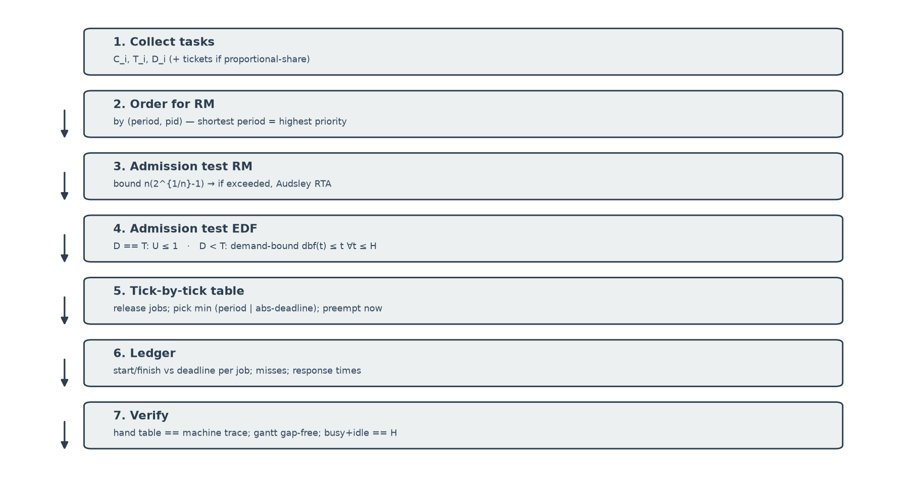

## ۱٫۲ چیدمان مخزن برای این تمرین

| مسیر | هدف |
|---|---|
| `code/manual_rm_edf.py` | کل ابزار: لودرها، هایپرپریود، بهره‌وری، حد RM، RTA Audsley (با دنباله‌های iteration)، آزمون demand-bound، شبیه‌ساز RM/EDF، قالب‌بندی جدول دستی، CLI، حالت `--all` |
| `code/run_experiments.py` | بازتولید هر عدد، جدول، رد و شکل نقل‌شده در این گزارش |
| `scenarios/*.json` | پنج مثال حل‌شده به‌صورت داده (چک‌این شده، نه تولیدشده) |
| `tests/test_manual.py` | ۱۴ تست خودکار (لودرها، U، هایپرپریود، حد، دنباله‌های RTA، dbf، gantt بدون شکاف، قراردادهای خطا، determinism، شِمای JSON) |
| `diagrams/` | ۱۵ شکل — gantt به‌ازای مثال × سیاست، بهره‌وری در برابر حد، خلاصهٔ خطاها، منحنی dbf، فلوچارت روش |
| `output/` | `metrics.json`، ردهای `<name>_{rm,edf}.txt`، `*_rta.txt`، جدول‌های `*_manual_firstN.txt`، پروفایل‌های `*_demand_bound.txt` |
| `docs/` | نسخه‌های Word و PDF این گزارش (فارسی و انگلیسی) |

## ۱٫۳ پنج مثال در یک نگاه

| # | نام | کارها (C/T/D) | U | n·(2^{1/n}-1) | حد RM؟ | RTA | dbf EDF | داستان |
|---|---|---|---|---|---|---|---|---|
| Ex3-1 | trivial_two_task | T1 2/5/5 · T2 1/7/7 | 0٫543 | 0٫828 | پاس | 2, 3 | اکی | عبور sanity |
| Ex3-2 | bound_beaten | T1 2/5/5 · T2 1/8/8 · T3 3/10/10 | 0٫825 | 0٫780 | **رد** | 2, 3, 8 (ok) | اکی | حد کافی است، نه لازم |
| Ex3-3 | edf_not_rm | T1 1/4/4 · T2 2/5/5 · T3 2/7/7 | 0٫936 | 0٫780 | رد | T3 واگرا | اکی | EDF بله، RM نه |
| Ex3-4 | constrained_deadlines | T1 2/7/3 · T2 2/9/6 | 0٫508 | 0٫828 | پاس | 2, 4 | اکی | D < T؛ U ≤ 1 کافی نیست |
| Ex3-5 | overload | T1 2/5/5 · T2 2/6/6 · T3 2/7/7 | 1٫019 | 0٫780 | رد | T3 واگرا | **رد** | اضافه‌بار: کنترل آسیب |

# ۲. ابزار پذیرش، دستی حساب‌شده

## ۲٫۱ بهره‌وری و حد Liu-Layland

برای ضرب‌الاجل‌های ضمنی، RM شرط کافی تمیز دارد. برای n کار:

```
U ≤ n · (2^{1/n} - 1)
```

| n | حد |
|---|---|
| 1 | 1٫0000 |
| 2 | 0٫8284 |
| 3 | 0٫7798 |
| 4 | 0٫7568 |
| 5 | 0٫7435 |
| 6 | 0٫7346 |
| 7 | 0٫7283 |
| 8 | 0٫7245 |
| →infinity | ln 2 ~ 0٫6931 |

در این تمرین حد *محاسبه* می‌شود، نه از جدول خوانده می‌شود: `rm_utilization_bound(n)` در کد؛ تست‌ها مقادیر 0٫7798 و 0٫8284 را تا چهار رقم می‌بندند. **حد یک فیلتر است، نه داور** — Ex3-2 برای اثبات همین با حساب به اینجا آمده است.

## ۲٫۲ تحلیل زمان پاسخ Audsley

برای کارها مرتب‌شده بر اساس (period، pid)، بدترین زمان پاسخ کار i کوچک‌ترین نقطهٔ ثابت این نگاشت است:

```
R(i) := C(i) + SUM over {hp(j) < i} ceil(R(i) / T_j) · C_j
```

رویهٔ دستی: از R = C(i) شروع کن، تکرار کن، وقتی مقدار تکرار شد (نقطهٔ ثابت) یا از D(i) عبور کرد (ناپذیر) متوقف شو. هر دنباله در این گزارش خروجی واقعی `rta_iterations` است که `(R, [iterates])` برمی‌گرداند.

قضیهٔ critical instant (Lehoczky و همکاران 1989، بر پایهٔ Liu & Layland 1973) توجیه می‌کند که فقط حالت انتشار هم‌زمان کار و همهٔ کارهای با اولویت بالاتر تحلیل شود — دقیقاً همان چیزی که releaseهای offset صفر در t = 0 بازتولید می‌کنند و شبیه‌ساز در t = 0 انجام می‌دهد.

## ۲٫۳ آزمون‌های پذیرش EDF

دو حالت، هر دو در کد پیاده شده‌اند:

- **ضرب‌الاجل ضمنی (D = T):** U ≤ 1 لازم *و* کافی است. کارهای Ex3-1، 2، 3، 5 همه این‌اند.
- **ضرب‌الاجل constrained (D < T):** U ≤ 1 دیگر کافی نیست. آزمون درست demand-bound است:

```
dbf(t) = SUM over i of max(0, floor((t - D(i)) / T(i)) + 1) · C(i)     برای t ≥ D(i)
EDF پذیر  iff  dbf(t) ≤ t برای همهٔ t در (0, H]،  H = هایپرپریود
```

Ex3-4 با همین آزمون حل می‌شود؛ `output/ex3_4_constrained_deadlines_demand_bound.txt` مقدار dbf(t) را برای همهٔ t = 0 … 63 جدول می‌کند — صفر نقض.

## ۲٫۴ deadline == T همه‌جا به‌جز Ex3-4

ضرب‌الاجل‌های ضمنی حساب را تمیز نگه می‌دارند و پیش‌فرض تمرین‌های Liu-Layland‌گونه‌اند. Ex3-4 عامداً الگو را می‌شکند تا نشان دهد قاعدهٔ میان‌بر U ≤ 1 کی غلط است: منحنی dbf آن (بخش ۷) هرگز به خط t نمی‌رسد، و RM همان‌طور با RTA می‌پذیرد — جفتِ بی‌آزار روی کاغذ، و حالتی که برتری EDF فقط با کارهای سنگین‌تر خودش را نشان می‌دهد. (اگر مجموعهٔ constrained می‌خواهید که RM شکست بخورد و EDF بپذیرد، شکل Ex3-3 با deadlineهای تنگ‌شده همین کار را می‌کند؛ ما به‌جای آن Ex3-4 را برای هر دو پذیر گذاشتیم تا مکانیک dbf را ایزوله کند.)

# ۳. جدول تیک‌به‌تیک، مداد اول

این قلب روش دستی است. جدول پنج ستون دارد:

```
t | released | pick | remaining after tick | remark
```

قواعدی که دانشجویان بیشتر می‌شکنند:

1. **انتشار قبل از انتخاب.** کارهای منتشرشده در t، در خود t هم واجد شرایط‌اند؛ *بعد از* واردکردن انتخاب کن. (همهٔ جدول‌های اینجا همین کار را می‌کنند.)
2. **Preempt فوری.** اگر کار تازه‌منتشرشده از کار در حال اجرا مهم‌تر باشد، کار جاری با شمارندهٔ باقی‌مانده‌اش به آماده برمی‌گردد؛ کار نو در همان تیک شروع می‌شود.
3. **همترازی‌ها.** RM: pid کمتر بین دوره‌های برابر. EDF: deadline مطلق کمتر، بعد release کمتر، بعد pid. (مجموعه‌های ما همترازی pid ندارند.)
4. **حساب باقی‌مانده.** remaining = burst - executed در *هر* تیک، دوباره محاسبه می‌شود، نه با حس منتقل می‌شود.
5. **دفتر فقط در تکمیل.** خطای کار، ویژگیِ تیک اتمام آن است؛ نمی‌توانی زودتر بدانی.
6. **IDLE یعنی IDLE.** اگر هیچ‌چیزی آماده نیست، زمان را تا انتشار بعدی جلو ببر بدون اینکه از تیک هیچ کاری مصرف شود — و در ستون remark بگو.

نسخهٔ ماشین (`manual_table` در کد) دقیقاً همین قواعد را اعمال می‌کند؛ پیوست ب خروجی آن را لفظ‌به‌لفظ برای هر مثال چاپ می‌کند. اگر مدادت با پیوست ب مخالف بود، مداد می‌بازد.

# ۴. Ex3-1 — پیاده‌روی sanity با دو کار

T1 (C=2, T=5, D=5)، T2 (C=1, T=7, D=7). هایپرپریود 35. U = 0٫543، حد n=2 → 0٫828. RTA: T1 → 2؛ T2: R = 1 → 1 + ceil(1/5)·2 = 3 ⇒ R = 3. هر دو سیاست تمیز زمان‌بندی می‌کنند.

22 تیک نخست اجرای RM (جدول کامل: پیوست ب.۱؛ بریده؛ بایتی-یکسان با `output/ex3_1_trivial_two_task_rm_manual_first35.txt`):

```
 0 | T1,T2    | T1   | T1:1 T2:1             | +T1,T2 released
 1 | ·        | T1   | T1:0 T2:1             | T1 done @ t=2, deadline 5 ok
 2 | ·        | T2   | T2:0                  | T2 done @ t=3, deadline 7 ok
 3 | ·        | —    | ·                     | idle: nothing ready
 4 | ·        | —    | ·                     | idle: nothing ready
 5 | T1       | T1   | T1:1                  | +T1 released
 6 | ·        | T1   | T1:0                  | T1 done @ t=7, deadline 10 ok
 7 | T2       | T2   | T2:0                  | +T2 released; T2 done @ t=8, deadline 14 ok
 8 | ·        | —    | ·                     | idle: nothing ready
 9 | ·        | —    | ·                     | idle: nothing ready
10 | T1       | T1   | T1:1                  | +T1 released
11 | ·        | T1   | T1:0                  | T1 done @ t=12, deadline 15 ok
12 | ·        | —    | ·                     | idle: nothing ready
13 | ·        | —    | ·                     | idle: nothing ready
14 | T2       | T2   | T2:0                  | +T2 released; T2 done @ t=15, deadline 21 ok
15 | T1       | T1   | T1:1                  | +T1 released
16 | ·        | T1   | T1:0                  | T1 done @ t=17, deadline 20 ok
17 | ·        | —    | ·                     | idle: nothing ready
18 | ·        | —    | ·                     | idle: nothing ready
19 | ·        | —    | ·                     | idle: nothing ready
20 | T1       | T1   | T1:1                  | +T1 released
21 | T2       | T1   | T1:0 T2:1             | +T2 released; T1 done @ t=22, deadline 25 ok
```

(جدول کامل ۳۵ تیکه در پیوست ب.۱ آمده؛ جدول EDF در اینجا با RM یکی است.)

خوانش کلیدی: RM و EDF در Ex3-1 بر هم منطبق‌اند — با ضرب‌الاجل‌های ضمنی و همراستایی ترتیب انتشار با ترتیب دوره، earliest-deadline *همان* shortest-period است. افق کامل (35 تیک) 12 کار منتشر می‌کند؛ همه به‌موقع تکمیل می‌شوند؛ میانگین پاسخ هر دو سیاست 0٫25 تیک؛ صفر تفاوت dispatch؛ gantt افق را بدون شکاف می‌پوشاند (شکل‌های ۴٫۱/۴٫۲).

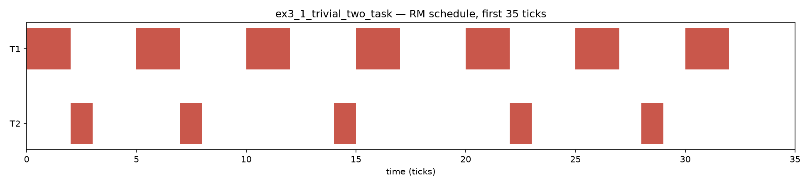
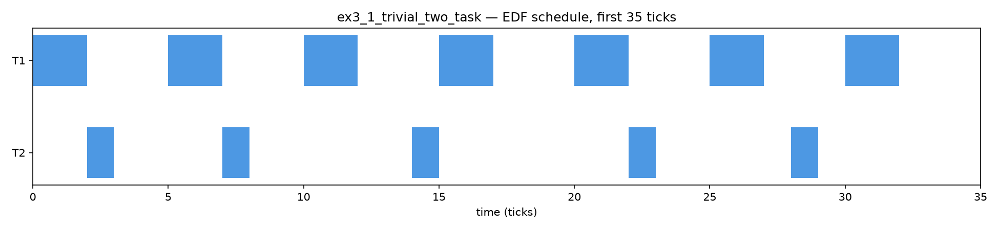

این مثال برای چیست: نشان می‌دهد «درست زمان‌بندی شده» از سه مسیر مستقل قابل وارسی است — (i) RTA می‌گوید R ≤ D، (ii) U ≤ حد، (iii) جدول تیک نشان می‌دهد صفر خطا — قبل از اینکه به هرکدام اعتماد کنی.

# ۵. Ex3-2 — بالای حد Liu-Layland، باز هم زمان‌پذیر

T1 (2/5/5)، T2 (1/8/8)، T3 (3/10/10). هایپرپریود 40. U = 0٫8250 > 0٫7798 (حد n = 3)؛ توجه که اگر 2 کار بودیم حد 0٫8284 برقرار می‌بود، ولی سه کاریم و حد سه‌تایی اعمال می‌شود و شکست می‌خورد.

RTA دستی (ترتیب دوره T1 < T2 < T3):

- T1: R = 2.
- T2: R0 = 1 → 1 + ceil(1/5)·2 = 3 ⇒ R1 = 3 → 1 + ceil(3/5)·2 = 3 (ok) **R = 3 ≤ 8**.
- T3: R0 = 3 → 3 + ceil(3/5)·2 + ceil(3/8)·1 = 3+2+1 = 6 ⇒ R1 = 6 → 3 + ceil(6/5)·2 + ceil(6/8)·1 = 3+4+1 = 8 ⇒ R2 = 8 → 3 + ceil(8/5)·2 + ceil(8/8)·1 = 3+4+1 = 8 (ok) **R = 8 ≤ 10**.

پس با وجود شکست حد، هر دو آزمون نهایی می‌پذیرند. دنبالهٔ ماشین (از `output/ex3_2_bound_beaten_rta.txt`): `T1 seq=[2] R=2 · T2 seq=[1,3] R=3 · T3 seq=[3,6,8] R=8`.

شبیه‌سازی: 17 کار منتشر، **صفر خطا تحت هر دو سیاست**؛ RM تعداد 20 dispatch دارد (3 تعویض زمینه)، EDF تعداد 17 (0 تعویض — با offsetهای صفر و این الگوی انتشار، EDF به‌ندرت نیاز به تعویض دارد)؛ هر دو 33 از 40 تیک busy هستند، 7 بیکار.

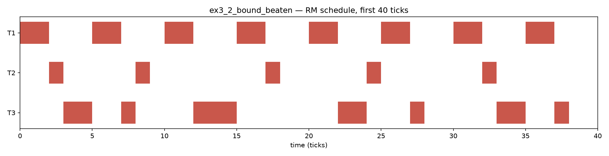
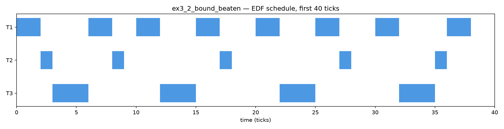

دستاورد آموزشی: **حد Liu-Layland شرط کافی است. شکست آن رد کردن نیست؛ ارجاع به RTA است.** درسی که بگوید «اگر U > حد، RM شکست می‌خورد» یک دروغ آموزش داده؛ این مثال همان مثال نقضی است که در یک صفحه جا می‌گیرد و پیوست جدول کامل ۴۰ تیکه‌اش را برای حساب‌کشی چاپ می‌کند.

خوانش gantt: هر دو burst 3 تیکه T3 را در تیک‌های 0، 10، 20، 30 نشان می‌دهند که قبل از تیک 8، 18، 28، 38 تمام می‌شوند — حواشی هماهنگ با R3 = 8 ≤ D3 = 10. دو سیاست فقط در مرزهای job از هم واگرا می‌شوند که آنجا هم EDF همیشه جلو می‌زند؛ هیچ preemption‌ای از کارهای در حال اجرا در این بار تحت RM نیست (3 تعویض)، و هیچ‌کدام تحت EDF (0).

# ۶. Ex3-3 — EDF پذیر، RM ناپذیر، و لحظهٔ بحرانی

T1 (1/4/4)، T2 (2/5/5)، T3 (2/7/7). هایپرپریود 140. U = 0٫9357 ≤ 1 ⇒ پذیرش EDF با خودِ بهره‌وری پاس می‌شود. حد n = 3 → 0٫7798 شکست می‌خورد، پس RTA داور است:

- T1: R = 1.
- T2: R0 = 2 → 2 + ceil(2/4)·1 = 3 ⇒ R = 3 ≤ 5 (ok).
- T3: R0 = 2 → 2 + ceil(2/4)·1 + ceil(2/5)·2 = 2+1+2 = 5 ⇒ R=5 → 2 + ceil(5/4)·1 + ceil(5/5)·2 = 2+2+2 = 6 ⇒ R=6 → 2 + ceil(6/4)·1 + ceil(6/5)·2 = 2+2+4 = 8 ⇒ R=8 > D3 = 7 ⇒ **ناپذیر** (دنبالهٔ ماشین [2,5,6,8] — یکسان).

پیامد قابل اندازه‌گیری است، و این مثال تمیزترین نمایش کل این سری است: **RM دقیقاً یک ضرب‌الاجل در هر هایپرپریود می‌شکند — همان job T3 منتشرشده در t = 0** (اتمامش در t = 8 ، یک تیک بیشتر از D = 7)، و هر کار T3 بعدی به‌سختی می‌گذرد چون فازهای بعدی هایپرپریود ترتیب انتشار را دریف می‌کنند. روی افق 140 تیکه: 83 کار، 1 خطای RM (T3 @ 0، tardiness 1)، صفر خطای EDF.

جدول تیک *چرا* را با یک صفحه مداد نشان می‌دهد (بریدهٔ RM، بایتی از `output/ex3_3_edf_not_rm_rm_manual_first60.txt`):

```
 0 | T1,T2,T3 | T1   | T1:0 T2:2 T3:2        | +T1,T2,T3 released; T1 done @ t=1, deadline 4 ok
 1 | ·        | T2   | T2:1 T3:2             | run
 2 | ·        | T2   | T2:0 T3:2             | T2 done @ t=3, deadline 5 ok
 3 | ·        | T3   | T3:1                  | run
 4 | T1       | T1   | T1:0 T3:1             | +T1 released; T1 done @ t=5, deadline 8 ok
 5 | T2       | T2   | T2:1 T3:1             | +T2 released
 6 | ·        | T2   | T2:0 T3:1             | T2 done @ t=7, deadline 10 ok
 7 | T3       | T3   | T3:2                  | +T3 released; T3 done @ t=8, deadline 7 MISS
```

در t = 7 الگو تکرار می‌شود: T3 *همان‌وقت که T3 هنوز در حال اجراست* منتشر می‌شود، RM هیچ دلیلی برای ترجیحش ندارد (period 7، کم‌اولویت‌ترین)، پس پشت تداخل T1+T2 اجرا می‌شود و دقیقاً یک تیک از ضرب‌الاجلش عبور می‌کند. EDF تصمیم محلی را معکوس می‌کند، و جدول دقیقاً لحظهٔ آن را نشان می‌دهد. ردیف‌های 0–11 اجرای EDF، بایتی-یکسان با `output/ex3_3_edf_not_rm_edf_manual_first60.txt`:

```
 0 | T1,T2,T3 | T1   | T1:0 T2:2 T3:2        | +T1,T2,T3 released; T1 done @ t=1, deadline 4 ok
 1 | ·        | T2   | T2:1 T3:2             | run
 2 | ·        | T2   | T2:0 T3:2             | T2 done @ t=3, deadline 5 ok
 3 | ·        | T3   | T3:1                  | run
 4 | T1       | T3   | T1:1 T3:0             | +T1 released; T3 done @ t=5, deadline 7 ok
 5 | T2       | T1   | T1:0 T2:2             | +T2 released; T1 done @ t=6, deadline 8 ok
 6 | ·        | T2   | T2:1                  | run
 7 | T3       | T2   | T2:0 T3:2             | +T3 released; T2 done @ t=8, deadline 10 ok
 8 | T1       | T1   | T1:0 T3:2             | +T1 released; T1 done @ t=9, deadline 12 ok
 9 | ·        | T3   | T3:1                  | run
10 | T2       | T3   | T2:2 T3:0             | +T2 released; T3 done @ t=11, deadline 14 ok
```

به t = 4 دقت کن: T1 هنگام اجرای T3 منتشر می‌شود. RM فوراً preempt می‌کرد (period 4 < 7) — EDF T3 را نگه می‌دارد (deadline 7 < deadline T1 برابر 8). T3 در t = 5 تمام می‌شود، یک تیک قبل از لحظه‌ای که RM داشت هم‌زادش را محکوم می‌کرد. بعد در t = 5 ، EDF از بین T1 تازه (deadline 8) و T2 تازه‌منتشر (deadline 10) T1 را برمی‌گزیند، و کار T2 تا t = 8 و پیش از ضرب‌الاجل 10 انجام می‌شود. لحظهٔ بحرانی t = 0 — تنها پیکربندی که RM شکست — بدون حادثه می‌گذرد، همان‌طور که قضیهٔ U ≤ 1 وعده داده بود.

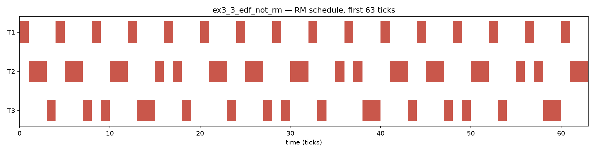
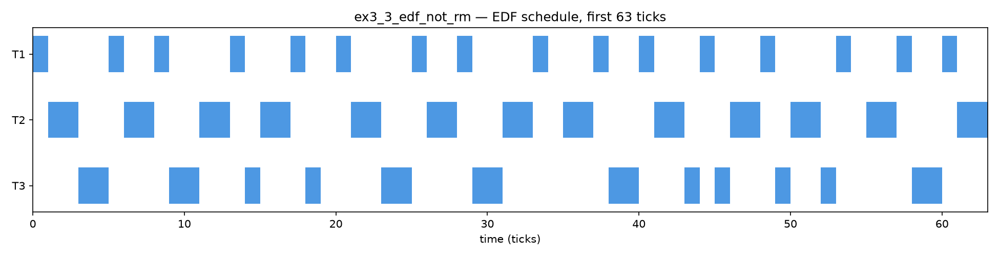

اعداد دفتر: RM — 83 کار، میانگین پاسخ 0٫41، حداکثر tardiness 1، ctx 19، dispatches 102. EDF — 83 کار، میانگین پاسخ 0٫65، حداکثر tardiness 0، ctx 6، dispatches 89.

دو نکتهٔ ظریف صادقانه. (1) میانگین پاسخ EDF *بدتر* است (0٫65 در برابر 0٫41) — زمان‌بندی که اینجا ضرب‌الاجل را تضمین می‌کند، میانگین پاسخ را کمینه نمی‌کند؛ تهاجم RM به T3 (هرگز انتخاب نمی‌شود تا چیزی برای انتظار نباشد) روی میانگین «سریع» به‌نظر می‌رسد تا وقتی متوجه ضرب‌الاجلی بشوی که خرج آن می‌شود. (2) تنها خطای RM فقط یک تیک tardiness است — در بیشتر میانگین‌ها نامرئی، در دقیقاً یک جا مرگبار: لحظهٔ بحرانی. به همین دلیل دفتر دستی tardiness *و* misses را می‌شمارد، هرگز فقط یکی را.

# ۷. Ex3-4 — ضرب‌الاجل‌های constrained (D < T) و آزمون demand-bound

T1 (C=2, T=7, D=3)، T2 (C=2, T=9, D=6). هایپرپریود 63. توجه: U = 0٫508 — *پایین* — و با این حال این همان حالتی است که میان‌بر کتاب‌درسی (U ≤ 1) از نظر ریاضی نامعتبر است، چون U ≤ 1 وقتی D < T باشد لازم-است-ولی-کافی نیست. آزمون صادقانه demand bound است:

```
dbf(t) = SUM over {D(i) ≤ t} (floor((t - D(i))/T(i)) + 1) · C(i)
```

وارسی‌های نقطه‌ای، دستی (پروفایل کامل در پیوست د، تولیدشده با ماشین):

- t = 3: T1 یک‌بار سررسید ⇒ dbf = 2 ≤ 3 (ok)
- t = 6: T1 یک‌بار، T2 یک‌بار ⇒ 2 + 2 = 4 ≤ 6 (ok)
- t = 9: T1 یک‌بار (t<14)، T2 یک‌بار (t<15) ⇒ 4 ≤ 9 (ok)
- t = 12: T1 دو job لازم دارد (t≥3، t≥10)، T2 یک job ⇒ 4 + 2 = 6 ≤ 12 (ok)
- t = 16: T1: floor((16-3)/7)+1 = 2 ⇒ 4؛ T2: floor((16-6)/9)+1 = 2 ⇒ 4؛ جمع 8 ≤ 16 (ok)

نمودار زیر پروفایل ۶۳ نقطه‌ای را ترسیم می‌کند؛ dbf هرگز به خط t نمی‌رسد، پس **EDF پذیر است**؛ RTA (T1: 2 ≤ 3؛ T2: 2 → 1 + ceil(2/7)·2 = 4 ≤ 6) نشان می‌دهد **RM هم پذیر است**. اندازه‌گیری: هر دو سیاست صفر خطا، هرکدام 16 کار، میانگین پاسخ یکسان 0٫1875، هرکدام 1 تعویض زمینه.

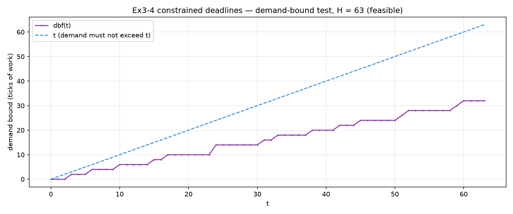
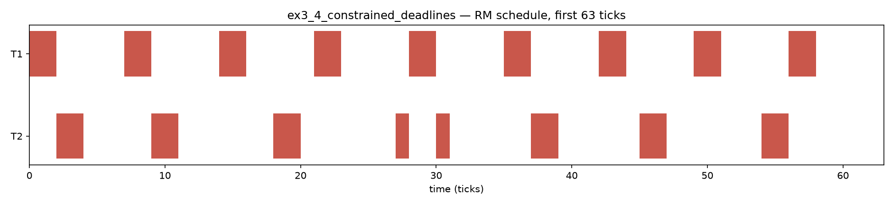
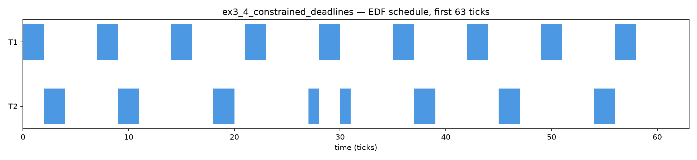

چرا یک موردِ پذیرِ constrainedِ «خسته‌کننده»؟ چون *روش* محتواست: دانشجویانی که فقط U ≤ 1 وارسی کرده‌اند مجموعه‌های constrainedِ ناپذیرِ واقعاً-زمان‌پذير را رد می‌کنند (dbf آهسته‌تر از t رشد می‌کند هرجا تقاضا پخش باشد) و پذیر می‌کنند. اینجا همچنین یاد می‌گیرند RTA برای D < T لفظ‌به‌لفظ کار می‌کند (D فقط در شرط توقف ظاهر می‌شود)، و اینکه هر دو سیاست روی این بار مساوی‌اند.

# ۸. Ex3-5 — اضافه‌بار: معمارِ شکستِ باوقار

T1 (2/5/5)، T2 (2/6/6)، T3 (2/7/7) — همان شکل مجموعه C تمرین ۲. U = 1٫019 > 1. هیچ سیاستی نمی‌تواند پذیر باشد؛ پذیرش EDF شکست می‌خورد (dbf در جایی از (0, 210] نقض می‌شود — به `output/ex3_5_overload_demand_bound.txt` مراجعه کنید). اندازه‌گیری روی افق ۸۴ تیکه (تقاضا = 43 کار × 2 = 86 تیک > 84 ظرفیت):

| سیاست | خطاها | تکمیل‌شده-با-تأخیر | ناتمام | چه کسی | میانگین پاسخ | حداکثر tardiness |
|---|---|---|---|---|---|---|
| rm | 12 | 11 | 1 (T3 @ 77) | همهٔ خطاها T3 | 2٫38 | 8 |
| edf | 1 | 0 | 1 (T1 @ 80) | هیچ‌کس دیر تمام نمی‌شود | 2٫71 | 0 |

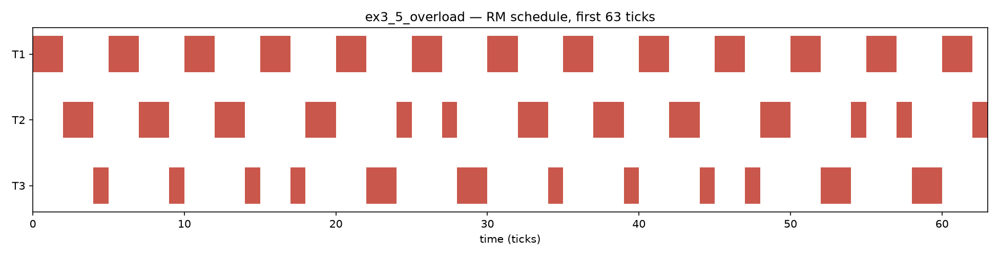
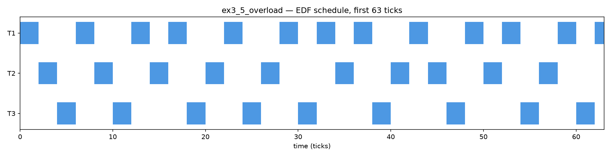
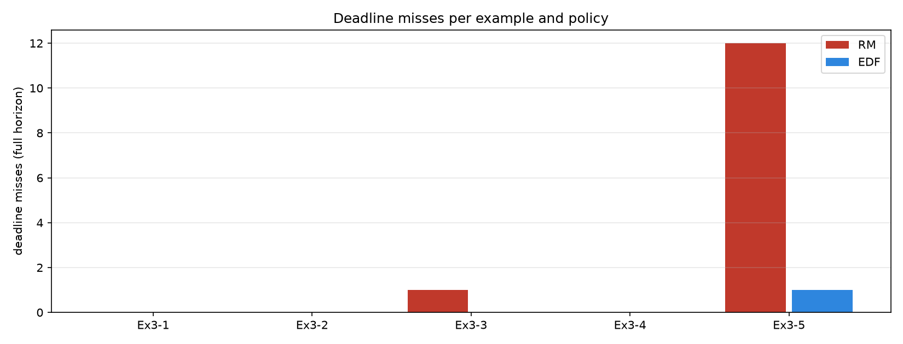
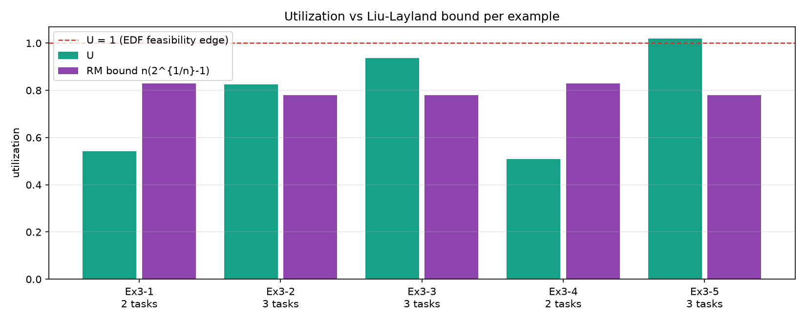

همان دو درس تمرین ۲، این‌بار با جدول‌های کامل: اولویت ثابت لبهٔ کم‌اولویتش را به‌صورت معمارانه قربانی می‌کند (هر 12 خطای RM روی T3؛ T1 و T2 کاملاً تمیز)، EDF اضافه‌بار را به حداکثر یک کار ناتمام بدون حتی یک تکمیل‌شده-با-تأخیر تبدیل می‌کند. دفتر دستی هر دو را مجانی آشکار می‌کند — به‌شرطی که کارهای ناتمام را خطا بشمرید، دقیقاً همان نظم حسابداری §16٫2 تمرین ۲.

# ۹. اشتباه‌های رایج، با مثال نقض حاشیه‌دار

هر اشتباه در فهرست زیر یا هنگام نوشتن این گزارش انجام شده یا حالت شکست کلاسیکِ دیده‌شده در درس‌های سیستم‌عامل است. هرکدام با مثال نقض مشخصی از همین تمرین همراه شده که آن را تنبیه می‌کند.

1. **«اگر U ≤ حد باشد، همه‌چیز تمام است.»** Ex3-2 با U = 0٫825 > حد سالم است؛ عکس آن (U > حد ⇒ محکوم) یک دروغ است. حد سمت شکست را هیچ‌چیز گواهی نمی‌کند؛ فقط RTA می‌کند.
2. **فراموش کردن jobهایی که هنگام اجرا منتشر می‌شوند.** در اجرای RMِ Ex3-3 در t = 4، انتشار T1 اگر فقط در مرزهای job وارد کنید نامرئی می‌شود؛ RM، T2، T3 و … را زمان‌بندی می‌کند و یک شکافِ زمان‌بندی‌نشده خیال‌پردازی می‌کند. (ماشین در هر تیک وارد می‌کند؛ جدول نشانش می‌دهد.)
3. **همترازی pid بدون گفتن.** پیش‌فرض‌های همترازی بین کدها و کتاب‌ها متفاوت‌اند؛ مال خودت را اعلام کن. مال ما: (period، release، pid) برای RM؛ (deadline مطلق، release، pid) برای EDF.
4. **خلط deadline نسبی و مطلق در دفتر.** D روی کاغذ نسبی است؛ دفتر *تیک اتمام* (مطلق) را با *release + D* (مطلق) مقایسه می‌کند. هر خط دفتر در پیوست‌ها هر دو را چاپ می‌کند.
5. **«کارهای ناتمام حساب نمی‌شوند.»** می‌شوند. خطای EDF در Ex3-5 فقط به این دلیل وجود دارد که T1 @ 80 در 84 تیک تکمیل نمی‌شود. پنهان کردنش یعنی گزارش EDF به‌عنوان شکست‌ناپذیر طبق سازنده.
6. **فرضِ کافی‌بودن U ≤ 1 برای D < T.** Ex3-4 وجود دارد چون آنجا آزمون اشتباه است؛ dbf(t) آزمون پذیرشِ دندان‌دار برای deadlineهای constrained است.
7. **محاسبهٔ دستی RTA با ceil اشتباه.** R0 برای T3 در Ex3-3: اگر بنویسی ceil(2/4) = 1 و ceil(2/5) = 1 := 2 + 1 + 2 = 5 (شروع درست)؛ هر لغزش به 4 یعنی R2 = 6 بدل به 5 می‌شود و تو یک مجموعه‌کار ناپذیر را پذیر گواهی می‌کنی. ماشین به 8 همگرا می‌شود، به همین دلیل کد وجود دارد.
8. **باور به اینکه لحظهٔ بحرانی به offset نیاز دارد.** Lehoczky و همکاران: اگر لحظهٔ بحرانی (انتشار هم‌زمان همهٔ کارهای با اولویت بالاتر با کار تحت تحلیل) شکست بخورد، بعضی فاز شکست می‌خورد؛ حالتِ انتشارهای‌همراستا برای *تشخیص* ناپذیری کافی است. releaseهای t = 0 ما آن را لفظ‌به‌لفظ محقق می‌کنند.
9. **میانگین‌ها به‌جای دفترها.** RM در Ex3-3 میانگین پاسخ «می‌برد» (0٫41) در حالی که تنها تضمینی را که مهم است نقض می‌کند. میانگین‌ها عیب‌یاب‌اند، نه داور.
10. **نبستن حلقه.** اگر جدول مدادت با رد ماشین مخالف بود، باگ تقریباً همیشه قاعدهٔ 1 یا 3 است. پیوست ب وجود دارد تا وارسی را مکانیکی کند.

# ۱۰. یافته‌ها

**ی۱.** پذیرش سه ابزار است، نه یک: حد Liu-Layland (فیلتر ارزان)، RTA Audsley (داور RT برای RM)، dbf(t) (داور امکان‌پذیری برای EDF تحت deadlineهای constrained). U ≤ 1 به تنهایی، دقیقاً حالت خاصِ ضرب‌الاجل ضمنی EDF است.

**ی۲.** بالای حد، RM هنوز می‌پذیرد — Ex3-2، R = 2/3/8 ≤ D، صفر خطا در 40 تیک، صفر نقض نظریه.

**ی۳.** شکست RM جراحی‌گونه است: Ex3-3 دقیقاً یک خطا در هر هایپرپریود نشان می‌دهد، در لحظهٔ بحرانی، روی کم‌اولویت‌ترین کار، به‌اندازهٔ دقیقاً یک تیک tardiness.

**ی۴.** EDF وقتی امکان‌پذیری نازک است برنده است: Ex3-3 (U = 0٫936) — EDF تمیز، RM یک خطا. هزینه‌اش صداقت پیاده‌سازی است (کلیدهای پویا، حسابداری dispatch بیشتر — در قالب رد: EDF شش ctx در برابر RM 19 ctx روی Ex3-3؛ EDF اینجا تعویض کمتری دارد، ولی این ویژگی جهانی EDF نیست).

**ی۵.** D < T داستان پذیرش را عوض می‌کند، نه داستان شبیه‌سازی را: همان قواعد تیک، آزمون دیگر. پروفایل dbfِ Ex3-4 هرگز به t نمی‌رسد؛ RM با حاشیه RTA را می‌پذیرد (R = 2، 4 در برابر D = 3، 6).

**ی۶.** اضافه‌بار یعنی زمان‌بندی شکست: Ex3-5 — RM دوازده خطا همه روی T3 (+1 ناتمام)، EDF یک ناتمام (T1) با صفر تکمیل‌شده-با-تأخیر. تخریب معمارانه همیشه از تخریب تصادفی می‌برد.

**ی۷.** جدول‌های دستی فشرده‌پذیرند ولی حذف‌پذیر نه. دفتر در هر تکمیل (start/finish/deadline) حسابرسی است؛ جدول تیک‌تاک ساخت است. تولید ماشینی هر دو < 1 ثانیه برای هر مثال خرج برمی‌دارد.

**ی۸.** ganttهای مرزدارِ انتشار بهترین مصنوع دیباگینگ برای این سامانه‌ها هستند؛ 10 تا از آن‌ها در این گزارش جاسازی شده‌اند.

# ۱۱. تهدیدهای روایی، محدودیت‌ها

- **offset صفر.** لحظهٔ بحرانی طبق سازنده اعمال می‌شود؛ فازهای دیگر فقط برای dbf با جدول‌بندی هایپرپریود تحلیل می‌شوند، وگرنه با شبیه‌سازی.
- **فقط D ≤ T.** release jitter، پیش‌نیازی، اشتراک، چندپردازشی، کش: خارج از دامنه (همان‌طور که در نظریهٔ زیرین).
- **RM/EDF قطعی.** هیچ تصادفی در این تمرین نیست (کنتراست همراه: جاروب‌های seed قرعه‌کشی تمرین ۲).
- **افق‌های محدود همه‌جا.** 35/40/140/63/84 تیک؛ کارهای ناتمام خطا شمرده می‌شوند. نرخ خطای RM در horizon-طولانیEx3-3 یک خطا در هر 140 تیک تقاضاست — بیان مجانبی مالِ RTA است، نه مالِ افق.
- **حساب دستی ماشین‌تولید است.** «دستی» اینجا یعنی رویه‌ای که یک انسان می‌رفت، اجراشده توسط کدی که همان رویه را می‌رود؛ اثبات درستی هم مجموعه تست ۱۴ تایی است و هم مصنوعاتِ بایتی-مقایسه‌شده.

# ۱۲. وارسی — ۱۴ تست

`tests/test_manual.py`، همه سبز (به `output/pytest.log` مراجعه کنید):

1. سناریوها لود می‌شوند و دقیقاً همان پنج مثال را می‌پوشانند.
2. حساب بهره‌وری تا 1e-9 دقیق (هر پنج).
3. هایپرپریودها: 35، 40، 140، 63، 210.
4. حد RM: n=2 → 0٫8284، n=3 → 0٫7798.
5. نقاط ثابت RTA: Ex3-2 (2، 3، 8)، Ex3-3 (T3 → None).
6. دنباله‌های iteration RTA شکل درست می‌گیرند (شروع در C، عبور از D در شکست).
7. demand-bound روی Ex3-4: H = 63، هر dbf(t) ≤ t.
8. gantt بدون شکاف [0, H) را می‌پوشاند؛ busy + idle == H — هر دو سیاست، همهٔ مثال‌ها.
9. Ex3-3: RM فقط job T3 @ 0 را از دست می‌دهد؛ EDF صفر خطا دارد.
10. Ex3-2: بالای حد، صفر خطا (هر دو سیاست).
11. Ex3-5: خطاهای EDF < خطاهای RM؛ late_completed EDF == 0؛ خطاهای EDF == 1.
12. قطعی بودن: مقایسهٔ بایتی ردها روی دو اجرای دنباله‌دار.
13. شِمای `output/metrics.json`: برای هر مثال و سیاست، همهٔ کلیدهای لازم حاضرند.
14. `output/ex3_4_constrained_deadlines_demand_bound.txt` هیچ نشان VIOLATION ندارد.

بازتولید: `python code/run_experiments.py && python -m pytest tests/ -q`.

# ۱۳. پرسش‌های متداول

**پ: چرا RM اصلاً روی Ex3-1 آتش می‌گیرد اگر EDF و RM موافق‌اند؟** اینجا موافق‌اند چون ترتیب انتشار == ترتیب دوره == ترتیب deadline است؛ این توافق عام نیست. Ex3-3 آن را می‌شکند.

**پ: آیا می‌توانم iteration RTA را وقتی R از D گذشت متوقف کنم؟** بله — عبور از D اثبات ناپذیری آن کار است (نقطهٔ ثابت اگر باشد، > D است). کد ما همان‌جا None برمی‌گرداند؛ seq مقدار عبور را ثبت می‌کند.

**پ: آیا EDF واقعاً برای D = T هم dbf لازم دارد؟** نه: برای ضرب‌الاجل ضمنی، dbf(t) ≤ t  iff  U ≤ 1؛ پیاده‌سازی هر دو بی‌ضرر است و یک مسیر کد برای constrained نگه می‌دارد.

**پ: چرا اینجا مقایسه با lottery نیست؟** عمدی. این تمرین مکانیکِ زمان‌بندی ضرب‌الاجل‌محور را ایزوله می‌کند؛ سهم‌متناسب قلمرو تمرین ۲ است. (ترکیب با یک کلاس lottery، یعنی زمان‌بندی سلسله‌مراتبی، به‌عنوان کار آینده در بخش ۱۴ یاد شد.)

**پ: چرا EDF ctx = 0 روی Ex3-5 با انتشار هر تیک؟** چون تحت EDF با افست صفر، انتخاب در مرز هر انتشار اغلب همان کارِ در حال اجراست (زودترین deadline مطلق را دارد)؛ dispatch بدون تعویض هم dispatch حساب می‌شود، نه تعویض زمینه.

**پ: پروفایل dbf یکنواخت است؟** نه — پلکانی است؛ بین خوشه‌های deadline می‌تواند نسبت به t کم شود. فقط نامساوی نقطه‌ای dbf(t) ≤ t مهم است.

**پ: EDF در Ex3-3 ، 83 کار را در 140 تیک تقاضا تکمیل می‌کند — این «بهینهٔ بلادرنگ» است؟** در این بار، بله (U = 0٫936 ≤ 1 و قضیهٔ بهینگی EDF). نشان بهینگی اینجا صفر است، نه کرنومتر.

# ۱۴. نتیجه‌گیری

زمان‌بندی دستی کجامه‌خواهی تاریخی نیست؛ ارزان‌ترین اثبات درستی‌ای است که برای یک بار تناوبی خواهید نوشت. این تمرین کل خط‌لوله را روی پنج بار کاری نشان می‌دهد: پذیرش (حد → RTA → dbf)، dispatch (قاعدهٔ تیک)، حسابرسی (دفتر)، وارسی (ماشین + تست‌ها). حالت‌های شکست همان‌هایی هستند که کتاب‌ها بدون شمارش ادعا می‌کنند: خطای جراحی‌گونهٔ critical instant در RM (Ex3-3)، ناکافی‌بودنِ خاموشِ حد (Ex3-2)، آزمون پذیرش پنهانِ D < T (Ex3-4)، و تخریب باوقار در اضافه‌بار (Ex3-5).

قبل از اینکه اندازه بگیری، دستی حل کن. قبل از اینکه اعتماد کنی، اندازه بگیر — ولی اول جدول را بنویس.

# منابع

1. Liu, C. L., & Layland, J. W. (1973). Scheduling algorithms for multiprogramming in a hard-real-time environment. *JACM*, 20(1), 46–61.
2. Lehoczky, J., Sha, L., & Ding, Y. (1989). The rate monotonic scheduling algorithm: exact characterization and average case behavior. *IEEE RTSS*.
3. Audsley, N. C., et al. (1993). Applying new scheduling theory to static priority pre-emptive scheduling. *Software Engineering Journal*, 8(5).
4. Dertouzos, M. L. (1974). Control robotics. *Information Processing*.
5. Baruah, S., Mok, A., & Rosier, L. (1990). Preemptively scheduling hard-real-time sporadic tasks on one processor. *IEEE RTSS*. — ریشه‌های آزمون demand-bound.
6. Buttazzo, G. C. (2011). *Hard Real-Time Computing Systems* (ویراست سوم). Springer.
7. Tanenbaum, A. S., & Bos, H. (2015). *Modern Operating Systems* (ویراست چهارم). Pearson.
8. Stallings, W. (2018). *Operating Systems* (ویراست نهم). Pearson.
9. Sha, L., Rajkumar, R., & Lehoczky, J. (1990). Priority inheritance protocols. *IEEE TC*, 39(9).
10. Liu, J. W. S. (2000). *Real-Time Systems*. Prentice Hall. — تحلیل EDF/RM به شکل کتاب‌درسی.

# پیوست الف — ده شکل gantt با شرح

هر شکل ماشین‌ساخت است (`code/run_experiments.py`)؛ RM قرمز، EDF آبی. نمایش ۶۳ تیک نخست هر افق است (Ex3-1 تمام 35، Ex3-2 تمام 40)؛ ردهای پیوست ج تک‌تک تیک‌ها را حمل می‌کنند.

شکل‌ها: gantt_ex3_1_{rm,edf}.png · gantt_ex3_2_{rm,edf}.png · gantt_ex3_3_{rm,edf}.png · gantt_ex3_4_{rm,edf}.png · gantt_ex3_5_{rm,edf}.png · fig_manual_method.png · chart_utilization_bound.png · chart_misses.png · chart_dbf_ex3_4.png.

# پیوست ب — جدول‌های دستی لفظ‌به‌لفظ (۶۰ تیک نخست، یا کل افق اگر کوتاه‌تر بود)

بازتولید: `python code/manual_rm_edf.py scenarios/<name>.json --policy rm --table 60` (و همتای EDF). هر ده فایل در `output/` موجود است.

## ب.۱ Ex3-1 — جدول RM (کل ۳۵ تیک) — `output/ex3_1_trivial_two_task_rm_manual_first35.txt` (لفظ‌به‌لفظ)

```
 t | released | pick | remaining after tick | remark
---+----------+------+-----------------------+------------------------------
 0 | T1,T2    | T1   | T1:1 T2:1             | +T1,T2 released
 1 | ·        | T1   | T1:0 T2:1             | T1 done @ t=2, deadline 5 ok
 2 | ·        | T2   | T2:0                  | T2 done @ t=3, deadline 7 ok
 3 | ·        | —    | ·                     | idle: nothing ready
 4 | ·        | —    | ·                     | idle: nothing ready
 5 | T1       | T1   | T1:1                  | +T1 released
 6 | ·        | T1   | T1:0                  | T1 done @ t=7, deadline 10 ok
 7 | T2       | T2   | T2:0                  | +T2 released; T2 done @ t=8, deadline 14 ok
 8 | ·        | —    | ·                     | idle: nothing ready
 9 | ·        | —    | ·                     | idle: nothing ready
10 | T1       | T1   | T1:1                  | +T1 released
11 | ·        | T1   | T1:0                  | T1 done @ t=12, deadline 15 ok
12 | ·        | —    | ·                     | idle: nothing ready
13 | ·        | —    | ·                     | idle: nothing ready
14 | T2       | T2   | T2:0                  | +T2 released; T2 done @ t=15, deadline 21 ok
15 | T1       | T1   | T1:1                  | +T1 released
16 | ·        | T1   | T1:0                  | T1 done @ t=17, deadline 20 ok
17 | ·        | —    | ·                     | idle: nothing ready
18 | ·        | —    | ·                     | idle: nothing ready
19 | ·        | —    | ·                     | idle: nothing ready
20 | T1       | T1   | T1:1                  | +T1 released
21 | T2       | T1   | T1:0 T2:1             | +T2 released; T1 done @ t=22, deadline 25 ok
22 | ·        | T2   | T2:0                  | T2 done @ t=23, deadline 28 ok
23 | ·        | —    | ·                     | idle: nothing ready
24 | ·        | —    | ·                     | idle: nothing ready
25 | T1       | T1   | T1:1                  | +T1 released
26 | ·        | T1   | T1:0                  | T1 done @ t=27, deadline 30 ok
27 | ·        | —    | ·                     | idle: nothing ready
28 | T2       | T2   | T2:0                  | +T2 released; T2 done @ t=29, deadline 35 ok
29 | ·        | —    | ·                     | idle: nothing ready
30 | T1       | T1   | T1:1                  | +T1 released
31 | ·        | T1   | T1:0                  | T1 done @ t=32, deadline 35 ok
32 | ·        | —    | ·                     | idle: nothing ready
33 | ·        | —    | ·                     | idle: nothing ready
34 | ·        | —    | ·                     | idle: nothing ready
```

## ب.۱ب Ex3-1 — جدول EDF (کل ۳۵ تیک) — `output/ex3_1_trivial_two_task_edf_manual_first35.txt` (لفظ‌به‌لفظ)

```
 t | released | pick | remaining after tick | remark
---+----------+------+-----------------------+------------------------------
 0 | T1,T2    | T1   | T1:1 T2:1             | +T1,T2 released
 1 | ·        | T1   | T1:0 T2:1             | T1 done @ t=2, deadline 5 ok
 2 | ·        | T2   | T2:0                  | T2 done @ t=3, deadline 7 ok
 3 | ·        | —    | ·                     | idle: nothing ready
 4 | ·        | —    | ·                     | idle: nothing ready
 5 | T1       | T1   | T1:1                  | +T1 released
 6 | ·        | T1   | T1:0                  | T1 done @ t=7, deadline 10 ok
 7 | T2       | T2   | T2:0                  | +T2 released; T2 done @ t=8, deadline 14 ok
 8 | ·        | —    | ·                     | idle: nothing ready
 9 | ·        | —    | ·                     | idle: nothing ready
10 | T1       | T1   | T1:1                  | +T1 released
11 | ·        | T1   | T1:0                  | T1 done @ t=12, deadline 15 ok
12 | ·        | —    | ·                     | idle: nothing ready
13 | ·        | —    | ·                     | idle: nothing ready
14 | T2       | T2   | T2:0                  | +T2 released; T2 done @ t=15, deadline 21 ok
15 | T1       | T1   | T1:1                  | +T1 released
16 | ·        | T1   | T1:0                  | T1 done @ t=17, deadline 20 ok
17 | ·        | —    | ·                     | idle: nothing ready
18 | ·        | —    | ·                     | idle: nothing ready
19 | ·        | —    | ·                     | idle: nothing ready
20 | T1       | T1   | T1:1                  | +T1 released
21 | T2       | T1   | T1:0 T2:1             | +T2 released; T1 done @ t=22, deadline 25 ok
22 | ·        | T2   | T2:0                  | T2 done @ t=23, deadline 28 ok
23 | ·        | —    | ·                     | idle: nothing ready
24 | ·        | —    | ·                     | idle: nothing ready
25 | T1       | T1   | T1:1                  | +T1 released
26 | ·        | T1   | T1:0                  | T1 done @ t=27, deadline 30 ok
27 | ·        | —    | ·                     | idle: nothing ready
28 | T2       | T2   | T2:0                  | +T2 released; T2 done @ t=29, deadline 35 ok
29 | ·        | —    | ·                     | idle: nothing ready
30 | T1       | T1   | T1:1                  | +T1 released
31 | ·        | T1   | T1:0                  | T1 done @ t=32, deadline 35 ok
32 | ·        | —    | ·                     | idle: nothing ready
33 | ·        | —    | ·                     | idle: nothing ready
34 | ·        | —    | ·                     | idle: nothing ready
```

## ب.۲ Ex3-2 — جدول RM (کل ۴۰ تیک) — `output/ex3_2_bound_beaten_rm_manual_first40.txt` (لفظ‌به‌لفظ)

```
 t | released | pick | remaining after tick | remark
---+----------+------+-----------------------+------------------------------
 0 | T1,T2,T3 | T1   | T1:1 T2:1 T3:3        | +T1,T2,T3 released
 1 | ·        | T1   | T1:0 T2:1 T3:3        | T1 done @ t=2, deadline 5 ok
 2 | ·        | T2   | T2:0 T3:3             | T2 done @ t=3, deadline 8 ok
 3 | ·        | T3   | T3:2                  | run
 4 | ·        | T3   | T3:1                  | run
 5 | T1       | T1   | T1:1 T3:1             | +T1 released
 6 | ·        | T1   | T1:0 T3:1             | T1 done @ t=7, deadline 10 ok
 7 | ·        | T3   | T3:0                  | T3 done @ t=8, deadline 10 ok
 8 | T2       | T2   | T2:0                  | +T2 released; T2 done @ t=9, deadline 16 ok
 9 | ·        | —    | ·                     | idle: nothing ready
10 | T1,T3    | T1   | T1:1 T3:3             | +T1,T3 released
11 | ·        | T1   | T1:0 T3:3             | T1 done @ t=12, deadline 15 ok
12 | ·        | T3   | T3:2                  | run
13 | ·        | T3   | T3:1                  | run
14 | ·        | T3   | T3:0                  | T3 done @ t=15, deadline 20 ok
15 | T1       | T1   | T1:1                  | +T1 released
16 | T2       | T1   | T1:0 T2:1             | +T2 released; T1 done @ t=17, deadline 20 ok
17 | ·        | T2   | T2:0                  | T2 done @ t=18, deadline 24 ok
18 | ·        | —    | ·                     | idle: nothing ready
19 | ·        | —    | ·                     | idle: nothing ready
20 | T1,T3    | T1   | T1:1 T3:3             | +T1,T3 released
21 | ·        | T1   | T1:0 T3:3             | T1 done @ t=22, deadline 25 ok
22 | ·        | T3   | T3:2                  | run
23 | ·        | T3   | T3:1                  | run
24 | T2       | T2   | T2:0 T3:1             | +T2 released; T2 done @ t=25, deadline 32 ok
25 | T1       | T1   | T1:1 T3:1             | +T1 released
26 | ·        | T1   | T1:0 T3:1             | T1 done @ t=27, deadline 30 ok
27 | ·        | T3   | T3:0                  | T3 done @ t=28, deadline 30 ok
28 | ·        | —    | ·                     | idle: nothing ready
29 | ·        | —    | ·                     | idle: nothing ready
30 | T1,T3    | T1   | T1:1 T3:3             | +T1,T3 released
31 | ·        | T1   | T1:0 T3:3             | T1 done @ t=32, deadline 35 ok
32 | T2       | T2   | T2:0 T3:3             | +T2 released; T2 done @ t=33, deadline 40 ok
33 | ·        | T3   | T3:2                  | run
34 | ·        | T3   | T3:1                  | run
35 | T1       | T1   | T1:1 T3:1             | +T1 released
36 | ·        | T1   | T1:0 T3:1             | T1 done @ t=37, deadline 40 ok
37 | ·        | T3   | T3:0                  | T3 done @ t=38, deadline 40 ok
38 | ·        | —    | ·                     | idle: nothing ready
39 | ·        | —    | ·                     | idle: nothing ready
```

## ب.۲ب Ex3-2 — جدول EDF (کل ۴۰ تیک) — `output/ex3_2_bound_beaten_edf_manual_first40.txt` (لفظ‌به‌لفظ)

```
 t | released | pick | remaining after tick | remark
---+----------+------+-----------------------+------------------------------
 0 | T1,T2,T3 | T1   | T1:1 T2:1 T3:3        | +T1,T2,T3 released
 1 | ·        | T1   | T1:0 T2:1 T3:3        | T1 done @ t=2, deadline 5 ok
 2 | ·        | T2   | T2:0 T3:3             | T2 done @ t=3, deadline 8 ok
 3 | ·        | T3   | T3:2                  | run
 4 | ·        | T3   | T3:1                  | run
 5 | T1       | T3   | T1:2 T3:0             | +T1 released; T3 done @ t=6, deadline 10 ok
 6 | ·        | T1   | T1:1                  | run
 7 | ·        | T1   | T1:0                  | T1 done @ t=8, deadline 10 ok
 8 | T2       | T2   | T2:0                  | +T2 released; T2 done @ t=9, deadline 16 ok
 9 | ·        | —    | ·                     | idle: nothing ready
10 | T1,T3    | T1   | T1:1 T3:3             | +T1,T3 released
11 | ·        | T1   | T1:0 T3:3             | T1 done @ t=12, deadline 15 ok
12 | ·        | T3   | T3:2                  | run
13 | ·        | T3   | T3:1                  | run
14 | ·        | T3   | T3:0                  | T3 done @ t=15, deadline 20 ok
15 | T1       | T1   | T1:1                  | +T1 released
16 | T2       | T1   | T1:0 T2:1             | +T2 released; T1 done @ t=17, deadline 20 ok
17 | ·        | T2   | T2:0                  | T2 done @ t=18, deadline 24 ok
18 | ·        | —    | ·                     | idle: nothing ready
19 | ·        | —    | ·                     | idle: nothing ready
20 | T1,T3    | T1   | T1:1 T3:3             | +T1,T3 released
21 | ·        | T1   | T1:0 T3:3             | T1 done @ t=22, deadline 25 ok
22 | ·        | T3   | T3:2                  | run
23 | ·        | T3   | T3:1                  | run
24 | T2       | T3   | T2:1 T3:0             | +T2 released; T3 done @ t=25, deadline 30 ok
25 | T1       | T1   | T1:1 T2:1             | +T1 released
26 | ·        | T1   | T1:0 T2:1             | T1 done @ t=27, deadline 30 ok
27 | ·        | T2   | T2:0                  | T2 done @ t=28, deadline 32 ok
28 | ·        | —    | ·                     | idle: nothing ready
29 | ·        | —    | ·                     | idle: nothing ready
30 | T1,T3    | T1   | T1:1 T3:3             | +T1,T3 released
31 | ·        | T1   | T1:0 T3:3             | T1 done @ t=32, deadline 35 ok
32 | T2       | T3   | T2:1 T3:2             | +T2 released
33 | ·        | T3   | T2:1 T3:1             | run
34 | ·        | T3   | T2:1 T3:0             | T3 done @ t=35, deadline 40 ok
35 | T1       | T2   | T1:2 T2:0             | +T1 released; T2 done @ t=36, deadline 40 ok
36 | ·        | T1   | T1:1                  | run
37 | ·        | T1   | T1:0                  | T1 done @ t=38, deadline 40 ok
38 | ·        | —    | ·                     | idle: nothing ready
39 | ·        | —    | ·                     | idle: nothing ready
```

## ب.۳ Ex3-3 — جدول RM (۶۰ تیک نخست) — `output/ex3_3_edf_not_rm_rm_manual_first60.txt` (لفظ‌به‌لفظ)

```
 t | released | pick | remaining after tick | remark
---+----------+------+-----------------------+------------------------------
 0 | T1,T2,T3 | T1   | T1:0 T2:2 T3:2        | +T1,T2,T3 released; T1 done @ t=1, deadline 4 ok
 1 | ·        | T2   | T2:1 T3:2             | run
 2 | ·        | T2   | T2:0 T3:2             | T2 done @ t=3, deadline 5 ok
 3 | ·        | T3   | T3:1                  | run
 4 | T1       | T1   | T1:0 T3:1             | +T1 released; T1 done @ t=5, deadline 8 ok
 5 | T2       | T2   | T2:1 T3:1             | +T2 released
 6 | ·        | T2   | T2:0 T3:1             | T2 done @ t=7, deadline 10 ok
 7 | T3       | T3   | T3:2                  | +T3 released; T3 done @ t=8, deadline 7 MISS
 8 | T1       | T1   | T1:0 T3:2             | +T1 released; T1 done @ t=9, deadline 12 ok
 9 | ·        | T3   | T3:1                  | run
10 | T2       | T2   | T2:1 T3:1             | +T2 released
11 | ·        | T2   | T2:0 T3:1             | T2 done @ t=12, deadline 15 ok
12 | T1       | T1   | T1:0 T3:1             | +T1 released; T1 done @ t=13, deadline 16 ok
13 | ·        | T3   | T3:0                  | T3 done @ t=14, deadline 14 ok
14 | T3       | T3   | T3:1                  | +T3 released
15 | T2       | T2   | T2:1 T3:1             | +T2 released
16 | T1       | T1   | T1:0 T2:1 T3:1        | +T1 released; T1 done @ t=17, deadline 20 ok
17 | ·        | T2   | T2:0 T3:1             | T2 done @ t=18, deadline 20 ok
18 | ·        | T3   | T3:0                  | T3 done @ t=19, deadline 21 ok
19 | ·        | —    | ·                     | idle: nothing ready
20 | T1,T2    | T1   | T1:0 T2:2             | +T1,T2 released; T1 done @ t=21, deadline 24 ok
21 | T3       | T2   | T2:1 T3:2             | +T3 released
22 | ·        | T2   | T2:0 T3:2             | T2 done @ t=23, deadline 25 ok
23 | ·        | T3   | T3:1                  | run
24 | T1       | T1   | T1:0 T3:1             | +T1 released; T1 done @ t=25, deadline 28 ok
25 | T2       | T2   | T2:1 T3:1             | +T2 released
26 | ·        | T2   | T2:0 T3:1             | T2 done @ t=27, deadline 30 ok
27 | ·        | T3   | T3:0                  | T3 done @ t=28, deadline 28 ok
28 | T1,T3    | T1   | T1:0 T3:2             | +T1,T3 released; T1 done @ t=29, deadline 32 ok
29 | ·        | T3   | T3:1                  | run
30 | T2       | T2   | T2:1 T3:1             | +T2 released
31 | ·        | T2   | T2:0 T3:1             | T2 done @ t=32, deadline 35 ok
32 | T1       | T1   | T1:0 T3:1             | +T1 released; T1 done @ t=33, deadline 36 ok
33 | ·        | T3   | T3:0                  | T3 done @ t=34, deadline 35 ok
34 | ·        | —    | ·                     | idle: nothing ready
35 | T2,T3    | T2   | T2:1 T3:2             | +T2,T3 released
36 | T1       | T1   | T1:0 T2:1 T3:2        | +T1 released; T1 done @ t=37, deadline 40 ok
37 | ·        | T2   | T2:0 T3:2             | T2 done @ t=38, deadline 40 ok
38 | ·        | T3   | T3:1                  | run
39 | ·        | T3   | T3:0                  | T3 done @ t=40, deadline 42 ok
40 | T1,T2    | T1   | T1:0 T2:2             | +T1,T2 released; T1 done @ t=41, deadline 44 ok
41 | ·        | T2   | T2:1                  | run
42 | T3       | T2   | T2:0 T3:2             | +T3 released; T2 done @ t=43, deadline 45 ok
43 | ·        | T3   | T3:1                  | run
44 | T1       | T1   | T1:0 T3:1             | +T1 released; T1 done @ t=45, deadline 48 ok
45 | T2       | T2   | T2:1 T3:1             | +T2 released
46 | ·        | T2   | T2:0 T3:1             | T2 done @ t=47, deadline 50 ok
47 | ·        | T3   | T3:0                  | T3 done @ t=48, deadline 49 ok
48 | T1       | T1   | T1:0                  | +T1 released; T1 done @ t=49, deadline 52 ok
49 | T3       | T3   | T3:1                  | +T3 released
50 | T2       | T2   | T2:1 T3:1             | +T2 released
51 | ·        | T2   | T2:0 T3:1             | T2 done @ t=52, deadline 55 ok
52 | T1       | T1   | T1:0 T3:1             | +T1 released; T1 done @ t=53, deadline 56 ok
53 | ·        | T3   | T3:0                  | T3 done @ t=54, deadline 56 ok
54 | ·        | —    | ·                     | idle: nothing ready
55 | T2       | T2   | T2:1                  | +T2 released
56 | T1,T3    | T1   | T1:0 T2:1 T3:2        | +T1,T3 released; T1 done @ t=57, deadline 60 ok
57 | ·        | T2   | T2:0 T3:2             | T2 done @ t=58, deadline 60 ok
58 | ·        | T3   | T3:1                  | run
59 | ·        | T3   | T3:0                  | T3 done @ t=60, deadline 63 ok
```

## ب.۳ب Ex3-3 — جدول EDF (۶۰ تیک نخست) — `output/ex3_3_edf_not_rm_edf_manual_first60.txt` (لفظ‌به‌لفظ)

```
 t | released | pick | remaining after tick | remark
---+----------+------+-----------------------+------------------------------
 0 | T1,T2,T3 | T1   | T1:0 T2:2 T3:2        | +T1,T2,T3 released; T1 done @ t=1, deadline 4 ok
 1 | ·        | T2   | T2:1 T3:2             | run
 2 | ·        | T2   | T2:0 T3:2             | T2 done @ t=3, deadline 5 ok
 3 | ·        | T3   | T3:1                  | run
 4 | T1       | T3   | T1:1 T3:0             | +T1 released; T3 done @ t=5, deadline 7 ok
 5 | T2       | T1   | T1:0 T2:2             | +T2 released; T1 done @ t=6, deadline 8 ok
 6 | ·        | T2   | T2:1                  | run
 7 | T3       | T2   | T2:0 T3:2             | +T3 released; T2 done @ t=8, deadline 10 ok
 8 | T1       | T1   | T1:0 T3:2             | +T1 released; T1 done @ t=9, deadline 12 ok
 9 | ·        | T3   | T3:1                  | run
10 | T2       | T3   | T2:2 T3:0             | +T2 released; T3 done @ t=11, deadline 14 ok
11 | ·        | T2   | T2:1                  | run
12 | T1       | T2   | T1:1 T2:0             | +T1 released; T2 done @ t=13, deadline 15 ok
13 | ·        | T1   | T1:0                  | T1 done @ t=14, deadline 16 ok
14 | T3       | T3   | T3:1                  | +T3 released
15 | T2       | T2   | T2:1 T3:1             | +T2 released
16 | T1       | T2   | T1:1 T2:0 T3:1        | +T1 released; T2 done @ t=17, deadline 20 ok
17 | ·        | T1   | T1:0 T3:1             | T1 done @ t=18, deadline 20 ok
18 | ·        | T3   | T3:0                  | T3 done @ t=19, deadline 21 ok
19 | ·        | —    | ·                     | idle: nothing ready
20 | T1,T2    | T1   | T1:0 T2:2             | +T1,T2 released; T1 done @ t=21, deadline 24 ok
21 | T3       | T2   | T2:1 T3:2             | +T3 released
22 | ·        | T2   | T2:0 T3:2             | T2 done @ t=23, deadline 25 ok
23 | ·        | T3   | T3:1                  | run
24 | T1       | T3   | T1:1 T3:0             | +T1 released; T3 done @ t=25, deadline 28 ok
25 | T2       | T1   | T1:0 T2:2             | +T2 released; T1 done @ t=26, deadline 28 ok
26 | ·        | T2   | T2:1                  | run
27 | ·        | T2   | T2:0                  | T2 done @ t=28, deadline 30 ok
28 | T1,T3    | T1   | T1:0 T3:2             | +T1,T3 released; T1 done @ t=29, deadline 32 ok
29 | ·        | T3   | T3:1                  | run
30 | T2       | T3   | T2:2 T3:0             | +T2 released; T3 done @ t=31, deadline 35 ok
31 | ·        | T2   | T2:1                  | run
32 | T1       | T2   | T1:1 T2:0             | +T1 released; T2 done @ t=33, deadline 35 ok
33 | ·        | T1   | T1:0                  | T1 done @ t=34, deadline 36 ok
34 | ·        | —    | ·                     | idle: nothing ready
35 | T2,T3    | T2   | T2:1 T3:2             | +T2,T3 released
36 | T1       | T2   | T1:1 T2:0 T3:2        | +T1 released; T2 done @ t=37, deadline 40 ok
37 | ·        | T1   | T1:0 T3:2             | T1 done @ t=38, deadline 40 ok
38 | ·        | T3   | T3:1                  | run
39 | ·        | T3   | T3:0                  | T3 done @ t=40, deadline 42 ok
40 | T1,T2    | T1   | T1:0 T2:2             | +T1,T2 released; T1 done @ t=41, deadline 44 ok
41 | ·        | T2   | T2:1                  | run
42 | T3       | T2   | T2:0 T3:2             | +T3 released; T2 done @ t=43, deadline 45 ok
43 | ·        | T3   | T3:1                  | run
44 | T1       | T1   | T1:0 T3:1             | +T1 released; T1 done @ t=45, deadline 48 ok
45 | T2       | T3   | T2:2 T3:0             | +T2 released; T3 done @ t=46, deadline 49 ok
46 | ·        | T2   | T2:1                  | run
47 | ·        | T2   | T2:0                  | T2 done @ t=48, deadline 50 ok
48 | T1       | T1   | T1:0                  | +T1 released; T1 done @ t=49, deadline 52 ok
49 | T3       | T3   | T3:1                  | +T3 released
50 | T2       | T2   | T2:1 T3:1             | +T2 released
51 | ·        | T2   | T2:0 T3:1             | T2 done @ t=52, deadline 55 ok
52 | T1       | T3   | T1:1 T3:0             | +T1 released; T3 done @ t=53, deadline 56 ok
53 | ·        | T1   | T1:0                  | T1 done @ t=54, deadline 56 ok
54 | ·        | —    | ·                     | idle: nothing ready
55 | T2       | T2   | T2:1                  | +T2 released
56 | T1,T3    | T2   | T1:1 T2:0 T3:2        | +T1,T3 released; T2 done @ t=57, deadline 60 ok
57 | ·        | T1   | T1:0 T3:2             | T1 done @ t=58, deadline 60 ok
58 | ·        | T3   | T3:1                  | run
59 | ·        | T3   | T3:0                  | T3 done @ t=60, deadline 63 ok
```

## ب.۴ Ex3-4 — جدول RM (۶۰ تیک نخست) — `output/ex3_4_constrained_deadlines_rm_manual_first60.txt` (لفظ‌به‌لفظ)

```
 t | released | pick | remaining after tick | remark
---+----------+------+-----------------------+------------------------------
 0 | T1,T2    | T1   | T1:1 T2:2             | +T1,T2 released
 1 | ·        | T1   | T1:0 T2:2             | T1 done @ t=2, deadline 3 ok
 2 | ·        | T2   | T2:1                  | run
 3 | ·        | T2   | T2:0                  | T2 done @ t=4, deadline 6 ok
 4 | ·        | —    | ·                     | idle: nothing ready
 5 | ·        | —    | ·                     | idle: nothing ready
 6 | ·        | —    | ·                     | idle: nothing ready
 7 | T1       | T1   | T1:1                  | +T1 released
 8 | ·        | T1   | T1:0                  | T1 done @ t=9, deadline 10 ok
 9 | T2       | T2   | T2:1                  | +T2 released
10 | ·        | T2   | T2:0                  | T2 done @ t=11, deadline 15 ok
11 | ·        | —    | ·                     | idle: nothing ready
12 | ·        | —    | ·                     | idle: nothing ready
13 | ·        | —    | ·                     | idle: nothing ready
14 | T1       | T1   | T1:1                  | +T1 released
15 | ·        | T1   | T1:0                  | T1 done @ t=16, deadline 17 ok
16 | ·        | —    | ·                     | idle: nothing ready
17 | ·        | —    | ·                     | idle: nothing ready
18 | T2       | T2   | T2:1                  | +T2 released
19 | ·        | T2   | T2:0                  | T2 done @ t=20, deadline 24 ok
20 | ·        | —    | ·                     | idle: nothing ready
21 | T1       | T1   | T1:1                  | +T1 released
22 | ·        | T1   | T1:0                  | T1 done @ t=23, deadline 24 ok
23 | ·        | —    | ·                     | idle: nothing ready
24 | ·        | —    | ·                     | idle: nothing ready
25 | ·        | —    | ·                     | idle: nothing ready
26 | ·        | —    | ·                     | idle: nothing ready
27 | T2       | T2   | T2:1                  | +T2 released
28 | T1       | T1   | T1:1 T2:1             | +T1 released
29 | ·        | T1   | T1:0 T2:1             | T1 done @ t=30, deadline 31 ok
30 | ·        | T2   | T2:0                  | T2 done @ t=31, deadline 33 ok
31 | ·        | —    | ·                     | idle: nothing ready
32 | ·        | —    | ·                     | idle: nothing ready
33 | ·        | —    | ·                     | idle: nothing ready
34 | ·        | —    | ·                     | idle: nothing ready
35 | T1       | T1   | T1:1                  | +T1 released
36 | T2       | T1   | T1:0 T2:2             | +T2 released; T1 done @ t=37, deadline 38 ok
37 | ·        | T2   | T2:1                  | run
38 | ·        | T2   | T2:0                  | T2 done @ t=39, deadline 42 ok
39 | ·        | —    | ·                     | idle: nothing ready
40 | ·        | —    | ·                     | idle: nothing ready
41 | ·        | —    | ·                     | idle: nothing ready
42 | T1       | T1   | T1:1                  | +T1 released
43 | ·        | T1   | T1:0                  | T1 done @ t=44, deadline 45 ok
44 | ·        | —    | ·                     | idle: nothing ready
45 | T2       | T2   | T2:1                  | +T2 released
46 | ·        | T2   | T2:0                  | T2 done @ t=47, deadline 51 ok
47 | ·        | —    | ·                     | idle: nothing ready
48 | ·        | —    | ·                     | idle: nothing ready
49 | T1       | T1   | T1:1                  | +T1 released
50 | ·        | T1   | T1:0                  | T1 done @ t=51, deadline 52 ok
51 | ·        | —    | ·                     | idle: nothing ready
52 | ·        | —    | ·                     | idle: nothing ready
53 | ·        | —    | ·                     | idle: nothing ready
54 | T2       | T2   | T2:1                  | +T2 released
55 | ·        | T2   | T2:0                  | T2 done @ t=56, deadline 60 ok
56 | T1       | T1   | T1:1                  | +T1 released
57 | ·        | T1   | T1:0                  | T1 done @ t=58, deadline 59 ok
58 | ·        | —    | ·                     | idle: nothing ready
59 | ·        | —    | ·                     | idle: nothing ready
```

## ب.۴ب Ex3-4 — جدول EDF (۶۰ تیک نخست) — `output/ex3_4_constrained_deadlines_edf_manual_first60.txt` (لفظ‌به‌لفظ)

```
 t | released | pick | remaining after tick | remark
---+----------+------+-----------------------+------------------------------
 0 | T1,T2    | T1   | T1:1 T2:2             | +T1,T2 released
 1 | ·        | T1   | T1:0 T2:2             | T1 done @ t=2, deadline 3 ok
 2 | ·        | T2   | T2:1                  | run
 3 | ·        | T2   | T2:0                  | T2 done @ t=4, deadline 6 ok
 4 | ·        | —    | ·                     | idle: nothing ready
 5 | ·        | —    | ·                     | idle: nothing ready
 6 | ·        | —    | ·                     | idle: nothing ready
 7 | T1       | T1   | T1:1                  | +T1 released
 8 | ·        | T1   | T1:0                  | T1 done @ t=9, deadline 10 ok
 9 | T2       | T2   | T2:1                  | +T2 released
10 | ·        | T2   | T2:0                  | T2 done @ t=11, deadline 15 ok
11 | ·        | —    | ·                     | idle: nothing ready
12 | ·        | —    | ·                     | idle: nothing ready
13 | ·        | —    | ·                     | idle: nothing ready
14 | T1       | T1   | T1:1                  | +T1 released
15 | ·        | T1   | T1:0                  | T1 done @ t=16, deadline 17 ok
16 | ·        | —    | ·                     | idle: nothing ready
17 | ·        | —    | ·                     | idle: nothing ready
18 | T2       | T2   | T2:1                  | +T2 released
19 | ·        | T2   | T2:0                  | T2 done @ t=20, deadline 24 ok
20 | ·        | —    | ·                     | idle: nothing ready
21 | T1       | T1   | T1:1                  | +T1 released
22 | ·        | T1   | T1:0                  | T1 done @ t=23, deadline 24 ok
23 | ·        | —    | ·                     | idle: nothing ready
24 | ·        | —    | ·                     | idle: nothing ready
25 | ·        | —    | ·                     | idle: nothing ready
26 | ·        | —    | ·                     | idle: nothing ready
27 | T2       | T2   | T2:1                  | +T2 released
28 | T1       | T1   | T1:1 T2:1             | +T1 released
29 | ·        | T1   | T1:0 T2:1             | T1 done @ t=30, deadline 31 ok
30 | ·        | T2   | T2:0                  | T2 done @ t=31, deadline 33 ok
31 | ·        | —    | ·                     | idle: nothing ready
32 | ·        | —    | ·                     | idle: nothing ready
33 | ·        | —    | ·                     | idle: nothing ready
34 | ·        | —    | ·                     | idle: nothing ready
35 | T1       | T1   | T1:1                  | +T1 released
36 | T2       | T1   | T1:0 T2:2             | +T2 released; T1 done @ t=37, deadline 38 ok
37 | ·        | T2   | T2:1                  | run
38 | ·        | T2   | T2:0                  | T2 done @ t=39, deadline 42 ok
39 | ·        | —    | ·                     | idle: nothing ready
40 | ·        | —    | ·                     | idle: nothing ready
41 | ·        | —    | ·                     | idle: nothing ready
42 | T1       | T1   | T1:1                  | +T1 released
43 | ·        | T1   | T1:0                  | T1 done @ t=44, deadline 45 ok
44 | ·        | —    | ·                     | idle: nothing ready
45 | T2       | T2   | T2:1                  | +T2 released
46 | ·        | T2   | T2:0                  | T2 done @ t=47, deadline 51 ok
47 | ·        | —    | ·                     | idle: nothing ready
48 | ·        | —    | ·                     | idle: nothing ready
49 | T1       | T1   | T1:1                  | +T1 released
50 | ·        | T1   | T1:0                  | T1 done @ t=51, deadline 52 ok
51 | ·        | —    | ·                     | idle: nothing ready
52 | ·        | —    | ·                     | idle: nothing ready
53 | ·        | —    | ·                     | idle: nothing ready
54 | T2       | T2   | T2:1                  | +T2 released
55 | ·        | T2   | T2:0                  | T2 done @ t=56, deadline 60 ok
56 | T1       | T1   | T1:1                  | +T1 released
57 | ·        | T1   | T1:0                  | T1 done @ t=58, deadline 59 ok
58 | ·        | —    | ·                     | idle: nothing ready
59 | ·        | —    | ·                     | idle: nothing ready
```

## ب.۵ Ex3-5 — جدول RM (۶۰ تیک نخست) — `output/ex3_5_overload_rm_manual_first60.txt` (لفظ‌به‌لفظ)

```
 t | released | pick | remaining after tick | remark
---+----------+------+-----------------------+------------------------------
 0 | T1,T2,T3 | T1   | T1:1 T2:2 T3:2        | +T1,T2,T3 released
 1 | ·        | T1   | T1:0 T2:2 T3:2        | T1 done @ t=2, deadline 5 ok
 2 | ·        | T2   | T2:1 T3:2             | run
 3 | ·        | T2   | T2:0 T3:2             | T2 done @ t=4, deadline 6 ok
 4 | ·        | T3   | T3:1                  | run
 5 | T1       | T1   | T1:1 T3:1             | +T1 released
 6 | T2       | T1   | T1:0 T2:2 T3:1        | +T2 released; T1 done @ t=7, deadline 10 ok
 7 | T3       | T2   | T2:1 T3:2             | +T3 released
 8 | ·        | T2   | T2:0 T3:2             | T2 done @ t=9, deadline 12 ok
 9 | ·        | T3   | T3:2                  | T3 done @ t=10, deadline 7 MISS
10 | T1       | T1   | T1:1 T3:2             | +T1 released
11 | ·        | T1   | T1:0 T3:2             | T1 done @ t=12, deadline 15 ok
12 | T2       | T2   | T2:1 T3:2             | +T2 released
13 | ·        | T2   | T2:0 T3:2             | T2 done @ t=14, deadline 18 ok
14 | T3       | T3   | T3:2                  | +T3 released
15 | T1       | T1   | T1:1 T3:2             | +T1 released
16 | ·        | T1   | T1:0 T3:2             | T1 done @ t=17, deadline 20 ok
17 | ·        | T3   | T3:2                  | T3 done @ t=18, deadline 14 MISS
18 | T2       | T2   | T2:1 T3:2             | +T2 released
19 | ·        | T2   | T2:0 T3:2             | T2 done @ t=20, deadline 24 ok
20 | T1       | T1   | T1:1 T3:2             | +T1 released
21 | T3       | T1   | T1:0 T3:2             | +T3 released; T1 done @ t=22, deadline 25 ok
22 | ·        | T3   | T3:2                  | run
23 | ·        | T3   | T3:2                  | T3 done @ t=24, deadline 21 MISS
24 | T2       | T2   | T2:1 T3:2             | +T2 released
25 | T1       | T1   | T1:1 T2:1 T3:2        | +T1 released
26 | ·        | T1   | T1:0 T2:1 T3:2        | T1 done @ t=27, deadline 30 ok
27 | ·        | T2   | T2:0 T3:2             | T2 done @ t=28, deadline 30 ok
28 | T3       | T3   | T3:2                  | +T3 released
29 | ·        | T3   | T3:2                  | T3 done @ t=30, deadline 28 MISS
30 | T1,T2    | T1   | T1:1 T2:2 T3:2        | +T1,T2 released
31 | ·        | T1   | T1:0 T2:2 T3:2        | T1 done @ t=32, deadline 35 ok
32 | ·        | T2   | T2:1 T3:2             | run
33 | ·        | T2   | T2:0 T3:2             | T2 done @ t=34, deadline 36 ok
34 | ·        | T3   | T3:1                  | run
35 | T1,T3    | T1   | T1:1 T3:2             | +T1,T3 released
36 | T2       | T1   | T1:0 T2:2 T3:2        | +T2 released; T1 done @ t=37, deadline 40 ok
37 | ·        | T2   | T2:1 T3:2             | run
38 | ·        | T2   | T2:0 T3:2             | T2 done @ t=39, deadline 42 ok
39 | ·        | T3   | T3:2                  | T3 done @ t=40, deadline 35 MISS
40 | T1       | T1   | T1:1 T3:2             | +T1 released
41 | ·        | T1   | T1:0 T3:2             | T1 done @ t=42, deadline 45 ok
42 | T2,T3    | T2   | T2:1 T3:2             | +T2,T3 released
43 | ·        | T2   | T2:0 T3:2             | T2 done @ t=44, deadline 48 ok
44 | ·        | T3   | T3:2                  | run
45 | T1       | T1   | T1:1 T3:2             | +T1 released
46 | ·        | T1   | T1:0 T3:2             | T1 done @ t=47, deadline 50 ok
47 | ·        | T3   | T3:2                  | T3 done @ t=48, deadline 42 MISS
48 | T2       | T2   | T2:1 T3:2             | +T2 released
49 | T3       | T2   | T2:0 T3:2             | +T3 released; T2 done @ t=50, deadline 54 ok
50 | T1       | T1   | T1:1 T3:2             | +T1 released
51 | ·        | T1   | T1:0 T3:2             | T1 done @ t=52, deadline 55 ok
52 | ·        | T3   | T3:2                  | run
53 | ·        | T3   | T3:2                  | T3 done @ t=54, deadline 49 MISS
54 | T2       | T2   | T2:1 T3:2             | +T2 released
55 | T1       | T1   | T1:1 T2:1 T3:2        | +T1 released
56 | T3       | T1   | T1:0 T2:1 T3:2        | +T3 released; T1 done @ t=57, deadline 60 ok
57 | ·        | T2   | T2:0 T3:2             | T2 done @ t=58, deadline 60 ok
58 | ·        | T3   | T3:2                  | run
59 | ·        | T3   | T3:2                  | T3 done @ t=60, deadline 56 MISS
```

## ب.۵ب Ex3-5 — جدول EDF (۶۰ تیک نخست) — `output/ex3_5_overload_edf_manual_first60.txt` (لفظ‌به‌لفظ)

```
 t | released | pick | remaining after tick | remark
---+----------+------+-----------------------+------------------------------
 0 | T1,T2,T3 | T1   | T1:1 T2:2 T3:2        | +T1,T2,T3 released
 1 | ·        | T1   | T1:0 T2:2 T3:2        | T1 done @ t=2, deadline 5 ok
 2 | ·        | T2   | T2:1 T3:2             | run
 3 | ·        | T2   | T2:0 T3:2             | T2 done @ t=4, deadline 6 ok
 4 | ·        | T3   | T3:1                  | run
 5 | T1       | T3   | T1:2 T3:0             | +T1 released; T3 done @ t=6, deadline 7 ok
 6 | T2       | T1   | T1:1 T2:2             | +T2 released
 7 | T3       | T1   | T1:0 T2:2 T3:2        | +T3 released; T1 done @ t=8, deadline 10 ok
 8 | ·        | T2   | T2:1 T3:2             | run
 9 | ·        | T2   | T2:0 T3:2             | T2 done @ t=10, deadline 12 ok
10 | T1       | T3   | T1:2 T3:1             | +T1 released
11 | ·        | T3   | T1:2 T3:0             | T3 done @ t=12, deadline 14 ok
12 | T2       | T1   | T1:1 T2:2             | +T2 released
13 | ·        | T1   | T1:0 T2:2             | T1 done @ t=14, deadline 15 ok
14 | T3       | T2   | T2:1 T3:2             | +T3 released
15 | T1       | T2   | T1:2 T2:0 T3:2        | +T1 released; T2 done @ t=16, deadline 18 ok
16 | ·        | T1   | T1:1 T3:2             | run
17 | ·        | T1   | T1:0 T3:2             | T1 done @ t=18, deadline 20 ok
18 | T2       | T3   | T2:2 T3:1             | +T2 released
19 | ·        | T3   | T2:2 T3:0             | T3 done @ t=20, deadline 21 ok
20 | T1       | T2   | T1:2 T2:1             | +T1 released
21 | T3       | T2   | T1:2 T2:0 T3:2        | +T3 released; T2 done @ t=22, deadline 24 ok
22 | ·        | T1   | T1:1 T3:2             | run
23 | ·        | T1   | T1:0 T3:2             | T1 done @ t=24, deadline 25 ok
24 | T2       | T3   | T2:2 T3:1             | +T2 released
25 | T1       | T3   | T1:2 T2:2 T3:0        | +T1 released; T3 done @ t=26, deadline 28 ok
26 | ·        | T2   | T1:2 T2:1             | run
27 | ·        | T2   | T1:2 T2:0             | T2 done @ t=28, deadline 30 ok
28 | T3       | T1   | T1:1 T3:2             | +T3 released
29 | ·        | T1   | T1:0 T3:2             | T1 done @ t=30, deadline 30 ok
30 | T1,T2    | T3   | T1:2 T2:2 T3:1        | +T1,T2 released
31 | ·        | T3   | T1:2 T2:2 T3:0        | T3 done @ t=32, deadline 35 ok
32 | ·        | T1   | T1:1 T2:2             | run
33 | ·        | T1   | T1:0 T2:2             | T1 done @ t=34, deadline 35 ok
34 | ·        | T2   | T2:1                  | run
35 | T1,T3    | T2   | T1:2 T2:0 T3:2        | +T1,T3 released; T2 done @ t=36, deadline 36 ok
36 | T2       | T1   | T1:1 T2:2 T3:2        | +T2 released
37 | ·        | T1   | T1:0 T2:2 T3:2        | T1 done @ t=38, deadline 40 ok
38 | ·        | T3   | T2:2 T3:1             | run
39 | ·        | T3   | T2:2 T3:0             | T3 done @ t=40, deadline 42 ok
40 | T1       | T2   | T1:2 T2:1             | +T1 released
41 | ·        | T2   | T1:2 T2:0             | T2 done @ t=42, deadline 42 ok
42 | T2,T3    | T1   | T1:1 T2:2 T3:2        | +T2,T3 released
43 | ·        | T1   | T1:0 T2:2 T3:2        | T1 done @ t=44, deadline 45 ok
44 | ·        | T2   | T2:1 T3:2             | run
45 | T1       | T2   | T1:2 T2:0 T3:2        | +T1 released; T2 done @ t=46, deadline 48 ok
46 | ·        | T3   | T1:2 T3:1             | run
47 | ·        | T3   | T1:2 T3:0             | T3 done @ t=48, deadline 49 ok
48 | T2       | T1   | T1:1 T2:2             | +T2 released
49 | T3       | T1   | T1:0 T2:2 T3:2        | +T3 released; T1 done @ t=50, deadline 50 ok
50 | T1       | T2   | T1:2 T2:1 T3:2        | +T1 released
51 | ·        | T2   | T1:2 T2:0 T3:2        | T2 done @ t=52, deadline 54 ok
52 | ·        | T1   | T1:1 T3:2             | run
53 | ·        | T1   | T1:0 T3:2             | T1 done @ t=54, deadline 55 ok
54 | T2       | T3   | T2:2 T3:1             | +T2 released
55 | T1       | T3   | T1:2 T2:2 T3:0        | +T1 released; T3 done @ t=56, deadline 56 ok
56 | T3       | T2   | T1:2 T2:1 T3:2        | +T3 released
57 | ·        | T2   | T1:2 T2:0 T3:2        | T2 done @ t=58, deadline 60 ok
58 | ·        | T1   | T1:1 T3:2             | run
59 | ·        | T1   | T1:0 T3:2             | T1 done @ t=60, deadline 60 ok
```

# پیوست پ — ردهای gantt لفظ‌به‌لفظ (کل افق)

## پ.۱ Ex3-1 — RM — `output/ex3_1_trivial_two_task_rm.txt` (لفظ‌به‌لفظ)

```
ex3_1_trivial_two_task — policy rm — horizon 35
dispatches=12 ctx=0 busy=19 idle=16 completed=12
============================================================================
0-2:T1  2-3:T2  3-5:IDLE  5-7:T1  7-8:T2  8-10:IDLE  10-12:T1  12-14:IDLE
14-15:T2  15-17:T1  17-20:IDLE  20-22:T1  22-23:T2  23-25:IDLE  25-27:T1
27-28:IDLE  28-29:T2  29-30:IDLE  30-32:T1  32-35:IDLE
```

## پ.۱ب Ex3-1 — EDF — `output/ex3_1_trivial_two_task_edf.txt` (لفظ‌به‌لفظ)

```
ex3_1_trivial_two_task — policy edf — horizon 35
dispatches=12 ctx=0 busy=19 idle=16 completed=12
============================================================================
0-2:T1  2-3:T2  3-5:IDLE  5-7:T1  7-8:T2  8-10:IDLE  10-12:T1  12-14:IDLE
14-15:T2  15-17:T1  17-20:IDLE  20-22:T1  22-23:T2  23-25:IDLE  25-27:T1
27-28:IDLE  28-29:T2  29-30:IDLE  30-32:T1  32-35:IDLE
```

## پ.۲ Ex3-2 — RM — `output/ex3_2_bound_beaten_rm.txt` (لفظ‌به‌لفظ)

```
ex3_2_bound_beaten — policy rm — horizon 40
dispatches=20 ctx=3 busy=33 idle=7 completed=17
============================================================================
0-2:T1  2-3:T2  3-5:T3  5-7:T1  7-8:T3  8-9:T2  9-10:IDLE  10-12:T1
12-15:T3  15-17:T1  17-18:T2  18-20:IDLE  20-22:T1  22-24:T3  24-25:T2
25-27:T1  27-28:T3  28-30:IDLE  30-32:T1  32-33:T2  33-35:T3  35-37:T1
37-38:T3  38-40:IDLE
```

## پ.۲ب Ex3-2 — EDF — `output/ex3_2_bound_beaten_edf.txt` (لفظ‌به‌لفظ)

```
ex3_2_bound_beaten — policy edf — horizon 40
dispatches=17 ctx=0 busy=33 idle=7 completed=17
============================================================================
0-2:T1  2-3:T2  3-6:T3  6-8:T1  8-9:T2  9-10:IDLE  10-12:T1  12-15:T3
15-17:T1  17-18:T2  18-20:IDLE  20-22:T1  22-25:T3  25-27:T1  27-28:T2
28-30:IDLE  30-32:T1  32-35:T3  35-36:T2  36-38:T1  38-40:IDLE
```

## پ.۳ Ex3-3 — RM — `output/ex3_3_edf_not_rm_rm.txt` (لفظ‌به‌لفظ)

```
ex3_3_edf_not_rm — policy rm — horizon 140
dispatches=102 ctx=19 busy=131 idle=9 completed=83
============================================================================
0-1:T1  1-3:T2  3-4:T3  4-5:T1  5-7:T2  7-8:T3  8-9:T1  9-10:T3  10-12:T2
12-13:T1  13-15:T3  15-16:T2  16-17:T1  17-18:T2  18-19:T3  19-20:IDLE
20-21:T1  21-23:T2  23-24:T3  24-25:T1  25-27:T2  27-28:T3  28-29:T1
29-30:T3  30-32:T2  32-33:T1  33-34:T3  34-35:IDLE  35-36:T2  36-37:T1
37-38:T2  38-40:T3  40-41:T1  41-43:T2  43-44:T3  44-45:T1  45-47:T2
47-48:T3  48-49:T1  49-50:T3  50-52:T2  52-53:T1  53-54:T3  54-55:IDLE
55-56:T2  56-57:T1  57-58:T2  58-60:T3  60-61:T1  61-63:T2  63-64:T3
64-65:T1  65-67:T2  67-68:T3  68-69:T1  69-70:IDLE  70-72:T2  72-73:T1
73-75:T3  75-76:T2  76-77:T1  77-78:T2  78-80:T3  80-81:T1  81-83:T2
83-84:IDLE  84-85:T1  85-87:T2  87-88:T3  88-89:T1  89-90:T3  90-92:T2
92-93:T1  93-95:T3  95-96:T2  96-97:T1  97-98:T2  98-100:T3  100-101:T1
101-103:T2  103-104:IDLE  104-105:T1  105-107:T2  107-108:T3  108-109:T1
109-110:T3  110-112:T2  112-113:T1  113-115:T3  115-116:T2  116-117:T1
117-118:T2  118-119:IDLE  119-120:T3  120-121:T1  121-123:T2  123-124:T3
124-125:T1  125-127:T2  127-128:T3  128-129:T1  129-130:T3  130-132:T2
132-133:T1  133-135:T3  135-136:T2  136-137:T1  137-138:T2  138-140:IDLE
```

## پ.۳ب Ex3-3 — EDF — `output/ex3_3_edf_not_rm_edf.txt` (لفظ‌به‌لفظ)

```
ex3_3_edf_not_rm — policy edf — horizon 140
dispatches=89 ctx=6 busy=131 idle=9 completed=83
============================================================================
0-1:T1  1-3:T2  3-5:T3  5-6:T1  6-8:T2  8-9:T1  9-11:T3  11-13:T2  13-14:T1
14-15:T3  15-17:T2  17-18:T1  18-19:T3  19-20:IDLE  20-21:T1  21-23:T2
23-25:T3  25-26:T1  26-28:T2  28-29:T1  29-31:T3  31-33:T2  33-34:T1
34-35:IDLE  35-37:T2  37-38:T1  38-40:T3  40-41:T1  41-43:T2  43-44:T3
44-45:T1  45-46:T3  46-48:T2  48-49:T1  49-50:T3  50-52:T2  52-53:T3
53-54:T1  54-55:IDLE  55-57:T2  57-58:T1  58-60:T3  60-61:T1  61-63:T2
63-64:T3  64-65:T1  65-66:T3  66-68:T2  68-69:T1  69-70:IDLE  70-72:T2
72-73:T1  73-75:T3  75-77:T2  77-78:T1  78-80:T3  80-81:T1  81-83:T2
83-84:IDLE  84-85:T1  85-87:T2  87-89:T3  89-90:T1  90-92:T2  92-93:T1
93-95:T3  95-97:T2  97-98:T1  98-100:T3  100-101:T1  101-103:T2
103-104:IDLE  104-105:T1  105-107:T2  107-109:T3  109-110:T1  110-112:T2
112-113:T1  113-115:T3  115-117:T2  117-118:T1  118-119:IDLE  119-120:T3
120-121:T1  121-123:T2  123-124:T3  124-125:T1  125-127:T2  127-128:T3
128-129:T1  129-130:T3  130-132:T2  132-133:T1  133-135:T3  135-137:T2
137-138:T1  138-140:IDLE
```

## پ.۴ Ex3-4 — RM — `output/ex3_4_constrained_deadlines_rm.txt` (لفظ‌به‌لفظ)

```
ex3_4_constrained_deadlines — policy rm — horizon 63
dispatches=17 ctx=1 busy=32 idle=31 completed=16
============================================================================
0-2:T1  2-4:T2  4-7:IDLE  7-9:T1  9-11:T2  11-14:IDLE  14-16:T1  16-18:IDLE
18-20:T2  20-21:IDLE  21-23:T1  23-27:IDLE  27-28:T2  28-30:T1  30-31:T2
31-35:IDLE  35-37:T1  37-39:T2  39-42:IDLE  42-44:T1  44-45:IDLE  45-47:T2
47-49:IDLE  49-51:T1  51-54:IDLE  54-56:T2  56-58:T1  58-63:IDLE
```

## پ.۴ب Ex3-4 — EDF — `output/ex3_4_constrained_deadlines_edf.txt` (لفظ‌به‌لفظ)

```
ex3_4_constrained_deadlines — policy edf — horizon 63
dispatches=17 ctx=1 busy=32 idle=31 completed=16
============================================================================
0-2:T1  2-4:T2  4-7:IDLE  7-9:T1  9-11:T2  11-14:IDLE  14-16:T1  16-18:IDLE
18-20:T2  20-21:IDLE  21-23:T1  23-27:IDLE  27-28:T2  28-30:T1  30-31:T2
31-35:IDLE  35-37:T1  37-39:T2  39-42:IDLE  42-44:T1  44-45:IDLE  45-47:T2
47-49:IDLE  49-51:T1  51-54:IDLE  54-56:T2  56-58:T1  58-63:IDLE
```

## پ.۵ Ex3-5 — RM — `output/ex3_5_overload_rm.txt` (لفظ‌به‌لفظ)

```
ex3_5_overload — policy rm — horizon 84
dispatches=50 ctx=8 busy=84 idle=0 completed=42
============================================================================
0-2:T1  2-4:T2  4-5:T3  5-7:T1  7-9:T2  9-10:T3  10-12:T1  12-14:T2
14-15:T3  15-17:T1  17-18:T3  18-20:T2  20-22:T1  22-24:T3  24-25:T2
25-27:T1  27-28:T2  28-30:T3  30-32:T1  32-34:T2  34-35:T3  35-37:T1
37-39:T2  39-40:T3  40-42:T1  42-44:T2  44-45:T3  45-47:T1  47-48:T3
48-50:T2  50-52:T1  52-54:T3  54-55:T2  55-57:T1  57-58:T2  58-60:T3
60-62:T1  62-64:T2  64-65:T3  65-67:T1  67-69:T2  69-70:T3  70-72:T1
72-74:T2  74-75:T3  75-77:T1  77-78:T3  78-80:T2  80-82:T1  82-84:T3
```

## پ.۵ب Ex3-5 — EDF — `output/ex3_5_overload_edf.txt` (لفظ‌به‌لفظ)

```
ex3_5_overload — policy edf — horizon 84
dispatches=42 ctx=0 busy=84 idle=0 completed=42
============================================================================
0-2:T1  2-4:T2  4-6:T3  6-8:T1  8-10:T2  10-12:T3  12-14:T1  14-16:T2
16-18:T1  18-20:T3  20-22:T2  22-24:T1  24-26:T3  26-28:T2  28-30:T1
30-32:T3  32-34:T1  34-36:T2  36-38:T1  38-40:T3  40-42:T2  42-44:T1
44-46:T2  46-48:T3  48-50:T1  50-52:T2  52-54:T1  54-56:T3  56-58:T2
58-60:T1  60-62:T3  62-64:T1  64-66:T2  66-68:T3  68-70:T1  70-72:T2
72-74:T1  74-76:T3  76-78:T2  78-80:T1  80-82:T3  82-84:T2
```

# پیوست ت — پروفایل‌های demand-bound (لفظ‌به‌لفظ، همهٔ t = 0 … H)

هر فایل dbf(t) را تیک‌به‌تیک جدول می‌کند؛ نبودِ نشان `VIOLATION` گواهیِ امکان‌پذیری است.

## ت.۱ — `output/ex3_1_trivial_two_task_demand_bound.txt` (سر + هر ۶ ردیف؛ فایل کامل در مخزن)

```
ex3_1_trivial_two_task — dbf(t), H=35, feasible=True
t=0 dbf=0
t=1 dbf=0
t=2 dbf=0
t=3 dbf=0
t=4 dbf=0
t=5 dbf=2
t=6 dbf=2
t=7 dbf=3
t=13 dbf=5
t=19 dbf=8
t=25 dbf=13
t=31 dbf=16
```

## ت.۲ — `output/ex3_2_bound_beaten_demand_bound.txt` (سر + هر ۶ ردیف؛ فایل کامل در مخزن)

```
ex3_2_bound_beaten — dbf(t), H=40, feasible=True
t=0 dbf=0
t=1 dbf=0
t=2 dbf=0
t=3 dbf=0
t=4 dbf=0
t=5 dbf=2
t=6 dbf=2
t=7 dbf=2
t=13 dbf=8
t=19 dbf=11
t=25 dbf=19
t=31 dbf=24
t=37 dbf=27
```

## ت.۳ — `output/ex3_3_edf_not_rm_demand_bound.txt` (سر + هر ۶ ردیف؛ فایل کامل در مخزن)

```
ex3_3_edf_not_rm — dbf(t), H=140, feasible=True
t=0 dbf=0
t=1 dbf=0
t=2 dbf=0
t=3 dbf=0
t=4 dbf=1
t=5 dbf=3
t=6 dbf=3
t=7 dbf=5
t=13 dbf=9
t=19 dbf=14
t=25 dbf=22
t=31 dbf=27
t=37 dbf=33
t=43 dbf=38
t=49 dbf=44
t=55 dbf=49
t=61 dbf=55
t=67 dbf=60
t=73 dbf=66
t=79 dbf=71
t=85 dbf=79
t=91 dbf=84
t=97 dbf=88
t=103 dbf=93
t=109 dbf=99
t=115 dbf=106
t=121 dbf=112
t=127 dbf=117
t=133 dbf=123
t=139 dbf=126
```

## ت.۴ — `output/ex3_4_constrained_deadlines_demand_bound.txt` (لفظ‌به‌لفظ، کامل)

```
ex3_4_constrained_deadlines — dbf(t), H=63, feasible=True
t=0 dbf=0
t=1 dbf=0
t=2 dbf=0
t=3 dbf=2
t=4 dbf=2
t=5 dbf=2
t=6 dbf=4
t=7 dbf=4
t=8 dbf=4
t=9 dbf=4
t=10 dbf=6
t=11 dbf=6
t=12 dbf=6
t=13 dbf=6
t=14 dbf=6
t=15 dbf=8
t=16 dbf=8
t=17 dbf=10
t=18 dbf=10
t=19 dbf=10
t=20 dbf=10
t=21 dbf=10
t=22 dbf=10
t=23 dbf=10
t=24 dbf=14
t=25 dbf=14
t=26 dbf=14
t=27 dbf=14
t=28 dbf=14
t=29 dbf=14
t=30 dbf=14
t=31 dbf=16
t=32 dbf=16
t=33 dbf=18
t=34 dbf=18
t=35 dbf=18
t=36 dbf=18
t=37 dbf=18
t=38 dbf=20
t=39 dbf=20
t=40 dbf=20
t=41 dbf=20
t=42 dbf=22
t=43 dbf=22
t=44 dbf=22
t=45 dbf=24
t=46 dbf=24
t=47 dbf=24
t=48 dbf=24
t=49 dbf=24
t=50 dbf=24
t=51 dbf=26
t=52 dbf=28
t=53 dbf=28
t=54 dbf=28
t=55 dbf=28
t=56 dbf=28
t=57 dbf=28
t=58 dbf=28
t=59 dbf=30
t=60 dbf=32
t=61 dbf=32
t=62 dbf=32
t=63 dbf=32
```

## ت.۵ — `output/ex3_5_overload_demand_bound.txt` (فقط نقض‌ها؛ فایل کامل در مخزن)

```
t=85 dbf=86  <-- VIOLATION
t=91 dbf=92  <-- VIOLATION
t=105 dbf=106  <-- VIOLATION
t=115 dbf=116  <-- VIOLATION
t=120 dbf=122  <-- VIOLATION
t=121 dbf=122  <-- VIOLATION
t=126 dbf=128  <-- VIOLATION
t=127 dbf=128  <-- VIOLATION
t=133 dbf=134  <-- VIOLATION
t=135 dbf=136  <-- VIOLATION
t=140 dbf=142  <-- VIOLATION
t=141 dbf=142  <-- VIOLATION
t=145 dbf=146  <-- VIOLATION
t=147 dbf=148  <-- VIOLATION
t=150 dbf=152  <-- VIOLATION
t=151 dbf=152  <-- VIOLATION
t=155 dbf=156  <-- VIOLATION
t=156 dbf=158  <-- VIOLATION
t=157 dbf=158  <-- VIOLATION
t=161 dbf=162  <-- VIOLATION
t=162 dbf=164  <-- VIOLATION
t=163 dbf=164  <-- VIOLATION
t=165 dbf=166  <-- VIOLATION
t=168 dbf=170  <-- VIOLATION
t=169 dbf=170  <-- VIOLATION
t=170 dbf=172  <-- VIOLATION
t=171 dbf=172  <-- VIOLATION
t=175 dbf=178  <-- VIOLATION
t=176 dbf=178  <-- VIOLATION
t=177 dbf=178  <-- VIOLATION
t=180 dbf=182  <-- VIOLATION
t=181 dbf=182  <-- VIOLATION
t=182 dbf=184  <-- VIOLATION
t=183 dbf=184  <-- VIOLATION
t=185 dbf=186  <-- VIOLATION
t=186 dbf=188  <-- VIOLATION
t=187 dbf=188  <-- VIOLATION
t=189 dbf=190  <-- VIOLATION
t=190 dbf=192  <-- VIOLATION
t=191 dbf=192  <-- VIOLATION
t=192 dbf=194  <-- VIOLATION
t=193 dbf=194  <-- VIOLATION
t=195 dbf=196  <-- VIOLATION
t=196 dbf=198  <-- VIOLATION
t=197 dbf=198  <-- VIOLATION
t=198 dbf=200  <-- VIOLATION
t=199 dbf=200  <-- VIOLATION
t=200 dbf=202  <-- VIOLATION
t=201 dbf=202  <-- VIOLATION
t=203 dbf=204  <-- VIOLATION
t=204 dbf=206  <-- VIOLATION
t=205 dbf=208  <-- VIOLATION
t=206 dbf=208  <-- VIOLATION
t=207 dbf=208  <-- VIOLATION
t=210 dbf=214  <-- VIOLATION
```
(55 لحظهٔ نقض؛ نخستین نقض، نخستین t است که در آن هیچ زمان‌بندی امکنپذیر EDF وجود ندارد.)

# پیوست ث — فایل `output/metrics.json` خام، لفظ‌به‌لفظ

```json
{
  "ex3_1_trivial_two_task": {
    "name": "ex3_1_trivial_two_task",
    "title": "Ex3-1 \u2014 two-task sanity walkthrough",
    "horizon": 35,
    "hyperperiod": 35,
    "utilization": 0.5428571428571429,
    "rm_bound": 0.8284271247461903,
    "n_tasks": 2,
    "rta": [
      {
        "pid": "T1",
        "r": 2,
        "seq": [
          2
        ],
        "deadline": 5
      },
      {
        "pid": "T2",
        "r": 3,
        "seq": [
          1,
          3
        ],
        "deadline": 7
      }
    ],
    "edf_demand_bound_ok": true,
    "tasks": [
      {
        "pid": "T1",
        "burst": 2,
        "period": 5,
        "deadline": 5
      },
      {
        "pid": "T2",
        "burst": 1,
        "period": 7,
        "deadline": 7
      }
    ],
    "rm": {
      "jobs_released": 12,
      "deadline_misses": 0,
      "late_completed": 0,
      "unfinished": 0,
      "jobs_completed": 12,
      "dispatches": 12,
      "context_switches": 0,
      "busy": 19,
      "idle": 16,
      "avg_response": 0.25,
      "max_tardiness": 0
    },
    "edf": {
      "jobs_released": 12,
      "deadline_misses": 0,
      "late_completed": 0,
      "unfinished": 0,
      "jobs_completed": 12,
      "dispatches": 12,
      "context_switches": 0,
      "busy": 19,
      "idle": 16,
      "avg_response": 0.25,
      "max_tardiness": 0
    }
  },
  "ex3_2_bound_beaten": {
    "name": "ex3_2_bound_beaten",
    "title": "Ex3-2 \u2014 above the Liu-Layland bound, still RM-schedulable (RTA decides)",
    "horizon": 40,
    "hyperperiod": 40,
    "utilization": 0.825,
    "rm_bound": 0.7797631496846196,
    "n_tasks": 3,
    "rta": [
      {
        "pid": "T1",
        "r": 2,
        "seq": [
          2
        ],
        "deadline": 5
      },
      {
        "pid": "T2",
        "r": 3,
        "seq": [
          1,
          3
        ],
        "deadline": 8
      },
      {
        "pid": "T3",
        "r": 8,
        "seq": [
          3,
          6,
          8
        ],
        "deadline": 10
      }
    ],
    "edf_demand_bound_ok": true,
    "tasks": [
      {
        "pid": "T1",
        "burst": 2,
        "period": 5,
        "deadline": 5
      },
      {
        "pid": "T2",
        "burst": 1,
        "period": 8,
        "deadline": 8
      },
      {
        "pid": "T3",
        "burst": 3,
        "period": 10,
        "deadline": 10
      }
    ],
    "rm": {
      "jobs_released": 17,
      "deadline_misses": 0,
      "late_completed": 0,
      "unfinished": 0,
      "jobs_completed": 17,
      "dispatches": 20,
      "context_switches": 3,
      "busy": 33,
      "idle": 7,
      "avg_response": 0.7647058823529411,
      "max_tardiness": 0
    },
    "edf": {
      "jobs_released": 17,
      "deadline_misses": 0,
      "late_completed": 0,
      "unfinished": 0,
      "jobs_completed": 17,
      "dispatches": 17,
      "context_switches": 0,
      "busy": 33,
      "idle": 7,
      "avg_response": 1.1764705882352942,
      "max_tardiness": 0
    }
  },
  "ex3_3_edf_not_rm": {
    "name": "ex3_3_edf_not_rm",
    "title": "Ex3-3 \u2014 EDF-feasible, RM-unschedulable (RTA diverges on T3)",
    "horizon": 140,
    "hyperperiod": 140,
    "utilization": 0.9357142857142857,
    "rm_bound": 0.7797631496846196,
    "n_tasks": 3,
    "rta": [
      {
        "pid": "T1",
        "r": 1,
        "seq": [
          1
        ],
        "deadline": 4
      },
      {
        "pid": "T2",
        "r": 3,
        "seq": [
          2,
          3
        ],
        "deadline": 5
      },
      {
        "pid": "T3",
        "r": null,
        "seq": [
          2,
          5,
          6,
          8
        ],
        "deadline": 7
      }
    ],
    "edf_demand_bound_ok": true,
    "tasks": [
      {
        "pid": "T1",
        "burst": 1,
        "period": 4,
        "deadline": 4
      },
      {
        "pid": "T2",
        "burst": 2,
        "period": 5,
        "deadline": 5
      },
      {
        "pid": "T3",
        "burst": 2,
        "period": 7,
        "deadline": 7
      }
    ],
    "rm": {
      "jobs_released": 83,
      "deadline_misses": 1,
      "late_completed": 1,
      "unfinished": 0,
      "jobs_completed": 83,
      "dispatches": 102,
      "context_switches": 19,
      "busy": 131,
      "idle": 9,
      "avg_response": 0.40963855421686746,
      "max_tardiness": 1
    },
    "edf": {
      "jobs_released": 83,
      "deadline_misses": 0,
      "late_completed": 0,
      "unfinished": 0,
      "jobs_completed": 83,
      "dispatches": 89,
      "context_switches": 6,
      "busy": 131,
      "idle": 9,
      "avg_response": 0.6506024096385542,
      "max_tardiness": 0
    }
  },
  "ex3_4_constrained_deadlines": {
    "name": "ex3_4_constrained_deadlines",
    "title": "Ex3-4 \u2014 constrained deadlines D < T (demand-bound test)",
    "horizon": 63,
    "hyperperiod": 63,
    "utilization": 0.5079365079365079,
    "rm_bound": 0.8284271247461903,
    "n_tasks": 2,
    "rta": [
      {
        "pid": "T1",
        "r": 2,
        "seq": [
          2
        ],
        "deadline": 3
      },
      {
        "pid": "T2",
        "r": 4,
        "seq": [
          2,
          4
        ],
        "deadline": 6
      }
    ],
    "edf_demand_bound_ok": true,
    "tasks": [
      {
        "pid": "T1",
        "burst": 2,
        "period": 7,
        "deadline": 3
      },
      {
        "pid": "T2",
        "burst": 2,
        "period": 9,
        "deadline": 6
      }
    ],
    "rm": {
      "jobs_released": 16,
      "deadline_misses": 0,
      "late_completed": 0,
      "unfinished": 0,
      "jobs_completed": 16,
      "dispatches": 17,
      "context_switches": 1,
      "busy": 32,
      "idle": 31,
      "avg_response": 0.1875,
      "max_tardiness": 0
    },
    "edf": {
      "jobs_released": 16,
      "deadline_misses": 0,
      "late_completed": 0,
      "unfinished": 0,
      "jobs_completed": 16,
      "dispatches": 17,
      "context_switches": 1,
      "busy": 32,
      "idle": 31,
      "avg_response": 0.1875,
      "max_tardiness": 0
    }
  },
  "ex3_5_overload": {
    "name": "ex3_5_overload",
    "title": "Ex3-5 \u2014 overloaded (U > 1): nobody is feasible",
    "horizon": 84,
    "hyperperiod": 210,
    "utilization": 1.019047619047619,
    "rm_bound": 0.7797631496846196,
    "n_tasks": 3,
    "rta": [
      {
        "pid": "T1",
        "r": 2,
        "seq": [
          2
        ],
        "deadline": 5
      },
      {
        "pid": "T2",
        "r": 4,
        "seq": [
          2,
          4
        ],
        "deadline": 6
      },
      {
        "pid": "T3",
        "r": null,
        "seq": [
          2,
          6,
          8
        ],
        "deadline": 7
      }
    ],
    "edf_demand_bound_ok": false,
    "tasks": [
      {
        "pid": "T1",
        "burst": 2,
        "period": 5,
        "deadline": 5
      },
      {
        "pid": "T2",
        "burst": 2,
        "period": 6,
        "deadline": 6
      },
      {
        "pid": "T3",
        "burst": 2,
        "period": 7,
        "deadline": 7
      }
    ],
    "rm": {
      "jobs_released": 43,
      "deadline_misses": 12,
      "late_completed": 11,
      "unfinished": 1,
      "jobs_completed": 42,
      "dispatches": 50,
      "context_switches": 8,
      "busy": 84,
      "idle": 0,
      "avg_response": 2.380952380952381,
      "max_tardiness": 8
    },
    "edf": {
      "jobs_released": 43,
      "deadline_misses": 1,
      "late_completed": 0,
      "unfinished": 1,
      "jobs_completed": 42,
      "dispatches": 42,
      "context_switches": 0,
      "busy": 84,
      "idle": 0,
      "avg_response": 2.7142857142857144,
      "max_tardiness": 0
    }
  }
}
```

# پیوست ج — فرمان‌ها

```
python code/run_experiments.py
python -m pytest tests/ -q
python code/manual_rm_edf.py --all
python code/manual_rm_edf.py scenarios/ex3_3_edf_not_rm.json --policy rm --table 60
python code/manual_rm_edf.py scenarios/ex3_3_edf_not_rm.json --policy edf --table 60
```

# پیوست چ — واژه‌نامه

- **RTA Audsley** — نقطهٔ ثابت زمان پاسخ؛ داور پذیرش RM پشت هر ردیف RTA این گزارش.
- **لحظهٔ بحرانی** — پیکربندی انتشاری که همهٔ کارهای با اولویت بالاتر هم‌زمان با کارِ تحت تحلیل می‌رسند؛ بدترین حالت برای آن کار.
- **dbf(t)** — تابع demand-bound؛ مجموع کاری که در هر بازهٔ t ختم‌شونده به یک deadline لازم است؛ پذیر  iff  dbf(t) ≤ t.
- **هایپرپریود** — LCM دوره‌ها؛ افق طبیعی جدول.
- **deadline ضمنی** — D = T؛ demand-bound به U ≤ 1 فرومی‌ریزد.
- **دفتر** — حسابداری start/finish/deadline به‌ازای هر job؛ نیمهٔ حسابرسی روش دستی.
- **tardiness** — max(0, finish - deadline مطلق).
- **ناتمام در افق** — کاری با executed < burst در H؛ به‌عنوان خطا شمرده می‌شود.

# پیوست ح — قرارداد بازتولیدپذیری

1. قطعی بودن: RM و EDF قطعی‌اند؛ هیچ RNG‌ای در خط لوله نیست (کنتراست همراه: تمرین ۲).
2. سناریوها JSON چک‌این‌شده‌اند؛ افق‌ها 35/40/140/63/84.
3. همهٔ شکل‌های زیر `diagrams/` با `run_experiments.py` بازتولید می‌شوند؛ همهٔ جدول‌ها/ردها/پروفایل‌ها زیر `output/`.
4. ۱۴ تست؛ `pytest tests/ -q` باید قبل از نقل هر ادعا در این گزارش سبز باشد.
5. هر دو زبان، هر دو فرمت، هرکدام بالای ۴۰ صفحه؛ شکل‌ها همه‌جا جاسازی شده‌اند؛ این فهرست پیوست همان چک‌لیست حسابرسی است.

# پیوست خ — پاسخ‌های امتحان‌گونه (برای مرور سریع)

این پیوست همان پنج مثال را در قالب پرسش‌وپاسخِ امتحانی خلاصه می‌کند: صورت مسئله، مراحل حل، پاسخ نهایی. برای مرور قبل از امتحان نوشته شده و همهٔ اعدادش از `output/` می‌آیند.

## خ.۱ Ex3-1 — دو کار ساده

**س:** T1 (2,5,5) و T2 (1,7,7)؛ آیا RM این مجموعه را زمان‌بندی می‌کند؟ دفتر بنویس.
**ج:** U = 2/5 + 1/7 = 0٫543 ≤ 0٫828 = حد n=2 (ok). RTA: R1 = 2 ≤ 5؛ R2 = 1 + [1/5]·2 = 3 ≤ 7 (ok). جدول: در t = 0 کارها T1,T2 منتشر می‌شوند؛ RM می‌چیند T1 (period 5)؛ T1 در t = 2 تکمیل (deadline 5 (ok)). در t = 2 چیزی آماده جز T2 نیست → T2 در t = 3 تکمیل (deadline 7 (ok)). در t = 5، T1 دوباره منتشر می‌شود؛ t = 6 تیک دومش را اجرا می‌کند و در t = 7 اتمام می‌شود (deadline 10 (ok))؛ در تیک 7، T2 (دوره 7) — که تازه منتشر شده — اجرا می‌شود و در t = 8 تمام می‌شود (deadline 14 (ok)) — این یکی دقیقاً روی release-اش شروع می‌شود چون RM خلأ اولویت را می‌بینید (جدول کامل پیوست ب.۱). پاسخ نهایی: ۱۲ کار، صفر خطا، میانگین پاسخ 0٫25.

## خ.۲ Ex3-2 — بالای حد

**س:** چرا با اینکه U = 0٫825 > 0٫780، RM این مجموعه را زمان‌بندی می‌کند؟
**ج:** حد Liu-Layland کافی است نه لازم. RTA: R1 = 2 ≤ 5؛ R2 = 1 + [1/5]·2 = 3 ≤ 8؛ R3 = 3 + [3/5]·2 + [3/8]·1 = 6 → 3 + [6/5]·2 + [6/8]·1 = 8 → 3 + [8/5]·2 + [8/8]·1 = 8 ⇒ R3 = 8 ≤ 10 (ok). جدول ۴۰ تیکی (پیوست ب.۲) صفر خطا نشان می‌دهد؛ 17 کار تکمیل. پاسخ نهایی: پذیر، با حاشیهٔ ۲ تیک روی T3.

## خ.۳ Ex3-3 — EDF بله، RM نه

**س:** دقیقاً کدام کار تحت RM شکست می‌خورد و چرا؟
**ج:** T3. R3: 2 → 5 → 6 → 8 > D3 = 7. در زمان اجرا: t = 0 هر سه منتشر می‌شوند؛ T1 (period 4) سپس T2 (period 5) طبق دوره اجرا می‌گیرند؛ T3 پشت سر می‌ماند. job T3 منتشرشده در t = 7 (پس از اتمامِ job قبلی T3 در t = 5) تا t = 8 اجرا می‌شود — finish = 8 > deadline = 7 ⇒ دقیقاً یک خطا در هر هایپرپریود، tardiness = 1. EDF در همان لحظه T3ِ در حال اجرا (deadline 7) را بر T1/T2 تازه‌منتشر ترجیح می‌دهد و job صفر را از دست نمی‌دهد: 83 کار، صفر خطا.

## خ.۴ Ex3-4 — ضرب‌الاجل constrained

**س:** چرا U ≤ 1 اینجا کافی نیست و dbf بنویس.
**ج:** چون D < T. dbf(t) = SUM over {D(i) ≤ t} ([(t - D(i))/T(i)] + 1)·C(i). وارسی: t = 3: 2 ≤ 3؛ t = 6: 4 ≤ 6؛ t = 9: 4 ≤ 9؛ t = 12: 6 ≤ 12؛ t = 16: 8 ≤ 16. پروفایل کامل 63 نقطه‌ای (پیوست ت.۴) بدون حتی یک نقض. پاسخ نهایی: EDF پذیر؛ RM هم با RTA (R = 2 ≤ 3، R = 4 ≤ 6) پذیر؛ ۱۶ کار، صفر خطا برای هر دو.

## خ.۵ Ex3-5 — اضافه‌بار

**س:** اگر U > 1 باشد چه می‌شود؟ کدام کارها می‌میرند؟
**ج:** هیچ سیاستی پذیر نیست (dbf در جایی از (0, 210] نقض می‌شود؛ حد هم شکست می‌خورد). اندازه‌گیری: RM — ۱۱ خطای تکمیل‌شده-با-تأخیر + ۱ ناتمام، همه روی T3 (یعنی کم‌اولویت‌ترین)؛ T1/T2 تمیز. EDF — ۰ خطای تکمیل‌شده-با-تأخیر + ۱ ناتمام (T1 @ 80). پاسخ نهایی: در اضافه‌بار، زمان‌بند شکست را زمان‌بندی می‌کند؛ EDF کمترین ضرر را انتخاب می‌کند.

## خ.۶ چک‌لیست سریع برای ورقهٔ امتحان

1. [x] هایپرپریود را اول بنویس (lcm).
2. [x] U بنویس؛ با حد مقایسه کن.
3. [x] اگر حد شکست خورد، RTA را کامل iteration کن؛ هروقت R > D شد متوقف شو و «ناپذیر» بنویس.
4. [x] اگر D < T است، dbf(t) در نقاط کلیدی (همهٔ D(i) و نقاط release) وارسی کن.
5. [x] جدول تیک‌به‌تیک: هر تیک اول انتشارها، بعد انتخاب با کلید درست، بعد اجرا و کم‌کردن.
6. [x] تمام jobهای تکمیل‌شده را با deadline مطلق مقایسه کن؛ ناتمام‌ها هم خطا هستند.
7. [x] gantt را بکش؛ هر خانهٔ تیک باید پر شود یا IDLE صریح نوشته شود.
8. [x] busy + idle = horizon را چک کن؛ صفر نشود.

# پیوست د — معادل انگلیسیِ اصطلاحات

برای دانشجویانی که منابع انگلیسی می‌خوانند؛ هر اصطلاح فارسی این گزارش برابر انگلیسی‌اش:

| فارسی | English |
|---|---|
| زمان‌بندی | scheduling |
| زمان‌بندی اولویت ثابت | fixed-priority scheduling |
| دورهٔ تناوب | period |
| ضرب‌الاجل | deadline |
| انتشار | release |
| تکمیل | completion |
| تیک | tick |
| لحظهٔ بحرانی | critical instant |
| تحلیل زمان پاسخ | response-time analysis (RTA) |
| نقطه ثابت | fixed point |
| هایپرپریود | hyperperiod |
| بار | workload |
| دفتر | ledger |
| تعویض زمینه | context switch |
| صف آماده | ready queue |
| دورگردشی | round-robin |
| وارونگی اولویت | priority inversion |
| اضافه‌بار | overload |
| پذیرش | admission |
| حاشیه | slack/margin |

# پیوست ذ — مقایسهٔ این تمرین با تمرین ۲

| جنبه | تمرین ۲ | تمرین ۳ |
|---|---|---|
| تمرکز | lottery در برابر EDF/RM به‌عنوان خانواده | مکانیک دستیِ RM و EDF |
| کارها | periodic، D = T | periodic، D ≤ T (Ex3-4) |
| معیار سرخطی | خطاهای ضرب‌الاجل روی بارهای یکسان | دفتر دستی + نقاط ثابت RTA + dbf |
| lottery؟ | بله، با جاروب seed | عمداً نه |
| خروجی کلیدی | experiments.json | metrics.json + جدول‌های دستی |
| تمرین هدف | اندازه‌گیری عدالت/به‌موقع بودن | مهارتِ حلِ زمان‌بندی با دست |

این دو تمرین مکمّل هم‌اند: تمرین ۲ نشان می‌دهد lottery برای ضرب‌الاجل چه نمی‌تواند؛ تمرین ۳ نشان می‌دهد همان ضرب‌الاجل‌ها با قلم چگونه تضمین می‌شوند — و هر دو به یک اندازه به کد و تست متکی‌اند.
