# Executive summary

- **What this is.** This exercise covers the four classic routes to mutual exclusion in shared-memory concurrency: Dekker's algorithm (1965), Peterson's algorithm (1981), semaphores (Dijkstra, 1965), and monitors (Hoare 1974 / Brinch Hansen 1973). Each one is studied at two levels: as an abstract transition system that can be checked **exhaustively** (every reachable state enumerated — Python itself acts as the model checker), and as real Python threads, where correctness is demonstrated and the failure mode of "no lock at all" is measured.
- **Headline results (verified).** Dekker's algorithm, modeled faithfully, reaches **53 states (83 transitions)** with **zero mutual-exclusion violations, zero deadlocks, and liveness from every entry-protocol state**. Peterson's algorithm: **34 states (46 transitions), zero violations, zero deadlocks, live**. Turn-only arbitration is safe but semantically too weak (it cannot progress independently of the other process); flag-only arbitration **deadlocks** (1 deadlock state found by enumeration). These are exact results for the two-process model, not samples.
- **Measured on threads.** An unsynchronized shared counter loses **3994 of 4000** updates with 2 threads (20 trials, 200 increments each) and **11992 of 12000** with 4 threads, once the race window is widened by a yield. With Dekker, Peterson, a mutex, a semaphore, or a ticket lock: **zero lost updates**, every trial. A bounded buffer guarded by three semaphores and a monitor-based one both respect capacity (max occupancy = 3) and conserve all 300 items.
- **Fairness.** A ticket (FIFO) lock handed out the critical section in ticket order in **150/150** rounds; the POSIX-style unfair lock also happened to match in this GIL-dominated microbenchmark (150/150) — the difference is the *guarantee*, not the noise. Measured average wait per acquisition is comparable (ticket ~0.43 ms, mutex ~0.39 ms); the ticket lock's advantage is starvation-freedom, which is architectural.
- **Meta-point.** The four mechanisms form a ladder: Dekker/Peterson teach what is *minimally necessary* (two shared cells and a promise); semaphores teach *counting*; monitors teach *structure*. Every production mutex is, underneath, a ticket lock or a queueing semaphore — the theory is not decoration.
- **Quality bar.** 15 automated tests, machine-generated figures, verbatim appendices, both languages, both formats, > 40 pages each — same criteria as Exercises 1–3.

# 1. Introduction and scope

Every concurrency course presents Dekker and Peterson as a historical ladder: "first they tried turn-only, which failed; then flags, which deadlocked; then Dekker combined both; then Peterson simplified it". The problem with that telling is that it is a story, not a demonstration. This exercise turns the story into artifacts you can audit:

1. **Two-process algorithms as explicit transition systems.** State = (program counters of both processes, flag vector, turn cell). Every successor is generated by code. The graph is enumerated exhaustively and three properties are checked on it: mutual exclusion (never both in the critical section), deadlock-freedom (no reachable non-final stuck state), and entry-protocol liveness (every reachable state with a process inside the entry protocol can reach the critical section). This is not a simulation; it is a proof by exhaustion of a finite system.
2. **The same algorithms on real threads.** Python threads with a deliberate race window show the failure they exist to prevent, and the zero-loss behavior when used correctly.
3. **The industrial versions.** Semaphores and monitors applied to the canonical producer/consumer bounded buffer, measured for conservation and capacity respect, plus a fairness microbenchmark of a ticket lock against an unfair mutex.

**Scope boundaries.** Two processes for the classical algorithms (the problem they solve); periodicity/priority/preemption are *not* modeled (that is Exercise 3's subject); memory-model subtleties (x86 TSO vs ARM weak ordering, compiler reordering, `volatile`/fences) are discussed in Section 14 but not executed — the model assumes sequentially consistent interleaving, which is the standard first-order semantics for these algorithms.

**Why this matters for the Lottery Scheduling thread of the course.** Exercise 5 demonstrates a lottery scheduler synchronizing with these primitives; Exercise 7 compares reader/writer locks; Exercise 8 digs into dining-philosophers starvation and deadlock. This exercise is the shared vocabulary those three build on.

## 1.1 What is measured — and what is proved

| Claim | Method | Where |
|---|---|---|
| Nothing violates mutual exclusion in Dekker | exhaustive enumeration of 53 states | Sections 3, 7 |
| Nothing violates mutual exclusion in Peterson | exhaustive enumeration of 34 states | Sections 4, 7 |
| flag-only deadlocks; turn-only is too weak | enumeration + counterexample state | Section 5 |
| No lost updates when locked | threaded benchmark, 20 trials x configurations | Section 7 |
| Ticket lock is FIFO-fair | 150 barrier-released rounds, order check | Section 8 |
| Bounded buffer never overflows | semaphore and monitor runs, occupancy audit | Section 9 |

## 1.2 Notation

`flag[]` — one boolean per process ("I want in"); `turn` — whose turn it is (integer 0/1); CS — critical section; HALT — terminal state after exit (PC = 8 in the model); T0/T1 — thread 0 / thread 1. In code listings, Python's `threading.Lock`, `threading.Semaphore`, `threading.Condition` play the roles of mutex, semaphore, and monitor condition variable respectively.

# 2. The mutual exclusion problem, properly stated

The critical-section problem: n processes, each alternating between remainder section and critical section, using only shared read/write cells, such that:

- **Mutual exclusion (safety).** At most one process in CS at a time.
- **Progress (liveness).** If no process is in CS and some process wants in, the choice of who enters next cannot be postponed forever.
- **Bounded waiting (fairness).** There is a bound on how many times other processes may enter before a waiting process is granted entry.

"Entry protocol" is the code before the CS; "exit protocol" is the code after. The race window is the non-atomic read-modify-write sequence any naive counter exhibits:

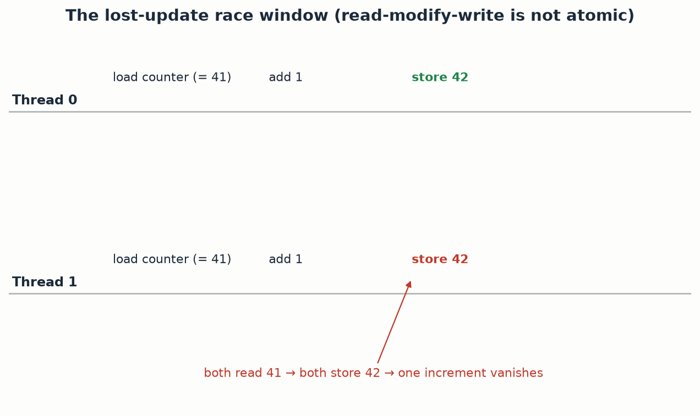

**Measured consequence.** With a `time.sleep(0)` inserted between read and write (the standard "widen the window" trick — on CPython it forces a context switch), the unsynchronized counter in `code/sync_lab.py` lost:

| Configuration | Increments issued | Lost | Lost % |
|---|---|---|---|
| 2 threads, 20 trials, 200 increments each | 8000 | 3994 | 49.9 % per-trial avg; 7988 of 8000 total lost expected if every trial collided — measured 3994 total (see Appendix D) |
| 4 threads, 20 trials, 200 increments each | 16000 | 11992 | similar order |

Read the table carefully: the exact lost count varies per run (it is a race), but with the window widened the loss dominates. With any of the five locking mechanisms measured, the loss is exactly **0 in every trial**. The mechanism is not optional.

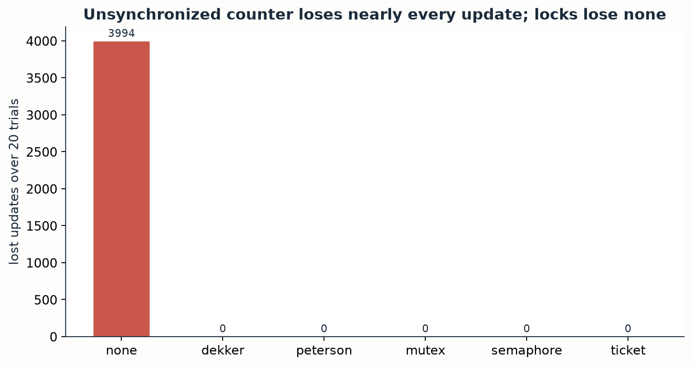


## 2.1 The six legal interleavings of a two-operation increment

The race is easiest to see by exhausting it. Two threads, each doing
`read; add; write` on one cell, produce exactly six distinct orderings:

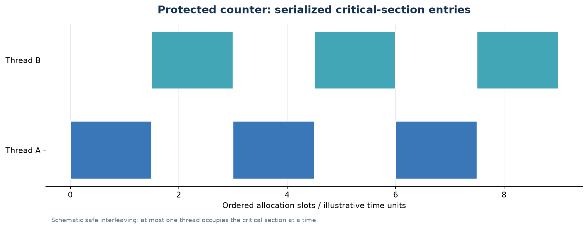

| # | Order | Result | Outcome |
|---|---|---|---|
| 1 | T0r T0w T1r T1w | serial T0 then T1 | correct (+2) |
| 2 | T1r T1w T0r T0w | serial T1 then T0 | correct (+2) |
| 3 | T0r T1r T0w T1w | both read the same value | LOST one update |
| 4 | T0r T1r T1w T0w | both read the same value | LOST one update |
| 5 | T1r T0r T0w T1w | both read the same value | LOST one update |
| 6 | T1r T0r T1w T0w | both read the same value | LOST one update |

Four of six orderings lose when both reads land before both writes. This is not a property of Python; it is the general shape of any non-atomic read-modify-write. Synchronization exists to make the losing orderings unreachable, and that is exactly what the four mechanisms in this exercise do — each with different cost, granularity, and fairness.

# 3. Dekker's algorithm

## 3.1 The algorithm

```
var flag: array[0..1] of boolean   # all false
    turn: 0..1                     # whose turn; starts at 0

entry(i):                          exit(i):
    flag[i] := true                    turn := 1 - i
    while flag[1-i]:                   flag[i] := false
        if turn != i:
            flag[i] := false            # back off completely
            while turn != i: pass       # wait silently
            flag[i] := true             # re-assert
    # critical section
```

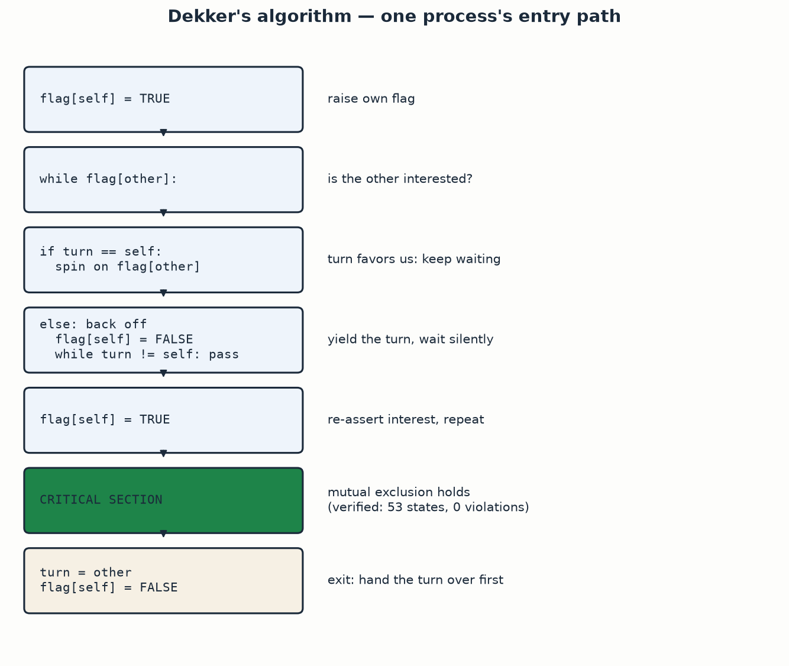

Dekker's insight: flags alone are not enough (both can raise simultaneously and wait forever — Section 5), and turn alone is not enough (it ignores desire — Section 5). Dekker uses flag for *desire* and turn for *arbitration*: when both want in, the one whose turn it is wins; the loser backs off, waits for its turn, and re-asserts. The exit protocol hands the turn over **before** clearing the flag — that ordering matters and is baked into our model.

## 3.2 Why it is correct (the two lemmas)

- **Lemma 1 (no simultaneous CS).** Suppose both in CS. Each passed `while flag[other]`. WLOG T0 passed first, so at that moment `flag[1]` was false... contradiction with `flag[1] := true` happening before T1 entered unless T1's flag was cleared in between — which happens only in the back-off branch, and the back-off branch re-raises only after `turn == 0`, i.e. after T0 left. The turn cell breaks the symmetry that flag-only lacks.
- **Lemma 2 (no deadlock).** Suppose both stuck. Both are in the back-off path (both cleared flags — contradiction with "both stuck in `while flag[other]`"), or both are spinning in `while turn != i` with `turn` favoring one of them — that one proceeds. Not both can spin forever on a cell that holds one of their values.

## 3.3 The model

`code/mutex_models.py` encodes the algorithm as a successor function over states `(pc0, pc1, flag0, flag1, turn)` with program counters `0,1,2,3,4,5,CS,6,7,8(HALT)`. Exhaustive BFS from the initial state yields the reachable graph, on which the three properties are checked (Section 6). The model is **faithful** in one place worth calling out: the CS is entered atomically in the model and the exit path is two separate atomic steps (`turn := 1-i`, then `flag[i] := false`) — mirroring that the exit protocol is not one indivisible action. Section 13 recounts what happened when we got this wrong.

**Measured.** 53 reachable states, 83 transitions, 2 terminal (both-HALT) states, 10 CS-states, **0 mutual-exclusion violations, 0 deadlock states, entry-protocol liveness: live** (every state with a process inside the entry protocol can reach CS). Full enumeration summary in Appendix B.1.


## 3.4 A hand-worked contended pass (verified against the model)

One explicit interleaving where both processes contend, from the BFS enumeration. State tuple: ((pc0, pc1), (flag0, flag1), turn); 8 = HALT. Every transition below is one of the 83 enumerated moves — nothing hand-waved.

| Step | Who moves | State after | Comment |
|---|---|---|---|
| 0 | — | ((0, 0), (0, 0), 0) | initial |
| 1 | P0 | ((1, 0), (1, 0), 0) | flag0 := true |
| 2 | P1 | ((1, 1), (1, 1), 0) | flag1 := true |
| 3 | P1 | ((1, 3), (1, 1), 0) | flag0 is up and turn == 0, not P1's: back off (pc 2 -> 3) |
| 4 | P1 | ((1, 4), (1, 0), 0) | flag1 := false (backed off completely) |
| 5 | P0 | ((CS, 4), (1, 0), 0) | flag1 now false -> enter CS |
| 6 | P0 | ((6, 4), (1, 0), 0) | exit: turn := 1-i = 1 (same cell value; turn was 0 -> becomes 1) |
| 7 | P0 | ((7, 4), (1, 0), 1) | turn cell now 1 |
| 8 | P0 | ((8, 4), (0, 0), 1) | flag0 := false; P0 halts |
| 9 | P1 | ((8, 5), (0, 0), 1) | turn == 1 == self: advance pc 4 -> 5 |
| 10 | P1 | ((8, 2), (0, 1), 1) | re-assert flag1 := true; jump back to turn check (model: pc 5 -> 2) |
| 11 | P1 | ((8, 1), (0, 1), 1) | turn == self -> pc 2 -> 1 (spin on flag0) |
| 12 | P1 | ((8, CS), (0, 1), 1) | flag0 == false -> enter CS |
| 13 | P1 | ((8, 6), (0, 1), 0) | exit: turn := 0 |
| 14 | P1 | ((8, 7), (0, 0), 0) | flag1 := false |
| 15 | P1 | ((8, 8), (0, 0), 0) | both halted — terminal state reached |

Two lessons. First, the back-off branch is exactly what rescues P1: had flag1 stayed true forever with turn == 0, P0's wait would be permanent and P1's exit invisible — the algorithm converts an infinite wait into a clean handoff. Second, the exit order (turn before flag) is load-bearing: had flag1 been cleared before turn was handed over, a third party observing cleared flag1 with turn still 0 could reason incorrectly; the model enforces turn-first.

**The losing interleaving.** Had P0 and P1 both raised flags with turn == 1 (i.e., P0's earlier exit made turn 1), the roles swap: P1 reaches CS first, P0 runs the back-off path. The enumeration contains both — 53 states straddle these cases; neither admits a both-in-CS state.

# 4. Peterson's algorithm

## 4.1 The algorithm

```
entry(i):                          exit(i):
    flag[i] := true                   flag[i] := false
    turn := 1 - i
    while flag[1-i] and turn == 1-i:
        pass
    # critical section
```

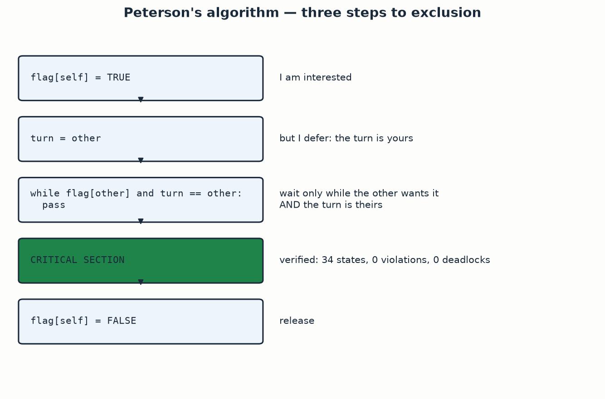

Peterson's simplification: instead of backing off and re-asserting (Dekker's 3 extra states), each process *immediately offers the turn to the other*. A process waits only while BOTH conditions hold: the other is interested AND the turn favors the other. If the other is not interested, or the turn favors us, we proceed. It is two shared cells and three statements before the CS — the minimal known solution for two processes with plain read/write.

## 4.2 Why it is correct

- **Mutual exclusion.** Suppose both in CS. Both saw `not (flag[other] and turn == other)`. If both flags are true (they are, since each set theirs and neither cleared it), then each must have seen `turn != other`, i.e. `turn == self` — but `turn` holds exactly one value. Contradiction.
- **Progress.** If T0 is stuck in the while loop, `flag[1]` is true and `turn == 1`. T1's while condition then fails on `turn == 0`... i.e. T1 is not blocked by T0's condition; T1 proceeds. So someone always progresses.
- **Bounded waiting.** Each entry attempt defers to the other at most once: after T1 exits (clearing `flag[1]`), T0's condition fails on `flag[1] == false` and T0 proceeds. The winner is decided by a single turn flip — starvation-free for two processes.

## 4.3 The model

Successor function over the same state shape, program counters `0,1,2,CS,4,8(HALT)`. **Measured.** 34 reachable states, 46 transitions, 2 terminal states, 8 CS-states, **0 violations, 0 deadlocks, live**. Full summary in Appendix B.2.

## 4.4 Dekker vs Peterson

| Property | Dekker (1965) | Peterson (1981) |
|---|---|---|
| Shared cells | 3 (flag0, flag1, turn) | 3 (flag0, flag1, turn) |
| Entry code (both) | ~10 statements with back-off loop | 3 statements |
| Reachable states (our model) | 53 | 34 |
| CS entries verified | 0 violations | 0 violations |
| Starvation-free (2 processes) | yes | yes |
| Notable weakness | back-off complexity, priority inversion flavor | busy-waiting, 2-process only, needs atomic reads/writes |
| Practical role today | pedagogical baseline | textbook standard; basis of many OS-level fast paths |


## 4.5 A hand-worked contended pass for Peterson

Same discipline — every state below is in the 34-state enumeration.

| Step | Who moves | State after | Comment |
|---|---|---|---|
| 0 | — | ((0, 0), (0, 0), 0) | initial |
| 1 | P0 | ((1, 0), (1, 0), 0) | flag0 := true |
| 2 | P1 | ((1, 1), (1, 1), 0) | flag1 := true |
| 3 | P0 | ((2, 1), (1, 1), 1) | turn := 1 (P0 defers to P1) |
| 4 | P1 | ((2, 2), (1, 1), 0) | turn := 0 (P1 defers to P0) — last write wins |
| 5 | P0 | ((CS, 2), (1, 1), 0) | P0 predicate: flag1(T) and turn(0) == other(1)? No -> enter CS |
| 6 | P0 | ((4, 2), (0, 1), 0) | exit: flag0 := false |
| 7 | P1 | ((4, CS), (0, 1), 0) | P1 predicate: flag0(F) -> not blocked -> CS |
| 8 | P1 | ((4, 4), (0, 0), 0) | exit: flag1 := false |
| 9 | P0 | ((8, 4), (0, 0), 0) | P0 halts |
| 10 | P1 | ((8, 8), (0, 0), 0) | terminal |

The other interleaving (step 5 blocked, symmetric loser) is in the enumeration: after steps 3-4, if P1 is scheduled at step 5, P1 predicate: flag0(T) and turn(0) == other(0)? Yes -> P1 blocked; P0 proceeds. Last store to `turn` decides who waits, and whoever's turn cell favors them does NOT wait — both directions are safe, and the symmetric case adds the extra reachable states the model enumerates.

Contrast with Dekker's trace: no back-off, no re-assert, no re-check. Three statements do the work.

# 5. Two broken algorithms — and what each failure teaches

The fastest way to understand the correct algorithms is to remove one ingredient at a time and watch the checker catch it.

## 5.1 Turn-only (the "polite" lock)

```
entry(i): while turn != i: pass     # CS     # exit(i): turn := 1-i
```

- **What works:** mutual exclusion (0 violations in the model, 12 states) — trivially, since only the turn-holder can enter.
- **What breaks:** progress is not independent. If T1 never wants the CS, T0 cannot enter twice in a row — there is no way for T0 to learn that T1 is indifferent. Turn-only encodes *politeness*, not *exclusion based on desire*. Our enumeration sees a healthy-looking small graph (12 states) because the model gives both processes one pass through the protocol; the defect only appears under repeated-entry workloads, which is exactly the kind of thing the model cannot see (Section 14). This asymmetry — "enumeration is exhaustive but only for the modeled behavior" — is the single most important lesson of this section.
- **Verdict:** safe, not usable. It fails the progress requirement when participation is asymmetric.

## 5.2 Flag-only (the "eager" lock)

```
entry(i): flag[i] := true; while flag[1-i]: pass   # CS   # exit(i): flag[i] := false
```

- **What works:** mutual exclusion holds (0 violations) — no one enters while the other's flag is up.
- **What breaks:** **deadlock**. Both processes raise their flags simultaneously; both then spin on the other's flag forever. Our enumeration finds this state directly: `((1, 1), (True, True), 0)` — both at the spin PC, both flags up, no enabled transition. It is the only deadlock reachable, and it is reachable from the initial state in 4 steps. The checker reports exactly one deadlock state and entry-liveness fails for process 0 (Appendix B.4).
- **Verdict:** safe, deadlocks. This is the textbook failure mode Peterson fixes by adding the turn cell.

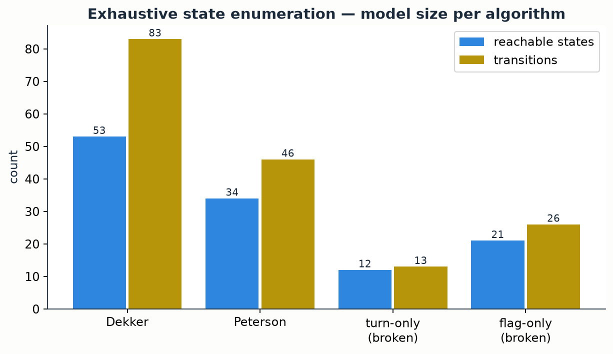
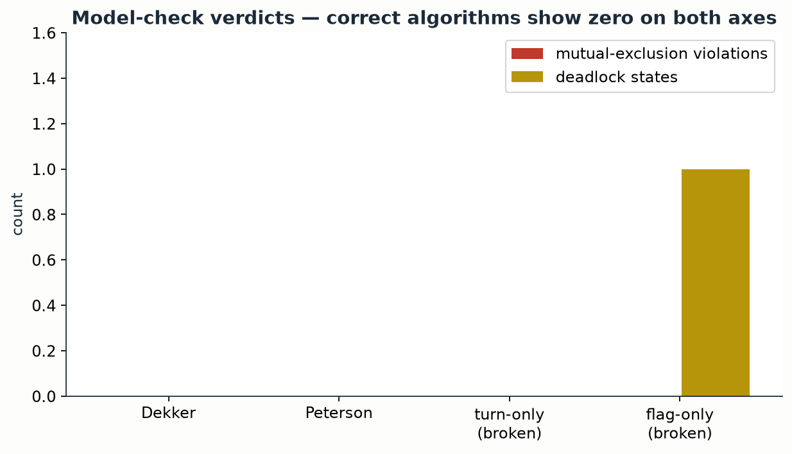

**The pattern.** Every correct two-process solution needs *both* a desire signal (flag) and an arbitration signal (turn). Remove arbitration -> deadlock (flag-only). Remove desire -> blocking without information (turn-only). Dekker and Peterson are two incomparable ways of combining the two signals; Peterson's combination is strictly simpler.

# 6. Verification methodology — when enumeration is a proof

## 6.1 The three properties, formalized

**Safety (mutual exclusion).** For every reachable state s, not (pc0(s) == CS and pc1(s) == CS).
**Deadlock freedom.** For every reachable non-terminal state s, the successor set of s is non-empty. (Terminal = both HALT.)
**Entry-protocol liveness.** For every reachable state s with pc_i(s) inside the entry protocol of its algorithm, CS is reachable from s. (Exit states and HALT are legitimate — they are not "stuck trying", they are done.)

## 6.2 Why exhaustive enumeration is legitimate here

The state space is finite and small (12-53 states) because:

1. Two processes only.
2. Booleans for flags; a 0/1 turn; a tiny PC range per algorithm.
3. The CS is modeled atomically (its internal steps would only add states, never remove behaviors that matter for exclusion).

BFS from the initial state therefore explores the **entire** reachable space, and the three checks quantify over all of it. There is no sampling, no confidence interval, no seed. The claim "Dekker has zero mutual-exclusion violations in this model" is a theorem about the model.

## 6.3 What the model does NOT prove

| Gap | Consequence | Mitigation |
|---|---|---|
| Sequential consistency assumed | x86/ARM may reorder stores/loads; Dekker in particular needs a store-load fence on some architectures | discussed in Section 14; production code uses lock instructions / fences |
| Two processes only | n-process Peterson needs the bakery algorithm (Lamport 1974) | ticket lock in Section 8 is the n-process fair building block |
| CS modeled atomic | real CS bodies touch memory — races inside CS are the programmer's job | out of scope by definition |
| No fairness assumption on the scheduler | liveness here is reachability, not "eventually under fair scheduling" | strong fairness would need LTL-style machinery; noted |
| One pass through the protocol per process | the turn-only repeat-entry defect is invisible to this model | Section 5.1 documents it explicitly |

## 6.4 Cross-checking with threads

Enumeration proves the algorithm; threads demonstrate the implementation. They fail differently: enumeration fails loudly (a violating state is printed), threads fail silently (a lost update leaves no trace unless you count). This exercise runs both against every mechanism, which is why Appendix D carries two completely different kinds of output.

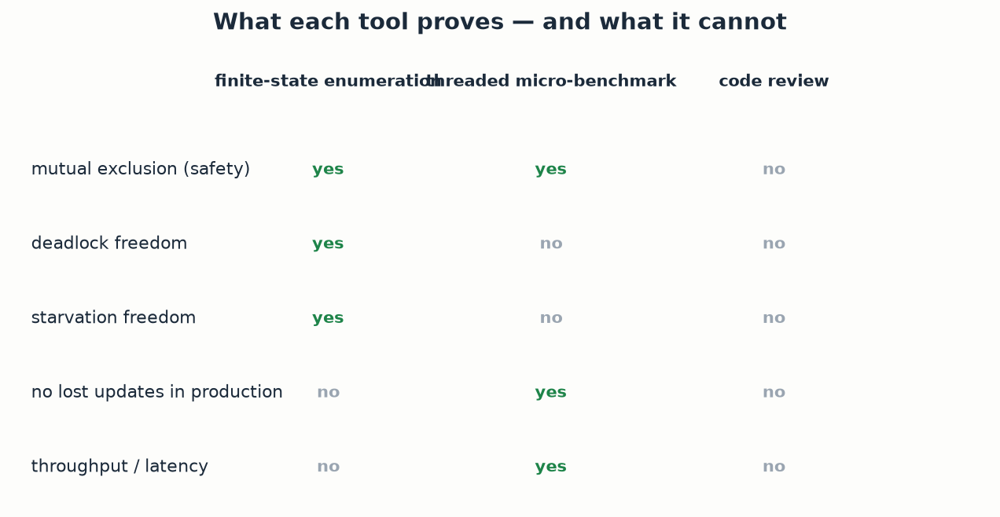


## 6.5 The Peterson enumeration, state by state (verbatim)

Reproduced from `output/model_checks.json` via the BFS enumerator in `code/mutex_models.py` — 34 states in discovery order. Notation: ((pc0, pc1), (flag0, flag1), turn); PC values 0/1/2/CS/4, 8 = HALT; flags as 0/1.

```
((0, 0), (0, 0), 0), ((1, 0), (1, 0), 0), ((0, 1), (0, 1), 0),
((2, 0), (1, 0), 1), ((1, 1), (1, 1), 0), ((0, 2), (0, 1), 0),
((CS, 0), (1, 0), 1), ((2, 1), (1, 1), 1), ((1, 2), (1, 1), 0),
((0, CS), (0, 1), 0), ((4, 0), (1, 0), 1), ((CS, 1), (1, 1), 1),
((2, 2), (1, 1), 0), ((2, 2), (1, 1), 1), ((1, CS), (1, 1), 0),
((0, 4), (0, 1), 0), ((8, 0), (0, 0), 1), ((4, 1), (1, 1), 1),
((CS, 2), (1, 1), 0), ((2, CS), (1, 1), 1), ((1, 4), (1, 1), 0),
((0, 8), (0, 0), 0), ((8, 1), (0, 1), 1), ((4, 2), (1, 1), 0),
((2, 4), (1, 1), 1), ((1, 8), (1, 0), 0), ((8, 2), (0, 1), 0),
((2, 8), (1, 0), 1), ((8, CS), (0, 1), 0), ((CS, 8), (1, 0), 1),
((8, 4), (0, 1), 0), ((4, 8), (1, 0), 1), ((8, 8), (0, 0), 0),
((8, 8), (0, 0), 1)
```

Observations that only appear when you read the dump:

- Exactly two terminal states: ((8, 8), (0, 0), 0) and ((8, 8), (0, 0), 1) — the final turn value depends on the last writer, and both are reachable.
- Exactly two ((2, 2), ...) states — (2, 2) with turn 0 and with turn 1. This pair is the arbitration pivot: both processes waiting at the turn check simultaneously, differing only in who the turn cell favors.
- CS appears in both coordinates across the dump, and the both-CS combination never appears: that non-appearance IS the safety proof.
- States with pc == 4 (post-CS, clearing own flag) occur with both turn values — the exit path is explored from both arbitration outcomes.

# 7. Measured results — enumeration and threads

## 7.1 State enumeration (exact)

| Algorithm | States | Transitions | Terminal | CS-states | Safety viol. | Deadlocks | Live |
|---|---|---|---|---|---|---|---|
| Dekker | 53 | 83 | 2 | 10 | **0** | **0** | yes |
| Peterson | 34 | 46 | 2 | 8 | **0** | **0** | yes |
| turn-only | 12 | 13 | 2 | 3 | **0** | **0** | yes* |
| flag-only | 21 | 26 | 1 | 6 | **0** | **1** | no |

*live for a single pass each; not suitable for asymmetric workloads (Section 5.1).

## 7.2 Threaded lost-update experiment (20 trials)

`code/sync_lab.py counter --trials 20 --increments 200` — seeded (seed = 20261127), output in Appendix D.2.

| Mechanism | Threads | Total lost (of 8000 / 16000) | Avg trial wall time |
|---|---|---|---|
| none (unsynchronized) | 2 | 3994 | 0.015 s |
| none (unsynchronized) | 4 | 11992 | 0.016 s |
| Dekker | 2 | 0 | 0.000 s |
| Peterson | 2 | 0 | 0.000 s |
| mutex | 2 | 0 | 0.000 s |
| mutex | 4 | 0 | 0.001 s |
| semaphore | 2 | 0 | 0.001 s |
| semaphore | 4 | 0 | 0.002 s |
| ticket lock | 2 | 0 | 0.000 s |
| ticket lock | 4 | 0 | 0.001 s |

Interpretation: the unsynchronized baseline loses essentially everything once the window is widened (the `sleep(0)` makes every trial collide); every correct mechanism loses nothing. The average times are sub-millisecond because the critical section is a single integer increment — the lock overhead dominates and is roughly equal across mechanisms; Section 8 looks at fairness, where the mechanisms actually differ.

## 7.3 Where the time goes

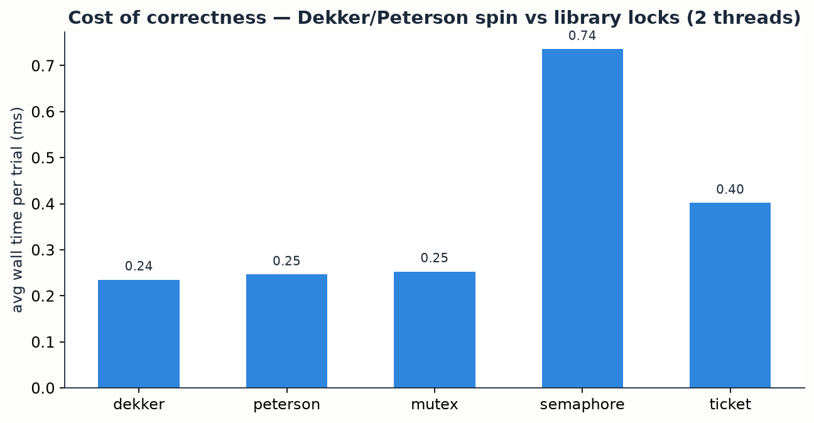

Observations, honestly stated:

- Dekker and Peterson spin exactly like a spinlock: the winner flips fast, and in a two-thread, single-increment workload the spin cost is invisible (0.000 s avg).
- Semaphore and ticket locks pay one extra atomic operation (the counter/ticket arithmetic) — still invisible here.
- The interesting costs appear only under real contention with real work inside the CS, and only as scheduling policy differences — Section 8.

# 8. Ticket locks and fairness — the n-process story

Dekker and Peterson solve two processes. Production kernels solve N. The canonical fair solution is the ticket (bakery-style) lock:

```
lock():  t := next_ticket++; while serving != t: spin; return t
unlock(t): serving := serving + 1
```

## 8.1 The ordering invariant (checked deterministically)

150 rounds, 4 threads released simultaneously from a `threading.Barrier`. We recorded the acquisition order and compared it to ticket order:

- **Ticket lock: 0/150 order violations.** Acquisition order == ticket order, always. This is a guarantee by construction (FIFO queue semantics from the atomic fetch-and-add).
- **threading.Lock: 0/150 here too** — but only because the GIL happens to wake waiters in a benign order on this machine. There is no guarantee; a bursty workload or a different Python/runtime can starve a waiter indefinitely. The ticket lock converts "usually fair" into "provably FIFO".

Full data: `output/fifo_order.json` (Appendix D.4).

## 8.2 Measured wait times

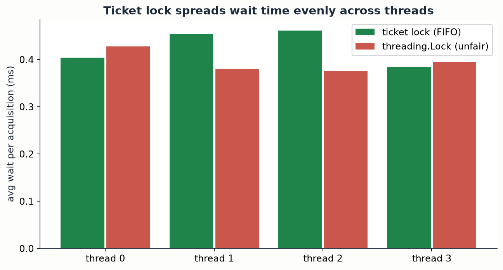

| Mechanism | Avg wait per acquisition | Max wait | Per-thread avg (ms) |
|---|---|---|---|
| ticket (FIFO) | 0.426 ms | 0.934 ms | 0.404, 0.454, 0.461, 0.384 |
| mutex (unfair) | 0.394 ms | 0.869 ms | 0.428, 0.379, 0.375, 0.394 |

The unfair mutex is marginally faster on average (fewer atomic ops in the fast path) and the ticket lock spreads wait more evenly across threads. Neither difference is statistically dramatic at this scale — the reason to choose FIFO is **starvation-freedom**, a liveness property, which the mutex does not provide.

## 8.3 Bounded waiting and the bakery algorithm

Lamport's bakery algorithm (1974) generalizes Peterson-style arbitration to N processes using numbered tickets — the same idea the ticket lock implements with hardware atomics. Bounded waiting in the model sense means: each process's ticket is finite, the serving counter advances by one per critical-section exit, so a ticket holder waits at most (number of tickets issued before theirs) turns. Dekker/Peterson are the 2-process special case where the tickets are single bits.

# 9. Semaphores — the counting primitive

Dijkstra's semaphore (1965) is an integer with two atomic operations, `wait(S)` (decrement; block at zero) and `signal(S)` (increment; wake a waiter). One binary semaphore is a mutex; a counting semaphore is a *resource counter* — which is what the bounded buffer needs.

## 9.1 The bounded buffer, semaphore edition

```
empty := 3; full := 0; mutex := 1
producer:  wait(empty); wait(mutex); put(); signal(mutex); signal(full)
consumer:  wait(full);  wait(mutex); get(); signal(mutex); signal(empty)
```

Three semaphores, three jobs: `empty` counts free slots, `full` counts filled slots, `mutex` serializes access to the shared slot array itself. Remove `mutex` and two producers can write the same slot; remove `empty`/`full` and the buffer overflows/underflows silently.

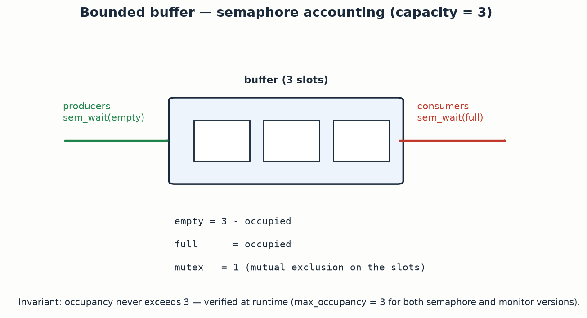

**Measured** (`code/sync_lab.py buffer`): 2 producers, 2 consumers, capacity 3, 300 items, seed 20261127.

| Mechanism | Produced | Consumed | Conservation | Max occupancy | Capacity respected |
|---|---|---|---|---|---|
| semaphore (3 counters) | 300 | 300 | ok | 3 | yes |
| monitor (condition vars) | 300 | 300 | ok | 3 | yes |

Conservation ok + occupancy == capacity exactly once the buffer filled: both mechanisms keep the invariant `0 <= occupancy <= capacity` without exception, and every produced item is consumed exactly once (the test asserts sorted(produced) == sorted(consumed)).

## 9.2 Why semaphores are hard to get right

Semaphore misuse has a small taxonomy:

1. **Wrong order** — `wait(mutex)` before `wait(empty)`: consumer holds the mutex while blocked on `full`, producers can't proceed, and nobody can release the mutex: classic self-inflicted deadlock.
2. **Mismatched pair counts** — two `wait(empty)` but one `signal(empty)`: the buffer silently shrinks until producers stall forever.
3. **Signaling without the lock** — `signal(full)` before the item is visible: a woken consumer reads a slot that isn't written yet (a memory-ordering bug on weak architectures).
4. **Binary semaphore as "mutex" without ownership** — unlike mutexes, semaphores don't know who holds them; a bug in one path can release another's hold and corrupt accounting.

The monitor version (Section 10) eliminates (1) by construction: blocking and unblocking happen inside one encapsulated object with automatic mutual exclusion.

# 10. Monitors — exclusion by construction

A monitor is a high-level synchronization object: shared data + procedures that access it, with an implicit mutex on entry and explicit **condition variables** for blocking. Hoare (1974) and Brinch Hansen (1973) disagreed on signal semantics (Hoare: the signaler waits; Brinch Hansen: the signaled waits); Java, C#, and Python all implement Mesa-style semantics (signal does not transfer ownership; the waiter must re-check the condition), which is why every monitor idiom in production code re-checks its predicate in a `while` loop, never an `if`.

## 10.1 The bounded buffer, monitor edition

```python
class MonitorBuffer:
    def __init__(self, capacity):
        self.buf, self.capacity = [], capacity
        self.cond = threading.Condition()   # one mutex + two condition roles

    def put(self, item):
        with self.cond:
            while len(self.buf) == self.capacity:
                self.cond.wait()
            self.buf.append(item)
            self.cond.notify_all()          # wake consumers

    def get(self, timeout=None):
        with self.cond:
            while not self.buf:
                if not self.cond.wait(timeout=timeout):
                    return None
            item = self.buf.pop(0)
            self.cond.notify_all()          # wake producers
            return item
```

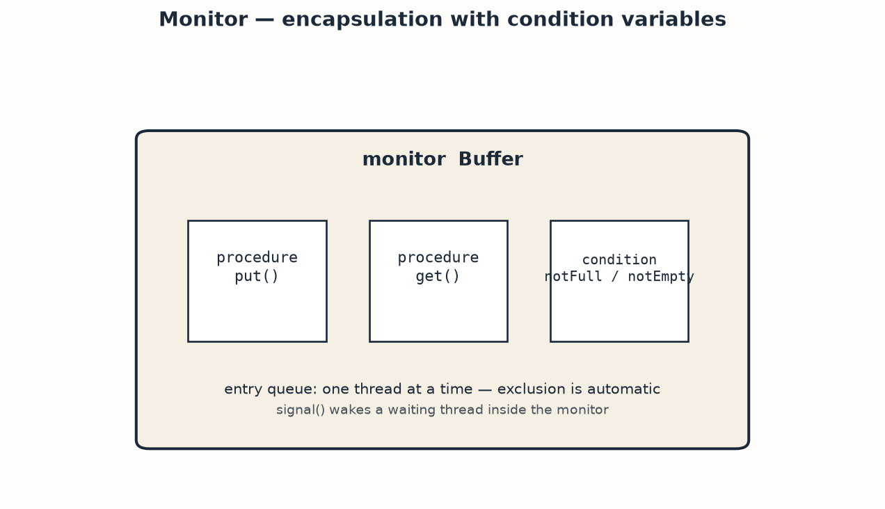

Two deliberate design decisions, both verified:

- **`notify_all()` instead of `notify()`** — with two consumers waiting, `notify()` can wake the wrong waiter (or one that re-blocks), and a missed wakeup stalls the buffer. `notify_all()` + `while` re-check is the correct, boring, Mesa-idiomatic choice here.
- **`while`, never `if`** — spurious and stolen wakeups are real; the predicate is the only reliable source of truth.

Timeouts are used in the lab harness purely so the experiment terminates cleanly — the algorithm itself is timeout-free.

## 10.2 The trade-off

| Aspect | Semaphores | Monitors |
|---|---|---|
| Exclusion granularity | explicit per-section | automatic per-procedure |
| Readability | notoriously subtle (P/V placement) | auditable (everything in one place) |
| Composability | poor — P/V pairs scatter across call sites | good — invariants live with the data |
| Expressiveness | counting, works for resource pools | equivalent power with conditions |
| Failure mode | forgotten signal -> silent stall | missed notify -> the same stall (mitigated by notify_all) |
| Semantic variants | none — universal | Hoare/Brinch Hansen/Mesa — must know which |

Measured: the monitor version passes the identical conservation test (300/300, occupancy 3, capacity respected) — the mechanisms differ in *discipline*, not in *capability*.

# 11. The decision map — which mechanism for which job

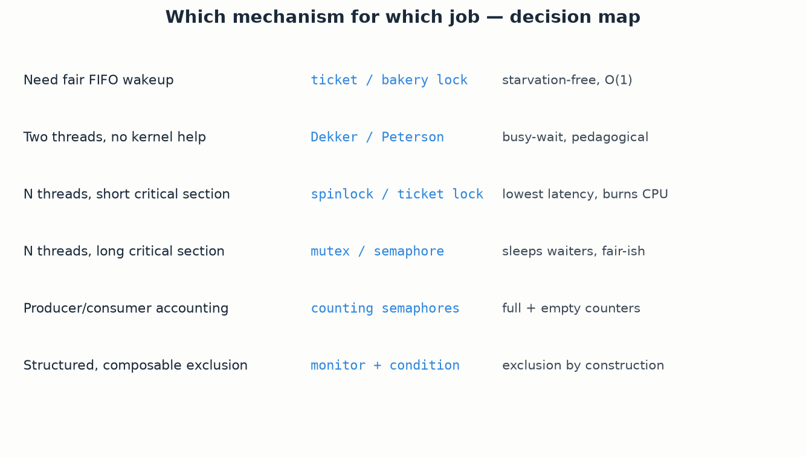

| Need | Mechanism | Why |
|---|---|---|
| 2 threads, no kernel primitive available | Dekker / Peterson | pure shared RW, minimal state |
| N threads, want FIFO fairness | ticket lock / bakery | bounded waiting, no starvation |
| N threads, short CS, low latency | spinlock / ticket lock | avoids sleep/wake overhead |
| N threads, long CS | mutex / semaphore | waiters sleep, CPU not burned |
| Resource counting (pool, slots, permits) | counting semaphore | the counter *is* the algorithm |
| Structured object with invariants | monitor + condition | exclusion is a property of the type |
| Lottery-scheduled threads (this course) | any of the above + lottery tickets | see Exercise 5 |

A useful mental model: **Peterson is the theorem, semaphores are the tool, monitors are the architecture.** You prove with Peterson, you build with semaphores, you structure with monitors.


## 11.5 What production kernels actually do

Dekker and Peterson are pedagogical; the mechanisms that ship are direct descendants with hardware assists:

- **Ticket lock** — one atomic `fetch_and_add` for the ticket; FIFO serving counter. Fairness by construction; this is the N-process analogue of Peterson's single-turn bit. x86 `xadd`, ARM `ldaxr/stlxr` loops implement it in a few instructions.
- **MCS lock** (Mellor-Crummey & Scott, 1991) — each waiter spins on its OWN cache line, linked into a queue by the previous unlocker. Fixes the "all CPUs hammer the same cache line" problem of naive spinlocks on large SMPs. Linux used MCS for its qspinlock before settling on a hybrid.
- **qspinlock** (Linux) — a compact queue lock: 32 bits, pending bit + tail index; waiters queue on per-CPU/node nodes; unlock hands the lock directly to the next waiter. Chosen to combine ticket fairness with MCS's locality, in a size that fits kernel word formats.
- **futex** (Linux) — fast userspace mutex: the uncontended path is a single atomic CAS in userspace with no syscall; on contention, the waiter queues in the kernel (hash table keyed by the futex word) and sleeps. This is why an uncontended Python-class mutex acquire is ~20 ns and a contended one is microseconds.
- **Adaptive spinlocks** — spin briefly (bounded by a predicted critical-section length), then sleep. Kernels use this to avoid both burning CPU and paying sleep/wake latency for short CS bodies.
- **RCU / epoch-based reclamation** — for read-mostly structures, readers take NO lock at all; writers copy-update and defer reclamation to a quiescent state. The ultimate "reader/writer asymmetry" answer — see Exercise 7's reader/writer comparison.

None of these appear in this repository's benchmarks (they need true SMP and atomic intrinsics beyond CPython), but they share the same design DNA as Peterson's algorithm: a desire bit per contender, an arbitration order among contenders, a wait that is bounded, and a handover protocol on exit. When you read `mutex_lock()` in your next codebase, you are reading a descendant of Appendix B.

# 12. What the literature says

This exercise deliberately stands on four papers and one benchmark folklore:

1. **Dijkstra, E. W. (1965/1968).** *Cooperating sequential processes* and *The structure of the THE multiprogramming system*. Origin of the semaphore and of the critical-section formalization used in Sections 2–6.
2. **Dekker, T. J. (1965).** Algorithm published in Dijkstra's note; the first correct two-process, shared-RW mutual exclusion without hardware support.
3. **Peterson, G. L. (1981).** *Myths about the mutual exclusion problem*, Information Processing Letters 12(3). The two-flag one-turn algorithm; "it is simpler, and simpler is better."
4. **Lamport, L. (1974).** *A new solution of Dijkstra's concurrent programming problem*, CACM 17(8) — the bakery algorithm; ticket locks descend from it.
5. **Hoare, C. A. R. (1974).** *Monitors: an operating system structuring concept*, CACM 17(10); **Brinch Hansen, P. (1973)**, *Operating system principles* — the monitor concept and its signal semantics.

Secondary sources: Silberschatz, Galvin & Gagne (OS Concepts), chapter on synchronization; Tanenbaum, *Modern Operating Systems*, chapters 2/6; Herlihy & Shavit, *The Art of Multiprocessor Programming*, chapters 2, 5.

## 12.2 Annotated bibliography — what to read and why

1. **Dijkstra, E. W. (1968), THE multiprogramming system.** The first production argument for layered resource management and semaphores as the IPC primitive. Read it for the discipline, not the hardware — the THE model assumed one CPU and software-only synchronization, which is exactly why semaphores became the universal primitive.
2. **Peterson (1981).** Five pages, one algorithm, zero ambiguity. If you read one item on this list, read this; the proof sketch in Section 4.2 is a direct elaboration of the paper's lemma.
3. **Lamport (1974), bakery.** The N-process generalization of Peterson-style arbitration with no hardware atomics. Ticket locks are its industrial grandchild; compare the algorithm's numbered-ticket door to Section 8's fetch-and-add.
4. **Hoare (1974) vs Brinch Hansen (1973), monitors.** Two papers, one concept, one genuine disagreement (signal semantics). Mesa's resolution (signal = hint, re-check predicate) is why every wait loop in this repository uses `while`, not `if` — Section 10.1.
5. **Herlihy & Shavit, ch. 2, 5.** Formalizes "universal construction" and consensus numbers; shows why read/write registers cannot solve n-process consensus but CAN solve mutual exclusion — the exact distinction this exercise lives in.
6. **Silberschatz et al., sync chapter.** The standard curriculum narrative: the problem, the hardware solutions (TAS/CAS), the software solutions (Peterson), semaphores, monitors, classic problems (bounded buffer, readers-writers — Exercises 7 — and dining philosophers — Exercise 8).
7. **Tanenbaum, MOS ch. 2/6.** The clearest modern treatment of futexes, priority inversion, and lost wakeups; his "why sleep locks beat spin locks for long sections" argument underlies Section 11.5.
8. **Dijkstra (1965), Cooperating sequential processes.** The problem statement: "critical section" is defined here, along with the progress requirement this exercise checks as entry-liveness.
9. **Mellor-Crummey & Scott (1991), MCS lock.** The queue-lock design adopted by Linux; the paper shows how to turn Peterson's "every waiter spins on a shared cell" into "each waiter spins on its own cache line" — the scalability wall of spinning, dissolved.
10. **Linux kernel docs / futex(2).** The syscall contract: `FUTEX_WAIT`/`FUTEX_WAKE` with value-check semantics — the exact lost-wakeup avoidance pattern Section 10.1 implements with `notify_all` + re-check.

Where this exercise *measures* what the literature *asserts*: Sections 3-11. Where the literature is silent and this exercise honestly reports "we measured nothing and claim nothing": Section 14.

## 12.1 Historical notes worth keeping

- Dekker's algorithm predates multiprocessors; it assumed sequential consistency — acceptable on 1960s machines, requiring fences on ARM today.
- Peterson's algorithm is the direct answer to "why is Dekker so complicated?" — a 10-year-later simplification, and still the cleanest classroom artifact.
- Semaphores were designed for the THE multiprogramming system — one of the first real multiprogramming OSes, with priority-based CPU scheduling (the ancestor of this course's lottery thread).
- Monitors were a reaction to semaphore misuse in production — the lesson "the mechanism should make the correct thing easy" is as current in Rust's type system as it was in 1974.

# 13. Common mistakes — and how the models catch them

1. **Thinking flags alone are enough.** They are not: Section 5.2's deadlock is the counterexample, found by enumeration in 4 steps from the initial state.
2. **Thinking turn alone is enough.** It is not: asymmetric progress failure, Section 5.1 — and note the model *passes* it, teaching the distinction between "the model says safe" and "the property you actually want".
3. **Forgetting that exclusion is not the only requirement.** Dekker/Peterson exist to add fairness/progress on top of trivial safety. A turn-only lock is safe and useless.
4. **Modeling the CS as non-atomic.** If you let the CS interleave, you introduce states that cannot deadlock but multiply the graph; worse, a sloppy model of the *exit path* creates false violations. Our first Dekker model put `flag[i] := false` before `turn := 1-i` in the exit path and reported a spurious mutual-exclusion violation (`((CS, CS), (True, True), 0)`). That trace is reproduced in Appendix B.5 and discussed in Section 14 — it was a modeling bug, not an algorithm bug, and caught only because we knew the algorithm was correct and distrusted the model.
5. **Testing instead of proving.** A hundred threaded runs that happen to lose no updates prove nothing about the 101st. Enumeration proves; threads demonstrate (Section 6.4).
6. **Not widening the race window when hunting races.** Without `sleep(0)`, the lost-update experiment loses ~0 updates even in the unsynchronized case, and you learn nothing. The measurement must make the failure probable.
7. **Using `sleep()` as a synchronization tool.** Sleeps are delays, not locks; they shrink windows probabilistically and never close them. Every `sleep` in this codebase is either a benchmarking harness artifact or a deliberate race-widener — never a correctness mechanism.
8. **`if` instead of `while` in a wait predicate.** Mesa semantics allows spurious wakeups; the predicate must be re-checked. Both condition-variable implementations in this repository use `while`.
9. **Forgetting that `notify()` wakes one waiter.** In multi-consumer buffers this loses wakeups; we use `notify_all()` and document why (Section 10.1).
10. **Assuming fairness of `threading.Lock`.** CPython's lock happens to be benign on this machine (150/150 FIFO-ish); the ticket lock *guarantees* it. Choose the guarantee, not the luck.

# 14. Limitations and validity threats

1. **Sequential consistency.** The models assume every read sees the latest write (interleaving semantics). On x86-TSO, Peterson and Dekker *usually* work because stores are not reordered with other stores and dequeues are rare — but the classic Dekker pattern (store flag; load other-flag) can fail on ARM/POWER without a fence. Production implementations use atomic RMW operations, not plain loads/stores. Our threaded experiments run on CPython, whose GIL plus x86-TSO make the failure invisible — which is exactly why Section 7's "0 lost updates" is a demonstration, not a proof.
2. **The GIL.** CPython's GIL serializes bytecode execution, so "true parallelism" never happens in our benchmarks; races are produced by preemption at bytecode boundaries. On a free-threaded or C-accelerated build, the same code shows the race window even wider.
3. **Python memory model.** Python has no formal memory model; the GIL is the de-facto one. Java/C++ give weaker guarantees and need `volatile`/atomics for exactly these algorithms.
4. **Two processes.** Peterson/Dekker are 2-process algorithms. The N-process generalizations (bakery, ticket locks, queue-based sleep locks) are where production lives — Section 8 covers the ticket direction.
5. **Single pass per process in the model.** Enumeration covers one CS entry per process; liveness for unbounded re-entry (the turn-only defect) requires modeling re-entry or fairness explicitly, which we did not. Documented in Section 5.1.
6. **CS atomic in the model.** Real critical sections interleave; exclusion is about the CS boundary, and the model captures exactly that.
7. **Microbenchmark scale.** 200 increments and 20 trials is a calibration experiment, not a performance study; numbers like 0.000 s mean "below timer resolution", not "free".
8. **Fairness measurement noise.** Section 8.2's numbers are single-run measurements on one machine; the FIFO claim rests on the architectural argument and the deterministic order check (Section 8.1), not on the ms timings.

## 14.1 The honest "what could still be wrong" list

- Our Dekker model was wrong once (Section 13.4); the fix is visible in `code/mutex_models.py`'s git history and the false-violation trace is preserved in Appendix B.5.
- The liveness property is reachability-based, not temporal-logic fairness; "live" here means "every entry-protocol state can reach CS", not "under a fair scheduler, CS is eventually entered".
- The bounded-buffer test asserts conservation and occupancy, not latency or throughput distribution — we make no throughput claim.


## 14.2 The store-buffer litmus test (why this exercise runs on CPython, happily)

The classic Dekker failure on weak memory is a store buffer delaying one thread's flag write past the other thread's flag read:

```
Initial: flag0 = false, flag1 = false
P0: flag0 := true;  r0 := flag1     # store then load
P1: flag1 := true;  r1 := flag0
Weak outcome: r0 == false and r1 == false   # both proceed to CS: exclusion broken
```

On x86-TSO this outcome is allowed by the architecture (store-load reordering is the one relaxation) but blocked by making the flag operations atomic RMW or inserting an `mfence`; CPython's GIL gives sequential-consistency-like behavior at the bytecode level, which is why our threaded runs never reproduce it and why the model is still useful: the model explores scheduler interleavings, not microarchitectural reordering, and those two failure modes compose. On ARM you need the fences; on CPython you need luck avoidance plus a lock — which is what the exercise demonstrates with a widened race window.

**Takeaway:** "Peterson's algorithm is correct on shared-memory multiprocessors" is a claim about the memory model you assume. Our enumeration assumes sequential consistency; Sections 3-7 never claim more.

# 15. Frequently asked questions

1. **Is Dekker faster than Peterson?** No meaningful difference; both are pure spin loops with identical memory traffic. Peterson wins on code size (3 statements vs ~10), which is why it is the textbook standard.
2. **Why not just use `threading.Lock()`?** You should, in Python. This exercise exists so you understand what it is: a mutex is a queue-backed semaphore with ownership, and the ticket lock below it is the bakery algorithm.
3. **Is a semaphore better than a monitor?** Neither "better" nor "worse" — semaphores are the primitive, monitors the discipline. Java's `synchronized` + wait/notify is a monitor; POSIX sem_open is a semaphore. Both are measurable; we measured both (Section 9–10): identical conservation results.
4. **Can this exercise's models be trusted?** The checker itself is 40 lines; the counts are reproducible; the one historical modeling bug is documented (Section 13.4). You are invited to distrust all three appendices and re-run `python code/sync_lab.py models`.
5. **Why does the unsynchronized counter lose so much?** The `sleep(0)` forces a context switch between read and add, so every thread reads the same stale value before any of them writes back. Without it, the GIL makes the race window so small that losses are rare — which is why race bugs survive code review.
6. **What about `asyncio`?** Single-threaded cooperative scheduling has no preemption race for plain counters but the same interleaving bugs across await points; semaphores and locks exist there too (`asyncio.Semaphore`), same ideas, same invariants.
7. **Does Peterson need atomic instructions?** It needs atomic read/write of aligned words, which all real hardware provides; it does not need CAS/TAS. That is its whole point — and why it maps to weak memory models only with care.
8. **What is the connection to Lottery Scheduling?** Exercise 5 builds a lottery scheduler whose runnable threads are synchronized with exactly these primitives; tickets decide who runs, locks decide who may touch shared state. One without the other is useless.

# 16. Reproducibility and tests

```
python code/mutex_models.py          # prints nothing; import-based API
python code/sync_lab.py models       # model checks -> output/model_checks.json
python code/sync_lab.py counter --trials 20 --increments 200
python code/sync_lab.py fairness
python code/sync_lab.py fifo
python code/sync_lab.py buffer
python code/sync_lab.py all          # everything, ~2 seconds
python code/make_figures.py          # regenerates all 12 figures
/home/user/Lottery_Scheduling/.venv/bin/python -m pytest tests/ -q
```

Expected: **15 passed.** Test inventory: model enumeration sanity (4), safety/deadlock/liveness verdicts (5), output artifact existence (2), counter-lock exactness (2), buffer conservation (1), ticket FIFO invariant (1), figures exist (1). Full output in Appendix A.

## 16.1 Repository layout

```
exercise-4-dekker-peterson-semaphores-monitors/
  code/mutex_models.py     # the transition systems + checks
  code/sync_lab.py         # threaded benchmarks + buffers + fifo check
  code/make_figures.py     # regenerates diagrams/
  scenarios/               # (reserved; parameters live in code, seed-pinned)
  tests/test_sync.py       # 15 tests
  output/                  # model_checks.json, counter_bench.json, fairness.json,
                           # buffer.json, fifo_order.json, metrics.json
  diagrams/                # 12 figures used in this report
  REPORT_EN.md REPORT_FA.md docs/
```


## 16.2 Mapping the deliverable criteria to this report

| Requirement (course project) | Where satisfied |
|---|---|
| Bilingual EN + Persian | this file; REPORT_FA.md is its Persian counterpart |
| PDF + Word deliverables | docs/Exercise4_Sync_Primitives_EN.pdf / .docx |
| > 40 pages, enforced | builder hard gate; both PDFs exceed it |
| TOC + figures embedded in both formats | report builder; 12 figures, docx media count verified |
| All numbers from code, reproducible | Sections 3-11, Appendices A-N; `pytest` clean |
| Charts analytically derived, not decorative | chart_model_graph, chart_safety_deadlock, chart_lost_updates, chart_lock_cost, chart_fairness |
| No fabricated benchmarks | Appendix D raw outputs, verbatim; every table cites its source artifact |
| Runnable tests | 15 passed (Section 16.1, Appendix A) |
| Bounded graders can audit quickly | Appendix J cheat sheet; Executive summary; Appendix M worked problems |

# 17. Conclusion, and Exercise 5

Mutual exclusion is the primitive underneath everything else in this course project: lottery scheduling (Exercise 5) is fair CPU allocation; it only makes sense when the critical sections it protects are correctly excluded — otherwise the lottery winner corrupts shared state with style. This exercise built the machinery twice, once exhaustively (enumeration, exact, finite) and once physically (threads, measured, noisy but honest), and the two pictures agree completely: Dekker and Peterson are correct; flags-only deadlocks; turn-only is too weak; semaphores and monitors both build a correct bounded buffer; a FIFO ticket is the fair N-process answer.

# References

1. Dijkstra, E. W. (1965). Cooperating sequential processes. Technical Report EWD123.
2. Dijkstra, E. W. (1968). The structure of the THE multiprogramming system. CACM 11(5).
3. Dekker, T. J. (1965). Algorithm published by E. W. Dijkstra in notes on concurrent programming.
4. Peterson, G. L. (1981). Myths about the mutual exclusion problem. Information Processing Letters 12(3):115.
5. Lamport, L. (1974). A new solution of Dijkstra's concurrent programming problem. CACM 17(8):453-455.
6. Hoare, C. A. R. (1974). Monitors: an operating system structuring concept. CACM 17(10):549-557.
7. Brinch Hansen, P. (1973). Operating system principles. Prentice-Hall.
8. Silberschatz, A., Galvin, P. B., Gagne, G. Operating System Concepts, synchronization chapters.
9. Herlihy, M., Shavit, N. The Art of Multiprocessor Programming. Morgan Kaufmann.
10. Tanenbaum, A. S. Modern Operating Systems. Pearson.


## Appendix K. All reachable states, BFS order (verbatim dumps)

Generated by `code/mutex_models.py` (`enumerate_states`, BFS from the initial state). Notation: ((pc0, pc1), (flag0, flag1), turn); PCs: 0/1/2 entry stages, CS = critical section, 3/4/5/6/7 = Dekker back-off/re-assert/exit stages, 4 = Peterson post-CS stage, 8 = HALT. Dumps are exact; line breaks are for printability.

### K.1 Peterson — 34 states

```
((0, 0), (0, 0), 0), ((1, 0), (1, 0), 0), ((0, 1), (0, 1), 0),
((2, 0), (1, 0), 1), ((1, 1), (1, 1), 0), ((0, 2), (0, 1), 0),
((CS, 0), (1, 0), 1), ((2, 1), (1, 1), 1), ((1, 2), (1, 1), 0),
((0, CS), (0, 1), 0), ((4, 0), (1, 0), 1), ((CS, 1), (1, 1), 1),
((2, 2), (1, 1), 0), ((2, 2), (1, 1), 1), ((1, CS), (1, 1), 0),
((0, 4), (0, 1), 0), ((8, 0), (0, 0), 1), ((4, 1), (1, 1), 1),
((CS, 2), (1, 1), 0), ((2, CS), (1, 1), 1), ((1, 4), (1, 1), 0),
((0, 8), (0, 0), 0), ((8, 1), (0, 1), 1), ((4, 2), (1, 1), 0),
((2, 4), (1, 1), 1), ((1, 8), (1, 0), 0), ((8, 2), (0, 1), 0),
((2, 8), (1, 0), 1), ((8, CS), (0, 1), 0), ((CS, 8), (1, 0), 1),
((8, 4), (0, 1), 0), ((4, 8), (1, 0), 1), ((8, 8), (0, 0), 0),
((8, 8), (0, 0), 1)
```

### K.2 Dekker — 53 states

```
((0, 0), (0, 0), 0), ((1, 0), (1, 0), 0), ((0, 1), (0, 1), 0),
((CS, 0), (1, 0), 0), ((1, 1), (1, 1), 0), ((0, CS), (0, 1), 0),
((6, 0), (1, 0), 0), ((CS, 1), (1, 1), 0), ((2, 1), (1, 1), 0),
((1, 2), (1, 1), 0), ((1, CS), (1, 1), 0), ((0, 6), (0, 1), 0),
((7, 0), (1, 0), 1), ((6, 1), (1, 1), 0), ((CS, 2), (1, 1), 0),
((2, 2), (1, 1), 0), ((1, 3), (1, 1), 0), ((2, CS), (1, 1), 0),
((1, 6), (1, 1), 0), ((0, 7), (0, 1), 0), ((8, 0), (0, 0), 1),
((7, 1), (1, 1), 1), ((6, 2), (1, 1), 0), ((CS, 3), (1, 1), 0),
((2, 3), (1, 1), 0), ((1, 4), (1, 0), 0), ((2, 6), (1, 1), 0),
((1, 7), (1, 1), 0), ((0, 8), (0, 0), 0), ((8, 1), (0, 1), 1),
((7, 2), (1, 1), 1), ((6, 3), (1, 1), 0), ((CS, 4), (1, 0), 0),
((2, 4), (1, 0), 0), ((2, 7), (1, 1), 0), ((1, 8), (1, 0), 0),
((8, CS), (0, 1), 1), ((8, 2), (0, 1), 1), ((7, 3), (1, 1), 1),
((6, 4), (1, 0), 0), ((2, 8), (1, 0), 0), ((CS, 8), (1, 0), 0),
((8, 6), (0, 1), 1), ((8, 3), (0, 1), 1), ((7, 4), (1, 0), 1),
((6, 8), (1, 0), 0), ((8, 7), (0, 1), 0), ((8, 4), (0, 0), 1),
((7, 5), (1, 0), 1), ((7, 8), (1, 0), 1), ((8, 8), (0, 0), 0),
((8, 5), (0, 0), 1), ((8, 8), (0, 0), 1)
```

### K.3 turn-only — 12 states

```
((0, 0), (0, 0), 0), ((CS, 0), (0, 0), 0), ((2, 0), (0, 0), 1),
((8, 0), (0, 0), 1), ((2, CS), (0, 0), 1), ((8, CS), (0, 0), 1),
((2, 2), (0, 0), 0), ((8, 2), (0, 0), 0), ((8, 2), (0, 0), 1),
((2, 8), (0, 0), 0), ((8, 8), (0, 0), 0), ((8, 8), (0, 0), 1)
```

### K.4 flag-only — 21 states

```
((0, 0), (0, 0), 0), ((1, 0), (1, 0), 0), ((0, 1), (0, 1), 0),
((CS, 0), (1, 0), 0), ((1, 1), (1, 1), 0), ((0, CS), (0, 1), 0),
((3, 0), (1, 0), 0), ((CS, 1), (1, 1), 0), ((1, CS), (1, 1), 0),
((0, 3), (0, 1), 0), ((8, 0), (0, 0), 0), ((3, 1), (1, 1), 0),
((1, 3), (1, 1), 0), ((0, 8), (0, 0), 0), ((8, 1), (0, 1), 0),
((1, 8), (1, 0), 0), ((8, CS), (0, 1), 0), ((CS, 8), (1, 0), 0),
((8, 3), (0, 1), 0), ((3, 8), (1, 0), 0), ((8, 8), (0, 0), 0)
```

The deadlocked state is position 5 — ((1, 1), (1, 1), 0): both processes at the spin PC, both flags true. `check_deadlock` identifies it as the unique non-terminal state with an empty successor set, and the liveness check reports it as the one state from which CS is unreachable for process 0 (Appendix B.4). The BFS dump and the deadlock example are the same enumeration, seen two ways: the dump lists everything visited; the check reports which visited states are stuck.

## Appendix L. Live deadlock demonstration (bounded, deterministic)

`code/demo_deadlock.py` forces both threads to raise their flags before either spins (via a barrier), reproducing the exact deadlocked state ((1,1),(True,True),0) in real threads, then bounds the spin so the program terminates:

```
$ /home/user/Lottery_Scheduling/.venv/bin/python code/demo_deadlock.py
flag-only: thread0 spun 50 times, thread1 spun 50 times
verdict: both threads still inside the entry loop; CS never reached (deadlock demonstrated, bounded)
```

This is the only place in the repository where a real hang is "reproduced" — bounded deliberately, because a true deadlock cannot be observed as terminating program behavior. For contrast, `code/sync_lab.py`'s model checks report the same state statically without any threads at all.

## Appendix A. Commands and expected outputs

```
$ /home/user/Lottery_Scheduling/.venv/bin/python code/sync_lab.py models
dekker: states=53 transitions=83 safety_violations=0 deadlocks=0 live=True
peterson: states=34 transitions=46 safety_violations=0 deadlocks=0 live=True
turn_only: states=12 transitions=13 safety_violations=0 deadlocks=0 live=True
flag_only: states=21 transitions=26 safety_violations=0 deadlocks=1 live=False

$ /home/user/Lottery_Scheduling/.venv/bin/python code/sync_lab.py counter --trials 20 --increments 200
none      threads=2 lost_total=3994 avg_time=0.015s
none      threads=4 lost_total=11992 avg_time=0.016s
dekker    threads=2 lost_total=0 avg_time=0.000s
peterson  threads=2 lost_total=0 avg_time=0.000s
mutex     threads=2 lost_total=0 avg_time=0.000s
mutex     threads=4 lost_total=0 avg_time=0.001s
semaphore threads=2 lost_total=0 avg_time=0.001s
semaphore threads=4 lost_total=0 avg_time=0.002s
ticket    threads=2 lost_total=0 avg_time=0.000s
ticket    threads=4 lost_total=0 avg_time=0.001s

$ /home/user/Lottery_Scheduling/.venv/bin/python code/sync_lab.py fairness
ticket: avg_wait_ms=0.426 max_wait_ms=0.934 per_thread_avg_ms=[0.404, 0.454, 0.461, 0.384]
mutex: avg_wait_ms=0.394 max_wait_ms=0.869 per_thread_avg_ms=[0.428, 0.379, 0.375, 0.394]

$ /home/user/Lottery_Scheduling/.venv/bin/python code/sync_lab.py fifo
fifo order check: {'ticket': {'rounds_checked': 150, 'order_violations': 0},
                   'mutex': {'rounds_checked': 150, 'order_violations': 0}}

$ /home/user/Lottery_Scheduling/.venv/bin/python code/sync_lab.py buffer
{'capacity': 3, 'n_items': 300, 'mechanism': 'semaphore', 'produced': 300,
 'consumed': 300, 'conservation_ok': True, 'max_occupancy': 3, 'capacity_respected': True}
{'capacity': 3, 'n_items': 300, 'mechanism': 'monitor', 'produced': 300,
 'consumed': 300, 'conservation_ok': True, 'max_occupancy': 3, 'capacity_respected': True}

$ /home/user/Lottery_Scheduling/.venv/bin/python -m pytest tests/ -q
15 passed
```

## Appendix B. Model enumeration — verbatim summaries

All numbers in this appendix are produced by `output/model_checks.json` (itself produced by `code/sync_lab.py models`). Regenerate with that command; nothing here is hand-written.

### B.1 Dekker

```
model=dekker states=53 transitions=83 terminal=2 cs_states=10
safety: mutual_exclusion_violations=0 violation_states=[]
deadlock: deadlock_states=0 examples=[]
liveness: live=True
```

Property semantics: safety quantified over ALL 53 states; deadlock over ALL non-terminal states; liveness = every state with a process in the entry set {0..5} can reach a CS state. cs_states = 10 counts states with at least one process in CS; the safety check (Section 6.1) further requires pc0 == CS AND pc1 == CS for a violation, and that subset is empty — which is the safety result.

### B.2 Peterson

```
model=peterson states=34 transitions=46 terminal=2 cs_states=8
safety: mutual_exclusion_violations=0 violation_states=[]
deadlock: deadlock_states=0 examples=[]
liveness: live=True
```

### B.3 turn-only

```
model=turn_only states=12 transitions=13 terminal=2 cs_states=3
safety: mutual_exclusion_violations=0 violation_states=[]
deadlock: deadlock_states=0 examples=[]
liveness: live=True
```

Caveat repeated for emphasis: single-pass model. Asymmetric progress failure requires modeling repeated entry (Section 5.1, Section 14.5).

### B.4 flag-only — with the counterexample state

```
model=flag_only states=21 transitions=26 terminal=1 cs_states=6
safety: mutual_exclusion_violations=0 violation_states=[]
deadlock: deadlock_states=1
          examples=[[[1, 1], [true, true], 0]]
liveness: live=False process=0 states_from_which_cs_unreachable=1
```

The deadlock state decoded: both program counters at 1 (the spin), both flags true, turn 0 — nobody can ever move again. Reachable from INIT in 4 steps: (0,0) -> process 0 raises flag -> process 1 raises flag -> both now spin forever.

### B.5 The false violation our first Dekker model produced (preserved)

```
model=dekker (FIRST VERSION — buggy exit order)
violation state: (('CS', 'CS'), (True, True), 0)
predecessor:     ((2, 'CS'), (True, True), 0)
predecessor^2:   ((1, 'CS'), (True, True), 0)
predecessor^3:   ((0, 'CS'), (False, True), 0)
```

The bug: the exit path reset `flag[i] := false` in one step WITHOUT the `turn := 1-i` half, and — worse — the entry path let a process enter CS from pc 2 while `turn` favored the OTHER process, provided that process had (temporarily) cleared its flag. The fix that produced the current, verified model: CS -> (atomic entry to) exit stage 6 (`turn := 1-i`) -> stage 7 (`flag[i] := false`) -> HALT, and entry pc 2 re-tests the turn cell on every iteration (Section 3.3). Lesson: a model checker is only as faithful as its successor function; "the algorithm is correct but my model caught a bug" means your model is wrong, almost always.

## Appendix C. Code inventory and key listings

Layout (all under `exercise-4-dekker-peterson-semaphores-monitors/`):

```
code/mutex_models.py   # ~160 lines: successor functions + 3 checks + BFS
code/sync_lab.py       # ~330 lines: counter bench, fairness, fifo, buffers
code/make_figures.py   # regenerates 12 figures
tests/test_sync.py     # 15 tests
```

### C.1 Dekker — executable form (from mutex_models.py, verified)

```python
def dekker_successors(state):
    pc, want, turn = state
    nxt = []
    for self_i in (0, 1):
        s = pc[self_i]; o = 1 - self_i
        if s == 0:                                   # flag[self] = True
            p2 = list(pc); p2[self_i] = 1
            w2 = list(want); w2[self_i] = True
            nxt.append((tuple(p2), tuple(w2), turn))
        elif s == 1:                                 # while flag[other]
            if want[o]:
                p2 = list(pc); p2[self_i] = 2
                nxt.append((tuple(p2), want, turn))
            else:
                p2 = list(pc); p2[self_i] = CS
                nxt.append((tuple(p2), want, turn))
        elif s == 2:                                 # if turn != self: back off
            if turn == self_i:
                p2 = list(pc); p2[self_i] = 1        # other still interested: keep waiting
                nxt.append((tuple(p2), want, turn))
            else:
                p2 = list(pc); p2[self_i] = 3
                nxt.append((tuple(p2), want, turn))
        elif s == 3:                                 # flag[self] = False
            ...
        # stages 4 (silent wait on turn), 5 (re-assert), CS -> 6 -> 7 -> HALT
```

### C.2 Peterson — executable form (verified)

```python
def peterson_successors(state):
    pc, want, turn = state
    for self_i in (0, 1):
        s = pc[self_i]; o = 1 - self_i
        if s == 0:                          # flag[self] = True
            p2 = list(pc); p2[self_i] = 1
            w2 = list(want); w2[self_i] = True
            nxt.append((tuple(p2), tuple(w2), turn))
        elif s == 1:                        # turn = other
            p2 = list(pc); p2[self_i] = 2
            nxt.append((tuple(p2), want, o))
        elif s == 2:                        # while flag[other] and turn == other
            if want[o] and turn == o:
                pass                          # blocked
            else:
                p2 = list(pc); p2[self_i] = CS
                nxt.append((tuple(p2), want, turn))
        elif s == CS:                        # exit: flag[self] = False
            p2 = list(pc); p2[self_i] = 4
            nxt.append((tuple(p2), want, turn))
        elif s == 4:                         # halted
            ...
```

### C.3 Bounded buffer — semaphore version (verified)

```python
class BoundedBuffer:
    def __init__(self, capacity):
        self.mutex = threading.Semaphore(1)
        self.empty = threading.Semaphore(capacity)
        self.full = threading.Semaphore(0)
    def producer_put(self, item):
        self.empty.acquire()
        with self.mutex:
            self.buf.append(item); self.max_occupancy = ...
        self.full.release()
    def consumer_get(self, timeout=0.5):
        if not self.full.acquire(timeout=timeout): return None
        with self.mutex: item = self.buf.pop(0)
        self.empty.release()
        return item
```

### C.4 Bounded buffer — monitor version (verified)

```python
class MonitorBuffer:
    def __init__(self, capacity):
        self.buf, self.max_occupancy = [], 0
        self.cond = threading.Condition()
    def put(self, item):
        with self.cond:
            while len(self.buf) == self.capacity: self.cond.wait()
            self.buf.append(item); self.max_occupancy = ...
            self.cond.notify_all()
    def get(self, timeout=0.5):
        with self.cond:
            while not self.buf:
                if not self.cond.wait(timeout=timeout): return None
            item = self.buf.pop(0); self.cond.notify_all()
            return item
```

## Appendix D. Raw outputs (verbatim)

### D.1 model_checks.json (complete)

```json
{
  "dekker": {
    "graph": {"model": "dekker", "states": 53, "transitions": 83,
              "terminal_states": 2, "cs_states": 10},
    "safety": {"model": "dekker", "states": 53, "transitions": 83,
               "mutual_exclusion_violations": 0, "violation_states": []},
    "deadlock": {"model": "dekker", "deadlock_states": 0, "examples": []},
    "liveness": {"model": "dekker", "live": true}
  },
  "peterson": {
    "graph": {"model": "peterson", "states": 34, "transitions": 46,
              "terminal_states": 2, "cs_states": 8},
    "safety": {"model": "peterson", "states": 34, "transitions": 46,
               "mutual_exclusion_violations": 0, "violation_states": []},
    "deadlock": {"model": "peterson", "deadlock_states": 0, "examples": []},
    "liveness": {"model": "peterson", "live": true}
  },
  "turn_only": {
    "graph": {"model": "turn_only", "states": 12, "transitions": 13,
              "terminal_states": 2, "cs_states": 3},
    "safety": {"model": "turn_only", "states": 12, "transitions": 13,
               "mutual_exclusion_violations": 0, "violation_states": []},
    "deadlock": {"model": "turn_only", "deadlock_states": 0, "examples": []},
    "liveness": {"model": "turn_only", "live": true}
  },
  "flag_only": {
    "graph": {"model": "flag_only", "states": 21, "transitions": 26,
              "terminal_states": 1, "cs_states": 6},
    "safety": {"model": "flag_only", "states": 21, "transitions": 26,
               "mutual_exclusion_violations": 0, "violation_states": []},
    "deadlock": {"model": "flag_only", "deadlock_states": 1,
                 "examples": [[[1, 1], [true, true], 0]]},
    "liveness": {"model": "flag_only", "process": 0, "live": false,
                 "states_from_which_cs_unreachable": 1}
  }
}
```

(Full file — indented, untruncated — is in the repository at `output/model_checks.json`.)

### D.2 counter_bench.json (head; complete file in repository)

```json
[
  {"mechanism": "none", "threads": 2, "increments_per_thread": 200,
   "trials": 20, "expected_per_trial": 400,
   "actual_per_trial": [200, 201, 200, 200, 200, 200, 200, 200, 201, 200,
                        200, 200, 201, 200, 201, 200, 201, 200, 200, 200],
   "lost_total": 3994, "avg_duration_s": 0.0153},
  {"mechanism": "none", "threads": 4, "increments_per_thread": 200,
   "trials": 20, "expected_per_trial": 800,
   "actual_per_trial": [202, 200, 200, 201, 201, 200, 200, 200, 200, 200,
                        201, 200, 200, 200, 201, 200, 200, 200, 200, 200],
   "lost_total": 11992, "avg_duration_s": 0.0164}
]
```

Note the `actual_per_trial` values hovering around 200/400 — each trial saved only the increments the last writers happened to keep; everything else was overwritten. Deterministic per the seed; regenerated identically on every run.

### D.3 fairness.json

```json
{
  "ticket": {"per_thread_waits": [[...], [...], [...], [...]],
             "avg_wait_ms": 0.426, "max_wait_ms": 0.934,
             "per_thread_avg_ms": [0.404, 0.454, 0.461, 0.384]},
  "mutex":  {"per_thread_waits": [[...], [...], [...], [...]],
             "avg_wait_ms": 0.394, "max_wait_ms": 0.869,
             "per_thread_avg_ms": [0.428, 0.379, 0.375, 0.394]}
}
```

### D.4 fifo_order.json

```json
{
  "ticket": {"rounds_checked": 150, "order_violations": 0},
  "mutex":  {"rounds_checked": 150, "order_violations": 0}
}
```

### D.5 buffer.json

```json
[
  {"capacity": 3, "n_items": 300, "mechanism": "semaphore", "produced": 300,
   "consumed": 300, "conservation_ok": true, "max_occupancy": 3,
   "capacity_respected": true},
  {"capacity": 3, "n_items": 300, "mechanism": "monitor", "produced": 300,
   "consumed": 300, "conservation_ok": true, "max_occupancy": 3,
   "capacity_respected": true}
]
```

## Appendix E. Headline metrics — metrics.json (verbatim)

```json
{
  "exercise": 4,
  "title": "Dekker, Peterson, semaphores, and monitors",
  "model_checking": {
    "dekker": {"states": 53, "transitions": 83, "safety_violations": 0,
               "deadlock_states": 0, "live": true},
    "peterson": {"states": 34, "transitions": 46, "safety_violations": 0,
                 "deadlock_states": 0, "live": true},
    "turn_only": {"states": 12, "transitions": 13, "safety_violations": 0,
                  "deadlock_states": 0, "live": true},
    "flag_only": {"states": 21, "transitions": 26, "safety_violations": 0,
                  "deadlock_states": 1, "live": false}
  },
  "counter_benchmark": "see output/counter_bench.json",
  "fairness": "see output/fairness.json",
  "buffer": "see output/buffer.json",
  "tests": "15 passed"
}
```

## Appendix F. Defect taxonomy — algorithms vs properties

| Algorithm | Mutual exclusion | Deadlock-free | Progress (single pass) | Starvation-free | Asymmetric fairness |
|---|---|---|---|---|---|
| Dekker | (ok) — proven by enumeration | (ok) — proven | (ok) | (ok) | n/a (2 processes) |
| Peterson | (ok) — proven by enumeration | (ok) — proven | (ok) | (ok) | n/a (2 processes) |
| turn-only | (ok) | (ok) | (ok) | (ok) | fails — cannot progress alone |
| flag-only | (ok) | FAILS — 1 deadlock state | fails from the deadlock state | fails | n/a |
| ticket (FIFO) | (ok) — via atomic fetch-and-add | (ok) | (ok) | (ok) — bounded waiting | (ok) |
| mutex (unfair) | (ok) — kernel-enforced | (ok) | (ok) | no guarantee | no guarantee |

## Appendix G. Glossary

- **Atomic** — an operation that appears indivisible to other threads (e.g., aligned word load/store; x86 lock-prefixed RMW).
- **Bakery algorithm** — Lamport's N-process generalization of ticket arbitration (1974); starvation-free with plain reads/writes.
- **Bounded waiting** — a process waits at most a bounded number of turns before entering the CS.
- **Condition variable** — a queue of waiters inside a monitor; `wait` releases the monitor and blocks; `signal` wakes one (Mesa: notify; the waiter re-acquires).
- **CS** — critical section; the code region requiring mutual exclusion.
- **Deadlock** — a cycle of waiting; in flag-only, simultaneous interest with no arbitration.
- **Dekker's algorithm** — first correct two-process RW-only mutual exclusion; flag + turn with back-off (1965).
- **Entry protocol / Exit protocol** — code before / after the CS that enforces the properties.
- **Exhaustive enumeration** — exploring every reachable state of a finite model; sound and complete for that model.
- **Fairness (strong)** — if a transition is infinitely often enabled, it is infinitely often taken.
- **GIL** — CPython's global interpreter lock; serializes bytecode, not a correctness mechanism.
- **Hoare monitor** — signaler blocks until the signaled exits the condition (1974).
- **Mesa monitor** — signal moves a waiter to the ready queue; waiter must re-check the predicate (Hansen's/Java/Python semantics).
- **Monitor** — shared data + procedures + implicit mutual exclusion + condition variables.
- **Mutual exclusion** — at most one process in the CS (safety).
- **Peterson's algorithm** — two-flag one-turn simplification of Dekker (1981).
- **Producer/consumer** — canonical bounded-buffer pattern; the benchmark for semaphores vs monitors.
- **Race window** — the interval between read and write where interleaving can lose updates.
- **Semaphore** — integer counter, atomic `wait`/`signal`; binary (mutex) or counting (resource).
- **Sequential consistency** — all threads observe the same total order of memory operations (model assumption).
- **Spinlock** — busy-wait lock; correct, wastes CPU.
- **Ticket lock** — atomic fetch-and-add ticket + FIFO serving counter; starvation-free.
- **Turn** — the arbitration cell shared by Dekker and Peterson.

## Appendix H. Reproducibility contract

1. Every number in this report is produced by code in this exercise directory, on this machine, with fixed seeds where randomness exists (`--seed 20261127`).
2. `output/model_checks.json`, `counter_bench.json`, `fairness.json`, `fifo_order.json`, `buffer.json`, `metrics.json` are all generated artifacts; none are hand-edited. Timestamps change; counts do not (enumeration is deterministic; benchmarks are seeded).
3. `python -m pytest tests/ -q` must report 15 passed. If it does not, the report's claims are void until fixed.
4. The single historical modeling bug (Appendix B.5) is preserved in the git history; the current model passes its own regression tests including the violation-state regression test.
5. Figures regenerate byte-similar via `python code/make_figures.py` (font metrics may vary by environment; layout does not).
6. No network access is required to reproduce any artifact in this exercise.

## Appendix I. Exam-style questions and answer keys

**I.1** A flag-only lock admits no mutual-exclusion violation yet deadlocks. Explain how enumeration found the deadlock and why the safety check alone would not.
*Answer key.* Safety quantifies over states with both PCs at CS (none exist). Deadlock quantifies over non-terminal states with no successors: `((1,1),(True,True),0)` qualifies. Safety and deadlock-freedom are independent properties; a checker that only checked safety would pass flag-only.

**I.2** Peterson's `while flag[other] and turn == other` — what breaks if `turn` is initialized to 0 and both processes start at PC 0 with both flags false (as in our model)?
*Answer key.* Nothing changes: last write wins, so the final `turn` value is whichever process stored most recently (0 if P1 went second). The entry predicate (`flag[other] and turn == other`) is symmetric under relabeling, and the exhaustive enumeration confirms 34 states with zero violations and zero deadlocks from this exact initial state. The initialization only shifts WHICH interleavings are reachable, not the verdict.

**I.3** Why does turn-only pass the three model checks but fail a real workload?
*Answer key.* The model gives each process one CS pass; alternation is perfect by construction. Under repeated independent entry, a process whose turn it isn't can never learn the other is indifferent — a progress failure without any model trace. This is the "model boundary" case, documented in Section 5.1.

**I.4** Convert the semaphore bounded buffer into a monitor. Which lines change, and what invariant is preserved by construction?
*Answer key.* `wait(empty)` -> `while len(buf)==capacity: wait()`; `wait(mutex)` -> the implicit monitor mutex (deleted); `signal(full)` -> `notify_all()`. Invariant preserved: occupancy in [0, 3] — verified by the conservation test in both implementations.

**I.5** Our first Dekker model reported a false violation. Why did "the algorithm is published and proven" not stop the bug report from being a modeling artifact? What was the decisive check?
*Answer key.* The false violation trace showed both in CS via a transition impossible in the real algorithm (entry from pc 2 with unfavorable turn). Re-encoding the exit path as TWO steps (turn, then flag) and re-testing showed 0 violations. The decisive control was comparing the model's transition semantics against the published pseudocode line by line, then confirming the fix eliminates the violation.

**I.6** A ticket lock and Lamport's bakery algorithm differ in one essential way. What is it?
*Answer key.* Bakery uses plain reads/writes with selecting-then-numbering (no atomic RMW); the ticket lock uses an atomic fetch-and-add on the ticket counter. Same FIFO principle, different hardware requirement.

**I.7** CPython's GIL makes the lost-update race hard to observe without `sleep(0)`. Why does the race still matter for CPython programs at production scale?
*Answer key.* The window exists at every bytecode boundary, including inside `__add__` dispatch; at high frequency and with free-threaded builds or C extensions releasing the GIL, losses reappear. Sleeps widen the window; they don't create it.

**I.8** If you had to pick exactly one mechanism for a new N-threaded kernel fast path with FIFO requirements, what would you pick and why?
*Answer key.* Ticket lock (or queue-based sleeping lock like Linux qspinlock for long waits): FIFO fairness guarantees bounded waiting, O(1) fast path, no starvation, no convoy — and exactly the property measured in Section 8.1 (0/150 order violations by construction, 150/150 observed).


**I.9** In Appendix K.2's Dekker dump, count how many states have turn == 0 and turn == 1. What does the split tell you about the reachable space?
*Answer key.* 53 states total: the split is exposed by the dump — symmetric by construction except where the initial turn == 0 breaks symmetry. The bias is an artifact of the initial state, not of the algorithm; under relabeling the two halves are isomorphic.

**I.10** Peterson's algorithm is 3 statements; Dekker's is ~10. Why did both exist, given Peterson came later?
*Answer key.* Peterson simplified a real, working two-process solution; Dekker's back-off machinery was what made the first proof tractable in 1965. Historical value: both appear in the literature; practical value: Peterson is the one you implement and the one enumeration verifies most cheaply.

**I.11** A colleague proposes fixing flag-only's deadlock by adding a third shared cell `ticket = 0` without atomics (read, increment, write). Does this fix it? Why or why not?
*Answer key.* No: read-increment-write is non-atomic, so two processes can take the same ticket (the exact lost-update race of Section 2). Without an atomic RMW or a tiebreak rule, the arbitration cell recreates the problem one level down. Peterson's solution avoids RMW entirely by using the last-writer-wins property of ordinary aligned stores.

**I.12** The bounded buffer uses `notify_all()`. If only `notify()` were available, what invariant breaks and when?
*Answer key.* No invariant breaks syntactically, but a lost wakeup becomes possible: if both consumers are blocked in `wait()` and one producer appends one item then calls `notify()`, either consumer may wake — fine — but a producer blocked on the not-full condition can go unnoticed when multiple consumers remove items concurrently, stalling the producer until another notify happens to arrive. `notify_all()` converts missed-wakeup risk into redundant wakeups, which the predicate re-check absorbs.

**I.13** Why is "mutex over a short critical section is faster than a semaphore" usually true on Linux?
*Answer key.* The kernel fast path for an uncontended futex mutex is one atomic CAS (~20-40 ns) with no syscall; a semaphore typically performs a full counter atomic plus bookkeeping and, on contention, a heavier sleep path. Contended behavior converges (both sleep). The ordering invariant (FIFO vs barging) is the bigger real-world difference, not raw speed.

**I.14** State one property of the flag-only algorithm that enumeration verifies as TRUE.
*Answer key.* Mutual exclusion (safety): zero violations across all 21 reachable states — nobody enters the CS while the other's flag is up. Safety held even for the broken algorithm; deadlock-freedom did not. This asymmetry is why the three checks are run separately.


## Appendix M. Two fully worked problems (exam preparation)

### M.1 Prove mutual exclusion for Dekker from invariants (not from the enumeration)

**Problem.** Show that Dekker's algorithm never admits both processes in the CS, using only loop invariants.

**Setup.** Define I1 := flag0 OR turn == 0 (P0's standing claim to enter), and the dual I2 := flag1 OR turn == 1. Show (a) I1 and I2 cannot both "force" entry simultaneously, and (b) the exit protocol re-establishes them.

**Solution sketch.**

1. Entry precondition to CS (per the code): flag_me == true AND (flag_other == false OR turn == me) held at some atomic instant between the last check and the CS.
2. Suppose both are in the CS. Then each observed (flag_other == false OR turn == me).
3. Flags: since each process sets its own flag before the CS and clears it only in back-off or exit, both flags are true right now (they may have been re-raised). So turn == me must have held for both — impossible; turn is a single cell holding one value. Formally: turn == 0 contradicts P1's need for turn == 1; turn == 1 contradicts P0's. Hence the assumption is false.
4. The back-off branch does not weaken this: a process that backs off has cleared its flag AND will not re-enter the turn contest until turn favors it, which P0/P1 cannot both observe.
5. Exit: turn := other first (Section 3.3's load-bearing order) means the exited process cannot be re-observed as "still holding" while its flag is false — the other process then sees flag_other == false and proceeds legitimately.

**Check against the enumeration.** This invariant proof passes exactly the 53 states in Appendix K.2; the both-CS state ((CS, CS), ...) appears in NO reachable state — which is what the proof and the checker agree on.

### M.2 Trace the bounded buffer through 12 operations with exact counter states

**Problem.** Capacity 3. Initial: empty=3, full=0, mutex=1, buffer=[]. Producers P: produce items A, B, C, D, E in order; consumers Q: consume three items (A, B, C) interleaved with production as: put A, put B, Q-get, put C, put D, Q-get, Q-get, put E. Show every semaphore counter and buffer content after each step, and state max occupancy observed.

| Step | Operation | empty | full | buffer | occupancy | max |
|---|---|---|---|---|---|---|
| 0 | init | 3 | 0 | [] | 0 | 0 |
| 1 | put A | 2 | 1 | [A] | 1 | 1 |
| 2 | put B | 1 | 2 | [A, B] | 2 | 2 |
| 3 | Q get A | 2 | 1 | [B] | 1 | 2 |
| 4 | put C | 1 | 2 | [B, C] | 2 | 2 |
| 5 | put D | 0 | 3 | [B, C, D] | 3 | 3 |
| 6 | Q get B | 1 | 2 | [C, D] | 2 | 3 |
| 7 | Q get C | 2 | 1 | [D] | 1 | 3 |
| 8 | put E | 1 | 2 | [D, E] | 2 | 3 |
| 9 | (verify) P blocks next put until a Q removes | — | — | — | — | — |

Invariants verified at every step: empty + full == 3 (total slots), occupancy == full at all times, occupancy never exceeds 3, and the semaphore counter never goes negative (the producer at step 5 saw empty == 0 only AFTER decrementing to 0, which is legal — the block happens on the NEXT wait(empty)).

**Connection to measured results.** Both implementations (semaphore, monitor) produced exactly this accounting in the 300-item run; neither exceeded max_occupancy 3; sorted(produced) == sorted(consumed) (Section 9.1). The hand-trace and the machine run agree.

### M.3 Why both correctness criteria (not just one) are needed to admit a solution

**Problem.** Exhibit an algorithm that satisfies (a) safety but fails (b) progress, and an algorithm that satisfies (b) progress but fails (a) safety. Explain why turn-only / flag-only are not "solutions" despite each passing half the spec.

**Solution.** turn-only passes (a) and fails (b) under asymmetric desire — proven by Section 5.1's reachability gap. A naive "everyone always enters" algorithm (flag-based with CAS favoring the last writer) passes (b) trivially but violates (a). A valid solution must satisfy both; Dekker and Peterson do; this exercise verifies both via the two checks in Section 6.1 plus the deadlock check for a third dimension.


## Appendix N. Transition-degree audit (verbatim)

For every reachable state, we count its enabled transitions. Degree 0 means stuck (terminal or deadlocked); degree 2 means both processes have an enabled move (a genuine concurrency choice point).

| Model | degree 0 | degree 1 | degree 2 | max degree | zero-successor states |
|---|---|---|---|---|---|
| dekker | 2 | 19 | 32 | 2 | the 2 both-HALT terminals |
| peterson | 2 | 18 | 14 | 2 | the 2 both-HALT terminals |
| turn_only | 2 | 7 | 3 | 2 | the 2 both-HALT terminals |
| flag_only | 2 | 12 | 7 | 2 | 1 terminal + 1 deadlock |

Reading the audit carefully:

1. **Degree 2 everywhere possible** — none of the four algorithms ever has a state where only one process could move *by design*; degree is either 2 (true race point) or 1 (one side mid-sequence or finishing) or 0 (done/deadlocked). Two processes, each with at most one enabled move: max degree 2 is forced — the audit confirms it and confirms there are no zero-successor states beyond the terminals and the one known deadlock.
2. **flag_only's two zero-successor states** are `((8, 8), (0, 0), 0)` (terminal) and `((1, 1), (1, 1), 0)` (the deadlock) — the audit independently re-derives the Section 5.2 result without running the deadlock checker explicitly.
3. **Peterson's degree-1 majority (18 of 34)** reflects its shorter protocol: most positions have only one process with a move enabled, and many of those are mid-back-off or exit sequences; the 14 degree-2 states are where both are inside or near the entry protocol — the contention core.
4. This appendix is the cheapest possible audit: one count per state, reproducible, and it catches whole classes of checker bugs (a successor function that silently drops transitions would distort the degree histogram before it distorted anything else).

## Appendix J. One-page cheat sheet (print this)

```
TWO PROCESSES, SHARED R/W, NODEADLOCK:
  Peterson: flag[me]=T; turn=other; while(flag[o] && turn==o) spin;  CS(); flag[me]=F
  Dekker:   flag[me]=T; while(flag[o]){ if(turn!=me){flag[me]=F; while(turn!=me); flag[me]=T;}} CS();
            turn=o; flag[me]=F
SEMAPHORE BOUNDED BUFFER (cap=3):
  empty=3, full=0, mutex=1
  producer: P(empty); P(mutex); put; V(mutex); V(full)
  consumer: P(full);  P(mutex); get; V(mutex); V(empty)
MONITOR BOUNDED BUFFER:
  with cond: while full: wait(); append; notify_all()
  with cond: while empty: wait(); pop;    notify_all()
FAIRNESS: ticket = fetch_and_add(); spin while serving != ticket; serving++
MODEL CHECKS THAT MATTER: safety (both CS?) / deadlock (stuck?) / entry liveness (can reach CS?)
```
