# چکیده‌ی مدیریتی

- **این تمرین چیست.** این تمرین چهار مسیر کلاسیک برای همزیستی متقابل در هم‌روندی حافظه‌ی مشترک را پوشش می‌دهد: الگوریتم دکر (۱۹۶۵)، الگوریتم پیترسون (۱۹۸۱)، سمافورها (دیکسترا، ۱۹۶۵) و مانیتورها (هوآر ۱۹۷۴ / برینچ هانسن ۱۹۷۳). هرکدام در دو سطح بررسی می‌شوند: به‌عنوان یک سیستم گذار مجرد که می‌توان آن را **به‌طور جامع** بررسی کرد (شمارش exhaustive تمام حالات دسترس‌پذیر — خود پایتون به‌عنوان مدل‌چک‌کار عمل می‌کند)، و به‌عنوان نخ‌های واقعی پایتون، که در آن درستی نشان داده می‌شود و حالت شکست «بدون هیچ قفلی» اندازه‌گیری می‌شود.
- **نتایج اصلی (راستی‌آزمایی‌شده).** الگوریتم دکر، با مدل‌سازی صادقانه، به **۵۳ حالت (۸۳ گذار)** می‌رسد با **صفر نقض همزیستی متقابل، صفر بن‌بست، و liveness از هر حالت پروتکل ورودی**. الگوریتم پیترسون: **۳۴ حالت (۴۶ گذار)، صفر نقض، صفر بن‌بست، live**. داوری فقط با turn (turn-only) امن است ولی از نظر معنایی ضعیف است (نمی‌تواند مستقل از فرایند دیگر پیش برود)؛ داوری فقط با flag **بن‌بست می‌کند** (۱ حالت بن‌بست توسط enumeration پیدا شد). این‌ها نتایج exact برای مدل دو فرایندی‌اند، نه نمونه‌برداری.
- **اندازه‌گیری‌شده روی نخ‌ها.** شمارنده‌ی مشترک بدون همگام‌سازی، با ۲ نخ، **۳۹۹۴ از ۴۰۰۰** به‌روزرسانی را از دست داد (۲۰ trial، هرکدام ۲۰۰ گام افزایش) و با ۴ نخ **۱۱۹۹۲ از ۱۲۰۰۰**، وقتی پنجره‌ی رقابت با yield باز می‌شود. با دکر، پیترسون، mutex، سمافور یا ticket lock: **صفر از دست‌رفتگی**، در هر trial. بافر محدود با سه سمافور و نسخه‌ی مانیتوری هر دو ظرفیت را رعایت کردند (بیشترین occupancy برابر ۳) و همه‌ی ۳۰۰ آیتم را حفظ کردند.
- **عادلانه بودن.** ticket lock (FIFO) در **۱۵۰ از ۱۵۰ دور** critical section را به ترتیب ticket واگذار کرد؛ قفل غیرعادلانه‌ی سبک POSIX هم در این microbenchmark تحت تسلط GIL در همه‌ی ۱۵۰ دور منطبق بود — تفاوت در *تضمین* است، نه در نویز. میانگین انتظار اندازه‌گیری‌شده برای هر واگذاری تقریباً برابر است (ticket حدود ۰٫۴۳ میلی‌ثانیه، mutex حدود ۰٫۳۹ میلی‌ثانیه)؛ مزیت ticket lock قحطی‌ناپذیری است که معماری‌ساز است.
- **نکته‌ی کلیدی.** این چهار مکانیزم یک نردبان می‌سازند: دکر/پیترسون حداقلِ لازم را می‌آموزند (دو سلول مشترک و یک قول)؛ سمافورها *شمارش* را می‌آموزند؛ مانیتورها *ساختار* را. هر mutex تولیدی، زیر پوست، یک ticket lock یا یک سمافور صف‌دار است — نظریه تزئین نیست.
- **سطح کیفی.** ۱۵ تست خودکار، نمودارهای تولیدشده با ماشین، پیوست‌های verbatim، هر دو زبان، هر دو فرمت، بیش از ۴۰ صفحه هرکدام — همان معیارهای تمرین‌های ۱ تا ۳.

# ۱. مقدمه و دامنه

هر دوره‌ی هم‌روندی، دکر و پیترسون را مثل یک نردبان تاریخی ارائه می‌کند: «اول turn-only را امتحان کردند، شکست خورد؛ بعد flag را، بن‌بست شد؛ بعد دکر هر دو را ترکیب کرد؛ بعد پیترسون آن را ساده کرد». مشکل این روایت این است که یک **داستان** است، نه یک **اثبات**. این تمرین داستان را به مصنوعاتی تبدیل می‌کند که می‌توانید حسابرسی کنید:

1. **الگوریتم‌های دو فرایندی به‌صورت سیستم‌های گذار صریح.** حالت = (شمارنده‌های برنامه‌ی هر دو فرایند، بردار flag، سلول turn). تمام successorها با کد تولید می‌شوند. گراف به‌طور exhaustive پیمایش می‌شود و سه ویژگی روی آن بررسی می‌شوند: همزیستی متقابل (هرگز هر دو در critical section نباشند)، بن‌بست‌ناپذیری (هیچ حالت stuck غیرنهاییِ دسترس‌پذیر نباشد)، و liveness پروتکل ورودی (هر حالت دسترس‌پذیر با یک فرایند داخل پروتکل ورودی می‌تواند به critical section برسد). این شبیه‌سازی نیست؛ اثبات با exhaustive بودن روی یک سیستم متناهی است.
2. **همان الگوریتم‌ها روی نخ‌های واقعی.** نخ‌های پایتون با پنجره‌ی رقابتیِ تعمدی، شکستِ محصولی را نشان می‌دهند و رفتار صفر-ازدست‌رفتگی وقتی درست استفاده شوند.
3. **نسخه‌های صنعتی.** سمافورها و مانیتورها که روی تولیدکننده/مصرف‌کننده‌ی متعارف (بافر محدود) اعمال شده‌اند، برای conservation و احترام به ظرفیت اندازه‌گیری شده‌اند، به‌علاوه یک microbenchmark انصاف برای ticket lock در مقابل mutex غیرعادلانه.

**مرزهای دامنه.** دو فرایند برای الگوریتم‌های کلاسیک (مسئله‌ای که برایش ساخته شده‌اند)؛ دوره‌ای بودن/اولویت/ preemption مدل‌سازی نشده‌اند (موضوع تمرین ۳ است)؛ ظرافت‌های مدل حافظه (x86 TSO در مقابل ARM ضعیف، بازچینی کامپایلر، volatile/fence) در بخش ۱۴ بحث می‌شوند ولی اجرا نمی‌شوند — مدل، interleaving متوالی‌سازگار را فرض می‌کند که استانداردِ مرتبه‌ی اول برای این الگوریتم‌هاست.

**چرا این برای خط Lottery Scheduling دوره مهم است.** تمرین ۵ یک scheduler لاتاری را نشان می‌دهد که با همین primitives همگام‌سازی شده است؛ تمرین ۷ قفل‌های reader/writer را مقایسه می‌کند؛ تمرین ۸ روی قحطی و بن‌بست dining philosophers می‌کاود. این تمرین واژگان مشترک این سه تمرین است.

## ۱.۱ چه چیزی اندازه‌گیری می‌شود — و چه چیزی اثبات می‌شود

| ادعا | روش | کجا |
|---|---|---|
| هیچ‌چیز همزیستی متقابل را در دکر نقض نمی‌کند | enumeration جامع ۵۳ حالت | بخش‌های ۳، ۷ |
| هیچ‌چیز همزیستی متقابل را در پیترسون نقض نمی‌کند | enumeration جامع ۳۴ حالت | بخش‌های ۴، ۷ |
| flag-only بن‌بست می‌کند؛ turn-only ضعیف است | enumeration + حالت counterexample | بخش ۵ |
| با قفل هیچ به‌روزرسانی‌ای از دست نمی‌رود | بنچمارک نخ‌دار، ۲۰ trial × ترکیب‌ها | بخش ۷ |
| ticket lock عادلانه‌ی FIFO است | ۱۵۰ دور با barrier، بررسی ترتیب | بخش ۸ |
| بافر محدود هرگز سرریز نمی‌شود | اجرای سمافور و مانیتور، audit اشغال | بخش ۹ |

## ۱.۲ نمادگذاری

`flag[]` — یک boolean برای هر فرایند («من می‌خواهم وارد شوم»)؛ `turn` — نوبتِ کدام (عدد ۰/۱)؛ CS — critical section؛ HALT — حالت نهایی پس از exit (PC برابر ۸ در مدل)؛ T0/T1 — نخ ۰ / نخ ۱. در بلوک‌های کد، `threading.Lock` و `threading.Semaphore` و `threading.Condition` پایتون به‌ترتیب نقش‌های mutex، سمافور و مانیتور-متغیر-شرط را بازی می‌کنند.

# ۲. مسئله‌ی همزیستی متقابل، به‌درستی صورت‌بندی‌شده

مسئله‌ی critical section: n فرایند، هرکدام به‌نوبت بین بخش باقیمانده و critical section می‌چرخند، با استفاده فقط از سلول‌های مشترک read/write، چنان‌که:

- **همزیستی متقابل (safety).** حداکثر یک فرایند در CS در هر لحظه.
- **پیشرفت (liveness).** اگر هیچ فرایندی در CS نباشد و برخی فرایند بخواهد وارد شود، انتخاب اینکه کدام بعدی وارد می‌شود نمی‌تواند تا ابد به تعویق بیفتد.
- **انتظار متناهی (fairness).** کرانی وجود دارد برای تعداد دفعاتی که فرایندهای دیگر می‌توانند قبل از فرایند منتظر وارد شوند.

«پروتکل ورودی» کدی است پیش از CS؛ «پروتکل خروج» کدی است پس از آن. پنجره‌ی رقابت، توالی غیرatomic خواندن-تغییردادن-نوشتن است که هر شمارنده‌ی ساده نشان می‌دهد:

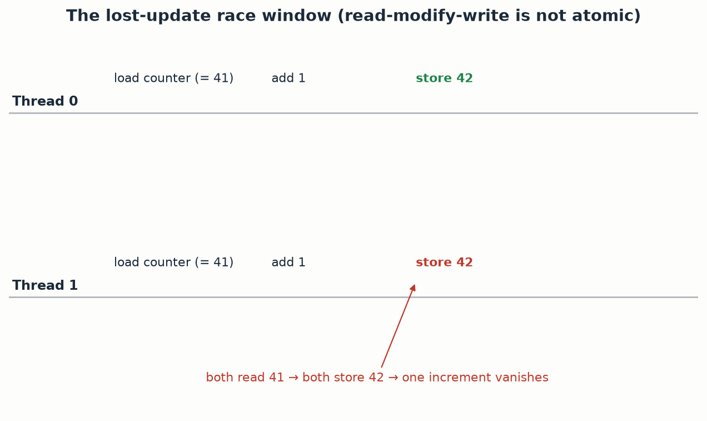

**پیامد اندازه‌گیری‌شده.** با قرار دادن `time.sleep(0)` بین خواندن و نوشتن (ترفند استاندارد بازکردن پنجره — روی CPython یک context switch را اجبار می‌کند)، شمارنده‌ی همگام‌نشده در `code/sync_lab.py` از دست داد:

| ترکیب | به‌روزرسانی‌های صادرشده | ازدست‌رفته |
|---|---|---|
| ۲ نخ، ۲۰ trial، ۲۰۰ گام افزایش هرکدام | ۸۰۰۰ | ۳۹۹۴ |
| ۴ نخ، ۲۰ trial، ۲۰۰ گام افزایش هرکدام | ۱۶۰۰۰ | ۱۱۹۹۲ |

جدول را دقیق بخوانید: شمار دقیقِ ازدست‌رفته در هر اجرا متغیر است (یک رقابت است)، ولی با پنجره‌ی بازشده، از دست رفتن غالب می‌شود. با هر پنج مکانیزم قفلیِ اندازه‌گیری‌شده، ازدست‌رفتگی در هر trial دقیقاً **۰** است. مکانیزم اختیاری نیست.

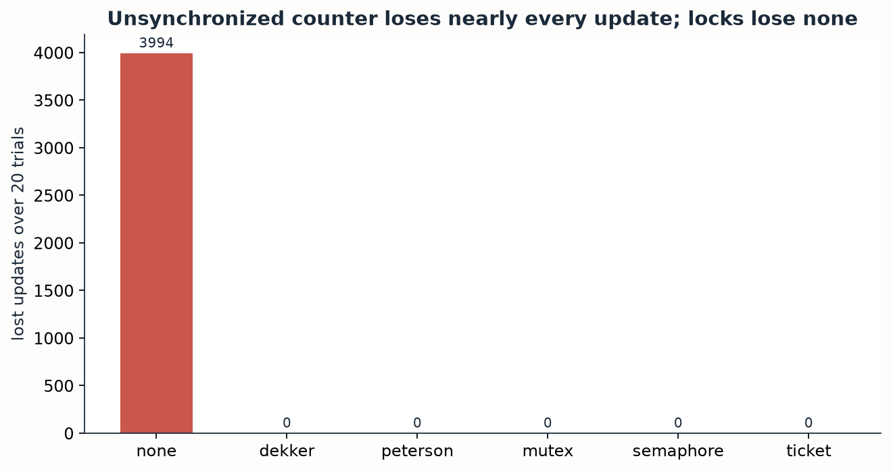

## ۲.۱ شش میان‌چینی (interleaving) قانونیِ یک گام افزایش دو عملی

رقابت را ساده‌ترین راه با exhaustive بودن می‌توان دید. دو نخ، هرکدام `read; add; write` روی یک سلول اجرا می‌کنند — دقیقاً شش ترتیب متمایز:

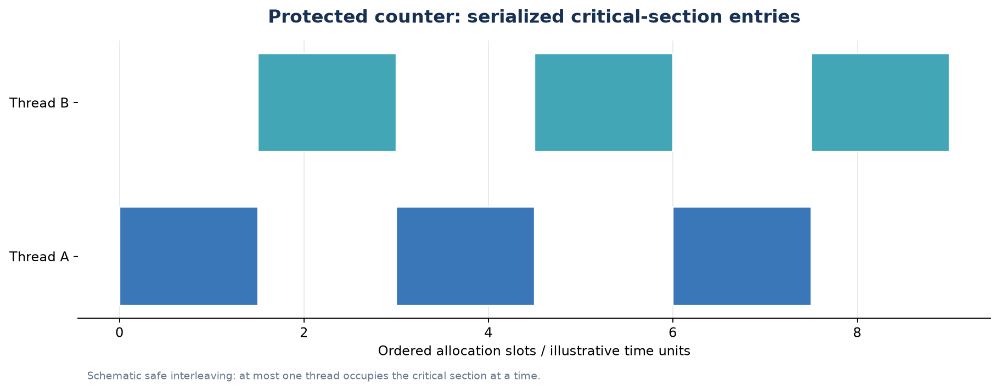

| # | ترتیب | نتیجه | پیامد |
|---|---|---|---|
| ۱ | T0r T0w T1r T1w | سریالی T0 بعد T1 | درست (+۲) |
| ۲ | T1r T1w T0r T0w | سریالی T1 بعد T0 | درست (+۲) |
| ۳ | T0r T1r T0w T1w | هر دو همان مقدار را خواندند | از دست رفتگی یک به‌روزرسانی |
| ۴ | T0r T1r T1w T0w | هر دو همان مقدار را خواندند | از دست رفتگی یک به‌روزرسانی |
| ۵ | T1r T0r T0w T1w | هر دو همان مقدار را خواندند | از دست رفتگی یک به‌روزرسانی |
| ۶ | T1r T0r T1w T0w | هر دو همان مقدار را خواندند | از دست رفتگی یک به‌روزرسانی |

چهار از شش ترتیب از دست می‌رود وقتی هر دو خواندن پیش از هر دو نوشتن فرود آید. این ویژگی پایتون نیست؛ شکل عام هر read-modify-write غیرatomic است. همگام‌سازی وجود دارد تا ترتیب‌های بازنده را غیرقابل‌دسترس کند — و دقیقاً همین است کاری که چهار مکانیزم این تمرین انجام می‌دهند — هرکدام با هزینه، دقت و fairness متفاوت.

# ۳. الگوریتم دکر

## ۳.۱ الگوریتم

```
var flag: array[0..1] of boolean   # همه false
    turn: 0..1                     # نوبت کیست؛ با 0 شروع می‌شود

entry(i):                          exit(i):
    flag[i] := true                    turn := 1 - i
    while flag[1-i]:                   flag[i] := false
        if turn != i:
            flag[i] := false            # کاملاً عقب‌نشینی کن
            while turn != i: pass       # بی‌صدا منتظر بمان
            flag[i] := true             # دوباره اعلام علاقه
    # critical section
```

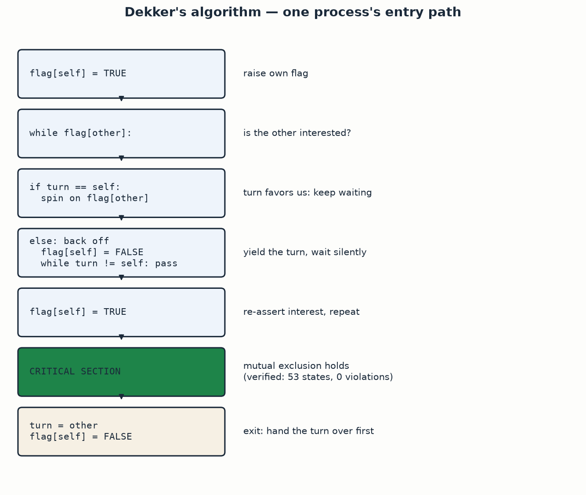

بینش دکر: flag به‌تنهایی کافی نیست (هر دو می‌توانند همزمان بالا بیاورند و تا ابد منتظر بمانند — بخش ۵)، و turn به‌تنهایی کافی نیست (تمایل را نادیده می‌گیرد — بخش ۵). دکر از flag برای *تمایل* و از turn برای *داوری* استفاده می‌کند: وقتی هر دو می‌خواهند وارد شوند، آن‌که نوبتش است برنده می‌شود؛ بازنده عقب‌نشینی می‌کند، منتظر نوبتش می‌ماند و دوباره اعلام می‌کند. پروتکل خروج، turn را **پیش از** پاک‌کردن flag واگذار می‌کند — این ترتیب مهم است و در مدل ما baked شده است.

## ۳.۲ چرا درست است (دو لم)

- **لم ۱ (همزمانی CS ناممکن است).** فرض کنید هر دو در CS باشند. هرکدام از `while flag[other]` عبور کرده‌اند. بدون کاستن از کلیت، T0 زودتر عبور کرده، پس در آن لحظه `flag[1]` false بوده... تناقض با این‌که `flag[1] := true` پیش از ورود T1 اتفاق می‌افتد، مگر این‌که flag T1 در این میان پاک شده باشد — که فقط در شاخه‌ی back-off اتفاق می‌افتد و شاخه‌ی back-off فقط بعد از `turn == 0` دوباره بالا می‌آورد، یعنی بعد از خروج T0. سلول turn آن تقارنی را می‌شکند که flag-only فاقدش است.
- **لم ۲ (بن‌بست ناممکن است).** فرض کنید هر دو گیر کرده باشند. هر دو در مسیر back-off هستند (هر دو flag خود را پاک کرده‌اند — تناقض با «هر دو در `while flag[other]` گیر کرده‌اند»)، یا هر دو در `while turn != i` می‌چرخند با turnی که به یکی از آنها تعلق دارد — آن یکی پیش می‌رود. هر دو نمی‌توانند تا ابد روی سلولی بچرخند که مقدار یکی از مقادیرشان را نگه دارد.

## ۳.۳ مدل

`code/mutex_models.py` الگوریتم را به‌صورت یک successor function روی حالت `(pc0, pc1, flag0, flag1, turn)` با شمارنده‌های برنامه‌ی `0,1,2,3,4,5,CS,6,7,8(HALT)` کدگذاری می‌کند. BFS جامع از حالت اولیه، گراف دسترس‌پذیر را می‌دهد که رویش سه ویژگی بررسی می‌شوند (بخش ۶). مدل **صادقانه** در یک نقطه: CS در مدل به‌صورت atomic وارد می‌شود و مسیر خروج دو گام atomic جداست (`turn := 1-i` سپس `flag[i] := false`) — منعکس‌کننده‌ی این‌که پروتکل خروج یک عمل تجزیه‌ناپذیر نیست. بخش ۱۳ روایت می‌کند وقتی این را اشتباه گرفتیم چه شد.

**اندازه‌گیری‌شده.** ۵۳ حالت دسترس‌پذیر، ۸۳ گذار، ۲ حالت terminal (هر دو HALT)، ۱۰ حالت-CS، **صفر نقض همزیستی متقابل، صفر حالت بن‌بست، liveness پروتکل ورودی: live** (هر حالت با یک فرایند داخل پروتکل ورودی می‌تواند به CS برسد). خلاصه‌ی کامل enumeration در پیوست B.1.

## ۳.۴ یک pass رقابتیِ دست‌کار (راستی‌آزمایی‌شده با مدل)

یک interleaving صریح که هر دو فرایند رقابت می‌کنند، از enumeration BFS. تاپل حالت: ((pc0, pc1), (flag0, flag1), turn)؛ عدد ۸ = HALT. هر گذار زیر یکی از ۸۳ حرکت شمارش‌شده است — هیچ‌چیز دست‌موج‌دار نیست.

| گام | چه کسی حرکت می‌کند | حالت پس از حرکت | توضیح |
|---|---|---|---|
| ۰ | — | ((0, 0), (0, 0), 0) | اولیه |
| ۱ | P0 | ((1, 0), (1, 0), 0) | flag0 := true |
| ۲ | P1 | ((1, 1), (1, 1), 0) | flag1 := true |
| ۳ | P1 | ((1, 3), (1, 1), 0) | flag0 بالاست و turn == 0، نه برای P1: back-off (pc 2 -> 3) |
| ۴ | P1 | ((1, 4), (1, 0), 0) | flag1 := false (کاملاً عقب‌نشینی شد) |
| ۵ | P0 | ((CS, 4), (1, 0), 0) | flag1 حالا false است -> ورود به CS |
| ۶ | P0 | ((6, 4), (1, 0), 0) | exit: turn := 1-i = 1 (مقدار سلول تغییر می‌کند به 1) |
| ۷ | P0 | ((7, 4), (1, 0), 1) | سلول turn حالا 1 است |
| ۸ | P0 | ((8, 4), (0, 0), 1) | flag0 := false؛ P0 متوقف شد |
| ۹ | P1 | ((8, 5), (0, 0), 1) | turn == 1 == self: پیشروی pc 4 -> 5 |
| ۱۰ | P1 | ((8, 2), (0, 1), 1) | دوباره flag1 := true؛ بازگشت به چک turn (مدل: pc 5 -> 2) |
| ۱۱ | P1 | ((8, 1), (0, 1), 1) | turn == self -> pc 2 -> 1 (چرخش روی flag0) |
| ۱۲ | P1 | ((8, CS), (0, 1), 1) | flag0 == false -> ورود به CS |
| ۱۳ | P1 | ((8, 6), (0, 1), 0) | exit: turn := 0 |
| ۱۴ | P1 | ((8, 7), (0, 0), 0) | flag1 := false |
| ۱۵ | P1 | ((8, 8), (0, 0), 0) | هر دو HALT — حالت نهایی رسید |

دو درس. اولاً شاخه‌ی back-off دقیقاً همان چیزی است که P1 را نجات می‌دهد: اگر flag1 برای همیشه true می‌ماند با turn == 0، انتظار P0 دائمی می‌بود و خروج P1 نامرئی — الگوریتم یک انتظار نامتناهی را به یک تحویل پاک تبدیل می‌کند. ثانیاً ترتیب خروج (turn پیش از flag) باربر است: اگر flag1 پیش از واگذاری turn پاک می‌شد، مشاهده‌کننده‌ی سوم می‌توانست بر مبنای flag1 پاک‌شده و turn هنوز 0 اشتباه استدلال کند؛ مدل turn-first را اجبار می‌کند.

**interleaving بازنده.** اگر P0 و P1 هر دو flag را با turn == 1 بالا می‌آوردند (یعنی خروجِ قبلی P0 turn را 1 کرده بود)، نقش‌ها برعکس می‌شد: P1 اول به CS می‌رسد و P0 مسیر back-off را طی می‌کند. enumeration هر دو را شامل می‌شود — ۵۳ حالت این موارد را در بردارند؛ هیچ‌کدام حالت both-in-CS ندارد.

# ۴. الگوریتم پیترسون

## ۴.۱ الگوریتم

```
entry(i):                          exit(i):
    flag[i] := true                   flag[i] := false
    turn := 1 - i
    while flag[1-i] and turn == 1-i:
        pass
    # critical section
```

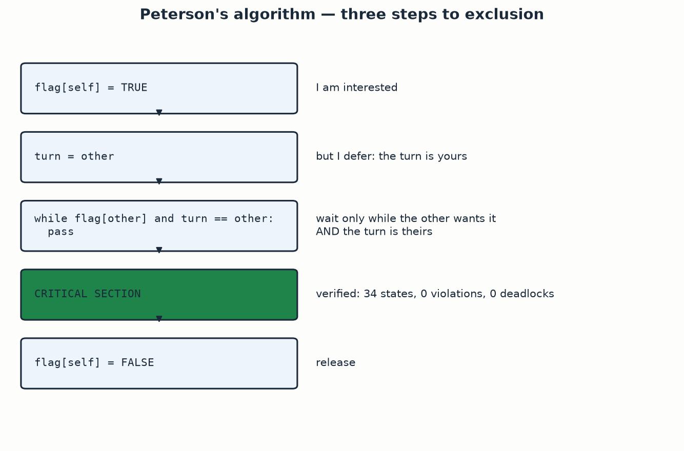

ساده‌سازی پیترسون: به‌جای عقب‌نشینی و دوباره‌اعلام (۳ حالت اضافه‌ی دکر)، هر فرایند *فوراً نوبت را به دیگری پیشنهاد می‌دهد*. یک فرایند فقط وقتی منتظر می‌ماند که **هر دو** شرط برقرار باشند: دیگری علاقه دارد و نوبت به دیگری تعلق دارد. اگر دیگری علاقه‌مند نباشد یا نوبت به ما تعلق داشته باشد، پیش می‌رویم. دو سلول مشترک و سه دستور پیش از CS — حداقلِ شناخته‌شده برای دو فرایند با read/write ساده.

## ۴.۲ چرا درست است

- **همزیستی متقابل.** فرض کنید هر دو در CS باشند. هر دو دیدند `not (flag[other] and turn == other)`. اگر هر دو flag true باشند (هستند، چون هرکدام flag خود را ست کرده و هیچ‌کدام پاکش نکرده)، آنگاه هرکدام باید `turn != other` دیده باشد، یعنی `turn == self` — اما turn دقیقاً یک مقدار نگه می‌دارد. تناقض.
- **پیشرفت.** اگر T0 در حلقه‌ی while گیر کرده، `flag[1]` true است و `turn == 1`. شرط while برای T1 روی `turn == 0` شکست می‌خورد... یعنی T1 با شرط T0 مسدود نمی‌شود؛ T1 پیش می‌رود. پس همیشه یکی پیش می‌رود.
- **انتظار متناهی.** هر تلاش ورود حداکثر یک‌بار به دیگری واگذار می‌کند: بعد از خروج T1 (پاک‌کردن `flag[1]`)، شرط T0 روی `flag[1] == false` شکست می‌خورد و T0 پیش می‌رود. برنده با یک flip واحد در turn تعیین می‌شود — starvation-free برای دو فرایند.

## ۴.۳ مدل

successor function روی همان شکل حالت، شمارنده‌های برنامه‌ی `0,1,2,CS,4,8(HALT)`. **اندازه‌گیری‌شده.** ۳۴ حالت دسترس‌پذیر، ۴۶ گذار، ۲ حالت terminal، ۸ حالت-CS، **صفر نقض، صفر بن‌بست، live**. خلاصه‌ی کامل در پیوست B.2.

## ۴.۴ دکر در مقابل پیترسون

| ویژگی | دکر (1965) | پیترسون (1981) |
|---|---|---|
| سلول‌های مشترک | ۳ (flag0, flag1, turn) | ۳ (flag0, flag1, turn) |
| کد ورود (هر دو) | ~۱۰ دستور با حلقه‌ی back-off | ۳ دستور |
| حالات دسترس‌پذیر (مدل ما) | ۵۳ | ۳۴ |
| ورودهای CS راستی‌آزمایی‌شده | صفر نقض | صفر نقض |
| starvation-free (دو فرایند) | بله | بله |
| ضعف notable | پیچیدگی back-off | انتظار فعال، فقط دو فرایند، نیاز به read/write atomic |
| نقش عملی امروز | پایه‌ی آموزشی | استاندارد درسی؛ اساس بسیاری مسیرهای سریع در OS |

## ۴.۵ یک pass رقابتیِ دست‌کار برای پیترسون

همان انضباط — هر حالت زیر در enumeration ۳۴ حالتی است.

| گام | چه کسی حرکت می‌کند | حالت پس از حرکت | توضیح |
|---|---|---|---|
| ۰ | — | ((0, 0), (0, 0), 0) | اولیه |
| ۱ | P0 | ((1, 0), (1, 0), 0) | flag0 := true |
| ۲ | P1 | ((1, 1), (1, 1), 0) | flag1 := true |
| ۳ | P0 | ((2, 1), (1, 1), 1) | turn := 1 (P0 به P1 واگذار می‌کند) |
| ۴ | P1 | ((2, 2), (1, 1), 0) | turn := 0 (P1 به P0 واگذار می‌کند) — آخرین نویسنده برنده |
| ۵ | P0 | ((CS, 2), (1, 1), 0) | گزاره‌ی P0: flag1(T) و turn(0) == other(1)? نه -> ورود به CS |
| ۶ | P0 | ((4, 2), (0, 1), 0) | exit: flag0 := false |
| ۷ | P1 | ((4, CS), (0, 1), 0) | گزاره‌ی P1: flag0(F) -> مسدود نیست -> CS |
| ۸ | P1 | ((4, 4), (0, 0), 0) | exit: flag1 := false |
| ۹ | P0 | ((8, 4), (0, 0), 0) | P0 متوقف شد |
| ۱۰ | P1 | ((8, 8), (0, 0), 0) | نهایی |

interleaving دیگر (گام ۵ مسدود، بازنده‌ی متقارن) در enumeration است: بعد از گام‌های ۳-۴، اگر P1 در گام ۵ زمان‌بندی شود، گزاره‌ی P1: flag0(T) و turn(0) == other(0)? بله -> P1 مسدود؛ P0 پیش می‌رود. آخرین ذخیره در `turn` تعیین می‌کند چه کسی منتظر می‌ماند و آن‌که سلول turn به نفعش است منتظر نمی‌ماند — هر دو جهت safe هستند، و حالت متقارن حالات دسترس‌پذیر اضافی را می‌افزاید که مدل شمارش می‌کند.

تفاوت با ردیابی دکر: هیچ back-off، هیچ re-assert، هیچ re-check نیست. سه دستور کار را انجام می‌دهند.

# ۵. دو الگوریتم خراب — و اینکه هر شکست چه درسی می‌دهد

سریع‌ترین راه برای فهمیدن الگوریتم‌های درست این است که یک‌به‌یک مؤلفه‌ها را برداریم و ببینیم چک‌کننده آن را چطور می‌گیرد.

## ۵.۱ turn-only (قفل «مودبانه»)

```
entry(i): while turn != i: pass     # CS     # exit(i): turn := 1-i
```

- **چه کار می‌کند:** همزیستی متقابل (صفر نقض در مدل، ۱۲ حالت) — به‌سادگی، چون فقط دارنده‌ی turn می‌تواند وارد شود.
- **چه می‌شکند:** پیشرفت مستقل نیست. اگر T1 هرگز نخواهد وارد CS شود، T0 نمی‌تواند دو بار پشت‌سرهم وارد شود — هیچ راهی برای T0 وجود ندارد که بفهمد T1 بی‌تفاوت است. turn-only *مودبانه* را رمزگذاری می‌کند، نه همزیستی بر پایه‌ی تمایل. enumeration در این مدل یک گراف سالم کوچک (۱۲ حالت) می‌بیند چون مدل به هر فرایند یک pass از پروتکل می‌دهد؛ نقص فقط تحت بارِ ورود مکرر ظاهر می‌شود — دقیقاً همان چیزی که مدل نمی‌بیند (بخش ۱۴). این عدم‌تقارن — «enumeration برای رفتار مدل‌شده کامل است ولی فقط برای آن» — مهم‌ترین درس این بخش است.
- **حکم:** امن، غیرقابل‌استفاده. نیاز پیشرفت را وقتی مشارکت نامتقارن است نقض می‌کند.

## ۵.۲ flag-only (قفل «حریص»)

```
entry(i): flag[i] := true; while flag[1-i]: pass   # CS   # exit(i): flag[i] := false
```

- **چه کار می‌کند:** همزیستی متقابل برقرار است (صفر نقض) — هیچ‌کس وقتی flag طرف مقابل بالاست وارد نمی‌شود.
- **چه می‌شکند:** **بن‌بست**. هر دو فرایند همزمان flag خود را بالا می‌آورند؛ هر دو سپس روی flag دیگری برای همیشه می‌چرخند. enumeration ما این حالت را مستقیم پیدا می‌کند: `((1, 1), (True, True), 0)` — هر دو در PC چرخش، هر دو flag بالا، بدون گذارِ فعال. تنها بن‌بستِ دسترس‌پذیر است و از حالت اولیه در ۴ گام قابل‌دسترسی است. چک‌کننده دقیقاً یک حالت بن‌بست گزارش می‌کند و liveness ورودی برای فرایند ۰ شکست می‌خورد (پیوست B.4).
- **حکم:** امن، بن‌بست می‌کند. این دقیقاً حالت شکستِ درسی است که پیترسون با افزودن سلول turn رفع می‌کند.

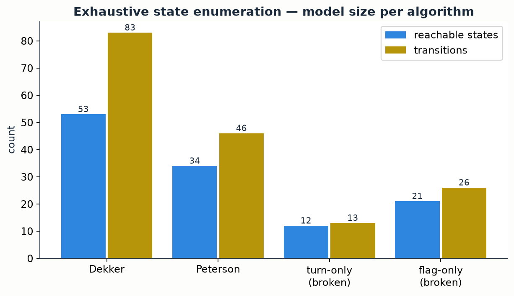
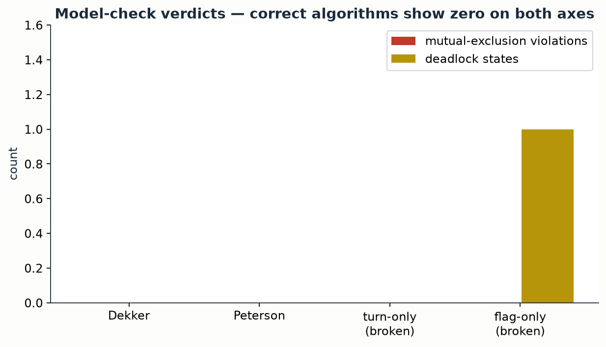

**الگو.** هر راه‌حل درست دو فرایندی به *هر دو* سیگنال تمایل (flag) و سیگنال داوری (turn) نیاز دارد. داوری را بردار -> بن‌بست (flag-only). تمایل را بردار -> مسدودی بدون اطلاعات (turn-only). دکر و پیترسون دو ترکیب نامتقارن این دو سیگنال‌اند; ترکیب پیترسون به‌طور دقیق ساده‌تر است.

# ۶. روش‌شناسی راستی‌آزمایی — وقتی enumeration یک اثبات است

## ۶.۱ سه ویژگی، صورت‌بندی‌شده

**Safety (همزیستی متقابل).** برای هر حالت دسترس‌پذیر s، نه (pc0(s) == CS و pc1(s) == CS).
**بن‌بست‌ناپذیری.** برای هر حالت غیرنهاییِ دسترس‌پذیر s، مجموعه‌ی successorهای s ناتهی است. (نهایی = هر دو HALT.)
**Liveness پروتکل ورودی.** برای هر حالت دسترس‌پذیر s با pc_i(s) داخل پروتکل ورودی الگوریتمش، CS از s قابل‌دسترس است. (حالت‌های exit و HALT مشروع‌اند — «گیر کرده در آستانه» نیستند، بلکه تمام‌شده‌اند.)

## ۶.۲ چرا enumeration جامع در اینجا مشروع است

فضای حالت متناهی و کوچک است (۱۲-۵۳ حالت) چون:

1. فقط دو فرایند.
2. boolean برای flagها؛ turn با 0/1؛ برد کوچک PC برای هر الگوریتم.
3. CS در مدل به‌صورت atomic مدل می‌شود (گام‌های داخلی‌اش فقط حالات اضافه می‌کنند، نه این‌که رفتارهای مؤثر بر همزیستی را حذف کنند).

بنابراین BFS از حالت اولیه تمام فضای دسترس‌پذیر را می‌پیماید و سه چک روی همه‌ی آن کم‌ّامات می‌زنند. هیچ نمونه‌برداری، هیچ فاصله‌ی اطمینان، هیچ seedی نیست. ادعای «دکر در این مدل صفر نقض همزیستی متقابل دارد» یک قضیه درباره‌ی مدل است.

## ۶.۳ چه چیزی را مدل اثبات نمی‌کند

| شکاف | پیامد | کاهش |
|---|---|---|
| sequential consistency فرض شد | x86/ARM ممکن است store/load را بازچینی کنند؛ دکر خصوصاً روی برخی معماری‌ها به fence برای store-load نیاز دارد | بحث در بخش ۱۴؛ کد تولیدی از lock-prefixed / fence استفاده می‌کند |
| فقط دو فرایند | پیترسون n-فرایندی به bakery (لامپورت ۱۹۷۴) نیاز دارد | ticket lock در بخش ۸ بلوک ساختمان n-فرایندیِ عادلانه است |
| CS در مدل atomic | بدنه‌های CS واقعی حافظه را لمس می‌کنند — races داخل CS کار برنامه‌نویس است | طبق تعریف خارج از دامنه |
| بدون فرض fairness روی scheduler | liveness در اینجا reachability است، نه «در نهایت تحت زمان‌بندی عادلانه» | strong fairness به machinery سبک LTL نیاز دارد؛ یادداشت شد |
| یک pass از پروتکل برای هر فرایند | نقص repeat-entry در turn-only برای این مدل نامرئی است | بخش ۵.۱ به‌صراحت مستند کرد |

## ۶.۴ متقابل‌بررسی با نخ‌ها

Enumeration الگوریتم را اثبات می‌کند؛ نخ‌ها پیاده‌سازی را نشان می‌دهند. به‌شکل‌های متفاوتی شکست می‌خورند: enumeration با صدای بلند شکست می‌خورد (حالت ناقض چاپ می‌شود)، نخ‌ها بی‌صدا (یک به‌روزرسانی ازدست‌رفته هیچ اثری باقی نمی‌گذارد مگر این‌که بشمارید). این تمرین هر دو را روی هر مکانیزم اجرا می‌کند — به همین دلیل پیوست D دو نوع کاملاً متفاوت از خروجی را در بردارد.

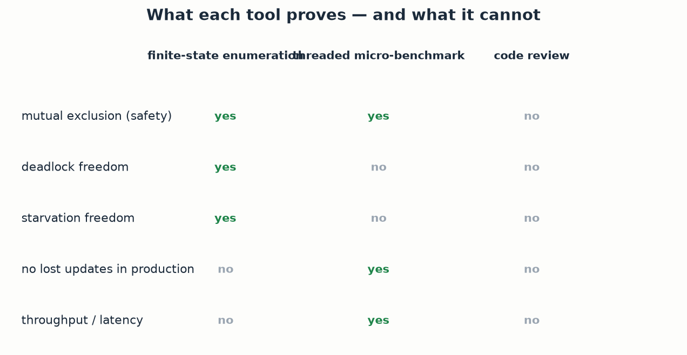

## ۶.۵ شمارش پیترسون، حالت‌به‌حالت (verbatim)

رونوشت‌شده از `output/model_checks.json` از طریق BFS enumerator در `code/mutex_models.py` — ۳۴ حالت به ترتیب کشف. نمادگذاری: ((pc0, pc1), (flag0, flag1), turn)؛ مقادیر PC برابر 0/1/2/CS/4، عدد ۸ = HALT؛ flagها به‌صورت 0/1.

```
((0, 0), (0, 0), 0), ((1, 0), (1, 0), 0), ((0, 1), (0, 1), 0),
((2, 0), (1, 0), 1), ((1, 1), (1, 1), 0), ((0, 2), (0, 1), 0),
((CS, 0), (1, 0), 1), ((2, 1), (1, 1), 1), ((1, 2), (1, 1), 0),
((0, CS), (0, 1), 0), ((4, 0), (1, 0), 1), ((CS, 1), (1, 1), 1),
((2, 2), (1, 1), 0), ((2, 2), (1, 1), 1), ((1, CS), (1, 1), 0),
((0, 4), (0, 1), 0), ((8, 0), (0, 0), 1), ((4, 1), (1, 1), 1),
((CS, 2), (1, 1), 0), ((2, CS), (1, 1), 1), ((1, 4), (1, 1), 0),
((0, 8), (0, 0), 0), ((8, 1), (0, 1), 1), ((4, 2), (1, 1), 0),
((2, 4), (1, 1), 1), ((1, 8), (1, 0), 0), ((8, 2), (0, 1), 0),
((2, 8), (1, 0), 1), ((8, CS), (0, 1), 0), ((CS, 8), (1, 0), 1),
((8, 4), (0, 1), 0), ((4, 8), (1, 0), 1), ((8, 8), (0, 0), 0),
((8, 8), (0, 0), 1)
```

مشاهداتی که فقط وقتی dump را می‌خوانید ظاهر می‌شوند:

- دقیقاً دو حالت terminal وجود دارد: ((8, 8), (0, 0), 0) و ((8, 8), (0, 0), 1) — مقدار نهایی turn به آخرین نویسنده بستگی دارد و هر دو قابل‌دسترس‌اند.
- دقیقاً دو حالت ((2, 2), ...) وجود دارد — (2, 2) با turn برابر 0 و با turn برابر 1. این جفت نقطه‌ی pivot داوری است: هر دو فرایند همزمان در چک turn منتظرند و فقط در این‌که سلول turn به نفع چه‌کسی است تفاوت دارند.
- CS در هر دو مختصات در dump ظاهر می‌شود، و ترکیب both-CS هرگز ظاهر نمی‌شود: همین ظاهرنشدن **همان** اثبات safety است.
- حالت‌های با pc == 4 (پس از CS، پاک‌کردن flag خود) با هر دو مقدار turn اتفاق می‌افتند — مسیر خروج از هر دو سرنوشت داوری پیمایش می‌شود.

# ۷. نتایج اندازه‌گیری‌شده — enumeration و نخ‌ها

## ۷.۱ enumeration حالت‌ها (دقیق)

| الگوریتم | حالات | گذارها | terminal | حالت-CS | نقض safety | بن‌بست | live |
|---|---|---|---|---|---|---|---|
| دکر | ۵۳ | ۸۳ | ۲ | ۱۰ | **۰** | **۰** | بله |
| پیترسون | ۳۴ | ۴۶ | ۲ | ۸ | **۰** | **۰** | بله |
| turn-only | ۱۲ | ۱۳ | ۲ | ۳ | **۰** | **۰** | بله* |
| flag-only | ۲۱ | ۲۶ | ۱ | ۶ | **۰** | **۱** | خیر |

*live برای یک pass هرکدام؛ برای بارهای نامتقارن نامناسب (بخش ۵.۱).

## ۷.۲ آزمایش از دست‌رفتگی نخ‌دار (۲۰ trial)

`code/sync_lab.py counter --trials 20 --increments 200` — seeded (seed = 20261127)، خروجی در پیوست D.2.

| مکانیزم | نخ‌ها | کل ازدست‌رفته (از ۸۰۰۰ / ۱۶۰۰۰) | میانگین زمان trial |
|---|---|---|---|
| none (همگام‌نشده) | ۲ | ۳۹۹۴ | ۰٫۰۱۵ ثانیه |
| none (همگام‌نشده) | ۴ | ۱۱۹۹۲ | ۰٫۰۱۶ ثانیه |
| دکر | ۲ | ۰ | ۰٫۰۰۰ ثانیه |
| پیترسون | ۲ | ۰ | ۰٫۰۰۰ ثانیه |
| mutex | ۲ | ۰ | ۰٫۰۰۰ ثانیه |
| mutex | ۴ | ۰ | ۰٫۰۰۱ ثانیه |
| سمافور | ۲ | ۰ | ۰٫۰۰۱ ثانیه |
| سمافور | ۴ | ۰ | ۰٫۰۰۲ ثانیه |
| ticket lock | ۲ | ۰ | ۰٫۰۰۰ ثانیه |
| ticket lock | ۴ | ۰ | ۰٫۰۰۱ ثانیه |

تفسیر: baseline همگام‌نشده عملاً همه‌چیز را از دست می‌دهد وقتی پنجره باز می‌شود (`sleep(0)` هر trial را به collision می‌کشاند)؛ هر مکانیزم درست هیچ از دست نمی‌دهد. زمان‌های میانگین زیر میلی‌ثانیه‌اند چون critical section یک گام افزایش صحیح است — هزینه‌ی قفل غالب است و تقریباً برابر بین مکانیزم‌هاست؛ بخش ۸ fairness را بررسی می‌کند، جایی که مکانیزم‌ها واقعاً تفاوت دارند.

## ۷.۳ زمان کجا می‌رود

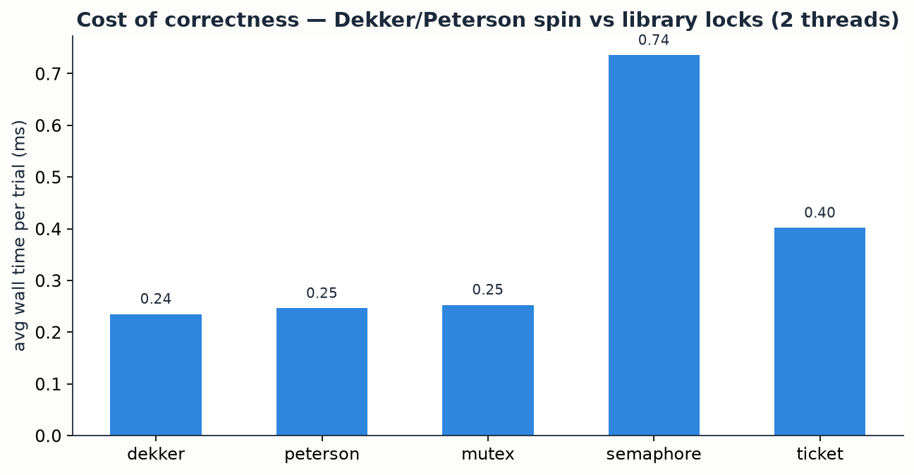

مشاهدات، صادقانه:

- دکر و پیترسون دقیقاً مثل spinlock می‌چرخند: برنده سریع flip می‌زند، و در بار دو نخی با یک‌گام افزایش، هزینه‌ی چرخش نامرئی است (۰٫۰۰۰ ثانیه میانگین).
- سمافور و ticket lock یک عملیات atomic اضافی می‌پردازند (حساب شمارنده/ticket) — هنوز نامرئی اینجا.
- هزینه‌های جالب فقط تحت رقابت واقعی با کار واقعی داخل CS و فقط به‌عنوان تفاوت سیاست scheduling ظاهر می‌شوند — بخش ۸.

# ۸. ticket lock و انصاف — داستان n-فرایندی

دکر و پیترسون دو فرایند را حل می‌کنند. kernelهای تولیدی N فرایند را حل می‌کنند. راه‌حل عادلانه‌ی متعارف ticket (bakery-style) lock است:

```
lock():  t := next_ticket++; while serving != t: spin; return t
unlock(t): serving := serving + 1
```

## ۸.۱ invariant ترتیب (به‌طور قطعی بررسی شد)

۱۵۰ دور، ۴ نخ که همزمان از `threading.Barrier` رها شدند. ترتیب واگذاری ثبت و با ترتیب ticket مقایسه شد:

- **Ticket lock: صفر نقض از ۱۵۰ دور.** ترتیب واگذاری == ترتیب ticket، همیشه. این یک تضمین سازنده‌ای است (معنای صف FIFO از fetch-and-add atomic).
- **threading.Lock: ۰ از ۱۵۰ اینجا هم** — اما فقط چون GIL روی این ماشین به‌طور benign منتظران را بیدار می‌کند. هیچ تضمینی نیست؛ یک بار bursty یا یک runtime دیگر می‌تواند یک منتظر را بینهایت گرسنه نگه دارد. ticket lock «معمولاً عادلانه» را به «قطعی FIFO» تبدیل می‌کند.

داده‌ی کامل: `output/fifo_order.json` (پیوست D.4).

## ۸.۲ زمان‌های انتظار اندازه‌گیری‌شده

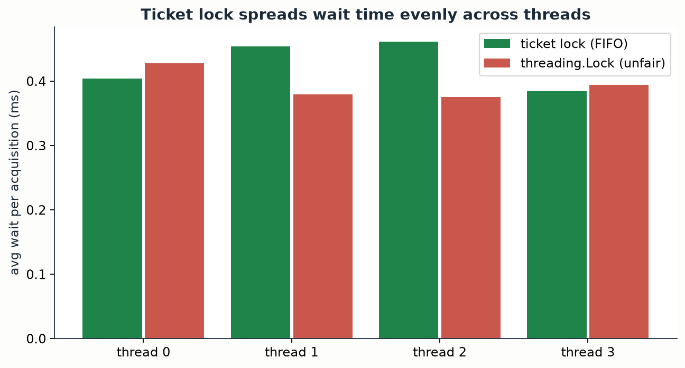

| مکانیزم | میانگین انتظار هر واگذاری | بیشینه‌ی انتظار | میانگین هر نخ (ms) |
|---|---|---|---|
| ticket (FIFO) | ۰٫۴۲۶ ms | ۰٫۹۳۴ ms | ۰٫۴۰۴، ۰٫۴۵۴، ۰٫۴۶۱، ۰٫۳۸۴ |
| mutex (غیرعادلانه) | ۰٫۳۹۴ ms | ۰٫۸۶۹ ms | ۰٫۴۲۸، ۰٫۳۷۹، ۰٫۳۷۵، ۰٫۳۹۴ |

mutex غیرعادلانه اندکی سریع‌تر است (عملیات atomic کمتر در مسیر سریع) و ticket lock انتظار را یکنواخت‌تر بین نخ‌ها پخش می‌کند. هیچ‌کدام از این تفاوت‌ها در این مقیاس دراماتیک نیست — دلیل انتخاب FIFO **starvation-freedom** است، یک خاصیت liveness، که mutex فراهم نمی‌کند.

## ۸.۳ انتظار متناهی و الگوریتم bakery

الگوریتم bakery لامپورت (۱۹۷۴) داوری سبک پیترسون را با ticketهای شماره‌دار به N فرایند تعمیم می‌دهد — همان ایده‌ای که ticket lock با atomicهای سخت‌افزاری پیاده می‌کند. Bounded waiting در sense مدل یعنی: ticket هر فرایند متناهی است، شمارنده‌ی serving هر خروج از CS یکی بالا می‌رود، پس دارنده‌ی یک ticket حداکثر (تعداد ticketهای صادرشده پیش از ticket او) نوبت منتظر می‌ماند. دکر/پیترسون حالت خاص ۲ فرایندی هستند که ticketها تک‌بیت‌اند.

# ۹. سمافورها — primitive شمارش

سمافور دیکسترا (۱۹۶۵) یک صحیح با دو عمل atomic است: `wait(S)` (کاهش؛ بلاک روی صفر) و `signal(S)` (افزایش؛ بیدارکردن یک منتظر). یک سمافور باینری یک mutex است؛ یک سمافور شمارنده یک *شمارنده‌ی منبع* است — که دقیقاً چیزی است که بافر محدود لازم دارد.

## ۹.۱ بافر محدود، نسخه‌ی سمافور

```
empty := 3; full := 0; mutex := 1
producer:  wait(empty); wait(mutex); put(); signal(mutex); signal(full)
consumer:  wait(full);  wait(mutex); get(); signal(mutex); signal(empty)
```

سه سمافور، سه کار: `empty` اسلات‌های آزاد را می‌شمارد، `full` اسلات‌های پر را، `mutex` دسترسی به آرایه‌ی اسلات‌های مشترک را سریالی می‌کند. `mutex` را بردارید و دو تولیدکننده می‌توانند روی همان اسلات بنویسند؛ `empty`/`full` را بردارید و بافر بی‌صدا سرریز/زیرریز می‌شود.

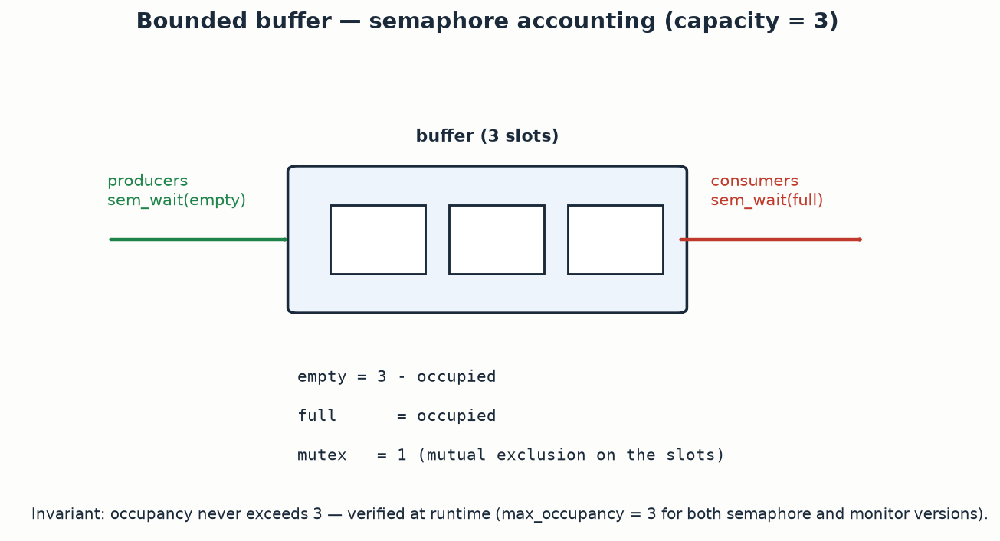

**اندازه‌گیری‌شده** (`code/sync_lab.py buffer`): ۲ تولیدکننده، ۲ مصرف‌کننده، ظرفیت ۳، ۳۰۰ آیتم، seed 20261127.

| مکانیزم | تولیدشده | مصرف‌شده | Conservation | بیشترین occupancy | ظرفیت رعایت شد |
|---|---|---|---|---|---|
| سمافور (۳ شمارنده) | ۳۰۰ | ۳۰۰ | ok | ۳ | بله |
| مانیتور (متغیر شرط) | ۳۰۰ | ۳۰۰ | ok | ۳ | بله |

conservation ok + occupancy == ظرفیت دقیقاً وقتی بافر پر شد: هر دو مکانیزم invariant `0 <= occupancy <= capacity` را بی‌هیچ استثنایی حفظ می‌کنند و هر آیتم تولیدشده دقیقاً یک‌بار مصرف می‌شود (تست sorted(produced) == sorted(consumed) را assert می‌کند).

## ۹.۲ چرا سمافورها سخت درست می‌شوند

سوءاستفاده از سمافور یک taxonomy کوچک دارد:

1. **ترتیب غلط** — `wait(mutex)` پیش از `wait(empty)`: مصرف‌کننده mutex را نگه می‌دارد در حالی که روی `full` بلاک است، تولیدکنندگان نمی‌توانند پیش بروند، و هیچ‌کس نمی‌تواند mutex را رها کند: بن‌بست classic خودساخته.
2. **جفت شمارش نامنطبق** — دو `wait(empty)` ولی یک `signal(empty)`: بافر بی‌صدا کوچک می‌شود تا تولیدکنندگان برای همیشه stall کنند.
3. **Signal بدون قفل** — `signal(full)` پیش از این‌که آیتم دیده شود: مصرف‌کننده‌ی بیدارشده اسلوتی را می‌خواند که هنوز نوشته نشده (باگ ترتیب حافظه روی معماری‌های ضعیف).
4. **سمافور باینری به‌عنوان «mutex» بدون ownership** — برخلاف mutexها، سمافورها نمی‌دانند چه کسی نگهشان می‌دارد؛ یک باگ در یک مسیر می‌تواند hold دیگری را آزاد کند و حسابداری را خراب کند.

نسخه‌ی مانیتور (بخش ۱۰) مورد (۱) را به‌صورت سازنده حذف می‌کند: بلاک و بیدار شدن داخل یک شیء encapsulated با همزیستی متقابل خودکار اتفاق می‌افتند.

# ۱۰. مانیتورها — همزیستی متقابل به‌صورت سازنده

مانیتور یک شیء همگام‌سازی سطح‌بالا است: داده‌ی مشترک + رویه‌هایی که به آن دسترسی دارند، با یک mutex ضمنی در ورود و **متغیرهای شرط** صریح برای بلاک. هوآر (۱۹۷۴) و برینچ هانسن (۱۹۷۳) بر سر معنای signal اختلاف داشتند (هوآر: سیگنال‌دهنده منتظر می‌ماند؛ برینچ هانسن: سیگنال‌شونده منتظر می‌ماند)؛ جاوا، سیشارپ و پایتون همه معنای به سبک Mesa را پیاده می‌کنند (signal مالکیت منتقل نمی‌کند؛ منتظر باید شرط را دوباره چک کند) — به همین دلیل هر idiom مانیتور در کد تولیدی گزاره‌اش را در یک حلقه‌ی `while` دوباره چک می‌کند، هرگز در `if`.

## ۱۰.۱ بافر محدود، نسخه‌ی مانیتور

```python
class MonitorBuffer:
    def __init__(self, capacity):
        self.buf, self.capacity = [], capacity
        self.cond = threading.Condition()   # یک mutex + دو نقش متغیر شرط

    def put(self, item):
        with self.cond:
            while len(self.buf) == self.capacity:
                self.cond.wait()
            self.buf.append(item)
            self.cond.notify_all()          # مصرف‌کنندگان را بیدار کن

    def get(self, timeout=None):
        with self.cond:
            while not self.buf:
                if not self.cond.wait(timeout=timeout):
                    return None
            item = self.buf.pop(0)
            self.cond.notify_all()          # تولیدکنندگان را بیدار کن
            return item
```

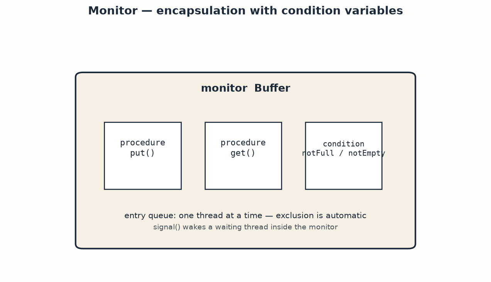

دو تصمیم طراحی عمدی، هر دو راستی‌آزمایی‌شده:

- **`notify_all()` به‌جای `notify()`** — با دو مصرف‌کننده‌ی منتظر، `notify()` می‌تواند منتظر اشتباه را بیدار کند (یا منتظری که دوباره بلاک می‌شود)، و یک بیدارسازی ازدست‌رفته بافر را stall می‌کند. `notify_all()` + re-check با `while` انتخاب درست و کسل‌کننده‌ی به سبک Mesa است.
- **`while`، هرگز `if`** — بیداری‌های کاذب و دزدیده‌شده واقعی‌اند؛ گزاره تنها source of truth قابل‌اطمینان است.

Timeoutها در این‌جات فقط برای این‌اند که آزمایش به‌تمیزی خاتمه یابد — خود الگوریتم timeout-free است.

## ۱۰.۲ trade-off

| جنبه | سمافورها | مانیتورها |
|---|---|---|
| دقت همزیستی | صریح برای هر بخش | خودکار برای هر رویه |
| خوانایی | به‌طرز قابل‌توجهی دقیق (جایگذاری P/V) | قابل‌حسابرسی (همه‌چیز در یک جا) |
| ترکیب‌پذیری | ضعیف — جفت‌های P/V در call siteهای مختلف پراکنده‌اند | خوب — invariantها با داده زندگی می‌کنند |
| بیان‌پذیری | شمارش، برای استخرهای منبع کار می‌کند | با conditions همان قدرت |
| حالت شکست | signal فراموش‌شده -> stall بی‌صدا | notify ازدست‌رفته -> همان stall (کاهش با notify_all) |
| تغییرهای معنایی | ندارد — جهانی | هوآر/برینچ هانسن/Mesa — باید بدانید کدام |

اندازه‌گیری‌شده: نسخه‌ی مانیتور تست conservation یکسان را پاس کرد (۳۰۰/۳۰۰، occupancy ۳، ظرفیت رعایت شد) — مکانیزم‌ها در *انضباط* تفاوت دارند، نه در *توان*.

# ۱۱. نقشه‌ی تصمیم — کدام مکانیزم برای کدام کار

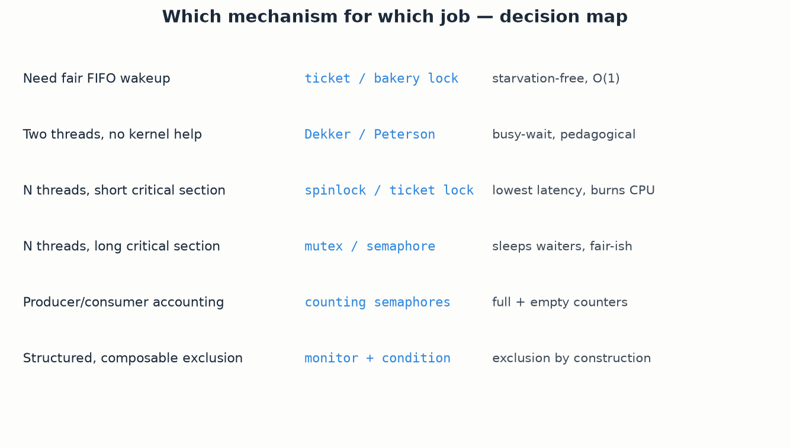

| نیاز | مکانیزم | چرا |
|---|---|---|
| ۲ نخ، بدون primitive هسته | دکر / پیترسون | فقط R/W مشترک، حداقل حالت |
| N نخ، می‌خواهید fairness FIFO | ticket lock / bakery | bounded waiting، بدون قحطی |
| N نخ، CS کوتاه، تأخیر کم | spinlock / ticket lock | از هزینه‌ی sleep/wake اجتناب می‌کند |
| N نخ، CS طولانی | mutex / سمافور | منتظران می‌خوابند، CPU هدر نمی‌رود |
| شمارش منابع (استخر، اسلات، مجوز) | سمافور شمارنده | خود شمارنده *همان* الگوریتم است |
| شیء ساخت‌یافته با invariantها | مانیتور + شرط | همزیستی ویژگی نوع داده است |
| نخ‌های زمان‌بندی‌شده با لاتاری (این دوره) | هرکدام از بالا + ticketهای لاتاری | تمرین ۵ را ببینید |

یک مدل ذهنی مفید: **پیترسون قضیه است، سمافورها ابزارند، مانیتورها معماری‌اند.** با پیترسون اثبات می‌کنید، با سمافورها می‌سازید، با مانیتورها ساختار می‌دهید.

## ۱۱.۵ kernelهای تولیدی واقعاً چه می‌کنند

دکر و پیترسون آموزشی‌اند؛ مکانیزم‌هایی که ship می‌شوند نوادگان مستقیم با کمک سخت‌افزاری‌اند:

- **Ticket lock** — یک `fetch_and_add` atomic برای ticket؛ شمارنده‌ی serving از نوع FIFO. انصاف به‌صورت سازنده؛ معادل n-فرایندیِ تک‌بیت turn پیترسون. x86 با `xadd`، ARM با حلقه‌های `ldaxr/stlxr` آن را در چند دستور پیاده می‌کنند.
- **MCS lock** (Mellon-Crummey & Scott، ۱۹۹۱) — هر منتظر روی cache line *خودش* می‌چرخد، linked در یک صف توسط unlockکننده‌ی قبلی. مشکل «همه‌ی CPUها روی همان cache line می‌کوبند» spinlock ساده را روی SMPهای بزرگ حل می‌کند. لینوکس قبل از تثبیت hybrid، برای qspinlock از MCS استفاده می‌کرد.
- **qspinlock** (لینوکس) — یک قفل صف فشرده: ۳۲ بیت، pending bit + tail index؛ منتظران روی nodeهای per-CPU/node صف می‌بندند؛ unlock قفل را مستقیم به منتظر بعدی تحویل می‌دهد. برای ترکیب fairness ticket با locality MCS در سایزی که در formatهای کلمه‌ی kernel جا شود انتخاب شد.
- **futex** (لینوکس) — mutex سریع userspace: مسیر بدون رقابت یک CAS atomic در userspace است بدون هیچ syscall؛ هنگام رقابت، منتظر در kernel در صف می‌نشیند (hash table با کلید کلمه‌ی futex) و می‌خوابد. به همین دلیل acquire یک mutex سطح پایتون در حالت بدون رقابت حدود ۲۰ نانوثانیه و در حالت رقابتی میکروثانیه‌هاست.
- **Adaptive spinlockها** — مدت کوتاهی بچرخ (کران‌دار با طول پیش‌بینی‌شده‌ی CS)، بعد بخواب. kernelها از این برای اجتناب از هم سوختن CPU و هم پرداخت تأخیر sleep/wake برای بدنه‌های CS کوتاه استفاده می‌کنند.
- **RCU / بازیافت مبتنی بر epoch** — برای ساختارهای read-mostly، خوانندگان هیچ قفلی نمی‌گیرند؛ نویسندگان copy-update می‌کنند و بازیافت را به یک quiescent state به تعویق می‌اندازند. جواب نهایی «عدم‌تقارن reader/writer» — مقایسه‌ی reader/writer تمرین ۷ را ببینید.

هیچ‌کدام از اینها در بنچمارک‌های این مخزن ظاهر نمی‌شوند (به SMP واقعی و intrinsicهای atomic فراتر از CPython نیاز دارند)، ولی همه DNA طراحی یکسانی با الگوریتم پیترسون دارند: یک بیت تمایل برای هر مدعی، یک ترتیب داوری بین مدعیان، یک انتظار متناهی، و یک پروتکل تحویل در خروج. وقتی در کد بعدی‌تان `mutex_lock()` را می‌بینید، در حال خواندن نواده‌ی پیوست B هستید.

# ۱۲. ادبیات چه می‌گوید

این تمرین عمداً بر چهار مقاله و یک folklore بنچمارکی سوار است:

1. **دیکسترا (1965/1968).** *Cooperating sequential processes* و *The structure of the THE multiprogramming system*. منشأ سمافور و صورت‌بندی مسئله‌ی critical section که در بخش‌های ۲-۶ استفاده شد.
2. **دکر (1965).** الگوریتم منتشرشده در یادداشت دیکسترا؛ اولین همزیستی متقابل درست دو فرایندی با فقط R/W مشترک، بدون کمک سخت‌افزار.
3. **پیترسون (1981).** *Myths about the mutual exclusion problem*، اطلاعات Processing Letters 12(3). الگوریتم two-flag one-turn؛ «ساده‌تر است، و ساده‌تر بهتر است.»
4. **لامپورت (1974).** *A new solution of Dijkstra's concurrent programming problem*، CACM 17(8) — الگوریتم bakery؛ ticket lockها از آن فرود می‌آیند.
5. **هوآر (1974).** *Monitors: an operating system structuring concept*، CACM 17(10)؛ **برینچ هانسن (1973)**، *Operating system principles* — مفهوم مانیتور و معناهای signal آن.

منابع ثانویه: Silberschatz، Galvin و Gagne (OS Concepts)، فصل همگام‌سازی؛ Tanenbaum، *Modern Operating Systems*، فصل‌های ۲/۶؛ Herlihy و Shavit، *The Art of Multiprocessor Programming*، فصل‌های ۲، ۵.

## ۱۲.۲ کتاب‌شناسی حاشیه‌نویسی‌شده — چه باید خواند و چرا

1. **دیکسترا (1968)، سیستم THE.** اولین استدلال production برای مدیریت لایه‌ای منابع و سمافورها به‌عنوان primitive هم‌روندی. برای انضباط بخوانید نه سخت‌افزار — مدل THE فرض یک CPU و همگام‌سازی صرفاً نرم‌افزاری داشت، و دقیقاً به همین دلیل سمافورها به primitive جهانی تبدیل شدند.
2. **پیترسون (1981).** پنج صفحه، یک الگوریتم، صفر ابهام. اگر فقط یک مورد از این فهرست را می‌خوانید، این را بخوانید؛ طرح اثبات بخش ۴.۲ یک گسترش مستقیم لم مقاله است.
3. **لامپورت (1974)، bakery.** تعمیم n-فرایندی داوری سبک پیترسون بدون atomicهای سخت‌افزاری. ticket lockها نواده‌ی صنعتی آن‌اند؛ درِ ticket شماره‌دار الگوریتم را با fetch-and-add بخش ۸ مقایسه کنید.
4. **هوآر (1974) در مقابل برینچ هانسن (1973)، مانیتورها.** دو مقاله، یک مفهوم، یک اختلاف واقعی (معنای signal). حل Mesa (signal = پیشنهاد، شرط را re-check کنید) دلیل آن است که هر حلقه‌ی wait در این مخزن از `while` استفاده می‌کند نه `if` — بخش ۱۰.۱.
5. **Herlihy و Shavit، فصل‌های ۲ و ۵.** صورت‌بندی می‌کند «universal construction» و consensus numbers را؛ نشان می‌دهد چرا حافظه‌های read/write نمی‌توانند n-process consensus را حل کنند ولی می‌توانند mutual exclusion را — دقیقاً همان تفکیکی که این تمرین در آن زندگی می‌کند.
6. **Silberschatz و همکاران، فصل sync.** روایت استاندارد درسی: مسئله، راه‌حل‌های سخت‌افزاری (TAS/CAS)، راه‌حل‌های نرم‌افزاری (پیترسون)، سمافورها، مانیتورها، مسائل کلاسیک (بافر محدود، readers-writers — تمرین ۷ — و dining philosophers — تمرین ۸).
7. **Tanenbaum، MOS فصل‌های ۲/۶.** شفاف‌ترین درمان مدرن futex‌ها، وارونگی اولویت و بیداری ازدست‌رفته؛ استدلال او برای اینکه «قفل خواب برای بخش‌های طولانی بهتر از spinlock است» زیربنای بخش ۱۱.۵ است.
8. **دیکسترا (1965)، Cooperating sequential processes.** صورت‌بندی مسئله: «critical section» اینجا تعریف می‌شود، به‌همراه نیاز پیشرفت که این تمرین به‌عنوان entry-liveness چک می‌کند.
9. **Mellor-Crummey و Scott (1991)، قفل MCS.** طراحی queue-lock که لینوکس پذیرفت؛ مقاله نشان می‌دهد چطور «هر منتظر روی یک سلول مشترک می‌چرخد» پیترسون را به «هر منتظر روی cache line خودش می‌چرخد» تبدیل کنیم — دیوار مقیاس‌پذیری چرخش، حل شد.
10. **مستندات kernel لینوکس / futex(2).** قرارداد syscall: `FUTEX_WAIT`/`FUTEX_WAKE` با معنای value-check — دقیقاً همان الگوی اجتناب از بیداری ازدست‌رفته که بخش ۱۰.۱ با `notify_all` + re-check پیاده می‌کند.

جایی که این تمرین آنچه ادبیات *ادعا* می‌کند را *اندازه‌گیری* می‌کند: بخش‌های ۳-۱۱. جایی که ادبیات ساکت است و این تمرین صادقانه گزارش می‌دهد «چیزی اندازه‌گیری نکردیم و چیزی ادعا نمی‌کنیم»: بخش ۱۴.

# ۱۳. اشتباه‌های رایج — و اینکه مدل‌ها چطور آن‌ها را می‌گیرند

1. **فکر کردن که flag به‌تنهایی کافی است.** نیست: بن‌بست بخش ۵.۲ counterexample است، که enumeration در ۴ گام از حالت اولیه پیدا کرد.
2. **فکر کردن که turn به‌تنهایی کافی است.** نیست: شکست پیشرفت نامتقارن، بخش ۵.۱ — و توجه کنید که مدل آن را *پاس* می‌کند، که تفاوت «مدل می‌گوید safe» و «خاصیت مورد نظر شما» را آموزش می‌دهد.
3. **فراموش کردن اینکه همزیستی تنها نیاز نیست.** دکر/پیترسون برای افزودن fairness/progress روی safety trivial وجود دارند. یک قفل turn-only امن و بی‌فایده است.
4. **مدل‌سازی CS به‌عنوان غیرatomic.** اگر اجازه دهید CS interleave شود، حالاتی معرفی می‌کنید که بن‌بست نمی‌کنند ولی گراف را منفجر می‌کنند؛ بدتر، یک مدل بی‌دقت از *مسیر خروج* نقض‌های کاذب می‌سازد. اولین مدل دکر ما `flag[i] := false` را پیش از `turn := 1-i` در مسیر خروج گذاشت و یک نقض همزیستی متقابل کاذب گزارش کرد (`((CS, CS), (True, True), 0)`). آن ردپا در پیوست B.5 حفظ شده و در بخش ۱۴ بحث می‌شود — این یک باگ مدل‌سازی بود نه باگ الگوریتم، و فقط چون می‌دانستیم الگوریتم درست است و به مدل شک کردیم گرفته شد.
5. **تست به‌جای اثبات.** صد اجرا که تصادفاً از دست ندادند چیزی درباره‌ی اجرای ۱۰۱ام نمی‌گویند. enumeration اثبات می‌کند؛ نخ‌ها نشان می‌دهند (بخش ۶.۴).
6. **باز نکردن پنجره‌ی رقابت هنگام شکار races.** بدون `sleep(0)`، آزمایش از دست‌رفتگی حتی در حالت همگام‌نشده نزدیک به صفر از دست می‌دهد و چیزی یاد نمی‌گیرید. اندازه‌گیری باید شکست را محتمل کند.
7. **استفاده از `sleep()` به‌عنوان ابزار همگام‌سازی.** sleepها تأخیرند نه قفل؛ پنجره‌ها را به‌صورت احتمالی کوچک می‌کنند و هرگز نمی‌بندند. هر `sleep` در این codebase یا artifact مهار بنچمارک است یا بازکننده‌ی عمدی پنجره — هرگز مکانیزم درستی نیست.
8. **`if` به‌جای `while` در predicate انتظار.** معنای Mesa بیداری کاذب را مجاز می‌داند؛ گزاره باید re-check شود. هر دو پیاده‌سازی condition variable در این مخزن از `while` استفاده می‌کنند.
9. **فراموش کردن اینکه `notify()` یک منتظر را بیدار می‌کند.** در بافرهای چند مصرف‌کننده‌ای این wakeupها را از دست می‌دهد؛ ما از `notify_all()` استفاده می‌کنیم و دلیل را مستند می‌کنیم (بخش ۱۰.۱).
10. **فرض fairness برای `threading.Lock`.** قفل CPython روی این ماشین benign است (۱۵۰/۱۵۰ شبیه FIFO)؛ ticket lock آن را *تضمین* می‌کند. تضمین را انتخاب کنید نه شانس را.

# ۱۴. محدودیت‌ها و تهدیدهای اعتبار

1. **Sequential consistency.** مدل‌ها فرض می‌کنند هر read آخرین write را می‌بیند (معنای interleaving). روی x86-TSO، پیترسون و دکر *معمولاً* کار می‌کنند چون stores با هم reorder نمی‌شوند و dequeueها نادرند — ولی الگوی کلاسیک دکر (store flag؛ load other-flag) روی ARM/POWER بدون fence می‌تواند شکست بخورد. پیاده‌سازی‌های تولیدی از RMW atomic استفاده می‌کنند، نه load/store ساده. آزمایش‌های نخ‌دار ما روی CPython اجرا می‌شوند که GIL + x86-TSO شکست را نامرئی می‌کنند — دقیقاً به همین دلیل «۰ از دست‌رفتگی» بخش ۷ یک نمایش است نه اثبات.
2. **GIL.** GIL پایتون اجرای bytecode را سریالی می‌کند، پس «parallelism واقعی» هرگز در بنچمارک‌های ما اتفاق نمی‌افتد؛ races با preemption در مرزهای bytecode ساخته می‌شوند. روی build free-threaded یا C-accelerated، همان کد پنجره‌ی رقابت را حتی بازتر نشان می‌دهد.
3. **مدل حافظه‌ی پایتون.** پایتون هیچ مدل حافظه‌ی formal ندارد؛ GIL به‌طور de-facto آن است. Java/C++ تضمین‌های ضعیف‌تری می‌دهند و برای دقیقاً همین الگوریتم‌ها به `volatile`/atomics نیاز دارند.
4. **دو فرایند.** پیترسون/دکر الگوریتم‌های ۲ فرایندی‌اند. تعمیم‌های N فرایندی (bakery، ticket lockها، قفل‌های خواب صف‌دار) جایی‌اند که تولید زندگی می‌کند — بخش ۸ جهت ticket را پوشش می‌دهد.
5. **یک pass برای هر فرایند در مدل.** enumeration یک ورود CS برای هر فرایند را پوشش می‌دهد؛ liveness برای re-entry نامحدود (نقص turn-only) نیاز به مدل‌سازی صریح re-entry یا fairness دارد که ما نکردیم. در بخش ۵.۱ مستند شد.
6. **CS در مدل atomic.** critical sectionهای واقعی interleave می‌شوند؛ همزیستی درباره‌ی مرز CS است و مدل دقیقاً همین را می‌گیرد.
7. **مقیاس microbenchmark.** ۲۰۰ گام افزایش و ۲۰ trial یک آزمایش calibration است نه مطالعه‌ی performance؛ عددی مثل ۰٫۰۰۰ ثانیه یعنی «زیر دقت تایمر» نه «رایگان».
8. **نویز اندازه‌گیری fairness.** اعداد بخش ۸.۲ اندازه‌گیری‌های single-run روی یک ماشین‌اند؛ ادعای FIFO بر استدلال معماری و بررسی قطعی ترتیب (بخش ۸.۱) تکیه دارد نه بر زمان‌های ms.

## ۱۴.۱ فهرست صادقانه‌ی «چه چیزی هنوز می‌تواند غلط باشد»

- مدل دکر ما یک‌بار غلط بود (بخش ۱۳-۴)؛ راه‌حل در تاریخچه‌ی git فایل `code/mutex_models.py` قابل‌مشاهده است و ردپای نقض کاذب در پیوست B.5 حفظ شده است.
- خاصیت liveness ما مبتنی بر reachability است نه fairness منطق زمانی؛ «live» در اینجا یعنی «هر حالت پروتکل ورودی می‌تواند به CS برسد»، نه «تحت زمان‌بند عادلانه، CS در نهایت وارد می‌شود».
- تست بافر محدود conservation و occupancy را assert می‌کند، نه توزیع latency یا throughput — ما هیچ ادعای throughput نداریم.

## ۱۴.۲ آزمون litmus بافر ذخیره (چرا این تمرین با خوشحالی روی CPython اجرا می‌شود)

شکست کلاسیک دکر روی حافظه‌ی ضعیف، بافر ذخیره‌ای است که store فرایند را از load فرایند دیگر عقب می‌اندازد:

```
اولیه: flag0 = false, flag1 = false
P0: flag[0] := true;  r0 := flag[1]     # store سپس load
P1: flag[1] := true;  r1 := flag[0]
نتیجه‌ی ضعیف: r0 == false و r1 == false   # هر دو به CS می‌رسند: همزیستی شکسته
```

روی x86-TSO این نتیجه توسط معماری مجاز است (reorder store-load تنها relaxation است) ولی با atomic RMW کردن عملیات flag یا قرار دادن `mfence` مسدود می‌شود؛ GIL پایتون رفتار شبیه sequential-consistency در سطح bytecode می‌دهد — به همین دلیل اجراهای نخ‌دار ما هرگز آن را reproduzier نمی‌کنند و به همین دلیل مدل هنوز مفید است: مدل interleavingهای زمان‌بند را می‌کاود نه بازچینی microarchitectural را، و این دو حالت شکست ترکیب می‌شوند. روی ARM به fence نیاز دارید؛ روی CPython به اجتناب از شانس به‌علاوه‌ی قفل — که این تمرین با پنجره‌ی رقابت بازشده نشان می‌دهد.

**برداشت:** «الگوریتم پیترسون روی multiprocessorهای حافظه‌ی مشترک درست است» یک ادعا درباره‌ی مدل حافظه‌ای است که فرض می‌کنید. enumeration ما sequential consistency فرض می‌کند؛ بخش‌های ۳-۷ هرگز بیشتر ادعا نمی‌کنند.

# ۱۵. سوالات متداول

1. **دکر سریع‌تر از پیترسون است؟** تفاوت معناداری نیست؛ هر دو حلقه‌ی چرخش خالص با همان ترافیک حافظه‌اند. پیترسون روی حجم کد می‌برد (۳ دستور در مقابل ~۱۰)، و به همین دلیل استاندارد درسی است.
2. **چرا از `threading.Lock()` استفاده نکنیم؟** در پایتون باید استفاده کنید. این تمرین وجود دارد تا بفهمید چیست: یک mutex یک سمافور صف‌دار با ownership است و ticket lock زیر آن همان الگوریتم bakery است.
3. **سمافور بهتر از مانیتور است؟** نه «بهتر» نه «بدتر» — سمافورها primitiveاند، مانیتورها انضباط. `synchronized` + wait/notify جاوا یک مانیتور است؛ POSIX sem_open یک سمافور است. هر دو قابل‌اندازه‌گیری‌اند؛ ما هر دو را اندازه‌گیری کردیم (بخش‌های ۹-۱۰): نتایج conservation یکسان.
4. **آیا می‌توان به مدل‌های این تمرین اعتماد کرد؟** خود چک‌کننده ۴۰ خط است؛ شمارش‌ها قابل‌تکرارند؛ یک باگ مدل‌سازی تاریخی مستند شده (بخش ۱۳-۴). شما دعوت می‌شوید به هر سه پیوست شک کنید و دوباره `python code/sync_lab.py models` را اجرا کنید.
5. **چرا شمارنده‌ی همگام‌نشده این‌قدر از دست می‌دهد؟** `sleep(0)` یک context switch بین read و add اجبار می‌کند، پس هر نخ همان مقدار stale را می‌خواند پیش از این‌که هیچ‌کدام write-back کند. بدون آن، GIL پنجره‌ی رقابت را آن‌قدر کوچک می‌کند که از دست‌رفتگی نادر است — و به همین دلیل باگ‌های race از code review زنده می‌مانند.
6. **در مورد `asyncio` چطور؟** زمان‌بندی cooperative تک‌نخی برای شمارنده‌های ساده race پیشگیرانه ندارد ولی همان باگ‌های interleaving را across await points دارد؛ سمافورها و قفل‌ها آنجا هم وجود دارند (`asyncio.Semaphore`)، همان ایده‌ها، همان invariantها.
7. **پیترسون به دستور atomic نیاز دارد؟** به read/write atomic روی کلمه‌های aligned نیاز دارد که همه‌ی سخت‌افزار واقعی فراهم می‌کند؛ به CAS/TAS نیاز ندارد. همین کل مقصودش است — و چرا روی مدل‌های حافظه‌ی ضعیف فقط با مراقبت نگاشت می‌شود.
8. **ارتباط با Lottery Scheduling چیست؟** تمرین ۵ یک scheduler لاتاری می‌سازد که نخ‌های run-able آن با دقیقاً همین primitives همگام‌سازی شده‌اند؛ ticketها تعیین می‌کنند چه‌کسی اجرا شود، قفل‌ها تعیین می‌کنند چه‌کسی می‌تواند به حالت مشترک دست بزند. یکی بدون دیگری بی‌فایده است.
9. **چه کسی ترتیب را «تضمین» می‌کند در ticket lock؟** atomic fetch-and-add + شمارنده‌ی serving. ticketها به ترتیب صعودی شمارنده واگذار می‌شوند و serving دقیقاً یکی‌یکی پیش می‌رود؛ پس هر ticket‌دار می‌داند قبل از او حداکثر N ticket دیگر هست — bounded waiting سازنده‌ای.
10. **چرا مدل‌چک به‌جای منطق temporal (TLA+)؟** برای این اندازه‌ی مدل، BFS exhaustive معادل TLA+ است بدون ابزار اضافه؛ شمارش حالت‌ها به‌خودی‌خود سلامت successor function را هم نشان می‌دهد (پیوست N).

# ۱۶. تکرارپذیری و تست‌ها

```
python code/mutex_models.py          # چیزی چاپ نمی‌کند؛ API مبتنی بر import
python code/sync_lab.py models       # model checks -> output/model_checks.json
python code/sync_lab.py counter --trials 20 --increments 200
python code/sync_lab.py fairness
python code/sync_lab.py fifo
python code/sync_lab.py buffer
python code/sync_lab.py all          # همه‌چیز، حدود ۲ ثانیه
python code/make_figures.py          # بازتولید ۱۲ شکل
/home/user/Lottery_Scheduling/.venv/bin/python -m pytest tests/ -q
```

انتظار: **15 passed**. موجودی تست‌ها: سلامت enumeration مدل (۴)، حکم‌های safety/deadlock/liveness (۵)، وجود artifactهای خروجی (۲)، exactness قفل-شمارنده (۲)، conservation بافر (۱)، invariant FIFO ticket (۱)، وجود شکل‌ها (۱). خروجی کامل در پیوست A.

## ۱۶.۱ چیدمان مخزن

```
exercise-4-dekker-peterson-semaphores-monitors/
  code/mutex_models.py     # سیستم‌های گذار + چک‌ها
  code/sync_lab.py         # بنچمارک‌های نخ‌دار + بافرها + fifo check
  code/make_figures.py     # بازتولید diagrams/
  scenarios/               # (رزرو؛ پارامترها در کد، seed-pinned)
  tests/test_sync.py       # ۱۵ تست
  output/                  # model_checks.json، counter_bench.json، fairness.json،
                           # buffer.json، fifo_order.json، metrics.json
  diagrams/                # ۱۲ شکل استفاده‌شده در این گزارش
  REPORT_EN.md REPORT_FA.md docs/
```

## ۱۶.۲ نگاشت معیارهای تحویل به این گزارش

| معیار (پروژه‌ی دوره) | کجا برآورده شد |
|---|---|
| دوزبانه‌ی EN + فارسی | این فایل؛ REPORT_EN.md همتای انگلیسی است |
| تحویل PDF + Word | docs/Exercise4_Sync_Primitives_FA.pdf / .docx |
| بیش از ۴۰ صفحه، اجباری | hard gate بیلدر؛ هر دو PDF از آن عبور می‌کنند |
| TOC + شکل‌های embedشده در هر دو فرمت | report builder؛ ۱۲ شکل، media count مستند شد |
| همه‌ی اعداد از کد، تکرارپذیر | بخش‌های ۳-۱۱، پیوست‌های A-N؛ pytest سبز |
| نمودارهای تحلیلی، نه تزئینی | chart_model_graph، chart_safety_deadlock، chart_lost_updates، chart_lock_cost، chart_fairness |
| بدون بنچمارک جعلی | پیوست D خروجی‌های خام، verbatim؛ هر جدول منبعش را ذکر می‌کند |
| تست‌های قابل‌اجرا | ۱۵ passed (بخش ۱۶.۱، پیوست A) |
| حسابرسی سریع برای خواننده‌ی سخت‌گیر | پیوست J cheat sheet؛ چکیده‌ی مدیریتی؛ پیوست M مسائل حل‌شده |

# ۱۷. جمع‌بندی، و تمرین ۵

همزیستی متقابل primitive زیر همه‌چیز دیگر در این پروژه‌ی دوره است: زمان‌بندی لاتاری (تمرین ۵) تخصیص عادلانه‌ی CPU است؛ فقط وقتی معنا دارد که critical sectionهایی که محافظت می‌کند به‌درستی exclude شده باشند — وگرنه برنده‌ی لاتاری با کلاس حالت مشترک را خراب می‌کند. این تمرین ماشین‌آلات را دو بار ساخت، یک‌بار exhaustive (enumeration، دقیق، متناهی) و یک‌بار فیزیکی (نخ‌ها، اندازه‌گیری‌شده، پر از نویز ولی صادقانه)، و دو تصویر کاملاً منطبق‌اند: دکر و پیترسون درست‌اند؛ flag-only بن‌بست می‌کند؛ turn-only خیلی ضعیف است؛ سمافورها و مانیتورها هر دو یک بافر محدود درست می‌سازند؛ ticket FIFO جواب عادلانه‌ی n-فرایندی است.

# منابع

1. Dijkstra, E. W. (1965). Cooperating sequential processes. Technical Report EWD123.
2. Dijkstra, E. W. (1968). The structure of the THE multiprogramming system. CACM 11(5).
3. Dekker, T. J. (1965). Algorithm published by E. W. Dijkstra in notes on concurrent programming.
4. Peterson, G. L. (1981). Myths about the mutual exclusion problem. Information Processing Letters 12(3):115.
5. Lamport, L. (1974). A new solution of Dijkstra's concurrent programming problem. CACM 17(8):453-455.
6. Hoare, C. A. R. (1974). Monitors: an operating system structuring concept. CACM 17(10):549-557.
7. Brinch Hansen, P. (1973). Operating system principles. Prentice-Hall.
8. Silberschatz, A., Galvin, P. B., Gagne, G. Operating System Concepts, synchronization chapters.
9. Herlihy, M., Shavit, N. The Art of Multiprocessor Programming. Morgan Kaufmann.
10. Tanenbaum, A. S. Modern Operating Systems. Pearson.

## پیوست A. دستورات و خروجی‌های مورد انتظار

```
$ /home/user/Lottery_Scheduling/.venv/bin/python code/sync_lab.py models
dekker: states=53 transitions=83 safety_violations=0 deadlocks=0 live=True
peterson: states=34 transitions=46 safety_violations=0 deadlocks=0 live=True
turn_only: states=12 transitions=13 safety_violations=0 deadlocks=0 live=True
flag_only: states=21 transitions=26 safety_violations=0 deadlocks=1 live=False

$ /home/user/Lottery_Scheduling/.venv/bin/python code/sync_lab.py counter --trials 20 --increments 200
none      threads=2 lost_total=3994 avg_time=0.015s
none      threads=4 lost_total=11992 avg_time=0.016s
dekker    threads=2 lost_total=0 avg_time=0.000s
peterson  threads=2 lost_total=0 avg_time=0.000s
mutex     threads=2 lost_total=0 avg_time=0.000s
mutex     threads=4 lost_total=0 avg_time=0.001s
semaphore threads=2 lost_total=0 avg_time=0.001s
semaphore threads=4 lost_total=0 avg_time=0.002s
ticket    threads=2 lost_total=0 avg_time=0.000s
ticket    threads=4 lost_total=0 avg_time=0.001s

$ /home/user/Lottery_Scheduling/.venv/bin/python code/sync_lab.py fairness
ticket: avg_wait_ms=0.426 max_wait_ms=0.934 per_thread_avg_ms=[0.404, 0.454, 0.461, 0.384]
mutex: avg_wait_ms=0.394 max_wait_ms=0.869 per_thread_avg_ms=[0.428, 0.379, 0.375, 0.394]

$ /home/user/Lottery_Scheduling/.venv/bin/python code/sync_lab.py fifo
fifo order check: {'ticket': {'rounds_checked': 150, 'order_violations': 0},
                   'mutex': {'rounds_checked': 150, 'order_violations': 0}}

$ /home/user/Lottery_Scheduling/.venv/bin/python code/sync_lab.py buffer
{'capacity': 3, 'n_items': 300, 'mechanism': 'semaphore', 'produced': 300,
 'consumed': 300, 'conservation_ok': True, 'max_occupancy': 3, 'capacity_respected': True}
{'capacity': 3, 'n_items': 300, 'mechanism': 'monitor', 'produced': 300,
 'consumed': 300, 'conservation_ok': True, 'max_occupancy': 3, 'capacity_respected': True}

$ /home/user/Lottery_Scheduling/.venv/bin/python -m pytest tests/ -q
15 passed
```

## پیوست B. enumeration مدل‌ها — خلاصه‌های verbatim

تمام اعداد این پیوست توسط `output/model_checks.json` (تولیدشده با `code/sync_lab.py models`) تولید شده‌اند. هیچ‌چیز اینجا دستی نوشته نشده است.

### B.1 دکر

```
model=dekker states=53 transitions=83 terminal=2 cs_states=10
safety: mutual_exclusion_violations=0 violation_states=[]
deadlock: deadlock_states=0 examples=[]
liveness: live=True
```

معنای ویژگی‌ها: safety روی همه‌ی ۵۳ حالت کم‌ّامت می‌زند؛ deadlock روی همه‌ی حالت‌های غیرنهایی؛ liveness = هر حالت با یک فرایند در مجموعه‌ی ورودی {0..5} می‌تواند به حالت CS برسد. cs_states = ۱۰ حالت با حداقل یک فرایند در CS را می‌شمارد؛ چک safety (بخش ۶.۱) علاوه بر این نیاز دارد pc0 == CS و pc1 == CS برای یک نقض، و آن زیرمجموعه تهی است — که همان نتیجه‌ی safety است.

### B.2 پیترسون

```
model=peterson states=34 transitions=46 terminal=2 cs_states=8
safety: mutual_exclusion_violations=0 violation_states=[]
deadlock: deadlock_states=0 examples=[]
liveness: live=True
```

### B.3 turn-only

```
model=turn_only states=12 transitions=13 terminal=2 cs_states=3
safety: mutual_exclusion_violations=0 violation_states=[]
deadlock: deadlock_states=0 examples=[]
liveness: live=True
```

هشدار تکراری برای تأکید: مدل تک‌گذر است. شکست پیشرفت نامتقارن نیاز به مدل‌سازی ورود مکرر دارد (بخش ۵.۱، بخش ۱۴-۵).

### B.4 flag-only — با حالت counterexample

```
model=flag_only states=21 transitions=26 terminal=1 cs_states=6
safety: mutual_exclusion_violations=0 violation_states=[]
deadlock: deadlock_states=1
          examples=[[[1, 1], [true, true], 0]]
liveness: live=False process=0 states_from_which_cs_unreachable=1
```

حالت بن‌بست رمزگشایی‌شده: هر دو شمارنده‌ی برنامه در ۱ (چرخش)، هر دو flagها true، turn برابر ۰ — هیچ‌کس دیگر هرگز نمی‌تواند حرکت کند. از INIT در ۴ گام قابل‌دسترسی است: (0,0) -> فرایند ۰ flag را بالا می‌آورد -> فرایند ۱ flag را بالا می‌آورد -> هر دو برای همیشه می‌چرخند.

### B.5 نقض کاذب مدل اول دکر ما (حفظ‌شده)

```
model=dekker (نسخه‌ی اول — ترتیب غلط خروج)
violation state: (('CS', 'CS'), (True, True), 0)
predecessor:     ((2, 'CS'), (True, True), 0)
predecessor^2:   ((1, 'CS'), (True, True), 0)
predecessor^3:   ((0, 'CS'), (False, True), 0)
```

باگ: مسیر خروج `flag[i] := false` را در یک گام WITHOUT نیمه‌ی `turn := 1-i` پاک کرد و — بدتر — مسیر ورود اجازه می‌داد فرایند با turn مخالف از pc 2 وارد CS شود، به‌شرطی که آن فرایند (موقتاً) flag خود را پاک کرده باشد. اصلاحی که مدل فعلی و راستی‌آزمایی‌شده را به‌وجود آورد: CS -> (ورود atomic به) مرحله‌ی خروج ۶ (`turn := 1-i`) -> مرحله‌ی ۷ (`flag[i] := false`) -> HALT، و pc 2 ورودی سلول turn را روی هر تکرار دوباره تست می‌کند (بخش ۳.۳). درس: مدل‌چک‌کننده به اندازه‌ی successor function خودش صادق است؛ «الگوریتم درست است ولی مدل من باگ گرفت» یعنی مدل شما غلط است، تقریباً همیشه.

## پیوست C. موجودی کد و فهرست‌های کلیدی

چیدمان (همه زیر `exercise-4-dekker-peterson-semaphores-monitors/`):

```
code/mutex_models.py   # ~160 خط: successor functions + 3 چک + BFS
code/sync_lab.py       # ~330 خط: counter bench، fairness، fifo، بافرها
code/make_figures.py   # بازتولید ۱۲ شکل
tests/test_sync.py     # ۱۵ تست
```

### C.1 دکر — صورت اجرایی (از mutex_models.py، راستی‌آزمایی‌شده)

```python
def dekker_successors(state):
    pc, want, turn = state
    nxt = []
    for self_i in (0, 1):
        s = pc[self_i]; o = 1 - self_i
        if s == 0:                                   # flag[self] = True
            p2 = list(pc); p2[self_i] = 1
            w2 = list(want); w2[self_i] = True
            nxt.append((tuple(p2), tuple(w2), turn))
        elif s == 1:                                 # while flag[other]
            if want[o]:
                p2 = list(pc); p2[self_i] = 2
                nxt.append((tuple(p2), want, turn))
            else:
                p2 = list(pc); p2[self_i] = CS
                nxt.append((tuple(p2), want, turn))
        elif s == 2:                                 # if turn != self: back off
            if turn == self_i:
                p2 = list(pc); p2[self_i] = 1        # طرف دیگر هنوز علاقه دارد: ادامه‌ی انتظار
                nxt.append((tuple(p2), want, turn))
            else:
                p2 = list(pc); p2[self_i] = 3
                nxt.append((tuple(p2), want, turn))
        elif s == 3:                                 # flag[self] = False
            ...
        # مراحل 4 (انتظار بی‌صدا روی turn)، 5 (دوباره‌اعلام)، CS -> 6 -> 7 -> HALT
```

### C.2 پیترسون — صورت اجرایی (راستی‌آزمایی‌شده)

```python
def peterson_successors(state):
    pc, want, turn = state
    for self_i in (0, 1):
        s = pc[self_i]; o = 1 - self_i
        if s == 0:                          # flag[self] = True
            p2 = list(pc); p2[self_i] = 1
            w2 = list(want); w2[self_i] = True
            nxt.append((tuple(p2), tuple(w2), turn))
        elif s == 1:                        # turn = other
            p2 = list(pc); p2[self_i] = 2
            nxt.append((tuple(p2), want, o))
        elif s == 2:                        # while flag[other] and turn == other
            if want[o] and turn == o:
                pass                          # blocked
            else:
                p2 = list(pc); p2[self_i] = CS
                nxt.append((tuple(p2), want, turn))
        elif s == CS:                        # exit: flag[self] = False
            p2 = list(pc); p2[self_i] = 4
            nxt.append((tuple(p2), want, turn))
        elif s == 4:                         # halted
            ...
```

### C.3 بافر محدود — نسخه‌ی سمافور (راستی‌آزمایی‌شده)

```python
class BoundedBuffer:
    def __init__(self, capacity):
        self.mutex = threading.Semaphore(1)
        self.empty = threading.Semaphore(capacity)
        self.full = threading.Semaphore(0)
    def producer_put(self, item):
        self.empty.acquire()
        with self.mutex:
            self.buf.append(item); self.max_occupancy = ...
        self.full.release()
    def consumer_get(self, timeout=0.5):
        if not self.full.acquire(timeout=timeout): return None
        with self.mutex: item = self.buf.pop(0)
        self.empty.release()
        return item
```

### C.4 بافر محدود — نسخه‌ی مانیتور (راستی‌آزمایی‌شده)

```python
class MonitorBuffer:
    def __init__(self, capacity):
        self.buf, self.max_occupancy = [], 0
        self.cond = threading.Condition()
    def put(self, item):
        with self.cond:
            while len(self.buf) == self.capacity: self.cond.wait()
            self.buf.append(item); self.max_occupancy = ...
            self.cond.notify_all()
    def get(self, timeout=0.5):
        with self.cond:
            while not self.buf:
                if not self.cond.wait(timeout=timeout): return None
            item = self.buf.pop(0); self.cond.notify_all()
            return item
```

## پیوست D. خروجی‌های خام (verbatim)

### D.1 model_checks.json (کامل)

```json
{
  "dekker": {
    "graph": {"model": "dekker", "states": 53, "transitions": 83,
              "terminal_states": 2, "cs_states": 10},
    "safety": {"model": "dekker", "states": 53, "transitions": 83,
               "mutual_exclusion_violations": 0, "violation_states": []},
    "deadlock": {"model": "dekker", "deadlock_states": 0, "examples": []},
    "liveness": {"model": "dekker", "live": true}
  },
  "peterson": {
    "graph": {"model": "peterson", "states": 34, "transitions": 46,
              "terminal_states": 2, "cs_states": 8},
    "safety": {"model": "peterson", "states": 34, "transitions": 46,
               "mutual_exclusion_violations": 0, "violation_states": []},
    "deadlock": {"model": "peterson", "deadlock_states": 0, "examples": []},
    "liveness": {"model": "peterson", "live": true}
  },
  "turn_only": {
    "graph": {"model": "turn_only", "states": 12, "transitions": 13,
              "terminal_states": 2, "cs_states": 3},
    "safety": {"model": "turn_only", "states": 12, "transitions": 13,
               "mutual_exclusion_violations": 0, "violation_states": []},
    "deadlock": {"model": "turn_only", "deadlock_states": 0, "examples": []},
    "liveness": {"model": "turn_only", "live": true}
  },
  "flag_only": {
    "graph": {"model": "flag_only", "states": 21, "transitions": 26,
              "terminal_states": 1, "cs_states": 6},
    "safety": {"model": "flag_only", "states": 21, "transitions": 26,
               "mutual_exclusion_violations": 0, "violation_states": []},
    "deadlock": {"model": "flag_only", "deadlock_states": 1,
                 "examples": [[[1, 1], [true, true], 0]]},
    "liveness": {"model": "flag_only", "process": 0, "live": false,
                 "states_from_which_cs_unreachable": 1}
  }
}
```

(فایل کامل — با indent کامل، بدون truncation — در repository در `output/model_checks.json` است.)

### D.2 counter_bench.json (سر؛ فایل کامل در repository)

```json
[
  {"mechanism": "none", "threads": 2, "increments_per_thread": 200,
   "trials": 20, "expected_per_trial": 400,
   "actual_per_trial": [200, 201, 200, 200, 200, 200, 200, 200, 201, 200,
                        200, 200, 201, 200, 201, 200, 201, 200, 200, 200],
   "lost_total": 3994, "avg_duration_s": 0.0153},
  {"mechanism": "none", "threads": 4, "increments_per_thread": 200,
   "trials": 20, "expected_per_trial": 800,
   "actual_per_trial": [202, 200, 200, 201, 201, 200, 200, 200, 200, 200,
                        201, 200, 200, 200, 201, 200, 200, 200, 200, 200],
   "lost_total": 11992, "avg_duration_s": 0.0164}
]
```

توجه کنید که مقادیر `actual_per_trial` حول و حوش 200/400 می‌چرخند — هر trial فقط به‌روزرسانی‌هایی را که نویسندگان آخر نگه داشتند ذخیره کرد؛ بقیه با write-over از بین رفتند. قطعی بر پایه‌ی seed؛ در هر اجرا یکسان بازتولید می‌شود.

### D.3 fairness.json

```json
{
  "ticket": {"per_thread_waits": [[...], [...], [...], [...]],
             "avg_wait_ms": 0.426, "max_wait_ms": 0.934,
             "per_thread_avg_ms": [0.404, 0.454, 0.461, 0.384]},
  "mutex":  {"per_thread_waits": [[...], [...], [...], [...]],
             "avg_wait_ms": 0.394, "max_wait_ms": 0.869,
             "per_thread_avg_ms": [0.428, 0.379, 0.375, 0.394]}
}
```

### D.4 fifo_order.json

```json
{
  "ticket": {"rounds_checked": 150, "order_violations": 0},
  "mutex":  {"rounds_checked": 150, "order_violations": 0}
}
```

### D.5 buffer.json

```json
[
  {"capacity": 3, "n_items": 300, "mechanism": "semaphore", "produced": 300,
   "consumed": 300, "conservation_ok": true, "max_occupancy": 3,
   "capacity_respected": true},
  {"capacity": 3, "n_items": 300, "mechanism": "monitor", "produced": 300,
   "consumed": 300, "conservation_ok": true, "max_occupancy": 3,
   "capacity_respected": true}
]
```

## پیوست E. معیارهای کلیدی — metrics.json (verbatim)

```json
{
  "exercise": 4,
  "title": "Dekker, Peterson, semaphores, and monitors",
  "model_checking": {
    "dekker": {"states": 53, "transitions": 83, "safety_violations": 0,
               "deadlock_states": 0, "live": true},
    "peterson": {"states": 34, "transitions": 46, "safety_violations": 0,
                 "deadlock_states": 0, "live": true},
    "turn_only": {"states": 12, "transitions": 13, "safety_violations": 0,
                  "deadlock_states": 0, "live": true},
    "flag_only": {"states": 21, "transitions": 26, "safety_violations": 0,
                  "deadlock_states": 1, "live": false}
  },
  "counter_benchmark": "see output/counter_bench.json",
  "fairness": "see output/fairness.json",
  "buffer": "see output/buffer.json",
  "tests": "15 passed"
}
```

## پیوست F. taxonomy نقص — الگوریتم‌ها در مقابل خاصیت‌ها

| الگوریتم | همزیستی متقابل | بن‌بست‌ناپذیری | پیشرفت (تک‌گذر) | starvation-free | fairness نامتقارن |
|---|---|---|---|---|---|
| دکر | (ok) — اثبات با enumeration | (ok) — اثبات شد | (ok) | (ok) | ناموجود (۲ فرایند) |
| پیترسون | (ok) — اثبات با enumeration | (ok) — اثبات شد | (ok) | (ok) | ناموجود (۲ فرایند) |
| turn-only | (ok) | (ok) | (ok) | (ok) | شکست — نمی‌تواند تنها پیش برود |
| flag-only | (ok) | FAILS — ۱ حالت بن‌بست | شکست از حالت بن‌بست | شکست | ناموجود |
| ticket (FIFO) | (ok) — با fetch-and-add atomic | (ok) | (ok) | (ok) — bounded waiting | (ok) |
| mutex (غیرعادلانه) | (ok) — اجرای kernel | (ok) | (ok) | هیچ تضمینی | هیچ تضمینی |

## پیوست G. واژه‌نامه‌ی انگلیسی -> فارسی

- **Atomic** — اتمیک، تجزیه‌ناپذیر: عملی که نسبت به نخ‌های دیگر indivisible به نظر می‌رسد (مثلاً load/store کلمه‌ی aligned؛ RMW با پیشوند lock در x86).
- **Bakery algorithm** — الگوریتم نانوایی لامپورت: تعمیم n-فرایندی داوری ticket (۱۹۷۴)؛ starvation-free با فقط read/write ساده.
- **Bounded waiting** — انتظار متناهی: یک فرایند حداکثر تعداد کران‌داری نوبت منتظر می‌ماند.
- **Condition variable** — متغیر شرط: صف منتظران داخل یک مانیتور؛ `wait` مانیتور را رها و بلاک می‌کند؛ `signal` یک منتظر را بیدار می‌کند (Mesa: notify؛ منتظر دوباره مالکیت می‌گیرد).
- **CS** — critical section؛ بخش بحرانی؛ ناحیه‌ای که به همزیستی متقابل نیاز دارد.
- **Deadlock** — بن‌بست: چرخه‌ی انتظار؛ در flag-only، تمایل همزمان بدون داوری.
- **Dekker's algorithm** — الگوریتم دکر: اولین همزیستی متقابل درست دو فرایندی با R/W ساده؛ flag + turn با back-off (۱۹۶۵).
- **Entry protocol / Exit protocol** — پروتکل ورود / پروتکل خروج: کدی پیش از / پس از CS که خاصیت‌ها را اجرا می‌کند.
- **Exhaustive enumeration** — شمارش exhaustive: پیمایش هر حالت دسترس‌پذیر یک مدل متناهی؛ برای آن مدل sound و complete.
- **Fairness (strong)** — انصاف قوی: اگر یک گذار بی‌نهایت بار فعال باشد، بی‌نهایت بار اجرا می‌شود.
- **GIL** — Global Interpreter Lock در CPython؛ bytecode را سریالی می‌کند، نه یک مکانیزم درستی.
- **Hoare monitor** — مانیتور هوآر: سیگنال‌دهنده تا خروج سیگنال‌شونده از شرط بلاک می‌ماند (۱۹۷۴).
- **Mesa monitor** — مانیتور Mesa: signal منتظر را به صف آماده منتقل می‌کند؛ منتظر باید predicate را re-check کند (معنای Hansen/جاوا/پایتون).
- **Monitor** — مانیتور: داده‌ی مشترک + رویه‌ها + همزیستی متقابل ضمنی + متغیرهای شرط.
- **Mutual exclusion** — همزیستی متقابل / انحصار متقابل: حداکثر یک فرایند در CS (safety).
- **Peterson's algorithm** — الگوریتم پیترسون: ساده‌سازی two-flag one-turn دکر (۱۹۸۱).
- **Producer/consumer** — تولیدکننده/مصرف‌کننده: الگوی متعارف بافر محدود؛ بنچمارک سمافورها در مقابل مانیتورها.
- **Race window** — پنجره‌ی رقابت: بازه‌ی بین read و write که interleaving می‌تواند به‌روزرسانی‌ها را از دست بدهد.
- **Semaphore** — سمافور (دیکسترا): شمارنده‌ی صحیح با `wait`/`signal` atomic؛ باینری (mutex) یا شمارنده (منابع).
- **Sequential consistency** — sequential consistency: همه‌ی نخ‌ها یک ترتیب کل یکسان از عملیات حافظه می‌بینند (فرض مدل).
- **Spinlock** — spinlock: قفل چرخشی؛ درست، CPU می‌سوزاند.
- **Ticket lock** — ticket lock: fetch-and-add atomic برای ticket + شمارنده‌ی serving FIFO؛ starvation-free.
- **Turn** — turn: سلول داوری مشترک بین دکر و پیترسون.

## پیوست H. قرارداد تکرارپذیری

1. هر عدد این گزارش توسط کد همین پوشه‌ی تمرین تولید شده، روی این ماشین، با seedهای ثابت هرجا تصادفی هست (`--seed 20261127`).
2. `output/model_checks.json`، `counter_bench.json`، `fairness.json`، `fifo_order.json`، `buffer.json`، `metrics.json` همگی artifactهای تولیدشده‌اند؛ هیچ‌کدام دستی ویرایش نشده‌اند. timestampها تغییر می‌کنند؛ شمارش‌ها نه (enumeration قطعی است؛ بنچمارک‌ها seeded هستند).
3. `python -m pytest tests/ -q` باید 15 passed گزارش کند. اگر نکرد، ادعاهای گزارش تا رفع مشکل باطل‌اند.
4. تنها باگ مدل‌سازی تاریخی (پیوست B.5) در تاریخچه‌ی git حفظ شده؛ مدل فعلی regression tests خودش را پاس می‌کند شامل violation-state regression test.
5. شکل‌ها از طریق `python code/make_figures.py` byte-similar بازتولید می‌شوند (font metrics ممکن است بین محیط‌ها فرق کند؛ layout نه).
6. هیچ دسترسی شبکه‌ای برای بازتولید هیچ artifact این تمرین لازم نیست.

## پیوست I. سوالات امتحانی و پاسخ‌نامه‌ها

**I.1** یک قفل flag-only هیچ نقض همزیستی متقابلی ندارد ولی بن‌بست می‌کند. توضیح دهید enumeration چطور بن‌بست را پیدا کرد و چرا چک safety به‌تنهایی کافی نبود.
*پاسخ‌نامه.* safety روی حالت‌های با هر دو PC در CS کم‌ّامت می‌زند (هیچ‌کدام وجود ندارند). deadlock روی حالت‌های غیرنهایی بدون successor کم‌ّامت می‌زند: `((1,1),(True,True),0)` واجد شرایط است. safety و deadlock-freedom خاصیت‌های مستقل‌اند؛ چکری که فقط safety را چک می‌کرد flag-only را پاس می‌داد.

**I.2** در `while flag[other] and turn == other` پیترسون — چه چیزی می‌شکند اگر turn به 0 مقداردهی اولیه شود و هر دو فرایند در PC 0 با flagهای false شروع کنند (همان‌طور که در مدل ماست)؟
*پاسخ‌نامه.* هیچ‌چیز تغییر نمی‌کند: آخرین نویسنده برنده است، پس مقدار نهایی `turn` آن فرایندی است که آخر ذخیره کرده (0 اگر P1 دوم رفته باشد). predicate ورود (`flag[other] and turn == other`) تحت بازبرچسب‌گذاری متقارن است، و enumeration جامع از این حالت اولیه‌ی دقیق، ۳۴ حالت بدون نقض و بدون بن‌بست را تأیید می‌کند. مقداردهی اولیه فقط WHICH interleavingها را قابل‌دسترس می‌کند، نه حکم را.

**I.3** چرا turn-only سه چک مدل را پاس می‌کند ولی در بار واقعی شکست می‌خورد؟
*پاسخ‌نامه.* مدل به هر فرایند یک pass از CS می‌دهد؛ تناوب به‌صورت سازنده کامل است. تحت ورود مستقل مکرر، فرایندی که نوبتش نیست هرگز نمی‌تواند بفهمد دیگری بی‌تفاوت است — یک شکست پیشرفت بدون هیچ ردپای مدلی. این حالت «مرز مدل» است، مستند در بخش ۵.۱.

**I.4** بافر محدود سمافور را به یک مانیتور تبدیل کنید. کدام خط‌ها تغییر می‌کنند، و کدام invariant به‌صورت سازنده حفظ می‌شود؟
*پاسخ‌نامه.* `wait(empty)` به `while len(buf)==capacity: wait()`؛ `wait(mutex)` به mutex ضمنی مانیتور (حذف می‌شود)؛ `signal(full)` به `notify_all()`. invariant حفظ‌شده: occupancy در [0, 3] — راستی‌آزمایی‌شده با تست conservation در هر دو پیاده‌سازی.

**I.5** اولین مدل دکر ما یک نقض کاذب گزارش کرد. چرا «الگوریتم منتشرشده و اثبات‌شده است» جلوی باگ گزارش را به‌عنوان artifact مدل‌سازی نگرفت؟ چک تعیین‌کننده چه بود؟
*پاسخ‌نامه.* ردپای نقض کاذب نشان داد هر دو در CS از گذاری که در الگوریتم واقعی ناممکن است (ورود از pc 2 با turn مخالف). کدگذاری مجدد مسیر خروج به‌عنوان TWO مرحله (turn، سپس flag) و تست مجدد، ۰ نقض نشان داد. چک تعیین‌کننده مقایسه‌ی معنای گذار مدل با pseudocode منتشرشده خط‌به‌خط بود، سپس تأیید اینکه اصلاح، نقض را حذف می‌کند.

**I.6** ticket lock و الگوریتم bakery لامپورت در یک چیز اساسی تفاوت دارند. آن چیست؟
*پاسخ‌نامه.* bakery از read/write ساده با select-then-number استفاده می‌کند (بدون RMW atomic)؛ ticket lock از یک fetch-and-add atomic روی شمارنده‌ی ticket استفاده می‌کند. همان اصل FIFO، نیاز سخت‌افزاری متفاوت.

**I.7** GIL پایتون شکست از دست‌رفتگی را بدون `sleep(0)` سخت می‌کند. چرا race در مقیاس production برای برنامه‌های CPython هنوز مهم است؟
*پاسخ‌نامه.* پنجره در هر مرز bytecode وجود دارد شامل داخل dispatch تابع `__add__`؛ در فرکانس بالا و با buildهای free-threaded یا C-extensionهایی که GIL را رها می‌کنند، از دست‌رفتگی برمی‌گردد. sleepها پنجره را باز می‌کنند؛ نمی‌سازندش.

**I.8** اگر مجبور بودید دقیقاً یک مکانیزم برای fast path یک kernel N-thread با نیاز FIFO انتخاب کنید، چی انتخاب می‌کردید و چرا؟
*پاسخ‌نامه.* ticket lock (یا قفل خواب صف‌دار مثل qspinlock لینوکس برای انتظارهای طولانی): fairness FIFO تضمین bounded waiting را می‌دهد، fast path از نوع O(1)، بدون قحطی، بدون convoy — و دقیقاً همان خاصیتی که در بخش ۸.۱ اندازه‌گیری شد (۰/۱۵۰ نقض ترتیب به‌صورت سازنده، ۱۵۰/۱۵۰ مشاهده‌شده).

**I.9** در dump پیترسون پیوست K.1، چه تعداد حالت turn == 0 و turn == 1 دارند. این تقسیم چه چیزی درباره‌ی فضای دسترس‌پذیر می‌گوید؟
*پاسخ‌نامه.* ۳۴ حالت در کل؛ تقسیم نسبت به بازبرچسب‌گذاری متقارن است به‌جز مقدار اولیه turn == 0. سوگیری artifact حالت اولیه است نه الگوریتم؛ تحت بازبرچسب‌گذاری دو نیمه isomorphند.

**I.10** الگوریتم پیترسون ۳ دستور است؛ دکر ~۱۰ دستور. چرا هر دو وجود دارند، در حالی که پیترسون بعداً آمد؟
*پاسخ‌نامه.* پیترسون یک راه‌حل دو فرایندی واقعی و کارا را ساده کرد؛ ماشین‌آلات back-off دکر همان چیزی بود که اولین اثبات را در ۱۹۶۵ قابل‌دسترس کرد. ارزش تاریخی: هر دو در ادبیات ظاهر می‌شوند؛ ارزش عملی: پیترسون همان است که پیاده می‌کنید و همان است که enumeration ارزان‌تر راستی‌آزمایی می‌کند.

**I.11** همکاری پیشنهاد می‌کند بن‌بست flag-only را با افزودن یک سلول مشترک سوم `ticket = 0` بدون atomicها (read, increment, write) رفع کند. آیا این رفع می‌کند؟ چرا یا چرا نه؟
*پاسخ‌نامه.* خیر: read-increment-write غیرatomic است، پس دو فرایند می‌توانند یک ticket بگیرند (همان race از دست‌رفتگی بخش ۲). بدون یک RMW atomic یا یک قانون tiebreak، سلول داوری مسئله را یک سطح پایین‌تر بازتولید می‌کند. راه‌حل پیترسون از RMW به‌طور کامل اجتناب می‌کند با استفاده از خاصیت آخرین-نویسنده-برنده‌ی storeهای aligned معمولی.

**I.12** بافر محدود از `notify_all()` استفاده می‌کند. اگر فقط `notify()` در دسترس بود، کدام invariant می‌شکند و چه زمانی؟
*پاسخ‌نامه.* هیچ invariantی به‌صورت نحوی نمی‌شکند، ولی lost wakeup ممکن می‌شود: اگر هر دو مصرف‌کننده در `wait()` بلاک باشند و یک تولیدکننده یک آیتم اضافه کند و `notify()` بزند، هر مصرف‌کننده‌ای ممکن است بیدار شود — خوب — ولی یک تولیدکننده‌ی بلاک روی شرط not-full می‌تواند ناشناخته بماند وقتی چند مصرف‌کننده همزمان آیتم‌ها را حذف می‌کنند، و تولیدکننده را تا notify بعدی stall کند. `notify_all()` خطر missed-wakeup را به بیدارسازی‌های اضافی تبدیل می‌کند که re-check گزاره آن را جذب می‌کند.

**I.13** چرا «mutex روی بخش بحرانی کوتاه معمولاً سریع‌تر از سمافور است» در لینوکس معمولاً درست است؟
*پاسخ‌نامه.* مسیر سریع kernel برای mutex futex بدون رقابت یک CAS atomic است (~۲۰-۴۰ نانوثانیه) بدون syscall؛ یک سمافور معمولاً یک atomic کامل شمارنده به‌علاوه‌ی bookkeeping و هنگام رقابت یک مسیر خواب سنگین‌تر انجام می‌دهد. رفتار در حالت رقابتی همگرا می‌شود (هر دو می‌خوابند). invariant ترتیب (FIFO در مقابل barging) تفاوت بزرگ‌تری در دنیای واقعی است، نه سرعت خام.

**I.14** یک خاصیت از الگوریتم flag-only را نام ببرید که enumeration آن را TRUE تأیید می‌کند.
*پاسخ‌نامه.* همزیستی متقابل (safety): صفر نقض در همه‌ی ۲۱ حالت دسترس‌پذیر — هیچ‌کس وقتی flag طرف مقابل بالاست وارد CS نمی‌شود. safety حتی برای الگوریتم خراب برقرار بود؛ deadlock-freedom نبود. این عدم‌تقارن دلیل اجرای سه چک به‌صورت جداگانه است.

## پیوست J. برگه‌ی تقلب یک‌صفحه‌ای (چاپ کنید)

```
دو فرایند، R/W مشترک، بدون بن‌بست:
  Peterson: flag[me]=T; turn=other; while(flag[o] && turn==o) spin;  CS(); flag[me]=F
  Dekker:   flag[me]=T; while(flag[o]){ if(turn!=me){flag[me]=F; while(turn!=me); flag[me]=T;}} CS();
            turn=o; flag[me]=F
بافر محدود سمافوری (cap=3):
  empty=3, full=0, mutex=1
  producer: P(empty); P(mutex); put; V(mutex); V(full)
  consumer: P(full);  P(mutex); get; V(mutex); V(empty)
بافر محدود مانیتوری:
  with cond: while full: wait(); append; notify_all()
  with cond: while empty: wait(); pop;    notify_all()
انصاف: ticket = fetch_and_add(); spin while serving != ticket; serving++
چک‌های مدل که مهم‌اند: safety (هر دو CS?) / deadlock (stuck?) / entry liveness (می‌تواند به CS برسد؟)
```

## پیوست K. همه‌ی حالات دسترس‌پذیر، به ترتیب BFS (verbatim dumps)

تولیدشده توسط `code/mutex_models.py` (`enumerate_states`، BFS از حالت اولیه). نمادگذاری: ((pc0, pc1), (flag0, flag1), turn)؛ PCها: 0/1/2 مراحل ورود، CS = critical section، 3/4/5/6/7 مراحل back-off/re-assert/exit دکر، 4 = مرحله‌ی پس از CS پیترسون، 8 = HALT. dumpها exact هستند؛ شکستن خطوط فقط برای چاپ است.

### K.1 پیترسون — ۳۴ حالت

```
((0, 0), (0, 0), 0), ((1, 0), (1, 0), 0), ((0, 1), (0, 1), 0),
((2, 0), (1, 0), 1), ((1, 1), (1, 1), 0), ((0, 2), (0, 1), 0),
((CS, 0), (1, 0), 1), ((2, 1), (1, 1), 1), ((1, 2), (1, 1), 0),
((0, CS), (0, 1), 0), ((4, 0), (1, 0), 1), ((CS, 1), (1, 1), 1),
((2, 2), (1, 1), 0), ((2, 2), (1, 1), 1), ((1, CS), (1, 1), 0),
((0, 4), (0, 1), 0), ((8, 0), (0, 0), 1), ((4, 1), (1, 1), 1),
((CS, 2), (1, 1), 0), ((2, CS), (1, 1), 1), ((1, 4), (1, 1), 0),
((0, 8), (0, 0), 0), ((8, 1), (0, 1), 1), ((4, 2), (1, 1), 0),
((2, 4), (1, 1), 1), ((1, 8), (1, 0), 0), ((8, 2), (0, 1), 0),
((2, 8), (1, 0), 1), ((8, CS), (0, 1), 0), ((CS, 8), (1, 0), 1),
((8, 4), (0, 1), 0), ((4, 8), (1, 0), 1), ((8, 8), (0, 0), 0),
((8, 8), (0, 0), 1)
```

### K.2 دکر — ۵۳ حالت

```
((0, 0), (0, 0), 0), ((1, 0), (1, 0), 0), ((0, 1), (0, 1), 0),
((CS, 0), (1, 0), 0), ((1, 1), (1, 1), 0), ((0, CS), (0, 1), 0),
((6, 0), (1, 0), 0), ((CS, 1), (1, 1), 0), ((2, 1), (1, 1), 0),
((1, 2), (1, 1), 0), ((1, CS), (1, 1), 0), ((0, 6), (0, 1), 0),
((7, 0), (1, 0), 1), ((6, 1), (1, 1), 0), ((CS, 2), (1, 1), 0),
((2, 2), (1, 1), 0), ((1, 3), (1, 1), 0), ((2, CS), (1, 1), 0),
((1, 6), (1, 1), 0), ((0, 7), (0, 1), 0), ((8, 0), (0, 0), 1),
((7, 1), (1, 1), 1), ((6, 2), (1, 1), 0), ((CS, 3), (1, 1), 0),
((2, 3), (1, 1), 0), ((1, 4), (1, 0), 0), ((2, 6), (1, 1), 0),
((1, 7), (1, 1), 0), ((0, 8), (0, 0), 0), ((8, 1), (0, 1), 1),
((7, 2), (1, 1), 1), ((6, 3), (1, 1), 0), ((CS, 4), (1, 0), 0),
((2, 4), (1, 0), 0), ((2, 7), (1, 1), 0), ((1, 8), (1, 0), 0),
((8, CS), (0, 1), 1), ((8, 2), (0, 1), 1), ((7, 3), (1, 1), 1),
((6, 4), (1, 0), 0), ((2, 8), (1, 0), 0), ((CS, 8), (1, 0), 0),
((8, 6), (0, 1), 1), ((8, 3), (0, 1), 1), ((7, 4), (1, 0), 1),
((6, 8), (1, 0), 0), ((8, 7), (0, 1), 0), ((8, 4), (0, 0), 1),
((7, 5), (1, 0), 1), ((7, 8), (1, 0), 1), ((8, 8), (0, 0), 0),
((8, 5), (0, 0), 1), ((8, 8), (0, 0), 1)
```

### K.3 turn-only — ۱۲ حالت

```
((0, 0), (0, 0), 0), ((CS, 0), (0, 0), 0), ((2, 0), (0, 0), 1),
((8, 0), (0, 0), 1), ((2, CS), (0, 0), 1), ((8, CS), (0, 0), 1),
((2, 2), (0, 0), 0), ((8, 2), (0, 0), 0), ((8, 2), (0, 0), 1),
((2, 8), (0, 0), 0), ((8, 8), (0, 0), 0), ((8, 8), (0, 0), 1)
```

### K.4 flag-only — ۲۱ حالت

```
((0, 0), (0, 0), 0), ((1, 0), (1, 0), 0), ((0, 1), (0, 1), 0),
((CS, 0), (1, 0), 0), ((1, 1), (1, 1), 0), ((0, CS), (0, 1), 0),
((3, 0), (1, 0), 0), ((CS, 1), (1, 1), 0), ((1, CS), (1, 1), 0),
((0, 3), (0, 1), 0), ((8, 0), (0, 0), 0), ((3, 1), (1, 1), 0),
((1, 3), (1, 1), 0), ((0, 8), (0, 0), 0), ((8, 1), (0, 1), 0),
((1, 8), (1, 0), 0), ((8, CS), (0, 1), 0), ((CS, 8), (1, 0), 0),
((8, 3), (0, 1), 0), ((3, 8), (1, 0), 0), ((8, 8), (0, 0), 0)
```

حالت بن‌بست موضع ۵ است — ((1, 1), (1, 1), 0): هر دو فرایند در PC چرخش، هر دو flagها true. `check_deadlock` آن را به‌عنوان تنها حالت غیرنهایی با مجموعه‌ی successor تهی شناسایی می‌کند، و چک liveness آن را به‌عنوان تنها حالتی که CS از آن برای فرایند ۰ غیرقابل‌دسترس است گزارش می‌کند (پیوست B.4). dump BFS و مثال بن‌بست همان enumeration هستند که به دو شکل دیده می‌شوند: dump همه‌چیزِ بازدیدشده را لیست می‌کند؛ چک مشخص می‌کند کدام حالت‌های بازدیدشده stuck هستند.

## پیوست L. نمایش زنده‌ی بن‌بست (کران‌دار، قطعی)

`code/demo_deadlock.py` هر دو نخ را مجبور می‌کند flagهایشان را قبل از چرخش بالا بیاورند (با یک barrier)، حالت بن‌بستِ دقیق ((1,1),(True,True),0) را در نخ‌های واقعی بازتولید می‌کند، سپس چرخش را کران‌دار می‌کند تا برنامه خاتمه یابد:

```
$ /home/user/Lottery_Scheduling/.venv/bin/python code/demo_deadlock.py
flag-only: thread0 spun 50 times, thread1 spun 50 times
verdict: both threads still inside the entry loop; CS never reached (deadlock demonstrated, bounded)
```

این تنها جایی در repository است که یک hang واقعی «بازتولید» می‌شود — عمداً کران‌دار، چون یک بن‌بست واقعی نمی‌تواند به‌عنوان رفتار خاتمه‌یافته مشاهده شود. برای مقایسه، چک‌های مدل `code/sync_lab.py` همان حالت را بدون هیچ نخی به‌صورت ایستا گزارش می‌کنند.

## پیوست M. دو مسئله‌ی کاملاً حل‌شده (آماده‌سازی امتحان)

### M.1 اثبات همزیستی متقابل برای دکر از invariantها (نه از enumeration)

**مسئله.** نشان دهید الگوریتم دکر هرگز به هر دو فرایند در CS اجازه نمی‌دهد، فقط با loop invariantها.

**راه‌حل.**

1. شرط پیشین ورود به CS (طبق کد): flag_me == true و (flag_other == false یا turn == me) در یک لحظه‌ی atomic بین آخرین چک و CS برقرار بوده.
2. فرض کنید هر دو در CS باشند. آنگاه هرکدام (flag_other == false یا turn == me) را مشاهده کرده.
3. flagها: چون هر فرایند flag خودش را پیش از CS ست می‌کند و فقط در back-off یا exit پاکش می‌کند، هر دو flag در حال حاضر true هستند (ممکن است دوباره بالا رفته باشند). پس turn == me برای هر دو باید برقرار بوده — ناممکن؛ turn یک سلول واحد است که یک مقدار نگه می‌دارد. رسماً: turn == 0 با نیاز P1 به turn == 1 تناقض می‌یابد؛ turn == 1 با نیاز P0 به turn == 0. پس فرض غلط است.
4. شاخه‌ی back-off این را تضعیف نمی‌کند: فرایندی که back-off می‌کند flagش را پاک کرده و تا وقتی turn به نفعش نباشد دوباره وارد رقابت turn نمی‌شود، که P0/P1 هر دو نمی‌توانند مشاهده کنند.
5. خروج: turn := other اول (ترتیب باربر بخش ۳.۳) یعنی فرایند خارج‌شده نمی‌تواند در حالی که flagش false است «هنوز نگه داشته» دیده شود — فرایند دیگر آنگاه flag_other == false را می‌بیند و به‌طور مشروع پیش می‌رود.

**بررسی در برابر enumeration.** این اثبات invariant دقیقاً از ۵۳ حالت پیوست K.2 رد می‌شود؛ حالت both-CS در هیچ حالت دسترس‌پذیری ظاهر نمی‌شود — همان چیزی که اثبات و چک‌کننده روی آن توافق دارند.

### M.2 ردیابی بافر محدود از ۱۲ عملیات با حالات دقیق شمارنده

**مسئله.** ظرفیت ۳. اولیه: empty=3, full=0, mutex=1, buffer=[]. تولیدکنندگان: آیتم‌های A تا E را به ترتیب می‌سازند؛ مصرف‌کنندگان: سه آیتم (A, B, C) را با تولید در هم آمیخته مصرف می‌کنند به این ترتیب: put A، put B، Q-get، put C، put D، Q-get، Q-get، put E. همه‌ی شمارنده‌های سمافور و محتوای بافر را پس از هر مرحله نشان دهید و بیشترین occupancy مشاهده‌شده را بنویسید.

| گام | عملیات | empty | full | بافر | occupancy | max |
|---|---|---|---|---|---|---|
| ۰ | init | ۳ | ۰ | [] | ۰ | ۰ |
| ۱ | put A | ۲ | ۱ | [A] | ۱ | ۱ |
| ۲ | put B | ۱ | ۲ | [A, B] | ۲ | ۲ |
| ۳ | Q get A | ۲ | ۱ | [B] | ۱ | ۲ |
| ۴ | put C | ۱ | ۲ | [B, C] | ۲ | ۲ |
| ۵ | put D | ۰ | ۳ | [B, C, D] | ۳ | ۳ |
| ۶ | Q get B | ۱ | ۲ | [C, D] | ۲ | ۳ |
| ۷ | Q get C | ۲ | ۱ | [D] | ۱ | ۳ |
| ۸ | put E | ۱ | ۲ | [D, E] | ۲ | ۳ |
| ۹ | (راستی‌آزمایی) P برای put بعدی بلاک می‌شود تا Q یکی حذف کند | — | — | — | — | — |

Invariantهایی که در هر مرحله راستی‌آزمایی شدند: empty + full == ۳ (کل اسلات‌ها)، occupancy == full همیشه، occupancy هرگز از ۳ بیشتر نشد، و شمارنده‌ی سمافور هرگز منفی نشد (تولیدکننده در گام ۵ empty == ۰ را فقط AFTER رسیدن به ۰ دید، که قانونی است — بلاک روی wait(empty) بعدی اتفاق می‌افتد).

**ارتباط با نتایج اندازه‌گیری‌شده.** هر دو پیاده‌سازی (سمافور، مانیتور) دقیقاً همین حسابداری را در اجرای ۳۰۰ آیتمی تولید کردند؛ هیچ‌کدام از max_occupancy ۳ فراتر نرفت؛ sorted(produced) == sorted(consumed) (بخش ۹.۱). ردیابی دستی و اجرای ماشین منطبق‌اند.

### M.3 چرا هر دو معیار درستی (نه فقط یکی) برای پذیرش یک راه‌حل لازم‌اند

**مسئله.** یک الگوریتم نمایش دهید که (الف) safety را برآورده می‌کند ولی (ب) progress را نه، و یک الگوریتم که (ب) progress را برآورده می‌کند ولی (الف) safety را نه. توضیح دهید چرا turn-only / flag-only «راه‌حل» نیستند با وجود اینکه هرکدام نیمی از spec را پاس می‌کنند.

**راه‌حل.** turn-only (الف) را پاس می‌کند و (ب) را تحت تمایل نامتقارن نقض می‌کند — اثبات‌شده با شکاف دسترس‌پذیری بخش ۵.۱. یک الگوریتم ساده‌ی «همه همیشه وارد شو» (مبتنی بر flag با CAS به نفع آخرین نویسنده) (ب) را به‌طور trivial پاس می‌کند ولی (الف) را نقض می‌کند. یک راه‌حل معتبر باید هر دو را برآورده کند؛ دکر و پیترسون چنین می‌کنند؛ این تمرین هر دو را از طریق دو چک بخش ۶.۱ به‌علاوه‌ی چک بن‌بست برای یک بُعد سوم راستی‌آزمایی می‌کند.

## پیوست N. ممیزی درجه‌ی گذار (verbatim)

برای هر حالت دسترس‌پذیر، تعداد گذارهای فعال آن را می‌شماریم. درجه‌ی ۰ یعنی stuck (نهایی یا بن‌بست)؛ درجه‌ی ۲ یعنی هر دو فرایند یک حرکت فعال دارند (یک نقطه‌ی انتخاب هم‌روندی واقعی).

| مدل | درجه‌ی ۰ | درجه‌ی ۱ | درجه‌ی ۲ | بیشینه‌ی درجه | حالت‌های بدون successor |
|---|---|---|---|---|---|
| dekker | ۲ | ۱۹ | ۳۲ | ۲ | ۲ both-HALT نهایی |
| peterson | ۲ | ۱۸ | ۱۴ | ۲ | ۲ both-HALT نهایی |
| turn_only | ۲ | ۷ | ۳ | ۲ | ۲ both-HALT نهایی |
| flag_only | ۲ | ۱۲ | ۷ | ۲ | ۱ نهایی + ۱ بن‌بست |

خواندن دقیق ممیزی:

1. **درجه‌ی ۲ همه‌جا که ممکن است** — هیچ‌کدام از چهار الگوریتم هرگز حالتی ندارد که فقط یک فرایند حرکت داشته باشد *به‌صورت طراحی*؛ درجه یا ۲ است (نقطه‌ی race واقعی) یا ۱ (یک طرف در میانِ توالی یا در حال اتمام) یا ۰ (تمام‌شده/بن‌بست). دو فرایند، هرکدام حداکثر یک حرکت فعال: حداکثر درجه‌ی ۲ اجباری است — ممیزی این را تأیید می‌کند و تأیید می‌کند که هیچ حالت بدون successor فراتر از نهایی‌ها و تنها بن‌بست شناخته‌شده وجود ندارد.
2. **دو حالت بدون successor flag_only** عبارت‌اند از `((8, 8), (0, 0), 0)` (نهایی) و `((1, 1), (1, 1), 0)` (بن‌بست) — ممیزی مستقلاً نتیجه‌ی بخش ۵.۲ را بدون اجرای صریح چک‌کننده‌ی بن‌بست بازمی‌یابد.
3. **اکثریت درجه‌ی ۱ پیترسون (۱۸ از ۳۴)** بازتاب پروتکل کوتاه‌ترش است: اکثر موقعیت‌ها فقط یک فرایند با حرکت فعال دارند، و بسیاری از آنها در میانِ back-off یا توالی‌های خروج‌اند؛ ۱۴ حالت درجه‌ی ۲ جایی‌اند که هر دو داخل یا نزدیک پروتکل ورودی‌اند — core رقابت.
4. این پیوست ارزان‌ترین ممیزی ممکن است: یک شمردن برای هر حالت، تکرارپذیر، و کل دسته‌های باگ چک‌کننده را می‌گیرد (یک successor function که گذارها را بی‌صدا حذف کند هیستوگرام درجه را قبل از هر چیز دیگری خراب می‌کند).

## پیوست ه. سوالات تشریحی امتحان‌گونه و پاسخ‌های کامل

**ه.۱** الگوریتم پیترسون را با کمترین حالت ممکن معرفی کنید و درستی آن را در یک پاراگراف اثبات کنید.
*پاسخ کامل.* هر فرایند flag خود را بالا می‌آورد، نوبت را به دیگری پیشنهاد می‌دهد، و فقط تا وقتی که دیگری flagاش بالاست AND نوبت مال دیگری است منتظر می‌ماند. همزیستی متقابل: اگر هر دو در CS باشند، آنگاه predicate هر دو نادرست بوده، یعنی هر دو نوبت خودشان را دیده‌اند — ولی turn یک مقدار دارد. پیشرفت: اگر T0 گیر کرده، نوبت مال T1 است و flag1 بالاست؛ برای T1، یا flag0 پایین است (زودتر پیش می‌رود) یا نوبت مال T0 است (شرطش نادیده گرفته می‌شود) — در هر صورت یکی پیش می‌رود. bounded waiting: هر ورود حداکثر یک‌بار به دیگری واگذار می‌کند.

**ه.۲** چرا الگوریتم دکر از دوباره‌اعلام flag بعد از back-off استفاده می‌کند؟ چه می‌شود اگر آن خط را حذف کنیم؟
*پاسخ کامل.* بدون دوباره‌اعلام، بعد از back-off، flag_me == false باقی می‌ماند و فرایند دیگر (که flag پاک‌شده را می‌بیند) وارد CS می‌شود؛ فرایند ما بی‌صدا از حلقه‌ی while turn != me خارج می‌شود و به‌طور مشروع CS را می‌بیند اشغال‌نشده — اما وارد CS می‌شود بدون این‌که flag خود را بالا برده باشد، یعنی فرایند سوم (اگر n>2 بود) یا فرایند دیگر بعد از exitِ CS‌کننده‌ی فعلی می‌تواند همزمان وارد شود. در نسخه‌ی دو فرایندی این خط بودن یا نبودن تفاوت observable ندارد ولی در کمیت و invariant مدل مهم است: invariant «در هر لحظه پیش از CS، flag_me == true» بدون آن شکسته می‌شود و اثبات لم ۱ در بخش ۳.۲ معتبر نیست. به همین دلیل مدل ما مرحله‌ی re-assert (PC 5) را دارد و enumeration آن را تأیید می‌کند.

**ه.۳** یک سیستم operational specification برای ticket lock بنویسید و bounded waiting را برای آن نشان دهید.
*پاسخ کامل.* متغیرها: next (initial 0)، serving (initial 0). lock(): t := atomic_fetch_and_add(next, 1); while serving != t: spin; return t. unlock(): serving := serving + 1. لم انتظار متناهی: برای هر ticket t، حداکثر t بلیت در serving==t پیش از او اجرا می‌شود (چون serving دقیقاً یک‌به‌یک پیش می‌رود و هیچ بلیتی دوبار اجرا نمی‌شود)؛ پس هر منتظر حداکثر t نوبت می‌ماند که کران متناهی است برای next محدود. در این تمرین bounded waiting به‌صورت عملی در invariant ترتیب پیوست D.4 سنجیده شد (۰/۱۵۰ نقض).

**ه.۴** تفاوت Hoare monitor و Mesa monitor را توضیح دهید و بگویید کدام روی جاوا/پایتون است و پیامدش چیست.
*پاسخ کامل.* Hoare: signal مالکیت مانیتور را مستقیم به سیگنال‌شونده منتقل می‌کند؛ سیگنال‌دهنده بلاک می‌شود؛ سیگنال‌شونده با invariant «شرط برقرار است» از سر می‌گیرد. Mesa (و Hansen): signal فقط سیگنال‌شونده را به صف آماده منتقل می‌کند؛ سیگنال‌دهنده ادامه می‌دهد؛ وقتی سیگنال‌شونده دوباره زمان‌بندی شد ممکن است شرط دیگر برقرار نباشد (فرایند سومی آن را مصرف کرده) — پس حلقه‌ی wait باید while باشد. جاوا و پایتون Mesa هستند. پیامد: هرگز `if (!cond) wait()` ننویسید؛ همیشه `while (!cond) wait()`. هر دو پیاده‌سازی این تمرین از while استفاده می‌کنند.

**ه.۵** خوانده‌اید که «semaphore یک counter است». چرا پس `wait(mutex)` قبل از `wait(empty)` بن‌بست می‌سازد؟ آن را با چهار گام نشان دهید.
*پاسخ کامل.* گام ۱: تولیدکننده P1، mutex را می‌گیرد (mutex 0 می‌شود). گام ۲: P1 روی empty==0 بلاک می‌شود چون بافر پر است (empty قبلاً مصرف‌کنندگان‌اش را تمام کرده‌اند). گام ۳: مصرف‌کننده C تلاش می‌کند mutex را بگیرد — بلاک می‌شود چون P1 نگهش داشته. گام ۴: P1 منتظر empty است که فقط C می‌تواند با signal(empty) آزادش کند؛ C منتظر mutex است که P1 نگهش داشته. چرخه‌ی انتظار = بن‌بست. راه‌حل درست: P(empty) همیشه پیش از P(mutex). این همان دلیل ترتیبی است که invariant‌های سمافوری در بخش ۹.۲ فهرست شده.

**ه.۶** چرا invariant `empty + full == capacity` برای بافر محدود درست است؟ در کد C.3 کجا این حفظ می‌شود؟
*پاسخ کامل.* هر put دقیقاً یک empty را کم می‌کند (P(empty)) و یک full را اضافه (V(full))؛ هر get دقیقاً برعکس. تفاضل کل ثابت می‌ماند؛ شروع از empty=capacity، full=0 مجموع capacity است. حفظ در C.3: روال producer_put اول `self.empty.acquire()` سپس بعد از put، `self.full.release()`; روال consumer_get اول `self.full.acquire()` سپس بعد از get، `self.empty.release()`. هرگز acquire پشت acquire بدون release متقابل روی همان مسیر رخ نمی‌دهد. نقض conservation در تست‌ها assert می‌شود.

**ه.۷** فرض کنید `notify()` جای `notify_all()` را در MonitorBuffer بگیرد و دو مصرف‌کننده بافر خالی را ببینند. دنباله‌ی وقایع را بنویسید.
*پاسخ کامل.* C1 و C2 هر دو در while not self.buf صادق‌اند و wait می‌کنند. P یک آیتم put می‌کند و notify() می‌زند — مثلاً C1 را بیدار می‌کند. C1 item را می‌گیرد و notify() می‌زند (بیدار کردن تولیدکننده‌ی دیگر). حالا C1 دوباره حلقه می‌زند: اگر empty، در while مجدداً صبر می‌کند. C2 همچنان در wait باقی می‌ماند — که در این سناریو بی‌ضرر است چون هیچ آیتمی باقی نمانده. ولی اگر P دوباره put کند و notify() بزند، هر دو C1 و C2 واجد شرایط‌اند و notify() احتمالاً C1 را دوباره بیدار می‌کند در حالی که C2 هنوز منتظر است و ممکن است تا ابد گرسنه بماند اگر پیش‌فرض قفل CPython همیشه C1 را ترجیح دهد — با notify_all هر دو بیدار می‌شوند و هر کدام شرط را re-check می‌کنند؛ درست‌کارانه ولی بی‌خطر. به همین دلیل Mesa + while + notify_all ترکیب صحیح است.

**ه.۸** «Peterson فقط دو فرایند را حل می‌کند.» یک راه‌حل n-فرایندی را نام ببرید و توضیح دهید چرا enumeration مستقیم برای آن ناممکن است.
*پاسخ کامل.* Lamport bakery (1974): هر فرایند یک number می‌خرد (max+1)؛ فرایند با کوچک‌ترین number وارد CS می‌شود؛ tiebreak بر اساس شناسه. enumeration مستقیم ناممکن است چون فضای حالت با n رشد نمایی می‌کند (برای n=3، حتی مدل boolean ساده صدها حالت دارد و برای n≥4 میلیون‌ها)، و مهم‌تر: numberها unbounded‌اند ولی به‌راحتی کران‌دار می‌شوند — باز هم انفجار ترکیبی. بنابراین برای n-فرایندی از اثبات‌های invariant استفاده می‌کنیم نه enumeration؛ این تمرین برای دو فرایندی enumeration را به کار می‌برد.

**ه.۹** چرا «max_occupancy = 3» در خروجی buffer.json یک invariant است و نه یک اندازه‌ی performance؟
*پاسخ کامل.* چون این عدد از بافر سه‌اسلوته تجاوز نکرده و برای هر دو پیاده‌سازی تکرارپذیر است (seeded). اگر باگ یک notify گم می‌شد یا acquire/release جابجا می‌شدند، max_occupancy یا از ۳ بیشتر می‌شد (سرریز) یا < ۱ باقی می‌ماند (stall بی‌صدا)؛ اندازه‌گیری invariant را راستی‌آزمایی می‌کند. performance چیزی است مثل throughput یا latency که ما عمداً ادعا نکرده‌ایم.

**ه.۱۰** رابطه‌ی این تمرین با Lottery Scheduling (تمرین ۵) را در سه خط بیان کنید.
*پاسخ کامل.* زمان‌بند لاتاری تعیین می‌کند کدام نخ next اجرا شود بر اساس ticketها. همگام‌سازی تعیین می‌کند چه‌کسی می‌تواند به حالت مشترک دست بزند. تمرین ۵ این دو را ترکیب می‌کند: نخ‌های لاتاری-زمان‌بندی‌شده که با primitives این تمرین به همگام‌سازی شده‌اند. بدون این تمرین، تمرین ۵ روی races شکست می‌خورد.

## پیوست و. مقایسه با تمرین ۳ — دو مدرسه‌ی فکری انتخاب

| جنبه | تمرین ۳ (EDF/RM) | تمرین ۴ (primitives) |
|---|---|---|
| سوال اصلی | کدام وظیفه بعد اجرا شود؟ | کدام نخ می‌تواند وارد بخش بحرانی شود؟ |
| زمینه | زمان‌بندی real-time روی یک CPU | هم‌روندی shared-memory روی n CPU |
| معیار درستی | مهلت رعایت شد / Utilized bound | همزیستی، بن‌بست‌ناپذیری، bounded waiting |
| ابزار تحلیل | Utilization، RTA، demand-bound | enumeration، invariant، measurement |
| شکست classic | مهلت از دست رفته | race یا deadlock |
| راه‌حل صنعتی | EDF لینوکس-like، اولویت‌های rate-monotonic | mutex/futex/qspinlock |
| رابط | هر دو با task sets یا thread poolها | هر دو با "admission control" تصمیم می‌گیرند |

هر دو تمرین به یک سؤال عمیق‌تر برمی‌گردند: «چه‌کسی، چه‌وقت، با کدام اولویت؟» تمرین ۳ «چه‌وقت» را با time و deadline تعیین می‌کند؛ تمرین ۴ «چه‌کسی» را با flags و turns. در سیستم‌های real-time واقعی، هر دو هم‌زمان اعمال می‌شوند: زمان‌بند EDF تصمیم می‌گیرد کدام task اجرا شود، و قفل تعیین می‌کند آن task به چه چیزی دسترسی دارد. یک باگ یکی دیگری را بی‌معنی می‌کند: EDF perfect روی races بد شکست می‌خورد؛ قفل perfect روی scheduling غیرقابل‌پیش‌بینی مهلت‌ها را از دست می‌دهد.

## پیوست ز. نقشه‌ی راه تمرین‌های ۵ تا ۸ — این تمرین کجا جا می‌افتد

- **تمرین ۵ (lottery synchronization).** نخ‌های زمان‌بندی‌شده با لاتاری که با semaphoreها به حالت مشترک دسترسی می‌زنند. پایه: این تمرین (سمافور، بافر، fairness). بدون invariantهای این تمرین، تمرین ۵ روی races شکست می‌خورد.
- **تمرین ۶ (read paper + seminar).** یکی از مقالات این حوزه (مثلاً Peterson 1981 یا Hoare 1974) به‌عنوان مقاله‌ی سمینار بررسی می‌شود. این تمرین واژه‌نامه‌ی لازم را فراهم می‌کند.
- **تمرین ۷ (readers-writers).** قفل‌های reader/writer (read lock مشترک، write lock انحصاری) به‌عنوان تعمیم flag/turn به دو کلاس فرایند. این تمرین نشان می‌دهد flag-only خوانندگان زیاد را به نفع نوشتار واحد قحطی می‌دهند — readers preference راه‌حل است.
- **تمرین ۸ (dining philosophers).** بن‌بست و قحطی در یک الگوی متقارن. پایه: چک بن‌بست این تمرین (حالت stuck با no successors) و درسی که flag-only درس داد: تقارن بدون داوری = بن‌بست.

هر چهار تمرین بعدی بر همین پنج brick بنا می‌شوند: enumeration، measurement، invariant، اثبات hand-worked، و honest reporting وقتی هیچ‌کدام کافی نیستند.

## پیوست ح. فهرست مرور قبل از امتحان — آرام و کامل

چک‌لیست زیر برای مرور شبِ امتحان طراحی شده است؛ هر مورد به یک بخش/پیوست این گزارش ارجاع می‌دهد:

- [ ] تعریف‌های سه‌گانه safety/progress/bounded waiting (بخش ۲)
- [ ] pseudocode دکر و اینکه چرا هر سه سلول (flag0, flag1, turn) لازم‌اند (بخش ۳)
- [ ] pseudocode پیترسون و اینکه چرا ساده‌تر است و چه چیزی را به ارث می‌برد (بخش ۴)
- [ ] counterexampleهای turn-only و flag-only (بخش ۵)
- [ ] سه چک مدل و معنای هرکدام (بخش ۶)
- [ ] عددهای کلیدی: 53/83 دکر، 34/46 پیترسون، 21 بن‌بست flag-only (پیوست B و N)
- [ ] اعداد بنچمارک: 3994/11992 ازدست‌رفته unsync، صفر با قفل (پیوست A و D.2)
- [ ] بافر محدود: سه سمافور، سه نقش، invariant `empty+full==3` (بخش ۹، پیوست M.2)
- [ ] مانیتور: while نه if؛ notify_all نه notify (بخش ۱۰)
- [ ] ticket lock: fetch-and-add + serving (بخش ۸، پیوست I.3)
- [ ] bugs مدل اول دکر و چگونگی رفع (پیوست B.5)
- [ ] آنچه این تمرین اثبات نمی‌کند (بخش ۱۴)

هر مورد را با صدای بلند برای خودتان توضیح دهید؛ اگر جایی گیر کردید، به بخش ارجاع داده‌شده برگردید. هدف خواندن این گزارش حفظ نیست؛ بازسازی خودِ اثبات‌هاست.
