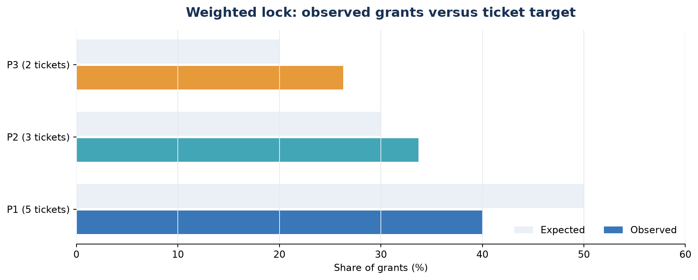
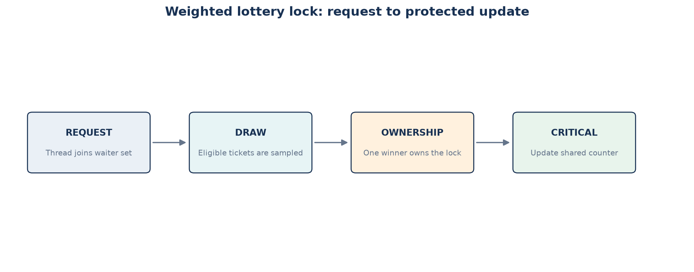
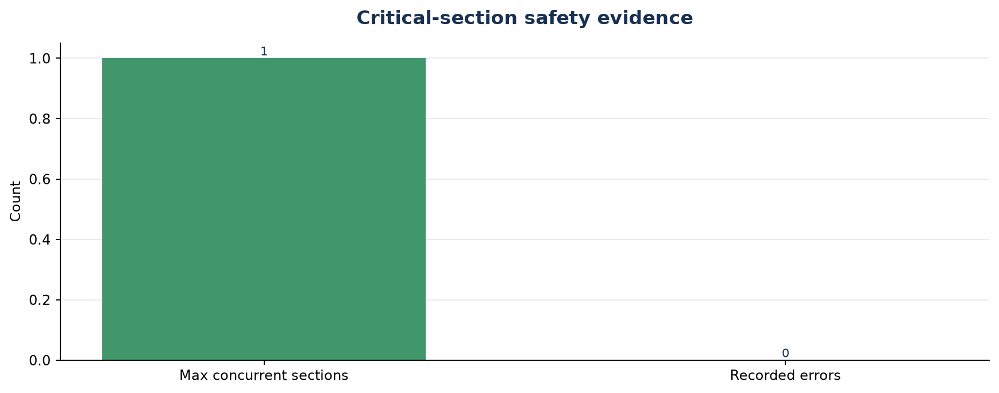
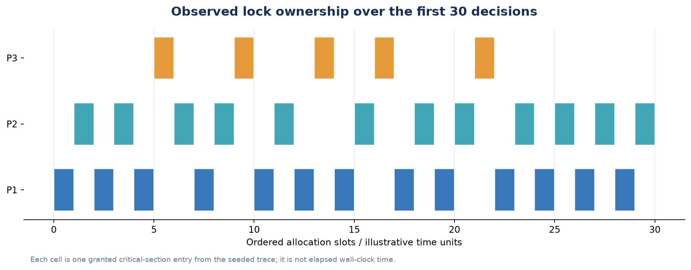

# Executive summary

Exercise 5 applies the lottery idea to synchronization rather than to CPU time slices. Three worker threads compete for permission to enter one shared critical section. The waiting requests carry weights of five, three, and two tickets. When the protected resource becomes free, the lock draws one ticket from the requests that are currently waiting. The winner becomes the sole owner until it releases the lock.

The experiment has two layers. A pure reference simulator gives an exactly reproducible trace for a fixed seed. A real threaded demonstration uses a condition variable, an explicit owner, a protected counter, and a finite grant limit so that all threads can terminate. The report records the requested share, observed grant counts, absolute share error, and a direct mutual-exclusion check.

The distinction is important: the implementation is a teaching demonstration of lottery-based lock or resource arbitration. It is not a kernel CPU scheduler, does not preempt arbitrary machine instructions, and does not promise a hard upper bound on waiting time.

# 1. Research question and scope

The question is whether proportional-share tickets can be used to arbitrate access to a contended synchronization resource. In the usual CPU example, a lottery selects which runnable process receives a quantum. For a lock, a lottery selects which waiting request receives the next ownership grant.

The unit being allocated is one critical-section entry. The pool includes only requests that have reached the waiting queue at the time of the draw. A process that has not yet submitted a request is not part of the current lottery. The owner is removed from the waiting set until it releases the lock.

This is a deliberately small model. It makes the relationship between the ticket rule and the mutual-exclusion invariant visible without claiming to reproduce the internal scheduling behavior of an operating-system kernel.

# 2. Lottery rule

Let the waiting requests be P1, P2, and P3, with ticket weights 5, 3, and 2. The total number of waiting tickets is 10. The probability of selecting request i in one draw is:

P(i wins) = tickets(i) / total waiting tickets

| Request | Tickets | Probability when all three wait | Ticket interval |
|---|---:|---:|---:|
| P1 | 5 | 50% | 1–5 |
| P2 | 3 | 30% | 6–8 |
| P3 | 2 | 20% | 9–10 |
| Total | 10 | 100% | 1–10 |

For example, a winning ticket of 7 selects P2. A winning ticket of 10 selects P3. The ticket number is sampled uniformly from the integer interval 1 through the total. The winner is found by accumulating the ticket counts in queue order until the cumulative value reaches the draw.

These percentages describe one draw, conditional on all three requests being present. They do not mean that every ten grants must contain exactly five P1 grants, three P2 grants, and two P3 grants. Over a sufficiently long sequence with a stable waiting set, the expected proportion approaches the ticket proportion. A finite sample can differ.

# 3. Lock architecture

The LotteryMutex class uses a threading.Condition to protect four pieces of state: the waiting-request collection, the current owner, the next request identifier, and the closed flag. The random generator is private to the lock and seeded explicitly so the grant sequence can be reproduced when the arrival sequence is the same.

The acquire operation validates that the ticket count is positive, creates a request object, appends it to the waiting set, and invokes the selection routine if the resource has no owner. A request waits in a condition loop until it becomes the owner or the demonstration closes. The loop is essential because condition notifications are wake-up hints; a thread must re-check the predicate while holding the condition lock.

The release operation validates object identity: only the exact current owner may release the resource. It then clears ownership, selects the next waiting request, or closes the demonstration after the requested number of grants. It wakes all waiters so that the selected owner can proceed and non-selected waiters can re-check the state.

# 4. Correctness properties

## 4.1 Mutual exclusion

The central invariant is that at most one request is the owner at any time. The owner is stored in one field protected by the condition's internal lock. Selection is performed only when the owner field is empty. A new owner is installed before the condition lock is released. A second request therefore cannot observe an empty owner slot during the same grant transition.

## 4.2 Ownership discipline

A request can release the lock only when it is the current owner. The implementation checks request identity, not just the process name. This prevents a stale request from releasing a later grant belonging to the same worker.

## 4.3 Progress and shutdown

When the owner releases the resource, the next request is chosen if the waiting collection is non-empty. The demo has a finite grant limit. On the final release it closes the queue, clears pending requests, and notifies all waiting threads. Those threads return from acquire with no request, allowing the demonstration to terminate without abandoning blocked workers.

## 4.4 What is not guaranteed

A weighted lottery is not FIFO. A low-ticket request can lose repeatedly. The probability of a win is conditional on the set of requests that are waiting at the draw. If requests arrive at different times, the observed grant share is not a direct estimator of long-term CPU share. The code does not claim starvation freedom or a bounded wait.

# 5. Experiment design and metrics

The reference simulator accepts a ticket mapping, number of decisions, and a seed. It generates a trace with the decision number, selected process, process ticket count, total tickets, and winning ticket. For a fixed input and seed, the trace is deterministic.

The threaded experiment starts one worker for each ticket weight. A successful acquisition protects a deliberately multi-step counter update. Each grant therefore corresponds to one critical-section entry and one counter increment. At the end, the implementation counts grants per process and computes the observed share.

The following metrics are written to the output directory:

- Expected share for each worker, calculated from its ticket weight.
- Observed grant count and observed share.
- Absolute share error, defined as the absolute difference between observed and expected share.
- Protected counter value, which should equal the number of successful grants.
- Maximum simultaneous critical-section count, which must be exactly one.
- Seed and configured number of scheduling decisions.

The share-error values are descriptive results of the selected finite run, not a universal accuracy guarantee. Re-running with another seed may produce a different trace and different share error.

# 6. Visual demonstration

The clip builder reads the recorded grant trace. It animates a rolling window of recent decisions, an observed-share chart, the ticket targets, and the most recent winning ticket. It exports both MP4 and GIF so the result can be viewed in a presentation or directly in a browser.

The animation is a visualization of the generated trace, not a separate simulator. This avoids a mismatch between the numbers in the report and the sequence shown in the clip. The video can be regenerated by running the trace-producing program first and then the clip builder.

# 7. Reproduction and validation

From the exercise directory, run the threaded demo with a fixed seed, generate the animation, and execute the tests. The test suite checks deterministic reference output, rejection of zero ticket counts, exact protected-counter completion, and the mutual-exclusion invariant.

A successful test run validates the properties covered by those tests only. It does not prove properties of every possible thread schedule or of a production kernel implementation.

# 8. Interpretation and limitations

The original lottery-scheduling work presents proportional-share resource management as a general resource-allocation idea, including mechanisms such as ticket transfer, ticket currencies, and lock-related resource allocation. This exercise isolates one synchronization use case so the selection rule and owner invariant can be studied together.

There are three practical limitations. First, Python's condition-variable wake-up order is not a FIFO guarantee. Second, ticket weights determine the probability of the next grant only among requests that are already waiting. Third, a lock can protect a critical section correctly while still providing poor latency or starvation behavior.

A real-time application must not treat this weighted lottery as an EDF or RM deadline mechanism. The lottery expresses relative access probability; it does not prove that a request will enter the critical section before a deadline.

# 9. Conclusion

The experiment demonstrates a weighted lottery for the next lock grant and checks that the critical section has a single owner. It also records the deviation between ticket share and observed grant share and creates a video from the same recorded trace. The correct conclusion is that lottery selection can illustrate proportional resource arbitration while mutual exclusion is enforced by a separate synchronization protocol. Probability, safety, and bounded waiting are distinct properties and must be evaluated separately.

# References

- Carl A. Waldspurger and William E. Weihl, “Lottery Scheduling: Flexible Proportional-Share Resource Management,” OSDI 1994. https://www.usenix.org/legacy/publications/library/proceedings/osdi/full_papers/waldspurger.pdf
- Allen B. Downey, The Little Book of Semaphores, synchronization patterns and resource allocation. https://greenteapress.com/wp/semaphores/
