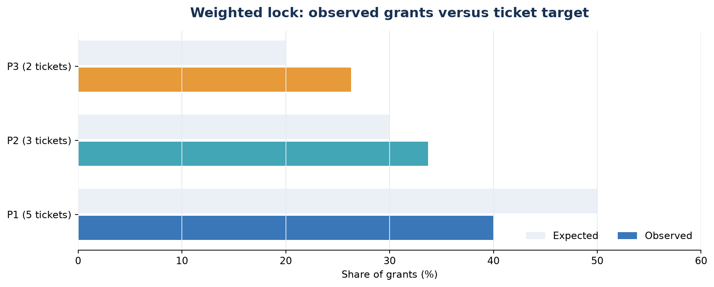
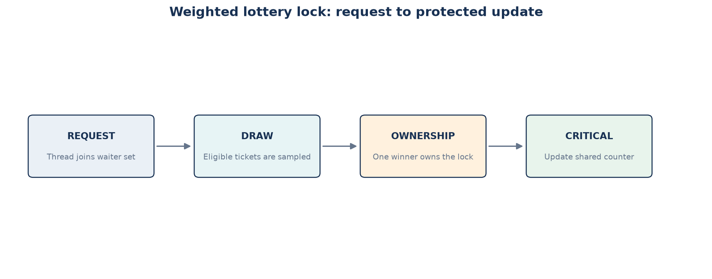
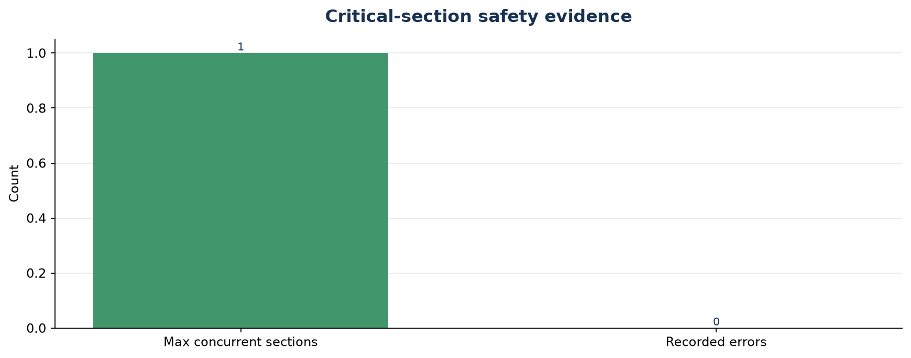
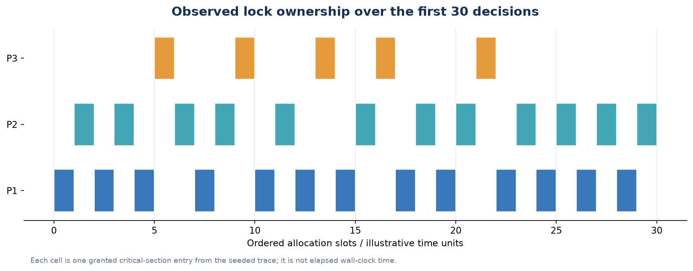

# خلاصه اجرایی

در تمرین پنجم، ایده‌ی قرعه‌کشی از تخصیص برش زمانی CPU به همگام‌سازی منتقل می‌شود. سه نخ کاری برای ورود به یک بخش بحرانی مشترک رقابت می‌کنند. درخواست‌های منتظر به‌ترتیب وزن‌های ۵، ۳ و ۲ بلیت دارند. هرگاه منبع آزاد شود، از میان درخواست‌هایی که در همان لحظه در صف انتظار هستند یک بلیت به‌صورت یکنواخت انتخاب می‌شود. مالک بلیت برنده تنها نخ مجاز برای ورود به بخش بحرانی خواهد بود و تا زمان آزادسازی قفل مالک باقی می‌ماند.

آزمایش دو لایه دارد. شبیه‌ساز مرجع، با seed ثابت رد تصمیم‌هایی کاملاً تکرارپذیر تولید می‌کند. نمونه‌ی چندنخی واقعی از شرط، مالک صریح، شمارنده‌ی محافظت‌شده و حدّ تعداد اعطا استفاده می‌کند تا تمام نخ‌ها در پایان به‌درستی خاتمه یابند. سهم هدف، تعداد اعطاهای مشاهده‌شده، خطای مطلق سهم و بررسی مستقیم انحصار متقابل ثبت می‌شوند.

نکته‌ی مهم در تفسیر این است که این برنامه نمونه‌ای آموزشی از تخصیص وزن‌دار حق استفاده از یک قفل یا منبع است. این برنامه زمان‌بند CPU در هسته‌ی سیستم‌عامل نیست، اجرای دستورهای دلخواه را preempt نمی‌کند و کران قطعی برای زمان انتظار نمی‌دهد.

# ۱. پرسش پژوهش و دامنه

پرسش این تمرین آن است که آیا می‌توان از بلیت‌های سهم‌متناسب برای انتخاب درخواست بعدیِ یک منبع همگام‌سازی استفاده کرد. در مثال معمول زمان‌بندی CPU، قرعه‌کشی مشخص می‌کند کدام فرایند آماده یک کوانتوم اجرا بگیرد. در مثال قفل، قرعه‌کشی مشخص می‌کند کدام درخواست منتظر، اعطای بعدی مالکیت را دریافت کند.

واحد تخصیص در این مدل یک بار ورود به بخش بحرانی است. مجموعه‌ی قرعه شامل درخواست‌هایی است که هنگام انجام قرعه به صف انتظار رسیده‌اند. فرایندی که هنوز درخواست خود را ثبت نکرده، در آن قرعه حضور ندارد. مالک نیز تا زمان آزادسازی قفل از مجموعه‌ی انتظار خارج است.

این یک مدل کوچک و آموزشی است. هدف آن روشن‌کردن رابطه‌ی قاعده‌ی بلیت با ناوردای انحصار متقابل است، نه شبیه‌سازی جزئیات زمان‌بندی هسته‌ی واقعی سیستم‌عامل.

# ۲. قاعده‌ی قرعه‌کشی

فرض کنید درخواست‌های منتظر P1 و P2 و P3 به‌ترتیب ۵ و ۳ و ۲ بلیت داشته باشند. مجموع بلیت‌ها ۱۰ است. احتمال انتخاب درخواست i در یک قرعه برابر است با:

احتمال انتخاب i = تعداد بلیت i تقسیم بر مجموع بلیت‌های منتظر

| درخواست | بلیت | احتمال در صورت حضور هر سه درخواست | بازه‌ی بلیت |
|---|---:|---:|---:|
| P1 | ۵ | ۵۰٪ | ۱ تا ۵ |
| P2 | ۳ | ۳۰٪ | ۶ تا ۸ |
| P3 | ۲ | ۲۰٪ | ۹ تا ۱۰ |
| مجموع | ۱۰ | ۱۰۰٪ | ۱ تا ۱۰ |

برای نمونه، اگر شماره‌ی بلیت برنده ۷ باشد، P2 انتخاب می‌شود. اگر شماره‌ی ۱۰ انتخاب شود، برنده P3 خواهد بود. عدد برنده به‌صورت یکنواخت از بازه‌ی صحیح ۱ تا مجموع بلیت‌ها انتخاب می‌شود. سپس با جمع تجمعی وزن درخواست‌ها، مالک بازه‌ای که عدد برنده در آن قرار می‌گیرد تعیین می‌شود.

این درصدها احتمال یک قرعه در شرایطی هستند که هر سه درخواست حاضر باشند. این به معنی آن نیست که در هر ده اعطا دقیقاً پنج بار P1، سه بار P2 و دو بار P3 انتخاب شوند. در دنباله‌ی بلند با مجموعه‌ی انتظار ثابت، سهم مورد انتظار به نسبت بلیت‌ها نزدیک می‌شود، اما یک نمونه‌ی محدود می‌تواند متفاوت باشد.

# ۳. معماری قفل

کلاس LotteryMutex با استفاده از threading.Condition چهار بخش از وضعیت را محافظت می‌کند: مجموعه‌ی درخواست‌های منتظر، مالک فعلی، شناسه‌ی درخواست بعدی و پرچم بسته‌شدن. مولد اعداد تصادفی داخل قفل قرار دارد و seed آن صریح است تا در صورت یکسان‌بودن ترتیب ورود درخواست‌ها، دنباله‌ی اعطاها قابل بازتولید باشد.

عملیات acquire ابتدا مثبت‌بودن تعداد بلیت‌ها را بررسی می‌کند، یک شیء درخواست می‌سازد، آن را در صف انتظار قرار می‌دهد و در صورت خالی‌بودن منبع، انتخاب را اجرا می‌کند. درخواست در یک حلقه‌ی شرطی منتظر می‌ماند تا مالک شود یا نمونه بسته شود. وجود حلقه ضروری است؛ اعلان شرط فقط نخ را بیدار می‌کند و نخ باید پس از بیداری و در حالی که قفل شرط را در اختیار دارد، دوباره برقراربودن شرط را بررسی کند.

عملیات release هویت دقیق درخواست را کنترل می‌کند؛ فقط مالک فعلی اجازه‌ی آزادسازی دارد. سپس مالکیت خالی می‌شود و درخواست بعدی انتخاب می‌شود، یا پس از آخرین اعطا نمونه بسته خواهد شد. همه‌ی نخ‌های منتظر بیدار می‌شوند تا مالک منتخب ادامه دهد و سایر نخ‌ها وضعیت جدید را دوباره بررسی کنند.

# ۴. ویژگی‌های درستی

## ۴.۱ انحصار متقابل

ناوردای اصلی این است که در هر لحظه حداکثر یک درخواست مالک منبع باشد. مالک در یک فیلد مشترک و تحت قفل داخلی شرط نگهداری می‌شود. انتخاب فقط زمانی انجام می‌شود که فیلد مالک خالی باشد. مالک جدید پیش از آزادشدن قفل شرط ثبت می‌شود؛ بنابراین درخواست دوم نمی‌تواند در همان گذار، منبع را بدون مالک مشاهده کند.

## ۴.۲ انضباط مالکیت

درخواست فقط وقتی می‌تواند قفل را آزاد کند که مالک فعلی باشد. پیاده‌سازی هویت شیء درخواست را بررسی می‌کند، نه فقط نام فرایند را. این کار مانع می‌شود درخواست قدیمی، اعطای جدیدی را که به همان نخ رسیده است آزاد کند.

## ۴.۳ پیشرفت و خاتمه

وقتی مالک منبع را آزاد می‌کند، در صورت وجود درخواست منتظر، درخواست بعدی انتخاب می‌شود. نمونه دارای حدّ تعداد اعطای متناهی است. پس از آخرین آزادسازی، صف بسته و درخواست‌های باقی‌مانده پاک می‌شوند و همه‌ی نخ‌ها اعلان دریافت می‌کنند. بنابراین نمایش بدون رهاکردن نخ‌های مسدود خاتمه می‌یابد.

## ۴.۴ آنچه تضمین نمی‌شود

قرعه‌کشی وزن‌دار FIFO نیست. یک درخواست با بلیت کم ممکن است چندین بار پیاپی بازنده شود. احتمال برد به مجموعه‌ی درخواست‌هایی وابسته است که هنگام قرعه در صف حاضرند. اگر درخواست‌ها در زمان‌های متفاوت برسند، سهم اعطای مشاهده‌شده برآورد مستقیمی از سهم بلندمدت CPU نیست. این کد نه آزادی از گرسنگی را ادعا می‌کند و نه کران بالایی برای انتظار ارائه می‌دهد.

# ۵. طراحی آزمایش و معیارها

شبیه‌ساز مرجع یک نگاشت بلیت، تعداد تصمیم‌ها و seed می‌گیرد. رد تولیدشده برای هر تصمیم شامل شماره‌ی تصمیم، فرایند انتخاب‌شده، تعداد بلیت آن فرایند، مجموع بلیت‌ها و شماره‌ی بلیت برنده است. برای ورودی و seed ثابت، رد خروجی قطعی است.

آزمایش چندنخی برای هر وزن یک نخ اجرا می‌کند. ورود موفق به قفل، یک به‌روزرسانی چندمرحله‌ای از شمارنده‌ی مشترک را محافظت می‌کند. بنابراین هر اعطا معادل یک ورود به بخش بحرانی و یک افزایش شمارنده است. در پایان تعداد اعطاهای هر فرایند شمرده و سهم مشاهده‌شده محاسبه می‌شود.

معیارهای زیر در پوشه‌ی خروجی ثبت می‌شوند:

- سهم مورد انتظار هر نخ که از نسبت تعداد بلیت‌ها به مجموع بلیت‌ها به دست می‌آید.
- تعداد اعطا و سهم مشاهده‌شده‌ی هر نخ.
- خطای مطلق سهم که قدرمطلق اختلاف سهم مشاهده‌شده و سهم هدف است.
- مقدار شمارنده‌ی محافظت‌شده که باید برابر تعداد اعطاهای موفق باشد.
- بیشینه‌ی تعداد بخش‌های بحرانی هم‌زمان که باید دقیقاً یک باشد.
- seed و تعداد تصمیم‌های تنظیم‌شده.

خطای سهم، نتیجه‌ی توصیفی همین اجرای محدود است و تضمین دقت برای تمام اجراها نیست. اجرای دوباره با seed دیگر می‌تواند رد تصمیم و خطای متفاوتی داشته باشد.

# ۶. نمایش بصری

برنامه‌ی ساخت کلیپ، رد ثبت‌شده‌ی اعطاها را می‌خواند. پنجره‌ای لغزان از تصمیم‌های اخیر، نمودار سهم مشاهده‌شده، سهم هدف هر وزن و شماره‌ی بلیت برنده‌ی آخر را متحرک می‌کند. خروجی هم به شکل MP4 و هم GIF تولید می‌شود تا در ارائه یا مرورگر قابل نمایش باشد.

انیمیشن صرفاً تصویرسازی همان رد تولیدشده است و شبیه‌ساز جداگانه‌ای نیست. به این ترتیب عددهای گزارش و ترتیب انتخاب‌ها در کلیپ از دو منبع متفاوت به دست نمی‌آیند. برای ساخت مجدد ویدئو ابتدا برنامه‌ی تولید رد و سپس سازنده‌ی کلیپ را اجرا کنید.

# ۷. بازتولید و اعتبارسنجی

از پوشه‌ی تمرین، برنامه‌ی نمونه را با seed ثابت اجرا کنید، کلیپ را بسازید و تست‌ها را اجرا کنید. مجموعه‌ی تست، قطعی‌بودن خروجی مرجع، رد تعداد بلیت صفر، تکمیل دقیق شمارنده‌ی محافظت‌شده و ناوردای انحصار متقابل را بررسی می‌کند.

موفقیت تست‌ها فقط ویژگی‌هایی را اعتبارسنجی می‌کند که در همان تست‌ها پوشش داده شده‌اند. این نتیجه اثبات رفتار تمام زمان‌بندی‌های ممکن نخ‌ها یا پیاده‌سازی هسته‌ی عملیاتی نیست.

# ۸. تفسیر و محدودیت‌ها

پژوهش اصلی زمان‌بندی قرعه‌کشی، تخصیص سهم‌متناسب را ایده‌ای عمومی برای مدیریت منابع معرفی می‌کند و سازوکارهایی مانند انتقال بلیت، ارزهای بلیت و تخصیص منابع قفل‌مانند را نیز بررسی می‌کند. این تمرین یک کاربرد همگام‌سازی را جدا می‌کند تا بتوان قاعده‌ی انتخاب را در کنار ناوردای مالکیت مطالعه کرد.

سه محدودیت عملی وجود دارد. نخست، ترتیب بیدارشدن نخ‌ها در condition پایتون تضمین FIFO نیست. دوم، وزن بلیت فقط احتمال اعطای بعدی را در میان درخواست‌های حاضر در صف کنترل می‌کند. سوم، یک قفل می‌تواند بخش بحرانی را درست محافظت کند اما همچنان تأخیر زیاد یا گرسنگی ایجاد کند.

یک برنامه‌ی بلادرنگ نباید این قرعه‌کشی وزن‌دار را سازوکار تضمین ضرب‌الاجل EDF یا RM تلقی کند. قرعه‌کشی احتمال دسترسی نسبی را بیان می‌کند؛ اثبات نمی‌کند که یک درخواست پیش از ضرب‌الاجل وارد بخش بحرانی خواهد شد.

# ۹. نتیجه‌گیری

این آزمایش قرعه‌کشی وزن‌دار برای اعطای بعدی قفل را نمایش می‌دهد و بررسی می‌کند که بخش بحرانی فقط یک مالک داشته باشد. اختلاف سهم بلیت و سهم اعطای مشاهده‌شده نیز ثبت می‌شود و ویدئو از همان رد تولیدشده ساخته می‌شود. نتیجه‌ی دقیق این است که قرعه‌کشی می‌تواند تخصیص سهم‌متناسب یک منبع را نمایش دهد، در حالی که انحصار متقابل باید به‌وسیله‌ی یک پروتکل همگام‌سازی جداگانه تضمین شود. احتمال انتخاب، ایمنی و انتظار کران‌دار سه ویژگی متفاوت‌اند و باید جداگانه ارزیابی شوند.

# منابع

- Carl A. Waldspurger و William E. Weihl، «Lottery Scheduling: Flexible Proportional-Share Resource Management»، کنفرانس OSDI سال ۱۹۹۴. https://www.usenix.org/legacy/publications/library/proceedings/osdi/full_papers/waldspurger.pdf
- Allen B. Downey، کتاب The Little Book of Semaphores، الگوهای همگام‌سازی و تخصیص منابع. https://greenteapress.com/wp/semaphores/
