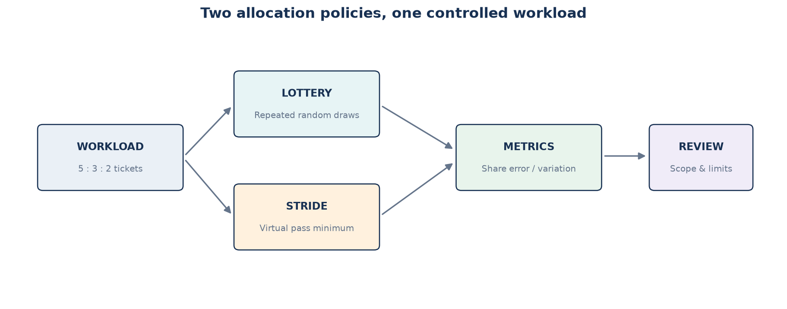
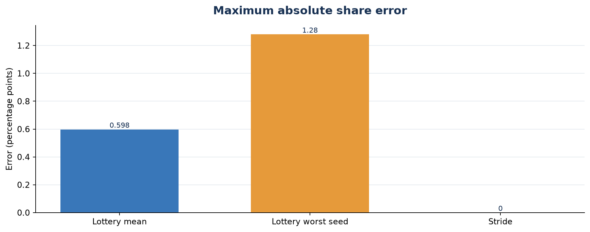
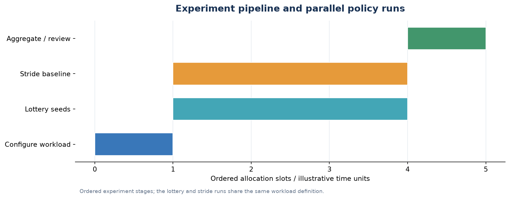
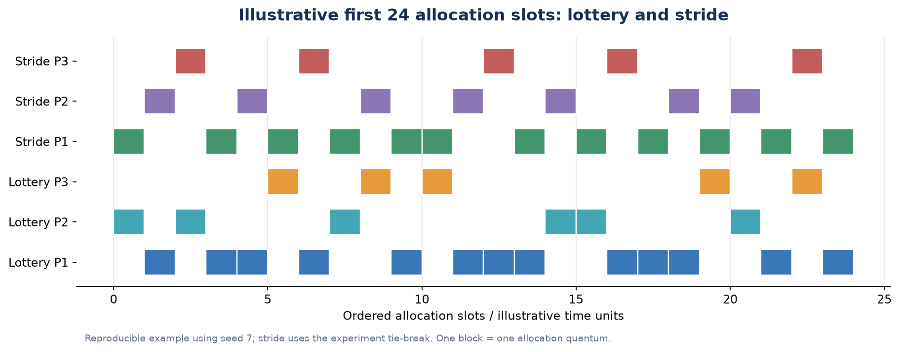

# Executive summary

This exercise reviews the foundational paper “Lottery Scheduling: Flexible Proportional-Share Resource Management” by Carl A. Waldspurger and William E. Weihl, presented at OSDI 1994. The paper's central idea is to represent a client's entitlement to a shared resource with tickets and allocate each resource quantum by drawing a winning ticket. The approach is probabilistic, composable, and intended to support proportional allocation across more than one kind of resource.

The practical part of this exercise implements a small reproducible comparison between lottery selection and stride scheduling. Both policies receive the same ticket vector and number of allocation decisions. Lottery results are measured over multiple seeds; stride produces a deterministic virtual-time schedule for the same simplified workload. An editable PowerPoint seminar deck and speaker notes in English and Persian accompany the experiment.

The experiment is intentionally narrow: one resource, equal-sized quanta, and clients that remain continuously runnable. It does not measure kernel overhead, context-switch latency, multicore effects, or hard real-time deadlines.

# 1. Paper identification and research problem

**Paper:** Carl A. Waldspurger and William E. Weihl, “Lottery Scheduling: Flexible Proportional-Share Resource Management,” Proceedings of the First USENIX Symposium on Operating Systems Design and Implementation (OSDI), 1994.

**Research problem:** Traditional priority-based schedulers select the highest-priority runnable entity, but priority is not always a direct or composable statement of a client's desired share of a resource. The paper asks how an operating system can allocate resources proportionally while allowing resource entitlements to be transferred and hierarchically subdivided.

The paper's ticket abstraction is useful because it turns a share into a countable claim. A client with twice as many tickets as another has twice the probability of winning a single lottery when both are eligible and the total ticket pool remains unchanged.

# 2. Core mechanism

Let client i own t_i tickets and let T be the sum of tickets owned by all eligible clients. A uniform draw selects one integer from 1 through T. The client owning the selected ticket receives the next allocation quantum.

The probability of a win in one draw is:

P(i wins) = t_i / T

For a ticket vector of 5:3:2, the expected shares are 50%, 30%, and 20%. A given short execution can deviate from those values. The expected allocation is a long-run property of repeated independent draws under a stable eligible set, not a guarantee that a fixed short interval matches the ratio exactly.

# 3. Contributions and design ideas

## 3.1 Proportional-share abstraction

A ticket is a transferable representation of resource entitlement. This decouples the resource allocation rule from a particular priority scale. A system can change a client's share by changing the number of tickets assigned to it.

## 3.2 Ticket transfer

Ticket transfer allows a client to temporarily pass resource entitlement to another entity. This is useful when one process is waiting for a server or a lock holder whose progress is required for the client's request. The rights can be directed toward the entity that currently needs to execute.

## 3.3 Ticket currencies

A ticket currency provides a hierarchical abstraction. A group can receive a portion of global resource rights and distribute its internal budget among its own clients. Local allocation decisions can be made without exposing every internal client's raw ticket count to the global allocator.

## 3.4 Compensation tickets

Compensation mechanisms address clients that do not consume a full quantum because they block or yield early. The goal is to avoid treating a client that uses only a fraction of its allocation as though it had consumed the entire quantum.

## 3.5 Resource generality

The paper's scope is not restricted to CPU time. The same entitlement abstraction can be applied to other resources when the system can define a meaningful allocation quantum and an eligible set of claimants. This motivates the synchronization-lock demonstration in Exercise 5.

# 4. Critical reading: strengths and limitations

The ticket model offers a compact and intuitive way to express relative shares. Its probabilistic selection avoids the rigid deterministic ordering of fixed priorities and supports dynamic changes in entitlement. The currency and transfer ideas make the abstraction useful in a structured system where resources are allocated across groups and dependencies.

However, probability does not provide an exact short-term service guarantee. A low-ticket client can lose repeatedly. The base algorithm does not provide a hard deadline guarantee or a deterministic upper bound on response time. The meaning of a ticket depends on the eligible set and on how the application assigns and transfers tickets. A measured CPU share is also not the same as a latency or fairness guarantee for every individual request.

A critical evaluation therefore needs to distinguish at least three questions: whether long-run proportions are close to the target, whether short-term latency is acceptable, and whether the workload has deadlines that must be guaranteed. The lottery mechanism answers the first question most directly; it does not automatically answer the other two.

# 5. Lottery and stride: the comparison implemented here

Stride scheduling is a deterministic proportional-share alternative. Each client has a stride inversely proportional to its ticket count. A virtual pass value tracks how much service the client has received. The client with the smallest pass value is selected, and its pass is advanced by its stride.

For a client with t_i tickets and a stride constant K:

stride(i) = K / t_i

After receiving one quantum, its pass value increases by stride(i). This virtual-time rule tends to keep service close to the ticket proportions without random variation in the sequence.

The supplied experiment uses a simple, explicit tie-break rule and always-runnable clients. It is meant to compare allocation-count error under identical conditions, not to reproduce every optimization of a production scheduler.

# 6. Experimental method

The workload uses P1, P2, and P3 with ticket weights 5, 3, and 2. Each run performs a fixed number of allocation decisions. Lottery runs are repeated with a sequence of independent seeds so that variation across runs can be measured. Stride is run once under a deterministic tie-break rule.

The output contains the workload definition, the target share for each client, per-seed lottery shares, the mean and worst maximum absolute share error across lottery runs, and the stride allocation shares and maximum absolute error.

The error metric for client i is:

absolute error(i) = absolute value(observed share(i) − target share(i))

The run-level maximum error is the largest client error in that run. Reporting the mean and worst run-level error avoids presenting one lucky random seed as a universal result.

# 7. Interpretation of the experimental model

Stride is expected to produce a close, deterministic allocation for this simple continuously runnable workload. Lottery is expected to fluctuate from run to run while approaching the target ratio over long sequences. The exact values belong to the generated JSON output and must be read from the executed experiment; this report does not substitute invented measurements.

The model intentionally excludes different quantum sizes, blocking behavior, ticket transfers, ticket currencies, priority inversion, multicore scheduling, timer and interrupt overhead, and real kernel dispatch cost. It therefore supports a conclusion about allocation counts in this model only. It does not establish that one algorithm is universally faster or better.

# 8. Seminar structure

The editable seminar deck follows this sequence:

1. Why proportional-share resource allocation is useful.
2. The lottery rule and the 5:3:2 worked example.
3. Extensions: transfer, currencies, and compensation.
4. The paper's scope and critical limitations.
5. The experimental workload, measurement method, and generated results.
6. Lottery versus stride: randomized versus deterministic allocation.
7. Synchronization as another resource-allocation application.
8. Conclusions and questions.

The speaker notes expand the intended message for every section. The slides are generated from the same result JSON as the report, so the experiment must be run before the presentation is built.

# 9. Reproducibility and validation

Run the research experiment first. It writes the comparison JSON into the exercise output directory. Then execute the slide generator to create the editable presentation. The tests verify fixed-seed reproducibility, input validation, and the expected closeness of the stride allocation for the included workload.

A valid submission should keep the generated JSON beside the report and presentation. This makes the workload, parameters, and measured values available for review and independent reproduction.

# 10. Conclusion

Lottery scheduling offers a flexible and composable proportional-share abstraction. Its strength is probabilistic allocation with a clear entitlement model, not deterministic deadline service. Stride scheduling uses virtual time to reduce allocation variance under a simple workload. The experiment and seminar make this distinction visible and emphasize that measured evidence must be interpreted only within its stated assumptions.

# References

- Waldspurger, C. A., and Weihl, W. E. (1994). “Lottery Scheduling: Flexible Proportional-Share Resource Management.” OSDI 1994. https://www.usenix.org/legacy/publications/library/proceedings/osdi/full_papers/waldspurger.pdf
- Waldspurger, C. A. (1995). “Lottery and Stride Scheduling: Flexible Proportional-Share Resource Management.” MIT-LCS-TR-667. https://hdl.handle.net/1721.1/149810
- Waldspurger, C. A., and Weihl, W. E. (1995). “Stride Scheduling: Deterministic Proportional-Share Resource Management.” MIT-LCS-TM-528. https://hdl.handle.net/1721.1/149244
