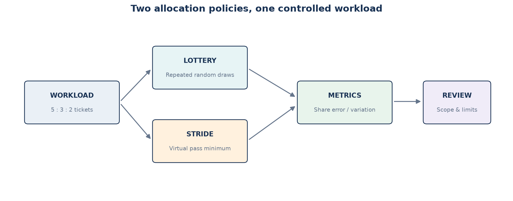
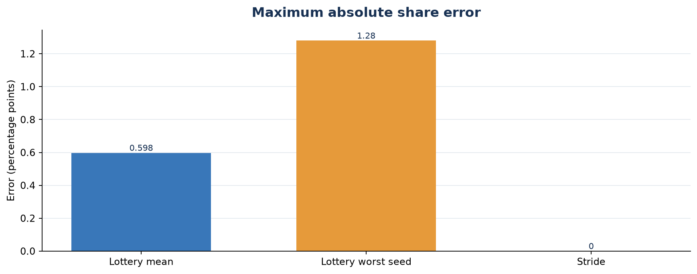
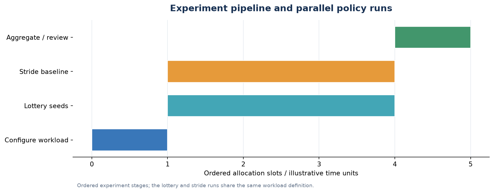
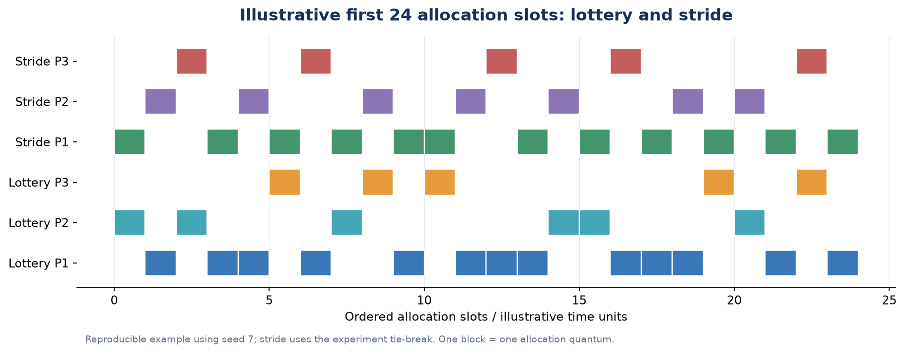

# خلاصه اجرایی

این تمرین مقاله‌ی بنیادی «Lottery Scheduling: Flexible Proportional-Share Resource Management» نوشته‌ی کارل والداسپیگر و ویلیام ویهل را که در کنفرانس OSDI سال ۱۹۹۴ ارائه شده بررسی می‌کند. ایده‌ی اصلی مقاله آن است که استحقاق هر کلاینت برای استفاده از یک منبع مشترک با بلیت نمایش داده شود و هر کوانتوم منبع با انتخاب تصادفی یک بلیت برنده تخصیص یابد. این روش احتمالاتی، ترکیب‌پذیر و قابل استفاده برای تخصیص سهم متناسب در بیش از یک نوع منبع است.

بخش عملی تمرین، یک مقایسه‌ی کوچک و بازتولیدپذیر بین انتخاب قرعه‌کشی و زمان‌بندی stride پیاده‌سازی می‌کند. هر دو سیاست، بردار بلیت و تعداد تصمیم‌های تخصیص یکسانی دریافت می‌کنند. نتایج قرعه‌کشی با چند seed سنجیده می‌شوند؛ stride برای همین بار کاری ساده، یک زمان‌بندی قطعی مبتنی بر زمان مجازی تولید می‌کند. یک ارائه‌ی پاورپوینت قابل‌ویرایش و یادداشت ارائه به زبان فارسی و انگلیسی نیز همراه آزمایش است.

دامنه‌ی آزمایش محدود و صریح است: یک منبع، کوانتوم‌های هم‌اندازه و کلاینت‌هایی که همواره آماده‌اند. سربار هسته، تأخیر تعویض متن، چند‌هسته‌ای‌بودن و ضرب‌الاجل بلادرنگ اندازه‌گیری نمی‌شوند.

# ۱. مشخصات مقاله و مسئله‌ی پژوهش

**مقاله:** Carl A. Waldspurger و William E. Weihl، «Lottery Scheduling: Flexible Proportional-Share Resource Management»، مجموعه‌مقالات نخستین سمپوزیوم USENIX درباره‌ی طراحی و پیاده‌سازی سیستم‌عامل، OSDI، سال ۱۹۹۴.

**مسئله‌ی پژوهش:** زمان‌بندهای اولویت‌محور معمولاً موجودیت آماده با بالاترین اولویت را انتخاب می‌کنند؛ اما اولویت همیشه بیان مستقیم و ترکیب‌پذیری از سهم موردنظر یک کلاینت در منبع نیست. مقاله بررسی می‌کند که سیستم‌عامل چگونه می‌تواند منابع را متناسب با سهم تخصیص دهد و در عین حال انتقال استحقاق و تقسیم سلسله‌مراتبی آن را ممکن سازد.

انتزاع بلیت مفید است چون سهم را به یک ادعای قابل‌شمارش تبدیل می‌کند. کلاینتی که دو برابر کلاینت دیگر بلیت دارد، در شرایطی که هر دو واجد شرایط باشند و مجموع بلیت‌ها ثابت بماند، دو برابر احتمال برد در یک قرعه دارد.

# ۲. سازوکار اصلی

فرض کنید کلاینت i تعداد t_i بلیت دارد و T مجموع بلیت‌های تمام کلاینت‌های واجد شرایط است. یک عدد صحیح به‌صورت یکنواخت از بازه‌ی ۱ تا T انتخاب می‌شود. کلاینتی که مالک بلیت انتخاب‌شده است، کوانتوم بعدی منبع را دریافت می‌کند.

احتمال برد i در یک قرعه:

احتمال برد i = تعداد بلیت i تقسیم بر مجموع بلیت‌ها

برای بردار بلیت ۵:۳:۲، سهم‌های مورد انتظار به‌ترتیب ۵۰، ۳۰ و ۲۰ درصد هستند. یک اجرای کوتاه می‌تواند از این اعداد فاصله داشته باشد. تخصیص مورد انتظار خاصیت بلندمدت تکرار قرعه‌های مستقل، تحت مجموعه‌ی ثابت کلاینت‌های واجد شرایط است؛ نه تضمینی که هر بازه‌ی کوتاه دقیقاً مطابق نسبت بلیت‌ها باشد.

# ۳. ایده‌ها و مشارکت‌های مقاله

## ۳.۱ انتزاع سهم‌متناسب

بلیت نمایش قابل‌انتقالی از استحقاق استفاده از منبع است. این کار قاعده‌ی تخصیص را از یک مقیاس اولویت خاص جدا می‌کند. سیستم می‌تواند با تغییر تعداد بلیت‌های اختصاص‌یافته به یک کلاینت، سهم آن را تغییر دهد.

## ۳.۲ انتقال بلیت

انتقال بلیت به یک کلاینت اجازه می‌دهد استحقاق استفاده از منبع را موقتاً به موجودیت دیگری واگذار کند. این ایده زمانی مفید است که یک فرایند منتظر سرور یا مالک قفلی باشد که پیشرفت آن برای تکمیل درخواست لازم است. حق استفاده از منبع می‌تواند به سمت موجودیتی هدایت شود که در آن لحظه باید اجرا شود.

## ۳.۳ ارزهای بلیت

ارز بلیت یک انتزاع سلسله‌مراتبی فراهم می‌کند. یک گروه بخشی از حقوق کلی منبع را دریافت می‌کند و سپس بودجه‌ی داخلی خود را بین کلاینت‌هایش تقسیم می‌کند. تصمیم تخصیص محلی می‌تواند بدون افشای تعداد خام بلیت تمام کلاینت‌های داخلی برای زمان‌بند سراسری انجام شود.

## ۳.۴ بلیت جبرانی

سازوکارهای جبرانی به کلاینت‌هایی می‌پردازند که به دلیل مسدودشدن یا واگذاری زودهنگام، کل کوانتوم تخصیص‌یافته را مصرف نمی‌کنند. هدف این است که کلاینتی که فقط بخشی از سهم زمانی خود را استفاده کرده، به‌اشتباه معادل کلاینتی تلقی نشود که تمام کوانتوم را مصرف کرده است.

## ۳.۵ تعمیم به منابع دیگر

دامنه‌ی مقاله تنها به زمان CPU محدود نیست. همان انتزاع استحقاق را می‌توان برای منابع دیگر نیز به کار برد، به شرط آنکه سیستم بتواند کوانتوم تخصیص و مجموعه‌ی متقاضیان واجد شرایط را تعریف کند. این نکته انگیزه‌ی نمایش قفل همگام‌سازی در تمرین ۵ است.

# ۴. مطالعه‌ی انتقادی: نقاط قوت و محدودیت‌ها

مدل بلیت روش فشرده و شهودی برای بیان سهم نسبی ارائه می‌کند. انتخاب احتمالاتی از ترتیب ثابت اولویت‌ها انعطاف‌پذیرتر است و تغییرات پویا در استحقاق را پشتیبانی می‌کند. ایده‌ی ارز و انتقال نیز در سامانه‌ای ساخت‌یافته که منابع را میان گروه‌ها و وابستگی‌ها تقسیم می‌کند مفید است.

با این حال، احتمال انتخاب تضمین خدمت دقیق در کوتاه‌مدت نیست. یک کلاینت با بلیت کم می‌تواند چند بار پیاپی بازنده شود. الگوریتم پایه تضمین ضرب‌الاجل سخت یا کران قطعی برای زمان پاسخ ارائه نمی‌دهد. معنای بلیت به مجموعه‌ی واجد شرایط و نحوه‌ی تخصیص و انتقال بلیت توسط برنامه وابسته است. سهم CPU اندازه‌گیری‌شده نیز با تضمین تأخیر یا عدالت برای تک‌تک درخواست‌ها یکسان نیست.

بنابراین ارزیابی انتقادی باید دست‌کم سه پرسش را جدا کند: آیا نسبت‌های بلندمدت به هدف نزدیک‌اند؟ آیا تأخیر کوتاه‌مدت قابل قبول است؟ آیا بار کاری ضرب‌الاجل‌هایی دارد که باید تضمین شوند؟ سازوکار قرعه‌کشی مستقیماً به پرسش اول پاسخ می‌دهد، اما دو پرسش دیگر را به‌صورت خودکار حل نمی‌کند.

# ۵. مقایسه‌ی قرعه‌کشی و stride

زمان‌بندی stride یک جایگزین قطعی برای تخصیص سهم‌متناسب است. برای هر کلاینت، مقداری به نام stride تعریف می‌شود که با تعداد بلیت آن نسبت وارون دارد. یک مقدار pass مجازی، میزان خدمتی را که کلاینت دریافت کرده دنبال می‌کند. کلاینتی که کمترین pass را دارد انتخاب می‌شود و پس از دریافت کوانتوم، مقدار pass آن به اندازه‌ی stride افزایش می‌یابد.

برای کلاینتی با t_i بلیت و ثابت K:

stride(i) = K تقسیم بر t_i

پس از دریافت یک کوانتوم، pass مجازی آن به اندازه‌ی stride افزایش می‌یابد. این قاعده‌ی زمان مجازی معمولاً خدمت را بدون نوسان تصادفی به نسبت بلیت‌ها نزدیک نگه می‌دارد.

آزمایش همراه، یک قاعده‌ی tie-break ساده و صریح و کلاینت‌های همواره آماده دارد. هدف، مقایسه‌ی خطای تعداد تخصیص در شرایط یکسان است، نه بازسازی همه‌ی بهینه‌سازی‌های یک زمان‌بند عملیاتی.

# ۶. روش آزمایش

بار کاری از P1 و P2 و P3 با وزن‌های بلیت ۵، ۳ و ۲ تشکیل شده است. هر اجرا تعداد ثابتی از تصمیم‌های تخصیص را انجام می‌دهد. اجرای قرعه‌کشی با مجموعه‌ای از seedهای مستقل تکرار می‌شود تا تغییرپذیری بین اجراها اندازه‌گیری شود. stride یک بار و با قاعده‌ی قطعی شکستن تساوی اجرا می‌شود.

خروجی شامل تعریف بار کاری، سهم هدف هر کلاینت، سهم قرعه‌کشی به‌ازای هر seed، میانگین و بدترین بیشینه‌ی خطای مطلق سهم در اجراهای قرعه‌کشی و سهم stride و بیشینه‌ی خطای آن است.

معیار خطای هر کلاینت i چنین تعریف می‌شود:

خطای مطلق سهم i = قدرمطلق سهم مشاهده‌شده i منهای سهم هدف i

بیشینه‌ی خطای هر اجرا، بزرگ‌ترین خطای بین کلاینت‌هاست. گزارش میانگین و بدترین اجرای قرعه‌کشی مانع از آن می‌شود که یک seed خوش‌شانس به‌عنوان نتیجه‌ی همیشگی الگوریتم معرفی شود.

# ۷. تفسیر مدل آزمایش

انتظار می‌رود stride در این بار کاری ساده و همواره آماده، تخصیص قطعی و نزدیکی تولید کند. قرعه‌کشی انتظار می‌رود بین اجراها نوسان داشته باشد و در دنباله‌های بلند به نسبت هدف نزدیک شود. مقادیر دقیق باید از فایل JSON تولیدشده توسط آزمایش خوانده شوند؛ این گزارش به‌جای داده‌ی اجرایی، عدد اندازه‌گیری‌شده‌ی ساختگی قرار نمی‌دهد.

مدل عمداً تفاوت اندازه‌ی کوانتوم‌ها، رفتار مسدودشدن، انتقال بلیت، ارز بلیت، وارونگی اولویت، زمان‌بندی چند‌هسته‌ای، سربار تایمر و هزینه‌ی dispatch واقعی هسته را حذف می‌کند. بنابراین فقط از نتیجه‌گیری درباره‌ی تعداد تخصیص‌ها در همین مدل پشتیبانی می‌کند و ثابت نمی‌کند که یک الگوریتم در همه‌ی شرایط سریع‌تر یا بهتر است.

# ۸. ساختار سمینار

ارائه‌ی قابل‌ویرایش از این ترتیب پیروی می‌کند:

۱. اهمیت تخصیص سهم‌متناسب منابع.
۲. قاعده‌ی قرعه‌کشی و مثال ۵:۳:۲.
۳. توسعه‌ها: انتقال، ارز و بلیت جبرانی.
۴. دامنه و محدودیت‌های انتقادی مقاله.
۵. بار کاری آزمایش، روش اندازه‌گیری و نتایج تولیدشده.
۶. قرعه‌کشی در برابر stride؛ تخصیص تصادفی در برابر قطعی.
۷. همگام‌سازی به‌عنوان کاربرد دیگری از تخصیص منبع.
۸. نتیجه‌گیری و پرسش‌ها.

یادداشت‌های سخنران، پیام موردنظر هر بخش را بسط می‌دهند. اسلایدها از همان فایل JSON نتایج گزارش ساخته می‌شوند؛ بنابراین پیش از ساخت ارائه باید آزمایش اجرا شود.

# ۹. بازتولیدپذیری و اعتبارسنجی

ابتدا آزمایش پژوهشی را اجرا کنید. فایل JSON مقایسه در پوشه‌ی خروجی تمرین نوشته می‌شود. سپس مولد اسلاید را اجرا کنید تا ارائه‌ی قابل‌ویرایش ساخته شود. تست‌ها تکرارپذیری seed ثابت، اعتبارسنجی ورودی و نزدیکی تخصیص stride را برای بار کاری تعریف‌شده بررسی می‌کنند.

در تحویل نهایی، بهتر است JSON تولیدشده در کنار گزارش و ارائه نگهداری شود. به این ترتیب بار کاری، پارامترها و مقادیر اندازه‌گیری‌شده برای بازبینی و بازتولید مستقل در دسترس خواهند بود.

# ۱۰. نتیجه‌گیری

زمان‌بندی قرعه‌کشی انتزاعی انعطاف‌پذیر و ترکیب‌پذیر برای تخصیص سهم‌متناسب ارائه می‌کند. نقطه‌ی قوت آن تخصیص احتمالاتی با مدل روشن استحقاق است، نه ارائه‌ی خدمت قطعی برای ضرب‌الاجل. زمان‌بندی stride با زمان مجازی، نوسان تخصیص را در یک بار کاری ساده کاهش می‌دهد. آزمایش و سمینار این تفاوت را روشن می‌کنند و تأکید دارند که شواهد اندازه‌گیری‌شده فقط در محدوده‌ی فرض‌های اعلام‌شده معتبرند.

# منابع

- Waldspurger, C. A. و Weihl, W. E. (1994). «Lottery Scheduling: Flexible Proportional-Share Resource Management». OSDI 1994. https://www.usenix.org/legacy/publications/library/proceedings/osdi/full_papers/waldspurger.pdf
- Waldspurger, C. A. (1995). «Lottery and Stride Scheduling: Flexible Proportional-Share Resource Management». MIT-LCS-TR-667. https://hdl.handle.net/1721.1/149810
- Waldspurger, C. A. و Weihl, W. E. (1995). «Stride Scheduling: Deterministic Proportional-Share Resource Management». MIT-LCS-TM-528. https://hdl.handle.net/1721.1/149244
