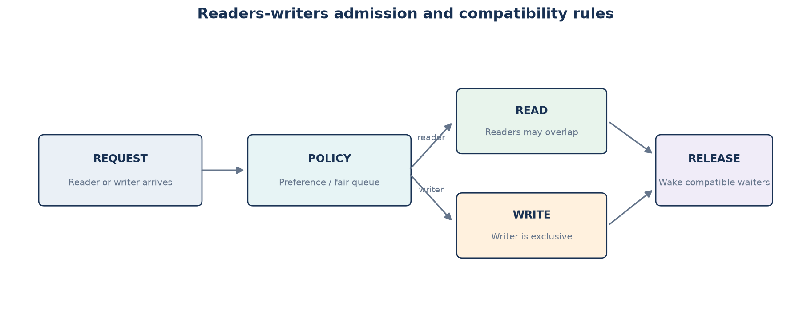
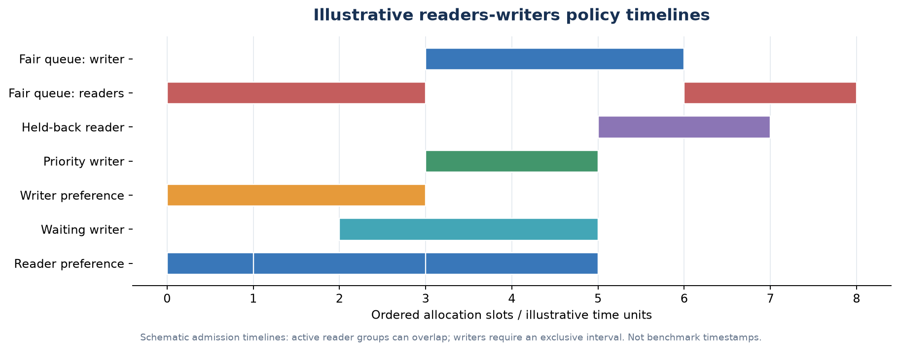
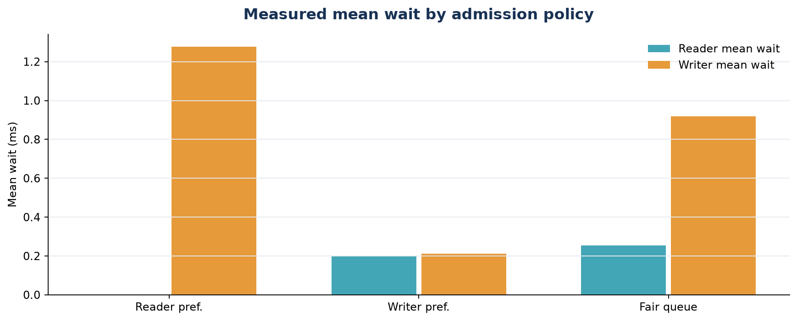
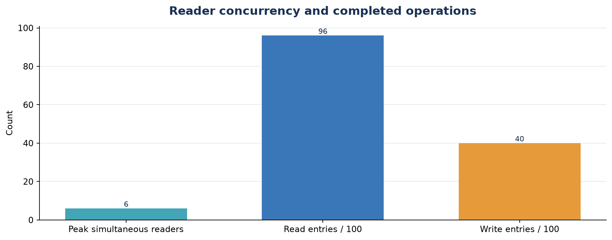

# Executive summary

The readers-writers problem models concurrent access to a shared data object. Multiple readers may inspect the object simultaneously, but a writer requires exclusive access. The central design question is not only how to prevent simultaneous reads and writes, but also how to decide which class of waiting request should be admitted next.

This exercise implements and compares three policies. Reader preference admits new readers whenever no writer is active, even if a writer is waiting. Writer preference prevents new readers from entering while at least one writer is queued. Fair mode uses an arrival queue and allows consecutive readers at its head to enter as a group, while preventing a later reader from bypassing an earlier conflicting writer.

The experiment measures reader and writer waiting times under the same finite workload. The tests focus on safety, the ability for readers to overlap, and the non-bypass property of the fair queue. Timing results are empirical observations from the host runtime; they are not universal worst-case bounds.

# 1. Problem definition

A shared object may be read by several threads at the same time without changing its value. A writer modifies the object and therefore must exclude both other writers and readers while the update is in progress.

The two fundamental safety rules are:

1. Any number of readers may be active together, provided no writer is active.
2. A writer may be active only when no reader and no other writer is active.

A policy can satisfy both safety rules and still have a progress problem. If requests of one class are continually allowed to overtake requests of the other class, the postponed class may experience starvation.

# 2. Admission policies

## 2.1 Reader preference

A reader may enter whenever there is no active writer. Waiting writers do not block newly arriving readers. This policy offers good reader concurrency and can make sense when reads greatly outnumber writes and writer latency is not critical.

Its weakness is writer starvation. A continuous stream of readers can keep the reader count above zero or repeatedly enter before a writer gets the lock. The writer is safe from concurrent readers but may wait for an unbounded period in an unconstrained arrival model.

## 2.2 Writer preference

A reader may enter only when there is no active writer and no writer waiting. When a writer arrives, new readers are held back until the waiting writer has had an opportunity to run.

This prevents a continuing stream of new readers from indefinitely bypassing a waiting writer. The opposite trade-off appears under a sustained stream of writers: readers can remain blocked because each new writer gets priority.

## 2.3 Fair arrival queue

Fair mode places each request in a queue. A request can be admitted only when it is compatible with the active set and no earlier queued request that conflicts with it remains ahead. Consecutive readers at the head are compatible and may enter together. A reader that arrives behind a writer cannot pass that writer.

This is not a global single-thread queue: non-conflicting readers can share the resource. It is FIFO fairness among requests that compete for the same access rights. The policy's progress argument assumes critical sections terminate and waiting threads are eventually scheduled.

# 3. Implementation design

ReaderWriterLock uses a threading.Condition to protect the active-reader count, active-writer flag, waiting-writer count, and fair-mode queue. A condition wait occurs inside a predicate loop so that a wake-up cannot be mistaken for permission to enter.

The reader acquisition path increments the active-reader count only after checking that the writer exclusion condition is satisfied. In fair mode, it additionally checks that no earlier queued writer conflicts with the request. A successful reader leaves the waiting queue and notifies other waiters so compatible readers can enter.

The writer acquisition path increments the waiting-writer count before waiting. Once admitted, it decreases the waiting count and sets the active-writer flag. Release clears that flag and notifies the waiters. The context-manager interface ensures that release runs even if an exception occurs inside a protected section.

# 4. Correctness reasoning

## 4.1 Writer exclusivity

The active-writer flag can be set only when the active-reader count is zero and no writer is active. The condition lock serializes the transition. Therefore two writers cannot both become active, and a writer cannot enter while readers remain active.

## 4.2 Reader compatibility

A reader enters only when no writer is active. Multiple readers can increment the active-reader count while the writer flag stays false. A writer cannot set its flag until all readers release.

## 4.3 Fair-mode non-bypass property

For a fair-mode request, the queue is scanned from the head to that request. If an earlier request needs the same access resource, the later request waits. Thus a reader that arrives after a writer cannot overtake it. Requests for non-neighbouring access classes are not relevant to this problem; the compatibility rule is specifically read versus write.

## 4.4 Limits of the fairness statement

The implementation does not claim an operating-system-independent time bound. The fair queue prevents bypass by earlier conflicting requests, but a thread still needs CPU time to run and release its critical section. If a thread never releases a lock, no admission policy can make the shared object progress safely.

# 5. Experimental method

Each policy receives the same number of reader and writer operations. A reader acquires the read side, samples the shared version, holds the read lock for a short interval, and releases it. A writer acquires the write side, increments the version, holds the write lock briefly, and releases it.

The program records reader wait samples and writer wait samples separately. For each class it reports sample count, mean, p50, p95, and maximum wait in milliseconds. It also records the final version, peak simultaneous readers, and completed read/write entries.

The same operation counts and critical-section durations are used for all three policies. This controls the workload shape, but it does not remove runtime noise. Python thread scheduling, CPU load, interpreter behavior, and operating-system lock implementation affect the measured numbers.

# 6. Results interpretation

The expected qualitative trade-off is more important than one observed runtime value:

| Policy | Requests protected from overtaking | Main starvation risk |
|---|---|---|
| Reader preference | New readers are not blocked by waiting writers | Writers |
| Writer preference | Waiting writers block new readers | Readers |
| Fair arrival queue | Earlier conflicting requests are not bypassed | No policy-level bypass under stated assumptions |

If a run reports a lower average wait for one class, that does not mean the policy is universally superior. The maximum and tail waits matter, and the workload ratio strongly influences the result. A reader-heavy workload naturally exercises the reader path more often than the writer path.

# 7. Testing and reproducibility

The test suite runs simultaneous reader and writer threads while checking that no writer overlaps another writer or any reader. It also checks that at least two readers can be active at the same time, demonstrating that the implementation is not merely a global mutex.

A second concurrency test holds an initial reader, queues a writer, then queues a later reader. When the first reader exits, the test checks that the writer enters before the later reader. This directly checks the fair-mode non-bypass rule.

Run the benchmark program to create the JSON result file, then execute the tests. Repeated runs can produce different wait-time measurements even when the workload parameters remain unchanged.

# 8. Discussion

The readers-writers problem has multiple correct solutions because applications value different progress properties. Reader preference can maximize read concurrency but risks starving writers. Writer preference protects writers from a continuous stream of incoming readers but can starve readers. A fair queue is a compromise: it preserves concurrent reading while preventing later conflicting requests from overtaking earlier requests.

Fairness should not be inferred from safety. A system can be perfectly safe and still postpone a writer forever. Conversely, a policy can be fair in queue order but provide no real-time guarantee if a thread is not scheduled or a critical section does not terminate.

# 9. Conclusion

The experiment distinguishes safety, concurrency, and fairness. All three modes enforce exclusive writes. Reader and writer preference choose different classes to protect against bypass. The fair queue uses arrival order among conflicting requests and still admits compatible readers concurrently. The output timing statistics help compare a concrete run, while the tests check the important correctness invariants.

# References

- Courtois, P.-J., Heymans, F., and Parnas, D. L. (1971). “Concurrent Control with Readers and Writers.” Communications of the ACM, 14(10), 667–668. https://doi.org/10.1145/362759.362813
- Downey, A. B. The Little Book of Semaphores, readers-writers synchronization patterns. https://greenteapress.com/wp/semaphores/
