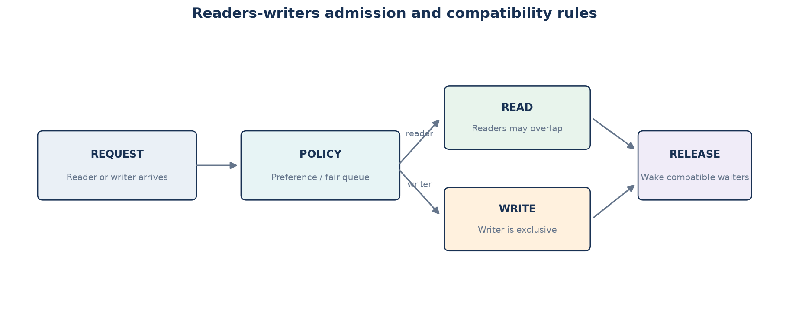
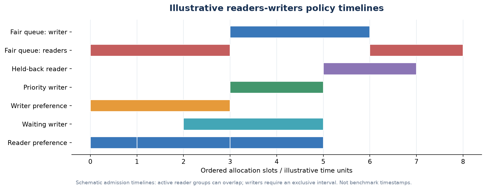
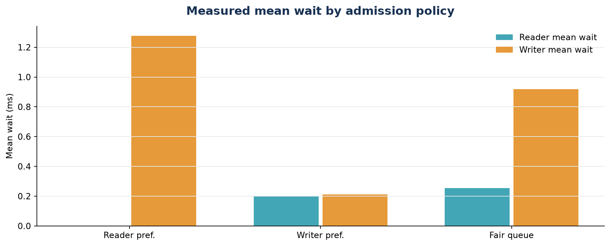
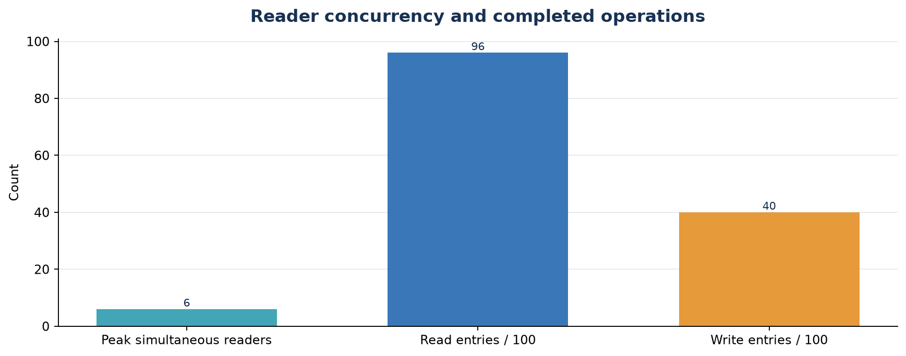

# خلاصه اجرایی

مسئله‌ی خوانندگان و نویسندگان دسترسی هم‌زمان به یک شیء داده‌ی مشترک را مدل می‌کند. چند خواننده می‌توانند هم‌زمان داده را مشاهده کنند، اما نویسنده برای تغییر آن به دسترسی انحصاری نیاز دارد. پرسش اصلی فقط جلوگیری از خواندن و نوشتن هم‌زمان نیست؛ باید مشخص شود کدام نوع درخواست منتظر در ادامه اجازه‌ی ورود دریافت کند.

این تمرین سه سیاست را پیاده‌سازی و مقایسه می‌کند. سیاست اولویت خواننده، تا زمانی که نویسنده‌ای فعال نباشد به خوانندگان جدید اجازه‌ی ورود می‌دهد، حتی اگر نویسنده‌ای در صف انتظار باشد. سیاست اولویت نویسنده، تا زمانی که حداقل یک نویسنده منتظر است مانع ورود خوانندگان جدید می‌شود. حالت منصفانه از صف ورود استفاده می‌کند و اجازه می‌دهد خوانندگان متوالی در ابتدای صف با هم وارد شوند، اما خواننده‌ی جدیدتر نمی‌تواند از نویسنده‌ی قدیمی‌تر و متعارض عبور کند.

آزمایش زمان انتظار خواننده و نویسنده را تحت یک بار کاری متناهی اندازه‌گیری می‌کند. تست‌ها ایمنی، امکان هم‌پوشانی خوانندگان و خاصیت عدم سبقت در صف منصفانه را بررسی می‌کنند. مقادیر زمانی مشاهده‌های تجربی از محیط اجرا هستند و کران عمومی بدترین حالت محسوب نمی‌شوند.

# ۱. تعریف مسئله

یک شیء مشترک ممکن است توسط چند نخ به‌طور هم‌زمان خوانده شود، بدون آنکه مقدار آن تغییر کند. نویسنده شیء را تغییر می‌دهد و بنابراین هنگام به‌روزرسانی باید هم نویسندگان دیگر و هم خوانندگان را کنار بزند.

دو قاعده‌ی اصلی ایمنی عبارت‌اند از:

۱. هر تعداد خواننده می‌توانند هم‌زمان فعال باشند، به شرط آنکه نویسنده‌ای فعال نباشد.
۲. نویسنده فقط زمانی می‌تواند فعال باشد که هیچ خواننده و نویسنده‌ی دیگری فعال نباشد.

یک سیاست ممکن است هر دو قاعده‌ی ایمنی را رعایت کند اما همچنان مشکل پیشرفت داشته باشد. اگر درخواست‌های یک گروه به‌طور پیوسته اجازه‌ی سبقت از درخواست‌های گروه دیگر را داشته باشند، گروه عقب‌افتاده ممکن است دچار گرسنگی شود.

# ۲. سیاست‌های پذیرش

## ۲.۱ اولویت خواننده

خواننده هرگاه نویسنده‌ی فعالی وجود نداشته باشد می‌تواند وارد شود. نویسندگان منتظر مانع ورود خوانندگان جدید نمی‌شوند. این سیاست هم‌زمانی خواندن را افزایش می‌دهد و می‌تواند برای بارهایی مناسب باشد که خواندن بسیار بیشتر از نوشتن است و تأخیر نویسنده حیاتی نیست.

ضعف آن گرسنگی نویسنده است. جریان پیوسته‌ی خوانندگان می‌تواند تعداد خوانندگان فعال را همواره مثبت نگه دارد یا پیش از رسیدن نوبت نویسنده، خوانندگان جدیدی وارد کند. نویسنده از نوشتن هم‌زمان با خوانندگان محافظت می‌شود، اما در مدل ورود نامحدود ممکن است مدت نامحدودی منتظر بماند.

## ۲.۲ اولویت نویسنده

خواننده تنها زمانی می‌تواند وارد شود که نه نویسنده‌ی فعالی وجود داشته باشد و نه نویسنده‌ای منتظر باشد. با رسیدن یک نویسنده، خوانندگان جدید متوقف می‌شوند تا نویسنده‌ی منتظر فرصتی برای اجرا داشته باشد.

این سیاست اجازه نمی‌دهد جریان دائمی خوانندگان جدید، نویسنده‌ی منتظر را برای همیشه عقب بیندازد. در مقابل، اگر جریان نویسندگان ادامه داشته باشد، خوانندگان ممکن است مسدود بمانند؛ زیرا هر نویسنده‌ی جدید اولویت می‌گیرد.

## ۲.۳ صف ورود منصفانه

حالت منصفانه هر درخواست را در صف قرار می‌دهد. درخواست تنها زمانی پذیرفته می‌شود که با مجموعه‌ی فعال سازگار باشد و درخواست قدیمی‌تری که با آن تعارض دارد در جلوی صف باقی نمانده باشد. خوانندگان متوالی در ابتدای صف با هم سازگارند و می‌توانند هم‌زمان وارد شوند. خواننده‌ای که پس از نویسنده وارد صف شود نمی‌تواند از آن عبور کند.

این سیاست به معنای اجرای کاملاً تک‌نخی نیست؛ خوانندگان غیرمتعارض می‌توانند منبع را به‌صورت هم‌زمان استفاده کنند. انصاف FIFO بین درخواست‌هایی اعمال می‌شود که برای مجوز دسترسی یکسان رقابت می‌کنند. استدلال پیشرفت فرض می‌کند بخش بحرانی خاتمه می‌یابد و سیستم‌عامل نخ‌های منتظر را در نهایت زمان‌بندی می‌کند.

# ۳. طراحی پیاده‌سازی

ReaderWriterLock از threading.Condition برای محافظت از شمارنده‌ی خوانندگان فعال، پرچم نویسنده‌ی فعال، شمارنده‌ی نویسندگان منتظر و صف حالت منصفانه استفاده می‌کند. انتظار شرطی در یک حلقه‌ی بررسی predicate انجام می‌شود تا بیدارشدن نخ به‌اشتباه مجوز ورود تلقی نشود.

مسیر ورود خواننده فقط پس از بررسی نبود نویسنده‌ی فعال، شمارنده‌ی خوانندگان را افزایش می‌دهد. در حالت منصفانه، بررسی می‌شود که نویسنده‌ی متعارض قدیمی‌تری پیش از درخواست وجود نداشته باشد. خواننده‌ی پذیرفته‌شده از صف انتظار خارج می‌شود و به نخ‌های دیگر اعلان می‌دهد تا خوانندگان سازگار نیز بتوانند وارد شوند.

مسیر ورود نویسنده پیش از انتظار، شمارنده‌ی نویسندگان منتظر را افزایش می‌دهد. پس از پذیرش، شمارنده کم می‌شود و پرچم نویسنده‌ی فعال تنظیم می‌شود. آزادسازی، پرچم را پاک می‌کند و به منتظران اعلان می‌دهد. رابط context manager تضمین می‌کند حتی در صورت رخ‌دادن استثنا در بخش محافظت‌شده، آزادسازی اجرا شود.

# ۴. استدلال درستی

## ۴.۱ انحصار نویسنده

پرچم نویسنده‌ی فعال تنها زمانی می‌تواند تنظیم شود که شمارنده‌ی خوانندگان فعال صفر و نویسنده‌ی دیگری غیرفعال باشد. قفل شرط گذار را سریال می‌کند. بنابراین دو نویسنده هم‌زمان فعال نمی‌شوند و نویسنده در حالی که خوانندگان هنوز فعال‌اند وارد نمی‌شود.

## ۴.۲ سازگاری خوانندگان

خواننده تنها زمانی وارد می‌شود که نویسنده‌ی فعالی وجود نداشته باشد. چند خواننده می‌توانند شمارنده‌ی خوانندگان را افزایش دهند در حالی که پرچم نویسنده همچنان خاموش است. نویسنده تا آزادسازی همه‌ی خوانندگان قادر به فعال‌کردن پرچم خود نیست.

## ۴.۳ خاصیت عدم سبقت در حالت منصفانه

برای یک درخواست در حالت منصفانه، صف از ابتدای آن تا خود درخواست بررسی می‌شود. اگر درخواست قدیمی‌تری به همان منبع دسترسی نیاز داشته باشد، درخواست جدیدتر منتظر می‌ماند. در نتیجه خواننده‌ای که بعد از یک نویسنده وارد صف شده، نمی‌تواند از آن سبقت بگیرد. درخواست‌های خواندن متوالی با هم سازگارند و می‌توانند گروهی وارد شوند.

## ۴.۴ محدودیت ادعای انصاف

پیاده‌سازی کران زمانی مستقل از سیستم‌عامل ادعا نمی‌کند. صف منصفانه مانع سبقت درخواست‌های متعارض قدیمی‌تر می‌شود، اما نخ همچنان باید زمان CPU بگیرد و بخش بحرانی خود را آزاد کند. اگر نخ قفل را هرگز آزاد نکند، هیچ سیاست پذیرشی نمی‌تواند با حفظ ایمنی، پیشرفت شیء مشترک را تضمین کند.

# ۵. روش آزمایش

هر سیاست تعداد یکسانی عملیات خواننده و نویسنده دریافت می‌کند. خواننده سمت خواندن را می‌گیرد، نسخه‌ی شیء مشترک را می‌خواند، برای مدت کوتاهی قفل خواندن را نگه می‌دارد و آزاد می‌کند. نویسنده سمت نوشتن را می‌گیرد، نسخه را افزایش می‌دهد، مدت کوتاهی قفل نوشتن را نگه می‌دارد و آزاد می‌کند.

برنامه نمونه‌های زمان انتظار خوانندگان و نویسندگان را جداگانه ثبت می‌کند. برای هر گروه تعداد نمونه، میانگین، صدک ۵۰، صدک ۹۵ و بیشینه‌ی انتظار را بر حسب میلی‌ثانیه گزارش می‌کند. نسخه‌ی نهایی داده، بیشینه‌ی تعداد خوانندگان هم‌زمان و تعداد ورودهای کامل‌شده نیز ثبت می‌شوند.

تعداد عملیات و زمان بخش بحرانی برای هر سه سیاست یکسان است. این کار شکل بار کاری را کنترل می‌کند، اما نویز محیط اجرا را حذف نمی‌کند. زمان‌بندی نخ‌های پایتون، بار CPU، رفتار مفسر و پیاده‌سازی قفل در سیستم‌عامل روی اعداد اندازه‌گیری‌شده اثر می‌گذارند.

# ۶. تفسیر نتایج

موازنه‌ی کیفی مورد انتظار از یک مقدار اندازه‌گیری‌شده‌ی منفرد مهم‌تر است:

| سیاست | گروه محافظت‌شده از سبقت | خطر اصلی گرسنگی |
|---|---|---|
| اولویت خواننده | خواننده‌ی جدید به‌خاطر نویسنده‌ی منتظر متوقف نمی‌شود | نویسندگان |
| اولویت نویسنده | نویسنده‌ی منتظر مانع خواننده‌ی جدید می‌شود | خوانندگان |
| صف منصفانه | درخواست متعارض قدیمی‌تر دور زده نمی‌شود | تحت فرض‌های اعلام‌شده، سبقت سیاستی وجود ندارد |

اگر یک اجرا میانگین انتظار کمتر برای یک گروه نشان دهد، این موضوع به معنی برتری همیشگی آن سیاست نیست. بیشینه و دنباله‌ی توزیع انتظار اهمیت دارند و نسبت خواندن به نوشتن بر نتیجه اثر زیادی می‌گذارد. بار کاری با خواندن فراوان طبیعتاً مسیر خواننده را بیشتر از مسیر نویسنده فعال می‌کند.

# ۷. تست و بازتولیدپذیری

مجموعه‌ی تست، نخ‌های خواننده و نویسنده را هم‌زمان اجرا می‌کند و بررسی می‌کند که هیچ نویسنده‌ای هم‌زمان با نویسنده یا خواننده‌ی دیگری فعال نباشد. همچنین کنترل می‌کند که دست‌کم دو خواننده بتوانند هم‌زمان فعال باشند تا روشن شود پیاده‌سازی صرفاً یک mutex سراسری نیست.

تست هم‌روندی دوم، یک خواننده‌ی اولیه را نگه می‌دارد، سپس یک نویسنده و پس از آن یک خواننده‌ی جدیدتر را در صف قرار می‌دهد. وقتی خواننده‌ی اولیه خارج شد، تست بررسی می‌کند نویسنده پیش از خواننده‌ی جدیدتر وارد شود. این آزمون مستقیماً خاصیت عدم سبقت در حالت منصفانه را بررسی می‌کند.

برای تولید فایل نتایج JSON برنامه‌ی آزمایش را اجرا کنید و سپس تست‌ها را انجام دهید. اجرای دوباره می‌تواند حتی با پارامترهای بار کاری یکسان، زمان‌های انتظار متفاوتی تولید کند.

# ۸. بحث

مسئله‌ی خوانندگان و نویسندگان چند راه‌حل درست دارد، زیرا برنامه‌های مختلف ویژگی‌های پیشرفت متفاوتی را ارزش‌گذاری می‌کنند. اولویت خواننده می‌تواند هم‌زمانی خواندن را بیشینه کند اما نویسندگان را در معرض گرسنگی قرار دهد. اولویت نویسنده از نویسندگان در برابر جریان خوانندگان تازه محافظت می‌کند، اما می‌تواند خوانندگان را گرسنه کند. صف منصفانه یک مصالحه است: هم‌زمانی خواندن را حفظ می‌کند و مانع سبقت درخواست‌های متعارض جدیدتر می‌شود.

نباید انصاف را از ایمنی نتیجه گرفت. یک سیستم می‌تواند کاملاً ایمن باشد و با این حال نویسنده را برای همیشه عقب بیندازد. از سوی دیگر، یک سیاست ممکن است در ترتیب صف منصفانه باشد، اما اگر نخ زمان‌بندی نشود یا بخش بحرانی پایان نیابد، هیچ تضمین بلادرنگی ارائه نکند.

# ۹. نتیجه‌گیری

این آزمایش ایمنی، هم‌زمانی و انصاف را از هم جدا می‌کند. هر سه حالت نوشتن انحصاری را رعایت می‌کنند. اولویت خواننده و نویسنده، گروه‌های متفاوتی را در برابر سبقت محافظت می‌کند. صف منصفانه از ترتیب ورود بین درخواست‌های متعارض استفاده می‌کند و همچنان ورود هم‌زمان خوانندگان سازگار را ممکن می‌سازد. آمار زمان اجرا به مقایسه‌ی یک اجرای مشخص کمک می‌کند و تست‌ها ناورداهای مهم درستی را بررسی می‌کنند.

# منابع

- Courtois, P.-J., Heymans, F., and Parnas, D. L. (1971). «Concurrent Control with Readers and Writers». Communications of the ACM, 14(10), 667–668. https://doi.org/10.1145/362759.362813
- Downey, A. B. کتاب The Little Book of Semaphores، الگوهای همگام‌سازی خوانندگان و نویسندگان. https://greenteapress.com/wp/semaphores/
