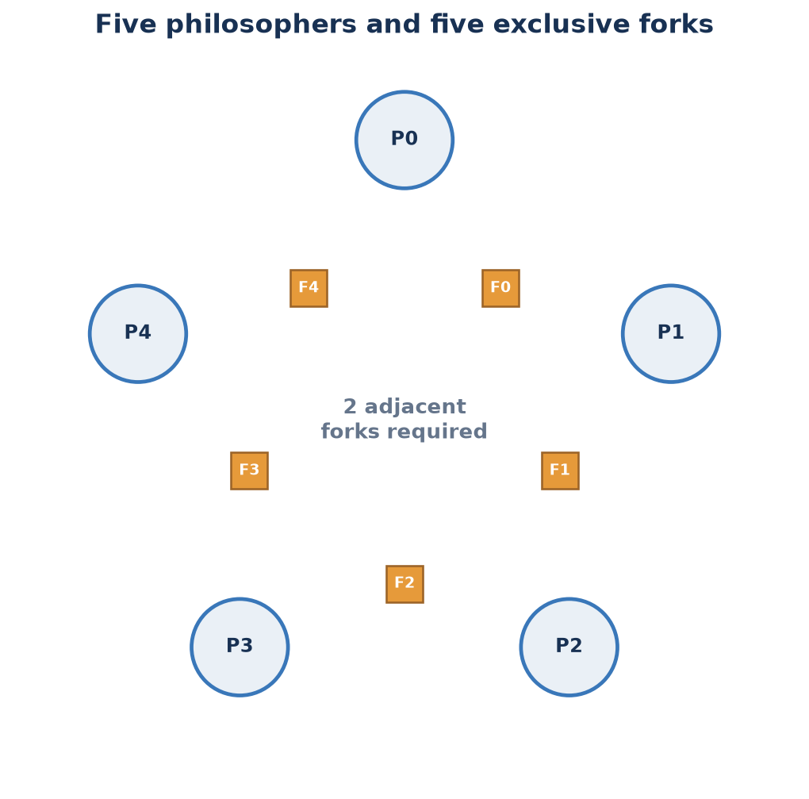
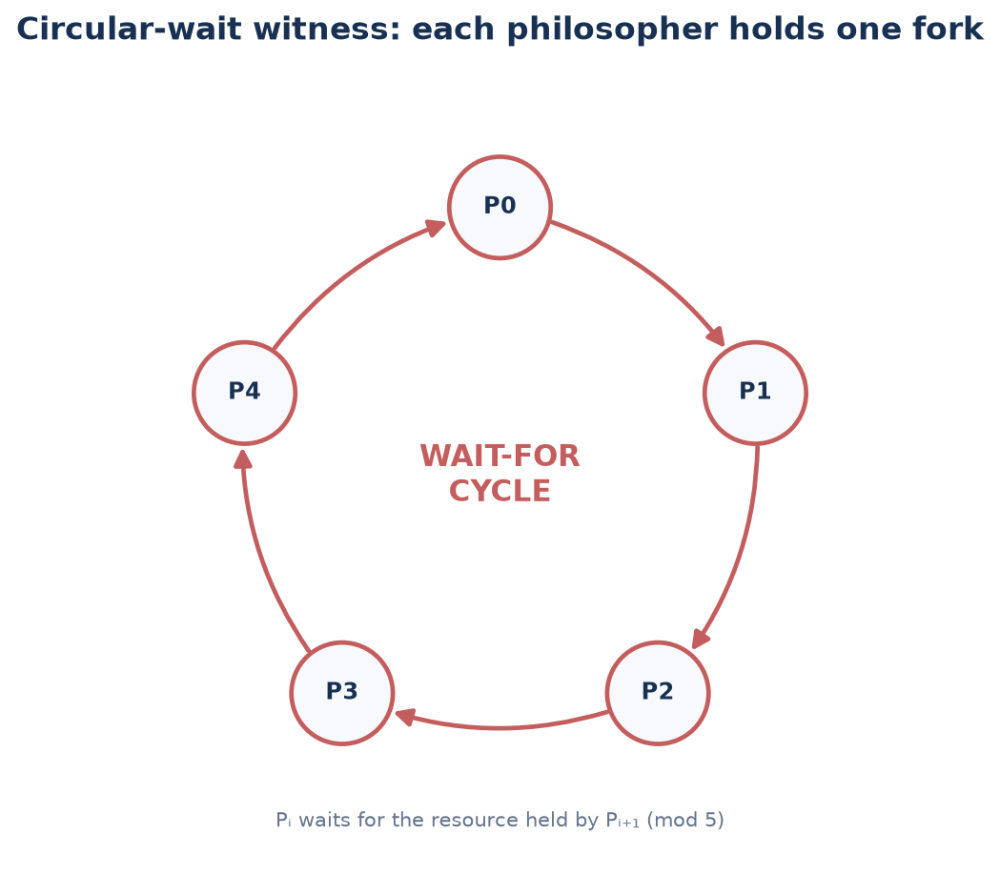
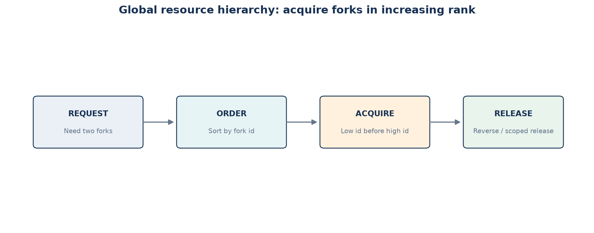
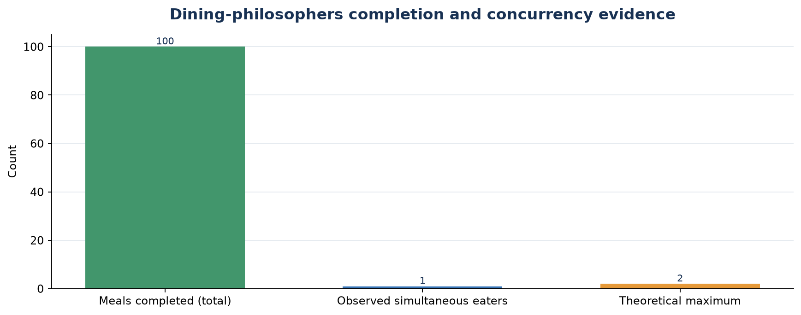
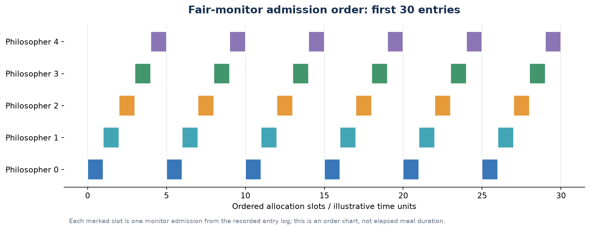

# Executive summary

The dining-philosophers problem demonstrates how individually safe resource operations can combine into a system-wide deadlock. Each philosopher alternates between thinking and eating. To eat, a philosopher needs two adjacent forks, and each fork can be held by only one philosopher.

This exercise implements three scenarios. The first deliberately constructs circular wait: every philosopher takes one fork and then requests the next fork. Finite timeouts record the blocked state and release the forks so the demonstration can exit. The second solution imposes one global order on fork acquisition, eliminating circular wait. The third uses a fair monitor that grants a request only when no conflicting philosopher is eating and no earlier queued conflicting request is being bypassed.

The exercise distinguishes deadlock freedom from starvation freedom. Resource ordering breaks the circular-wait condition but does not promise FIFO lock acquisition. The monitor preserves local FIFO order among requests that share a fork, under explicit assumptions about finite meals and operating-system thread scheduling.

# 1. Problem model

There are N philosophers seated around a circular table and N forks, one between each adjacent pair. Philosopher i needs fork i and fork (i + 1) modulo N to eat. A fork is an exclusive resource: two philosophers sharing that fork cannot eat at the same time.

The problem is not solved by making every fork individually exclusive; a system of exclusive locks can still deadlock. If each philosopher takes one fork and waits for the next, every requested fork is held by a neighbour. Nobody can proceed to the release step.

# 2. Deadlock conditions

The classic necessary conditions for deadlock are mutual exclusion, hold-and-wait, no preemption, and circular wait. In the dining-philosophers construction:

- Mutual exclusion holds because each fork is a lock with one owner.
- Hold-and-wait holds because a philosopher keeps its first fork while requesting the second.
- No preemption holds because a fork is released by its owner rather than forcibly taken away.
- Circular wait forms because each philosopher waits for a fork held by the next philosopher around the table.

The demo synchronizes all threads after they have acquired their first fork. That barrier makes the circular state reproducible: every philosopher is holding one fork before any thread tries to acquire the second. Each second acquisition then uses a finite timeout. If no philosopher obtains the second fork, the program records a deadlock witness and releases the first fork in a finally block.

The timeout is part of the laboratory harness, not the prevention algorithm. Without a timeout or external intervention, the constructed state would remain blocked.

# 3. Solution A — global resource hierarchy

The resource-hierarchy solution gives every fork a unique numeric rank. A philosopher must acquire the lower-numbered fork before the higher-numbered fork, regardless of which fork is normally called left or right.

This creates a strict order for every wait edge. A circular wait would require a sequence of strictly increasing fork ranks to return to its starting fork. Such a sequence cannot exist. Therefore the wait-for graph cannot contain a cycle, and this protocol prevents deadlock caused by circular wait.

The implementation uses the same global order for every philosopher and releases both locks through nested context managers. It runs a finite number of meals per philosopher and checks that every meal completes.

## 3.1 What hierarchy does not prove

A global lock order proves the absence of circular wait in this resource model. It does not prove that Python's Lock grants access in FIFO order. A thread could be repeatedly delayed by the host scheduler or lock implementation. The exercise therefore claims deadlock prevention, but it does not claim starvation freedom for this method.

# 4. Solution B — fair monitor

The monitor treats the table as one coordinated resource-allocation problem. Every philosopher places a request in a shared queue protected by a condition variable. A request can enter when two conditions hold:

1. No currently eating philosopher shares either fork with the requester.
2. No earlier request in the queue that shares a fork with the requester is being bypassed.

This is a conflict-aware FIFO rule. It does not force all philosophers to eat one at a time. Two non-neighbouring philosophers do not share a fork and may eat simultaneously. A later neighbour cannot pass an earlier waiting neighbour because their requests conflict.

When a philosopher finishes its meal, it removes itself from the active set and notifies all waiters. Each waiter re-checks the predicate. The monitor records the entry sequence, the maximum number of simultaneous eaters, and any violation of the adjacency safety condition.

# 5. Safety and progress properties

## 5.1 Safety

Adjacent philosophers cannot eat at the same time because they need a common fork. The monitor checks this property whenever a request enters. For a five-philosopher ring, at most two philosophers can eat simultaneously because the largest independent set of the cycle has size two.

## 5.2 Deadlock freedom

The hierarchy solution eliminates circular wait by requiring every acquisition to follow one strict global ordering. The fair monitor also avoids the classic circular fork hold-and-wait pattern because ownership of the two forks is granted as one monitor admission decision rather than acquired independently.

## 5.3 Starvation and fairness

The fair monitor does not allow a request to be passed by an earlier queued request that shares a fork. Once the finite set of earlier conflicting requests is served, the request can become eligible, provided its neighbours eventually finish and the operating system schedules the waiting thread.

This is a conditional progress argument, not a hard real-time guarantee. It depends on finite critical sections, no thread terminating while retaining the monitor state, and fair-enough scheduling by the host environment. The code does not promise a fixed maximum waiting time in milliseconds.

# 6. Experimental design

The experiment reports three results:

| Scenario | Purpose | Main evidence |
|---|---|---|
| Circular-wait witness | Construct a deadlock state | Each philosopher holds its first fork and times out on the second |
| Resource hierarchy | Prevent circular wait | Every philosopher completes the configured number of meals |
| Fair monitor | Preserve safety and local fairness | No adjacent pair eats together; all meals complete; entry sequence is recorded |

The number of philosophers and meals is configurable in the Python functions. The top-level run writes a JSON file containing each scenario's parameters, completion counts, safety checks, and explanatory notes.

The test suite checks that the deadlock witness is detected and cleaned up, that global-order acquisition completes all meals, and that the monitor admits no adjacent eaters while allowing the theoretical maximum concurrency.

# 7. How to run and reproduce

Run the dining program to generate the JSON result file. Run the test suite to validate the deadlock witness, resource ordering, monitor safety, and rejection of invalid philosopher identifiers.

The deadlock demo uses short timeouts only to keep the laboratory safe and repeatable. Increasing or decreasing a timeout changes how long the demonstration waits, not the circular-wait proof. The resource-hierarchy and monitor demonstrations use finite meal counts so all worker threads can terminate.

# 8. Discussion: deadlock is not starvation

Deadlock means a set of requests cannot progress because each waits for a resource held by another member of the set. Starvation means a particular request is postponed indefinitely even though the system as a whole continues to make progress.

Resource hierarchy addresses deadlock by removing circular wait. It does not prescribe which blocked thread a lock implementation should wake first. The monitor's conflict-aware queue addresses starvation risk more directly by preventing later requests that need the same forks from overtaking earlier requests. These are different guarantees and should not be conflated.

# 9. Conclusion

The first scenario constructs the classic circular-wait pattern in a controlled manner. The global-order solution prevents a resource cycle and demonstrates deadlock freedom for this lock arrangement. The fair monitor coordinates both fork requirements and preserves arrival order among conflicting requests, while allowing independent philosophers to eat concurrently. The results demonstrate that mutual exclusion, deadlock freedom, starvation freedom, and hard response-time bounds are separate properties.

# References

- E. W. Dijkstra, “Two Starvation-Free Solutions of a General Exclusion Problem,” EWD625. https://www.cs.utexas.edu/~EWD/transcriptions/EWD06xx/EWD625.html
- Allen B. Downey, The Little Book of Semaphores, dining philosophers and resource ordering. https://greenteapress.com/wp/semaphores/
- D. L. Parnas and related early work on concurrent resource allocation; see Dijkstra's exclusion-problem notes for the ordering argument.
