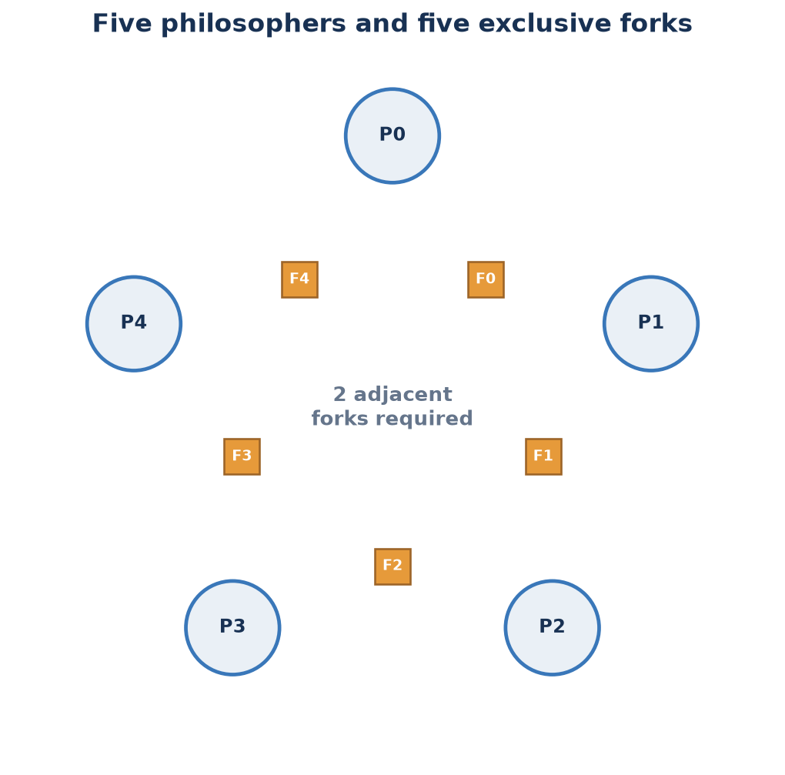
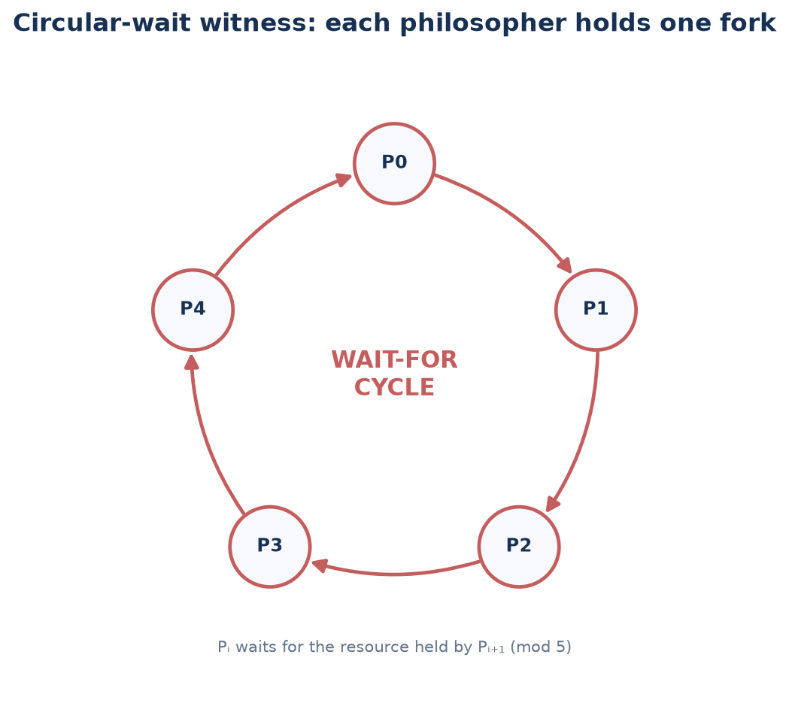
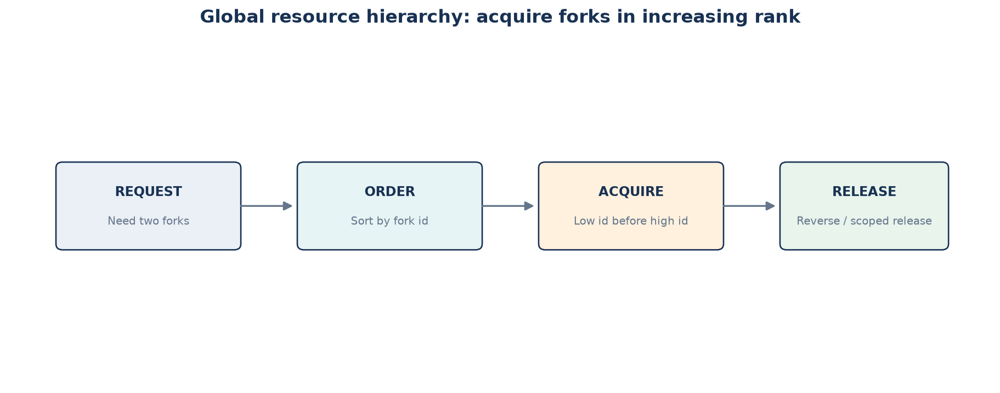
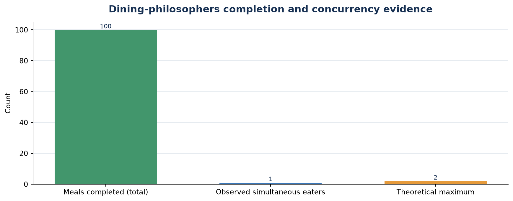
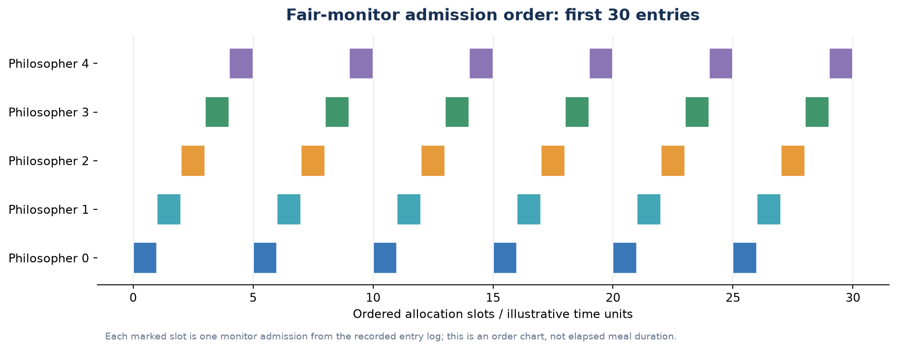

# خلاصه اجرایی

مسئله‌ی فیلسوفان غذاخور نشان می‌دهد که عملیات تخصیص منبع که به‌تنهایی ایمن هستند، ممکن است در کنار هم به بن‌بست سراسری منجر شوند. هر فیلسوف بین فکرکردن و غذاخوردن جابه‌جا می‌شود. برای غذاخوردن، دو چنگال مجاور لازم است و هر چنگال در هر لحظه فقط در اختیار یک فیلسوف قرار می‌گیرد.

این تمرین سه سناریو را پیاده‌سازی می‌کند. سناریوی اول انتظار دوری را عمداً ایجاد می‌کند: هر فیلسوف یک چنگال برمی‌دارد و سپس چنگال بعدی را درخواست می‌کند. مهلت انتظار محدود، وضعیت مسدود را ثبت می‌کند و چنگال‌ها را آزاد می‌کند تا برنامه بتواند خاتمه یابد. راه‌حل دوم یک ترتیب سراسری برای برداشتن چنگال‌ها تحمیل می‌کند و انتظار دوری را از بین می‌برد. راه‌حل سوم از یک مانیتور منصفانه استفاده می‌کند که تنها زمانی درخواست را می‌پذیرد که فیلسوف متعارضی در حال غذاخوردن نباشد و درخواست متعارض قدیمی‌تری در صف دور زده نشود.

این تمرین آزادی از بن‌بست را از آزادی از گرسنگی جدا می‌کند. ترتیب سراسری منابع شرط انتظار دوری را حذف می‌کند، اما ترتیب FIFO برای گرفتن قفل را تضمین نمی‌کند. مانیتور، تحت فرض‌های صریح درباره‌ی متناهی‌بودن زمان غذاخوردن و زمان‌بندی نخ‌ها توسط سیستم‌عامل، ترتیب محلی FIFO را بین درخواست‌هایی که چنگال مشترک دارند حفظ می‌کند.

# ۱. مدل مسئله

N فیلسوف دور یک میز دایره‌ای و N چنگال قرار دارند؛ میان هر دو فیلسوف مجاور یک چنگال است. فیلسوف i برای غذاخوردن به چنگال i و چنگال بعدی با پیمانه‌ی N نیاز دارد. هر چنگال منبعی انحصاری است: دو فیلسوفی که یک چنگال مشترک می‌خواهند نمی‌توانند هم‌زمان غذا بخورند.

این مسئله با انحصاری‌کردن تک‌تک چنگال‌ها به‌تنهایی حل نمی‌شود؛ مجموعه‌ای از قفل‌های انحصاری همچنان ممکن است به بن‌بست برسد. اگر هر فیلسوف یک چنگال بردارد و منتظر چنگال بعدی بماند، چنگال درخواستی هر فیلسوف در اختیار همسایه‌ی اوست. هیچ‌کس نمی‌تواند به مرحله‌ی آزادسازی برسد.

# ۲. شرط‌های بن‌بست

چهار شرط ضروری کلاسیک برای بن‌بست عبارت‌اند از انحصار متقابل، نگهداری و انتظار، عدم امکان سلب اجباری منبع و انتظار دوری. در ساخت فیلسوفان غذاخور:

- انحصار متقابل برقرار است، زیرا هر چنگال یک قفل با یک مالک است.
- نگهداری و انتظار برقرار است، زیرا فیلسوف چنگال اول را نگه می‌دارد و چنگال دوم را درخواست می‌کند.
- سلب اجباری وجود ندارد، زیرا چنگال توسط مالک آزاد می‌شود و از او به‌زور گرفته نمی‌شود.
- انتظار دوری شکل می‌گیرد، زیرا هر فیلسوف منتظر چنگالی است که فیلسوف بعدی در دایره در اختیار دارد.

نمایش آزمایشگاهی، همه‌ی نخ‌ها را پس از گرفتن چنگال اول به کمک barrier هم‌زمان می‌کند. این barrier وضعیت دوری را بازتولیدپذیر می‌کند: پیش از آنکه هر نخ چنگال دوم را بخواهد، هر فیلسوف یک چنگال در اختیار دارد. گرفتن چنگال دوم با مهلت انتظار محدود انجام می‌شود. اگر هیچ فیلسوفی چنگال دوم را نگیرد، برنامه شاهد بن‌بست را ثبت کرده و چنگال اول را در finally آزاد می‌کند.

مهلت انتظار بخشی از ابزار آزمایش است، نه الگوریتم جلوگیری از بن‌بست. بدون timeout یا دخالت بیرونی، وضعیت ساخته‌شده مسدود باقی می‌ماند.

# ۳. راه‌حل اول — ترتیب سراسری منابع

در راه‌حل ترتیب منابع، به هر چنگال یک رتبه‌ی عددی یکتا داده می‌شود. هر فیلسوف باید ابتدا چنگال با شماره‌ی کمتر و سپس چنگال با شماره‌ی بیشتر را بگیرد؛ صرف‌نظر از اینکه آن چنگال معمولاً چپ یا راست نامیده می‌شود.

این روش برای تمام یال‌های انتظار یک ترتیب اکید ایجاد می‌کند. انتظار دوری مستلزم آن است که دنباله‌ای از شماره‌های چنگال به‌طور پیوسته افزایش یابد و در نهایت به شماره‌ی آغازین خود بازگردد. چنین دنباله‌ای ناممکن است. بنابراین گراف انتظار نمی‌تواند چرخه داشته باشد و این پروتکل بن‌بست ناشی از انتظار دوری را حذف می‌کند.

پیاده‌سازی برای همه‌ی فیلسوفان از همان ترتیب سراسری استفاده می‌کند و با context managerهای تو در تو هر دو قفل را آزاد می‌کند. تعداد غذاخوردن‌ها برای هر فیلسوف متناهی است و برنامه تکمیل تمام وعده‌ها را بررسی می‌کند.

## ۳.۱ چیزی که ترتیب منابع ثابت نمی‌کند

ترتیب سراسری قفل‌ها نبود انتظار دوری را در این مدل منابع ثابت می‌کند. اما ثابت نمی‌کند که Lock پایتون دسترسی را به ترتیب FIFO اعطا می‌کند. ممکن است نخ بر اثر زمان‌بندی میزبان یا پیاده‌سازی قفل بارها عقب بیفتد. بنابراین این تمرین ادعای جلوگیری از بن‌بست دارد، اما برای این روش آزادی از گرسنگی ادعا نمی‌کند.

# ۴. راه‌حل دوم — مانیتور منصفانه

مانیتور، میز را یک مسئله‌ی هماهنگ تخصیص منبع در نظر می‌گیرد. هر فیلسوف درخواست خود را در صف مشترکی قرار می‌دهد که با شرط محافظت می‌شود. درخواست زمانی وارد می‌شود که دو شرط برقرار باشند:

۱. هیچ فیلسوف در حال غذاخوردنی، چنگال مشترکی با درخواست‌کننده نداشته باشد.
۲. هیچ درخواست قدیمی‌تر در صف که چنگال مشترکی با درخواست‌کننده دارد، دور زده نشود.

این یک قاعده‌ی FIFO آگاه از تعارض است. همه‌ی فیلسوفان مجبور نیستند یکی‌یکی غذا بخورند. دو فیلسوف غیرمجاور چنگال مشترکی ندارند و می‌توانند هم‌زمان غذا بخورند. فیلسوف همسایه‌ی جدیدتر نمی‌تواند از درخواست قدیمی‌تر سبقت بگیرد.

وقتی فیلسوف غذاخوردن را تمام می‌کند، از مجموعه‌ی فعال حذف می‌شود و به همه‌ی منتظران اعلان داده می‌شود. هر منتظر شرط را دوباره بررسی می‌کند. مانیتور ترتیب ورود، بیشینه‌ی تعداد غذاخوران هم‌زمان و هرگونه نقض شرط ایمنی مجاورت را ثبت می‌کند.

# ۵. ویژگی‌های ایمنی و پیشرفت

## ۵.۱ ایمنی

فیلسوفان مجاور نمی‌توانند هم‌زمان غذا بخورند، زیرا به یک چنگال مشترک نیاز دارند. مانیتور این ویژگی را هنگام ورود درخواست بررسی می‌کند. در حلقه‌ای با پنج فیلسوف، حداکثر دو فیلسوف می‌توانند هم‌زمان غذا بخورند، زیرا بزرگ‌ترین مجموعه‌ی مستقل چرخه اندازه‌ی دو دارد.

## ۵.۲ آزادی از بن‌بست

راه‌حل ترتیب منابع با الزام یک ترتیب سراسری اکید، انتظار دوری را حذف می‌کند. مانیتور منصفانه نیز الگوی کلاسیک نگه‌داشتن یک چنگال و انتظار برای چنگال دیگر را کنار می‌گذارد، زیرا مالکیت هر دو چنگال در یک تصمیم ورود مانیتور اعطا می‌شود، نه اینکه جداگانه گرفته شوند.

## ۵.۳ گرسنگی و انصاف

مانیتور منصفانه اجازه نمی‌دهد درخواست توسط درخواست قدیمی‌تری که چنگال مشترک دارد دور زده شود. پس از سرویس‌شدن مجموعه‌ی متناهی درخواست‌های متعارض قدیمی‌تر، درخواست می‌تواند واجد شرایط شود؛ به شرط آنکه همسایه‌ها در نهایت غذاخوردن را تمام کنند و سیستم‌عامل نخ منتظر را زمان‌بندی کند.

این استدلال پیشرفت مشروط است و تضمین بلادرنگ سخت محسوب نمی‌شود. به بخش‌های بحرانی متناهی، پایان‌نیافتن نخ در حالی که وضعیت مانیتور را نگه داشته و زمان‌بندی منصفانه‌ی کافی توسط محیط میزبان وابسته است. کد کران ثابتی بر زمان انتظار بر حسب میلی‌ثانیه ادعا نمی‌کند.

# ۶. طراحی آزمایش

آزمایش سه نوع خروجی گزارش می‌کند:

| سناریو | هدف | شاهد اصلی |
|---|---|---|
| شاهد انتظار دوری | ساخت وضعیت بن‌بست | هر فیلسوف چنگال اول را نگه می‌دارد و برای دومی timeout می‌شود |
| ترتیب سراسری منابع | جلوگیری از انتظار دوری | هر فیلسوف تعداد وعده‌های تنظیم‌شده را کامل می‌کند |
| مانیتور منصفانه | حفظ ایمنی و انصاف محلی | هیچ دو فیلسوف مجاور هم‌زمان غذا نمی‌خورند؛ همه‌ی وعده‌ها کامل می‌شوند؛ ترتیب ورود ثبت می‌شود |

تعداد فیلسوفان و وعده‌ها در توابع پایتون قابل تنظیم است. اجرای اصلی یک فایل JSON می‌نویسد که پارامترهای هر سناریو، تعداد تکمیل‌شده، بررسی‌های ایمنی و یادداشت‌های توضیحی را نگه می‌دارد.

مجموعه‌ی تست بررسی می‌کند که شاهد بن‌بست شناسایی و پاک‌سازی شود، ترتیب سراسری تمام وعده‌ها را کامل کند و مانیتور اجازه‌ی غذاخوردن هم‌زمان فیلسوفان مجاور را ندهد و در عین حال بیشینه‌ی هم‌زمانی نظری را ممکن سازد.

# ۷. نحوه‌ی اجرا و بازتولید

برنامه‌ی dining را اجرا کنید تا فایل نتایج JSON ساخته شود. سپس تست‌ها را اجرا کنید تا شاهد بن‌بست، ترتیب منابع، ایمنی مانیتور و رد شناسه‌ی نامعتبر فیلسوف اعتبارسنجی شوند.

نمایش بن‌بست فقط برای ایمن و تکرارپذیرماندن آزمایش از timeout کوتاه استفاده می‌کند. تغییر این مهلت، مدت انتظار نمایش را تغییر می‌دهد، نه استدلال انتظار دوری را. نمایش‌های ترتیب منابع و مانیتور از تعداد وعده‌ی متناهی استفاده می‌کنند تا تمام نخ‌ها خاتمه یابند.

# ۸. بحث: بن‌بست با گرسنگی یکسان نیست

بن‌بست به این معناست که مجموعه‌ای از درخواست‌ها نمی‌توانند پیشرفت کنند، زیرا هر درخواست منتظر منبعی است که در اختیار یکی از اعضای همان مجموعه قرار دارد. گرسنگی یعنی یک درخواست خاص برای همیشه عقب می‌افتد، در حالی که کل سیستم همچنان پیشرفت می‌کند.

ترتیب منابع با حذف انتظار دوری به بن‌بست می‌پردازد. اما تعیین نمی‌کند که پیاده‌سازی قفل، کدام نخ مسدود را زودتر بیدار کند. صف آگاه از تعارض مانیتور، خطر گرسنگی را مستقیم‌تر هدف می‌گیرد؛ زیرا مانع سبقت درخواست‌های جدیدتر از درخواست‌های قدیمی‌تر می‌شود که به همان چنگال‌ها نیاز دارند. این دو تضمین متفاوت‌اند و نباید با یکدیگر اشتباه گرفته شوند.

# ۹. نتیجه‌گیری

سناریوی نخست الگوی کلاسیک انتظار دوری را به شکل کنترل‌شده می‌سازد. راه‌حل ترتیب سراسری منابع، چرخه‌ی انتظار را حذف می‌کند و آزادی از بن‌بست را برای این چینش قفل‌ها نشان می‌دهد. مانیتور منصفانه هر دو نیاز چنگال را با هم هماهنگ می‌کند و ترتیب ورود را بین درخواست‌های متعارض حفظ می‌کند، در حالی که اجازه می‌دهد فیلسوفان مستقل هم‌زمان غذا بخورند. نتایج نشان می‌دهند انحصار متقابل، آزادی از بن‌بست، آزادی از گرسنگی و کران زمانی سخت، ویژگی‌های جداگانه‌ای هستند.

# منابع

- E. W. Dijkstra، «Two Starvation-Free Solutions of a General Exclusion Problem»، یادداشت EWD625. https://www.cs.utexas.edu/~EWD/transcriptions/EWD06xx/EWD625.html
- Allen B. Downey، کتاب The Little Book of Semaphores، مسئله‌ی فیلسوفان غذاخور و ترتیب منابع. https://greenteapress.com/wp/semaphores/
